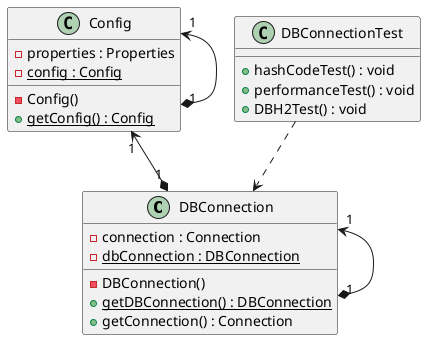
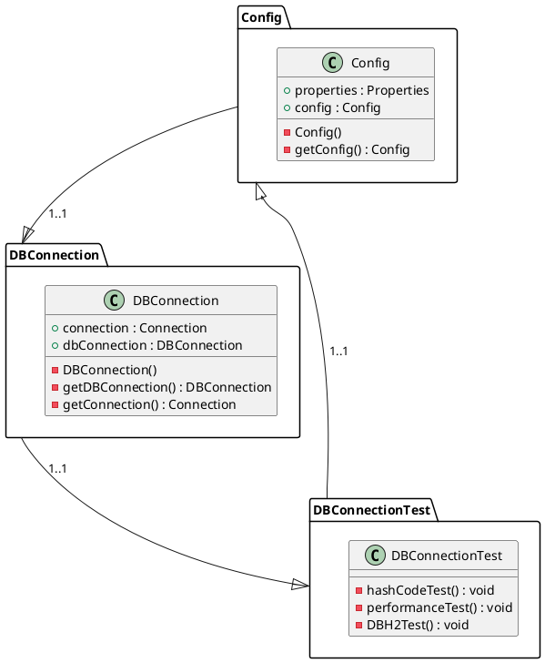

# Case E106

Diagram type: class · tier 2 · outcome: compiled low-structural
Image: `E106.png`

## Ground truth

## Answer (0 display-only lines removed; they are in `E106.stripped.txt`)

## Structural diff

Element F1 1.000 · Relationship F1 0.000

- nodes matched (3): `config`, `dbconnection`, `dbconnectiontest`
- nodes missed (0): none
- nodes spurious (0): none
- edges matched (0): none
- edges missed (4): `config -> config : composition`, `dbconnection -> config : composition`, `dbconnection -> dbconnection : composition`, `dbconnectiontest -> dbconnection : dependency`
- edges spurious (3): `config -> dbconnection : inheritance`, `dbconnection -> dbconnectiontest : inheritance`, `dbconnectiontest -> config : inheritance`
