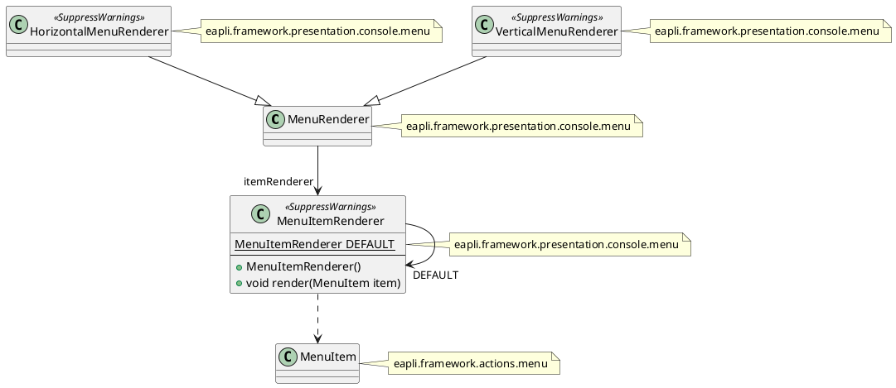

# Case E107

Diagram type: class · tier 3 · outcome: compiled low-structural
Image: `E107.png`

## Ground truth

```plantuml
' Blob ID: f4b04251bf859fd39de78f5ec4852a0a8ac85070
' Original Path: /10.0/eapli.framework.core/eapli/framework/presentation/console/menu/MenuItemRenderer.puml
' Source: World of Code

@startuml

skinparam svgLinkTarget _parent
skinparam linetype ortho
set namespaceSeparator none
class "<b><size:14>MenuItemRenderer</b>\n<size:10>eapli.framework.presentation.console.menu" as eapli.framework.presentation.console.menu.MenuItemRenderer <<SuppressWarnings>> [[../../../../../eapli/framework/presentation/console/menu/MenuItemRenderer.html{eapli.framework.presentation.console.menu.MenuItemRenderer}]] {
{static} +MenuItemRenderer DEFAULT
+MenuItemRenderer()
+void render(MenuItem item)
}


class "<b><size:14>HorizontalMenuRenderer</b>\n<size:10>eapli.framework.presentation.console.menu" as eapli.framework.presentation.console.menu.HorizontalMenuRenderer <<SuppressWarnings>> [[../../../../../eapli/framework/presentation/console/menu/HorizontalMenuRenderer.html{eapli.framework.presentation.console.menu.HorizontalMenuRenderer}]] {
}

hide eapli.framework.presentation.console.menu.HorizontalMenuRenderer fields
hide eapli.framework.presentation.console.menu.HorizontalMenuRenderer methods

eapli.framework.presentation.console.menu.HorizontalMenuRenderer ..> eapli.framework.presentation.console.menu.MenuItemRenderer

eapli.framework.presentation.console.menu.MenuItemRenderer -->  "DEFAULT" eapli.framework.presentation.console.menu.MenuItemRenderer

class "<b><size:14>MenuItem</b>\n<size:10>eapli.framework.actions.menu" as eapli.framework.actions.menu.MenuItem  [[../../../../../eapli/framework/actions/menu/MenuItem.html{eapli.framework.actions.menu.MenuItem}]] #white {
}

hide eapli.framework.actions.menu.MenuItem fields
hide eapli.framework.actions.menu.MenuItem methods

eapli.framework.presentation.console.menu.MenuItemRenderer ..> eapli.framework.actions.menu.MenuItem

class "<b><size:14>MenuRenderer</b>\n<size:10>eapli.framework.presentation.console.menu" as eapli.framework.presentation.console.menu.MenuRenderer  [[../../../../../eapli/framework/presentation/console/menu/MenuRenderer.html{eapli.framework.presentation.console.menu.MenuRenderer}]] {
}

hide eapli.framework.presentation.console.menu.MenuRenderer fields
hide eapli.framework.presentation.console.menu.MenuRenderer methods

eapli.framework.presentation.console.menu.MenuRenderer -->  "itemRenderer" eapli.framework.presentation.console.menu.MenuItemRenderer

class "<b><size:14>VerticalMenuRenderer</b>\n<size:10>eapli.framework.presentation.console.menu" as eapli.framework.presentation.console.menu.VerticalMenuRenderer <<SuppressWarnings>> [[../../../../../eapli/framework/presentation/console/menu/VerticalMenuRenderer.html{eapli.framework.presentation.console.menu.VerticalMenuRenderer}]] {
}

hide eapli.framework.presentation.console.menu.VerticalMenuRenderer fields
hide eapli.framework.presentation.console.menu.VerticalMenuRenderer methods

eapli.framework.presentation.console.menu.VerticalMenuRenderer ..> eapli.framework.presentation.console.menu.MenuItemRenderer


@enduml
```

## Answer (0 display-only lines removed; they are in `E107.stripped.txt`)

## Structural diff

Element F1 0.667 · Relationship F1 0.400

- nodes matched (5): `horizontalmenurenderer`, `menuitem`, `menuitemrenderer`, `menurenderer`, `verticalmenurenderer`
- nodes missed (0): none
- nodes spurious (5): `eapli.framework.actions.menu`, `eapli.framework.presentation.console.menu` ×4
- edges matched (3): `menuitemrenderer -> menuitem : dependency`, `menuitemrenderer -> menuitemrenderer : association (one arrowhead)`, `menurenderer -> menuitemrenderer : association (one arrowhead)`
- edges missed (2): `horizontalmenurenderer -> menuitemrenderer : dependency`, `verticalmenurenderer -> menuitemrenderer : dependency`
- edges spurious (7): `horizontalmenurenderer -> eapli.framework.presentation.console.menu : dependency`, `horizontalmenurenderer -> menurenderer : inheritance`, `menuitem -> eapli.framework.actions.menu : dependency`, `menuitemrenderer -> eapli.framework.presentation.console.menu : dependency`, `menurenderer -> eapli.framework.presentation.console.menu : dependency`, `verticalmenurenderer -> eapli.framework.presentation.console.menu : dependency`, `verticalmenurenderer -> menurenderer : inheritance`
