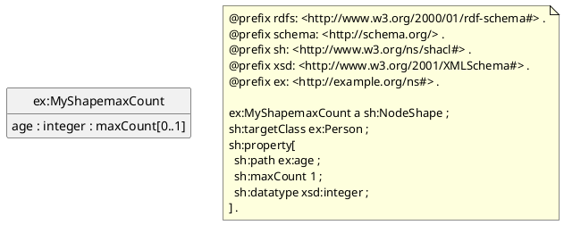
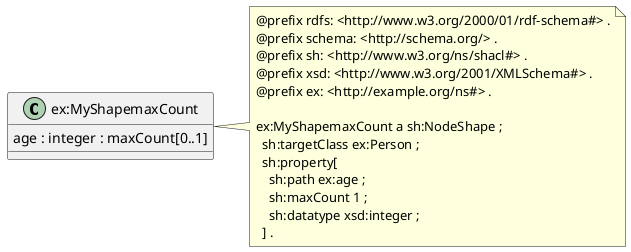

# Case E108

Diagram type: class · tier 2 · outcome: compiled low-structural
Image: `E108.png`

## Ground truth

## Answer (8 display-only lines removed; they are in `E108.stripped.txt`)

## Structural diff

Element F1 1.000 · Relationship F1 0.000

- nodes matched (2): `@prefix rdfs: <http://www.w3.org/2000/01/rdf-schema#> . @prefix schema: <http://schema.org/> . @prefix sh: <http://www.w3.org/ns/shacl#> . @prefix xsd: <http://www.w3.org/2001/xmlschema#> . @prefix ex: <http://example.org/ns#> . ex:myshapemaxcount a sh:nodeshape ; sh:targetclass ex:person ; sh:property[ sh:path ex:age ; sh:maxcount 1 ; sh:datatype xsd:integer ; ] .`, `ex:myshapemaxcount`
- nodes missed (0): none
- nodes spurious (0): none
- edges matched (0): none
- edges missed (0): none
- edges spurious (1): `ex:myshapemaxcount -> @prefix rdfs: <http://www.w3.org/2000/01/rdf-schema#> . @prefix schema: <http://schema.org/> . @prefix sh: <http://www.w3.org/ns/shacl#> . @prefix xsd: <http://www.w3.org/2001/xmlschema#> . @prefix ex: <http://example.org/ns#> . ex:myshapemaxcount a sh:nodeshape ; sh:targetclass ex:person ; sh:property[ sh:path ex:age ; sh:maxcount 1 ; sh:datatype xsd:integer ; ] . : dependency`
