# Failure-case index — zero-shot image→PlantUML benchmark

**Models included: 7/7** (panel label: main) — 213 sampled cases.

Stratified sample of failures: up to **2 case(s) per (model × diagram type × tier × outcome class)** over the failure classes `provider_drop`, `compile_fail`, `compiled_low_structural`. `compiled_low_structural` = rendered but Element or Relationship F1 < 0.5. Selection is a seeded shuffle (seed=20260614) over key-sorted rows — deterministic and per-cell independent. A missing prediction/render file is itself signal (a provider drop or a non-rendering prediction).

## Coverage (available → sampled)

| Model | provider_drop | compile_fail | compiled_low_structural |
|---|---|---|---|
| GPT-5.2 | 1→1 | 64→16 | 83→15 |
| Claude Opus 4.6 | — | 59→14 | 117→16 |
| Gemini 3.1 Pro | — | 28→13 | 31→10 |
| Qwen3.5-2B | — | 809→16 | 95→16 |
| Qwen3.5-9B | — | 589→16 | 188→16 |
| Qwen3.5-27B | — | 356→16 | 114→16 |
| Qwen3.5-397B-A17B | — | 213→16 | 111→16 |

_101 cell(s) capped at 2 (full list in the JSON `capped_cells`) — the sample is a subset of those cells, not the complete failure set._

## Cases

### GPT-5.2

#### outcome: provider_drop

#### `b3d43297c56f7d7d725d9d50288912cf40e8ed50` — provider_drop (class, tier 1)

- CSR: `no prediction (missing/timeout)`
- Element: tp=0 fp=0 fn=1 F1=0.000; type-acc matched=0 correct=0 excluded=0
- Relationship: tp=0 fp=0 fn=0 F1=1.000
- chrF++: 0.00
- Files: GT `data/puml_files/b3d43297c56f7d7d725d9d50288912cf40e8ed50.puml` (yes) · pred `data/runs/gpt-5.2-2025-12-11_20260613T154248Z/b3d43297c56f7d7d725d9d50288912cf40e8ed50.puml` (MISSING) · input `data/puml_images_1568/b3d43297c56f7d7d725d9d50288912cf40e8ed50.png` (yes) · render `data/csr/gpt-5.2-2025-12-11_20260613T154248Z/png/b3d43297c56f7d7d725d9d50288912cf40e8ed50.png` (MISSING)

GT PlantUML:
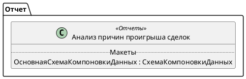

_Prediction: no file on disk (provider/harness drop)._

#### outcome: compile_fail

#### `05af3d5892f56a4b70714d0b17d90ff90d8a945c` — compile_fail (sequence, tier 2)

- CSR: `Error line 8 in file: data/csr/gpt-5.2-2025-12-11_20260613T154248Z/extracted/05af3d5892f56a4b70714d0b17d90ff90d8a945c.puml`
- Element: tp=0 fp=0 fn=11 F1=0.000; type-acc matched=0 correct=0 excluded=0
- Relationship: tp=0 fp=0 fn=14 F1=0.000; missed: message
- chrF++: 81.21
- Files: GT `data/puml_files/05af3d5892f56a4b70714d0b17d90ff90d8a945c.puml` (yes) · pred `data/runs/gpt-5.2-2025-12-11_20260613T154248Z/05af3d5892f56a4b70714d0b17d90ff90d8a945c.puml` (yes) · input `data/puml_images_1568/05af3d5892f56a4b70714d0b17d90ff90d8a945c.png` (yes) · render `data/csr/gpt-5.2-2025-12-11_20260613T154248Z/png/05af3d5892f56a4b70714d0b17d90ff90d8a945c.png` (MISSING)

GT PlantUML:
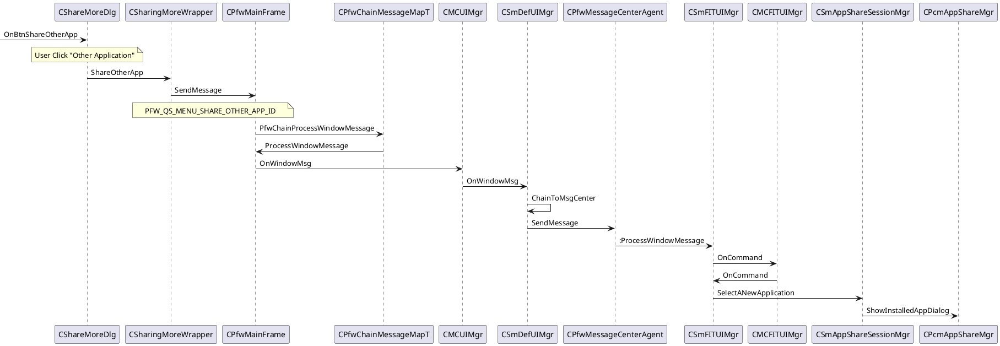

Prediction PlantUML:
```plantuml
@startuml
left to right direction
skinparam sequenceMessageAlign center
skinparam responseMessageBelowArrow true
skinparam ParticipantPadding 20
skinparam BoxPadding 10

participant "CShareMoreDlg" as CShareMoreDlg
participant "CSharingMoreWrapper" as CSharingMoreWrapper
participant "CPfwMainFrame" as CPfwMainFrame
participant "CPfwChainMessageMapT" as CPfwChainMessageMapT
participant "CMCUIMgr" as CMCUIMgr
participant "CSmDefUIMgr" as CSmDefUIMgr
participant "CPfwMessageCenterAgent" as CPfwMessageCenterAgent
participant "CSmFITUIMgr" as CSmFITUIMgr
participant "CMCFITUIMgr" as CMCFITUIMgr
participant "CSmAppShareSessionMgr" as CSmAppShareSessionMgr
participant "CPcmAppShareMgr" as CPcmAppShareMgr

CShareMoreDlg -> CShareMoreDlg : OnBtnShareOtherApp
note right of CShareMoreDlg
User Click "Other Application"
end note

CShareMoreDlg -> CSharingMoreWrapper : ShareOtherApp
CSharingMoreWrapper -> CPfwMainFrame : SendMessage
note over CSharingMoreWrapper,CPfwMainFrame
PFW_QS_MENU_SHARE_OTHER_APP_ID
end note

CPfwMainFrame -> CPfwChainMessageMapT : PfwChainProcessWindowMessage
CPfwChainMessageMapT --> CPfwMainFrame : ProcessWindowMessage
CPfwMainFrame -> CMCUIMgr : OnWindowMsg
CMCUIMgr -> CSmDefUIMgr : OnWindowMsg
CSmDefUIMgr -> CSmDefUIMgr : ChainToMsgCenter
CSmDefUIMgr -> CPfwMessageCenterAgent : SendMessage
CPfwMessageCenterAgent -> CSmFITUIMgr : ProcessWindowMessage
CSmFITUIMgr -> CMCFITUIMgr : OnCommand
CMCFITUIMgr --> CSmFITUIMgr : OnCommand
CSmFITUIMgr -> CSmAppShareSessionMgr : SelectANewApplication
CSmAppShareSessionMgr -> CPcmAppShareMgr : ShowInstalledAppDialog

@enduml
```

#### `2fc02b638db7d0314c7594c6f6a03f1a6f247100` — compile_fail (class, tier 3)

- CSR: `Error line 9 in file: data/csr/gpt-5.2-2025-12-11_20260613T154248Z/extracted/2fc02b638db7d0314c7594c6f6a03f1a6f247100.puml`
- Element: tp=0 fp=0 fn=5 F1=0.000; type-acc matched=0 correct=0 excluded=0
- Relationship: tp=0 fp=0 fn=6 F1=0.000; missed: inheritance, aggregation, association
- chrF++: 71.49
- Files: GT `data/puml_files/2fc02b638db7d0314c7594c6f6a03f1a6f247100.puml` (yes) · pred `data/runs/gpt-5.2-2025-12-11_20260613T154248Z/2fc02b638db7d0314c7594c6f6a03f1a6f247100.puml` (yes) · input `data/puml_images_1568/2fc02b638db7d0314c7594c6f6a03f1a6f247100.png` (yes) · render `data/csr/gpt-5.2-2025-12-11_20260613T154248Z/png/2fc02b638db7d0314c7594c6f6a03f1a6f247100.png` (MISSING)

GT PlantUML:
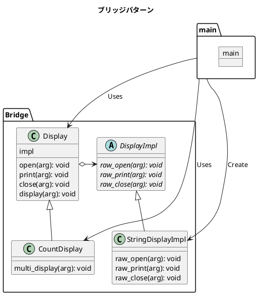

Prediction PlantUML:
```plantuml
```plantuml
@startuml
title ブリッジパターン

skinparam shadowing false
skinparam packageStyle folder
skinparam classAttributeIconSize 0

package "main" as PKG_MAIN {
  class main as MAIN
}

package "Bridge" as PKG_BRIDGE {

  abstract class Display << (C,#B7E1B0) >> {
    impl
    --
    open(arg): void
    print(arg): void
    close(arg): void
    display(arg): void
  }

  abstract class DisplayImpl << (A,#BFE9EA) >> {
    --
    {abstract} raw_open(arg): void
    {abstract} raw_print(arg): void
    {abstract} raw_close(arg): void
  }

  class CountDisplay << (C,#B7E1B0) >> {
    --
    multi_display(arg): void
  }

  class StringDisplayImpl << (C,#B7E1B0) >> {
    --
    raw_open(arg): void
    raw_print(arg): void
    raw_close(arg): void
  }

  Display o--> DisplayImpl
  CountDisplay --|> Display
  StringDisplayImpl --|> DisplayImpl
}

MAIN ..> Display : Uses
MAIN ..> StringDisplayImpl : Uses
MAIN ..> StringDisplayImpl : Create

@enduml
```
```

#### `30969b941c87171a79af4ee7c2f2ca6f1178a0fe` — compile_fail (class, tier 2)

- CSR: `Error line 46 in file: data/csr/gpt-5.2-2025-12-11_20260613T154248Z/extracted/30969b941c87171a79af4ee7c2f2ca6f1178a0fe.puml`
- Element: tp=0 fp=0 fn=6 F1=0.000; type-acc matched=0 correct=0 excluded=0
- Relationship: tp=0 fp=0 fn=6 F1=0.000; missed: aggregation, association
- chrF++: 42.52
- Files: GT `data/puml_files/30969b941c87171a79af4ee7c2f2ca6f1178a0fe.puml` (yes) · pred `data/runs/gpt-5.2-2025-12-11_20260613T154248Z/30969b941c87171a79af4ee7c2f2ca6f1178a0fe.puml` (yes) · input `data/puml_images_1568/30969b941c87171a79af4ee7c2f2ca6f1178a0fe.png` (yes) · render `data/csr/gpt-5.2-2025-12-11_20260613T154248Z/png/30969b941c87171a79af4ee7c2f2ca6f1178a0fe.png` (MISSING)

GT PlantUML:
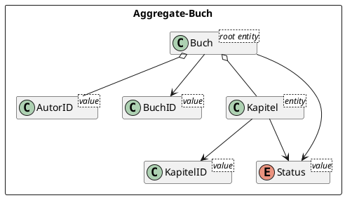

Prediction PlantUML (truncated):
```plantuml
@startuml
title Aggregate-Buch

skinparam shadowing false
skinparam backgroundColor white
skinparam roundcorner 12
skinparam class {
  BackgroundColor #f7f7f7
  BorderColor #333333
  ArrowColor #333333
  FontSize 22
}
skinparam note {
  BackgroundColor white
  BorderColor #333333
  FontSize 22
}

' Helper stereotypes for colored circle letters
class Buch <<C>> 
class AutorID <<C>>
class BuchID <<C>>
class Kapitel <<C>>
class KapitelID <<C>>
class Status <<E>>

' Color the stereotype circles
skinparam class<<C>> {
  BackgroundColor #f7f7f7
  BorderColor #333333
  StereotypeFontColor #000000
  StereotypeBackgroundColor #b9d7bf
}
skinparam class<<E>> {
  BackgroundColor #f7f7f7
  BorderColor #333333
  StereotypeFontColor #000000
  StereotypeBackgroundColor #f2a08f
}

' Show only the stereotype letter in a circle-like badge
hide members
hide circle

' Notes (dashed boxes)
note top right of Buch
  <i>root entity</i>
end note

note top right of AutorID
  <i>value</i>
end note

note top right of BuchID
  <i>value</i>
end note

note top right of Kapitel
  <i>entity</i>
end note

note top right of KapitelID
  <i>value</i>
end note

note top right of Status
  <i>value</i>
end note

' Layout hints
Buch -[hidden]down-> BuchID
AutorID -[hidden]right-> BuchID
BuchID -[hidden]right-> Kapitel
Kapitel -[hidden]down-> KapitelID
KapitelID -[hidden]right-> Status

' Relationships
Buch o-- AutorID
Buch --> BuchID
Buch o-- Kapitel
```

#### `32e297812885b315c9ec8f772b7a81897cfbaed0` — compile_fail (sequence, tier 3)

- CSR: `Error line 24 in file: data/csr/gpt-5.2-2025-12-11_20260613T154248Z/extracted/32e297812885b315c9ec8f772b7a81897cfbaed0.puml`
- Element: tp=0 fp=0 fn=4 F1=0.000; type-acc matched=0 correct=0 excluded=0
- Relationship: tp=0 fp=0 fn=4 F1=0.000; missed: message
- chrF++: 74.22
- Files: GT `data/puml_files/32e297812885b315c9ec8f772b7a81897cfbaed0.puml` (yes) · pred `data/runs/gpt-5.2-2025-12-11_20260613T154248Z/32e297812885b315c9ec8f772b7a81897cfbaed0.puml` (yes) · input `data/puml_images_1568/32e297812885b315c9ec8f772b7a81897cfbaed0.png` (yes) · render `data/csr/gpt-5.2-2025-12-11_20260613T154248Z/png/32e297812885b315c9ec8f772b7a81897cfbaed0.png` (MISSING)

GT PlantUML:
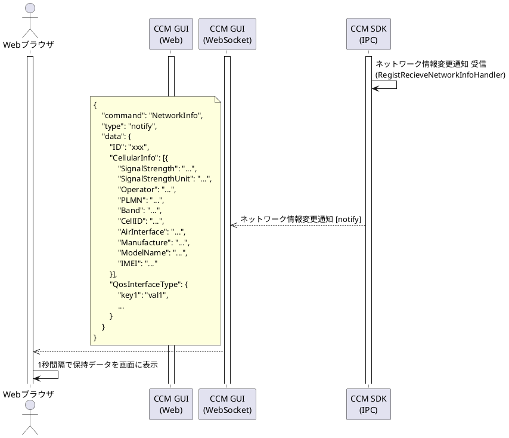

Prediction PlantUML:
```plantuml
@startuml
hide footbox
skinparam shadowing false
skinparam sequence {
  ParticipantPadding 40
  BoxPadding 10
  MessageAlign left
  LifeLineBorderColor #000000
  LifeLineBackgroundColor #FFFFFF
  ParticipantBorderColor #666666
  ParticipantBackgroundColor #D9D9E8
  NoteBackgroundColor #FFFED6
  NoteBorderColor #666666
}

actor "Webブラウザ" as WB

participant "CCM GUI\n(Web)" as WEB
participant "CCM GUI\n(WebSocket)" as WS
participant "CCM SDK\n(IPC)" as SDK

SDK -> SDK : ネットワーク情報変更通知 受信\n(RegistRecieveNetworkInfoHandler)

SDK ..> WS : ネットワーク情報変更通知 [notify]

note over WEB,WS
{
  "command": "NetworkInfo",
  "type": "notify",
  "data": {
    "ID": "xxx",
    "CellularInfo": [{
      "SignalStrength": "...",
      "SignalStrengthUnit": "...",
      "Operator": "...",
      "PLMN": "...",
      "Band": "...",
      "CellID": "...",
      "AirInterface": "...",
      "Manufacture": "...",
      "ModelName": "...",
      "IMEI": "..."
    }],
    "QosInterfaceType": {
      "key1": "val1",
      ...
    }
  }
}
end note

WS ..> WB : 1秒間隔で保持データを画面に表示
WB -> WB

@enduml
```

#### `3e8ecc26a5a423e016c2d7c2fe96a7e63fe2de0e_15` — compile_fail (class, tier 1)

- CSR: `Error line 11 in file: data/csr/gpt-5.2-2025-12-11_20260613T154248Z/extracted/3e8ecc26a5a423e016c2d7c2fe96a7e63fe2de0e_15.puml`
- Element: tp=0 fp=0 fn=3 F1=0.000; type-acc matched=0 correct=0 excluded=0
- Relationship: tp=0 fp=0 fn=2 F1=0.000; missed: association
- chrF++: 66.53
- Files: GT `data/puml_files/3e8ecc26a5a423e016c2d7c2fe96a7e63fe2de0e_15.puml` (yes) · pred `data/runs/gpt-5.2-2025-12-11_20260613T154248Z/3e8ecc26a5a423e016c2d7c2fe96a7e63fe2de0e_15.puml` (yes) · input `data/puml_images_1568/3e8ecc26a5a423e016c2d7c2fe96a7e63fe2de0e_15.png` (yes) · render `data/csr/gpt-5.2-2025-12-11_20260613T154248Z/png/3e8ecc26a5a423e016c2d7c2fe96a7e63fe2de0e_15.png` (MISSING)

GT PlantUML:
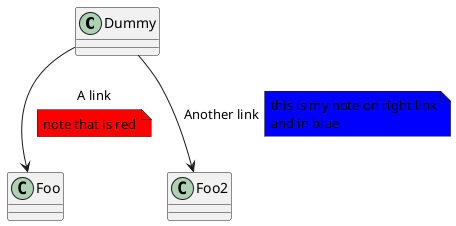

Prediction PlantUML:
```plantuml
@startuml
skinparam classAttributeIconSize 0

class Dummy
class Foo
class Foo2

Dummy -down-> Foo : A link
Dummy -down-> Foo2 : Another link

note left of Dummy -[#red,fill=red] 
note that is red
end note

note right of Dummy -[#blue,fill=blue]
this is my note on right link
and in blue
end note
@enduml
```

#### `4aad380673ff1225b973f740bf80ec99dfb70724` — compile_fail (sequence, tier 1)

- CSR: `Error line 22 in file: data/csr/gpt-5.2-2025-12-11_20260613T154248Z/extracted/4aad380673ff1225b973f740bf80ec99dfb70724.puml`
- Element: tp=0 fp=0 fn=5 F1=0.000; type-acc matched=0 correct=0 excluded=0
- Relationship: tp=0 fp=0 fn=8 F1=0.000; missed: message
- chrF++: 71.42
- Files: GT `data/puml_files/4aad380673ff1225b973f740bf80ec99dfb70724.puml` (yes) · pred `data/runs/gpt-5.2-2025-12-11_20260613T154248Z/4aad380673ff1225b973f740bf80ec99dfb70724.puml` (yes) · input `data/puml_images_1568/4aad380673ff1225b973f740bf80ec99dfb70724.png` (yes) · render `data/csr/gpt-5.2-2025-12-11_20260613T154248Z/png/4aad380673ff1225b973f740bf80ec99dfb70724.png` (MISSING)

GT PlantUML:
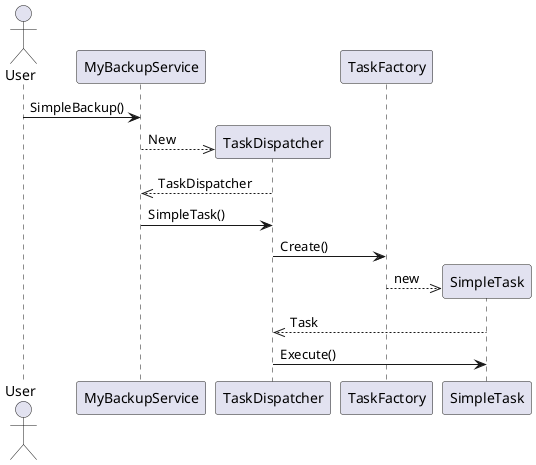

Prediction PlantUML:
```plantuml
@startuml
hide footbox
skinparam shadowing false
skinparam sequence {
  ParticipantPadding 40
  BoxPadding 10
  LifeLineBorderColor #666666
  LifeLineBackgroundColor #FFFFFF
  ParticipantBorderColor #333333
  ParticipantBackgroundColor #E6E6F2
  ActorBorderColor #333333
  ActorBackgroundColor #E6E6F2
}

actor User
participant MyBackupService
participant TaskDispatcher
participant TaskFactory
participant SimpleTask

User -> MyBackupService : SimpleBackup()
MyBackupService ..> TaskDispatcher : New
TaskDispatcher ..> MyBackupService : TaskDispatcher
MyBackupService -> TaskDispatcher : SimpleTask()
TaskDispatcher -> TaskFactory : Create()
TaskFactory ..> SimpleTask : new
SimpleTask ..> TaskDispatcher : Task
TaskDispatcher -> SimpleTask : Execute()

@enduml
```

#### `532d5a1ff757de7127780cff4493ccdd7a51c49a` — compile_fail (sequence, tier 4)

- CSR: `Error line 68 in file: data/csr/gpt-5.2-2025-12-11_20260613T154248Z/extracted/532d5a1ff757de7127780cff4493ccdd7a51c49a.puml`
- Element: tp=0 fp=0 fn=13 F1=0.000; type-acc matched=0 correct=0 excluded=0
- Relationship: tp=0 fp=0 fn=34 F1=0.000; missed: message
- chrF++: 57.86
- Files: GT `data/puml_files/532d5a1ff757de7127780cff4493ccdd7a51c49a.puml` (yes) · pred `data/runs/gpt-5.2-2025-12-11_20260613T154248Z/532d5a1ff757de7127780cff4493ccdd7a51c49a.puml` (yes) · input `data/puml_images_1568/532d5a1ff757de7127780cff4493ccdd7a51c49a.png` (yes) · render `data/csr/gpt-5.2-2025-12-11_20260613T154248Z/png/532d5a1ff757de7127780cff4493ccdd7a51c49a.png` (MISSING)

GT PlantUML (truncated):
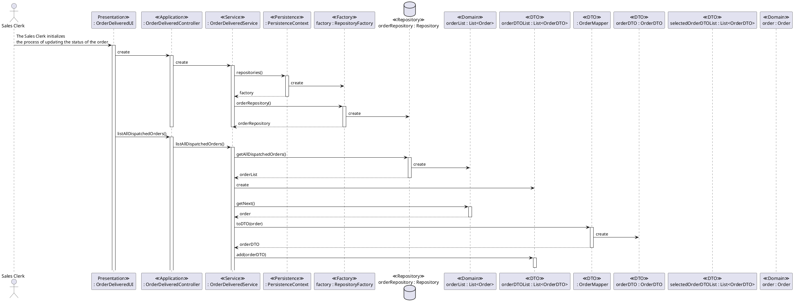

Prediction PlantUML (truncated):
```plantuml
@startuml
skinparam backgroundColor white
skinparam shadowing false
skinparam sequenceMessageAlign center
skinparam responseMessageBelowArrow true
skinparam ParticipantPadding 18
skinparam BoxPadding 10
skinparam ArrowColor #333333
skinparam LifeLineBorderColor #999999
skinparam LifeLineBackgroundColor #FFFFFF
skinparam ParticipantBorderColor #999999
skinparam ParticipantBackgroundColor #E9E9F2
skinparam NoteBackgroundColor #FFFFFF
skinparam NoteBorderColor #999999

actor "Sales Clerk" as SalesClerk

participant "Presentation>>\n: OrderDeliveredUI" as UI
participant "«Application»\n: OrderDeliveredController" as Controller
participant "«Service»\n: OrderDeliveredService" as Service
participant "«Persistence»\n: PersistenceContext" as PC
participant "«Factory»\nfactory : RepositoryFactory" as RF
database "«Repository»\norderRepository : Repository" as Repo
participant "«Domain»\norderList : List<Order>" as OrderList
participant "«DTO»\norderDTOList : List<OrderDTO>" as OrderDTOList
participant "«DTO»\n: OrderMapper" as Mapper
participant "«DTO»\norderDTO : OrderDTO" as OrderDTO
participant "«DTO»\nselectedOrderDTOList : List<OrderDTO>" as SelectedOrderDTOList
participant "«Domain»\norder : Order" as Order

note left of SalesClerk
The Sales Clerk initializes
the process of updating the status of the order
end note

create UI
SalesClerk -> UI : create
activate UI

create Controller
UI -> Controller : create
activate Controller

create Service
Controller -> Service : create
activate Service

Service -> PC : repositories()
activate PC
PC --> Service : factory
deactivate PC

create RF
Service -> RF : create
activate RF

Service -> RF : orderRepository()
RF --> Service : orderRepository

create Repo
Service -> Repo : create
activate Repo

UI -> Controller : listAllDispatchedOrders()
Controller -> Service : listAllDispatchedOrders()
Service -> Repo : getAllDispatchedOrders()
create OrderList
Repo --> Service : orderList

create OrderDTOList
Service -> OrderDTOList : create

loop foreach
  Service -> OrderList : getNext()
  OrderList --> Service : order
  Service -> Mapper : toDTO(order)
  create OrderDTO
  Mapper --> Service : orderDTO
  Service -> OrderDTOList : add(orderDTO)
end
```

#### `5922ccf81ce292fdd445209df90f8035c5b34c23` — compile_fail (class, tier 1)

- CSR: `no PNG produced`
- Element: tp=0 fp=0 fn=1 F1=0.000; type-acc matched=0 correct=0 excluded=0
- Relationship: tp=0 fp=0 fn=0 F1=1.000
- chrF++: 8.29
- Files: GT `data/puml_files/5922ccf81ce292fdd445209df90f8035c5b34c23.puml` (yes) · pred `data/runs/gpt-5.2-2025-12-11_20260613T154248Z/5922ccf81ce292fdd445209df90f8035c5b34c23.puml` (yes) · input `data/puml_images_1568/5922ccf81ce292fdd445209df90f8035c5b34c23.png` (yes) · render `data/csr/gpt-5.2-2025-12-11_20260613T154248Z/png/5922ccf81ce292fdd445209df90f8035c5b34c23.png` (MISSING)

GT PlantUML:
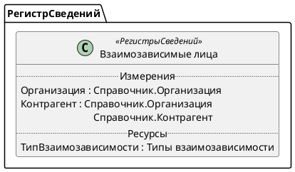

Prediction PlantUML:


#### `704b783235640f12565d250b751599d621aff349` — compile_fail (sequence, tier 1)

- CSR: `Error line 16 in file: data/csr/gpt-5.2-2025-12-11_20260613T154248Z/extracted/704b783235640f12565d250b751599d621aff349.puml`
- Element: tp=0 fp=0 fn=4 F1=0.000; type-acc matched=0 correct=0 excluded=0
- Relationship: tp=0 fp=0 fn=0 F1=1.000
- chrF++: 34.18
- Files: GT `data/puml_files/704b783235640f12565d250b751599d621aff349.puml` (yes) · pred `data/runs/gpt-5.2-2025-12-11_20260613T154248Z/704b783235640f12565d250b751599d621aff349.puml` (yes) · input `data/puml_images_1568/704b783235640f12565d250b751599d621aff349.png` (yes) · render `data/csr/gpt-5.2-2025-12-11_20260613T154248Z/png/704b783235640f12565d250b751599d621aff349.png` (MISSING)

GT PlantUML:
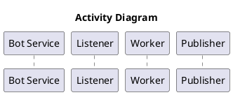

Prediction PlantUML:
```plantuml
@startuml
title Activity Diagram

skinparam shadowing false
skinparam backgroundColor white
skinparam defaultTextAlignment center
skinparam roundcorner 10
skinparam activity {
  BackgroundColor #E6E6FA
  BorderColor #333333
  FontSize 28
  FontColor #000000
}

' Top row
activity "Bot Service" as BS1
activity "Listener" as L1
activity "Worker" as W1
activity "Publisher" as P1

' Bottom row
activity "Bot Service" as BS2
activity "Listener" as L2
activity "Worker" as W2
activity "Publisher" as P2

' Layout helpers
BS1 -[hidden]-> L1
L1  -[hidden]-> W1
W1  -[hidden]-> P1

BS2 -[hidden]-> L2
L2  -[hidden]-> W2
W2  -[hidden]-> P2

BS1 -[hidden]down-> BS2
L1  -[hidden]down-> L2
W1  -[hidden]down-> W2
P1  -[hidden]down-> P2

' Dashed vertical connectors
BS1 ..down.. BS2
L1  ..down.. L2
W1  ..down.. W2
P1  ..down.. P2
@enduml
```

#### `784e17a8866ba13c13db1d894170cfb21ee51dbb` — compile_fail (class, tier 4)

- CSR: `Error line 14 in file: data/csr/gpt-5.2-2025-12-11_20260613T154248Z/extracted/784e17a8866ba13c13db1d894170cfb21ee51dbb.puml`
- Element: tp=0 fp=0 fn=12 F1=0.000; type-acc matched=0 correct=0 excluded=0
- Relationship: tp=0 fp=0 fn=8 F1=0.000; missed: inheritance, association
- chrF++: 73.45
- Files: GT `data/puml_files/784e17a8866ba13c13db1d894170cfb21ee51dbb.puml` (yes) · pred `data/runs/gpt-5.2-2025-12-11_20260613T154248Z/784e17a8866ba13c13db1d894170cfb21ee51dbb.puml` (yes) · input `data/puml_images_1568/784e17a8866ba13c13db1d894170cfb21ee51dbb.png` (yes) · render `data/csr/gpt-5.2-2025-12-11_20260613T154248Z/png/784e17a8866ba13c13db1d894170cfb21ee51dbb.png` (MISSING)

GT PlantUML:
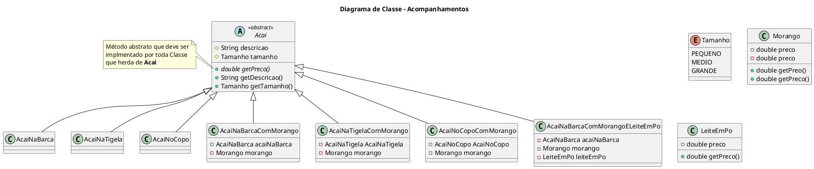

Prediction PlantUML (truncated):
```plantuml
@startuml
title Diagrama de Classe - Acompanhamentos

skinparam classAttributeIconSize 0
skinparam shadowing false
skinparam linetype ortho

note left of Acai
Método abstrato que deve ser
implementado por toda Classe
que herda de Acai
end note

abstract class Acai <<abstract>> {
  String descricao
  Tamanho tamanho
  {abstract} double getPreco()
  String getDescricao()
  Tamanho getTamanho()
}

enum Tamanho {
  PEQUENO
  MEDIO
  GRANDE
}

class AcaiNaBarca
class AcaiNaTigela
class AcaiNoCopo

class Morango {
  double preco
  double preco
  double getPre()
  double getPreco()
}

class LeiteEmPo {
  double preco
  double getPreco()
}

class AcaiNaBarcaComMorango {
  AcaiNaBarca acaiNaBarca
  Morango morango
}

class AcaiNaTigelaComMorango {
  AcaiNaTigela AcaiNaTigela
  Morango morango
}

class AcaiNoCopoComMorango {
  AcaiNoCopo AcaiNoCopo
  Morango morango
}

class AcaiNaBarcaComMorangoELeiteEmPo {
  AcaiNaBarca acaiNaBarca
  Morango morango
  LeiteEmPo leiteEmPo
}

AcaiNaBarca --|> Acai
AcaiNaTigela --|> Acai
AcaiNoCopo --|> Acai

AcaiNaBarcaComMorango --|> Acai
AcaiNaTigelaComMorango --|> Acai
AcaiNoCopoComMorango --|> Acai
AcaiNaBarcaComMorangoELeiteEmPo --|> Acai

AcaiNaBarcaComMorango --> AcaiNaBarca
AcaiNaBarcaComMorango --> Morango

AcaiNaTigelaComMorango --> AcaiNaTigela
AcaiNaTigelaComMorango --> Morango

AcaiNoCopoComMorango --> AcaiNoCopo
```

#### `880c4bc548f9e57bcce86d0e90a558cd9dad31d5` — compile_fail (sequence, tier 2)

- CSR: `Error line 23 in file: data/csr/gpt-5.2-2025-12-11_20260613T154248Z/extracted/880c4bc548f9e57bcce86d0e90a558cd9dad31d5.puml`
- Element: tp=0 fp=0 fn=3 F1=0.000; type-acc matched=0 correct=0 excluded=0
- Relationship: tp=0 fp=0 fn=5 F1=0.000; missed: message
- chrF++: 67.45
- Files: GT `data/puml_files/880c4bc548f9e57bcce86d0e90a558cd9dad31d5.puml` (yes) · pred `data/runs/gpt-5.2-2025-12-11_20260613T154248Z/880c4bc548f9e57bcce86d0e90a558cd9dad31d5.puml` (yes) · input `data/puml_images_1568/880c4bc548f9e57bcce86d0e90a558cd9dad31d5.png` (yes) · render `data/csr/gpt-5.2-2025-12-11_20260613T154248Z/png/880c4bc548f9e57bcce86d0e90a558cd9dad31d5.png` (MISSING)

GT PlantUML:
```plantuml
' Blob ID: 880c4bc548f9e57bcce86d0e90a558cd9dad31d5
' Original Path: /docs/US/US14/US014_SD_getListFromExternalModule(fileName).puml
' Source: World of Code

@startuml
autonumber

skinparam titleFontSize 25


participant "store: SnsUserStore " as store
participant "<<interface>>\n:LoadSnsUsersFromExternalSource" as externalSource
participant ":List<SnsUserDTO>" as listDTO

title : SD_getListFromExternalModule(fileName)
'1'
[o-> store : getListFromExternalModule(fileName)
activate store
'2'
store -> store : className = getClassName(fileName)
activate store
deactivate store

'5'
store -> externalSource : dtoList = readFileFromExternalSource(fileName)

activate externalSource

'6'
externalSource --> listDTO **: create()
note over externalSource
 <w:#FFAAAA>multiple interactions in the externalSource to extract a list of SnsUserDTO</w>
end note
deactivate externalSource

'7'
[<-- store : return dtoList

deactivate store


@enduml
```

Prediction PlantUML:
```plantuml
@startuml
title SD_getListFromExternalModule(fileName)

hide footbox
skinparam sequenceMessageAlign left
skinparam ParticipantPadding 40
skinparam BoxPadding 10

actor " " as caller

participant "store: SnsUserStore" as store
participant "<<interface>>\n:LoadSnsUsersFromExternalSource" as loader
participant ":List<SnsUserDTO>" as list

caller -> store : 1 getListFromExternalModule(fileName)
activate store

store -> store : 2 className = getClassName(fileName)

store -> loader : 3 dtoList = readFileFromExternalSource(fileName)
activate loader

loader ..> list : 4 create()

note over loader, list
multiple interactions in the externalSource to extract a list of SnsUserDTO
end note

deactivate loader

store --> caller : 5 return dtoList
deactivate store

@enduml
```

#### `a3716c3d98cce05fe2a292cf86bf6bc243cd15bf` — compile_fail (sequence, tier 4)

- CSR: `Error line 56 in file: data/csr/gpt-5.2-2025-12-11_20260613T154248Z/extracted/a3716c3d98cce05fe2a292cf86bf6bc243cd15bf.puml`
- Element: tp=0 fp=0 fn=4 F1=0.000; type-acc matched=0 correct=0 excluded=0
- Relationship: tp=0 fp=0 fn=19 F1=0.000; missed: message
- chrF++: 36.37
- Files: GT `data/puml_files/a3716c3d98cce05fe2a292cf86bf6bc243cd15bf.puml` (yes) · pred `data/runs/gpt-5.2-2025-12-11_20260613T154248Z/a3716c3d98cce05fe2a292cf86bf6bc243cd15bf.puml` (yes) · input `data/puml_images_1568/a3716c3d98cce05fe2a292cf86bf6bc243cd15bf.png` (yes) · render `data/csr/gpt-5.2-2025-12-11_20260613T154248Z/png/a3716c3d98cce05fe2a292cf86bf6bc243cd15bf.png` (MISSING)

GT PlantUML (truncated):
```plantuml
' Blob ID: a3716c3d98cce05fe2a292cf86bf6bc243cd15bf
' Original Path: /docs/sequence_close_server.uml
' Source: World of Code

@startuml
box "Client"
	participant client
	participant tcpclient
end box
box "Server"
	participant tcpserver
	participant server
end box

server -> tcpserver : listen
activate tcpserver  #0066FF
hnote over tcpserver #0066FF : LISTEN
	

client -> tcpclient : connect
activate client

activate tcpclient #009999
deactivate tcpserver
tcpclient -> tcpserver : SYN
hnote over tcpclient #009999 : SYN-SENT
hnote over tcpserver #0099FF : SYN-RECEIVED
activate tcpserver  #0099FF

tcpserver -> tcpclient : SYN, ACK
deactivate tcpclient
deactivate tcpserver

tcpclient -> tcpserver : ACK
hnote over tcpclient #ADD1B2 : ESTABLISHED
hnote over tcpserver #ADD1B2 : ESTABLISHED
activate tcpclient #ADD1B2
activate tcpserver #ADD1B2
deactivate client


tcpserver -> server : EPOLLIN
activate server
server -> tcpserver : write
tcpserver -> tcpclient : PSH, ACK
tcpclient -> tcpserver : ACK
tcpclient -> client : EPOLLIN
activate client
client -> tcpclient : read
deactivate client

deactivate tcpserver
server -> tcpserver : close
activate tcpserver 	#B4A7E5
hnote over tcpserver #B4A7E5 : FIN_WAIT1
deactivate tcpclient
tcpserver -> tcpclient : FIN, ACK
activate tcpclient #FF99FF
deactivate tcpserver
hnote over tcpclient #FF99FF : CLOSE_WAIT
tcpclient -> tcpserver : ACK
deactivate server
activate tcpserver #FF9966
hnote over tcpserver #FF9966 : FIN_WAIT2
tcpclient -> client : EPOLLRDHUP
deactivate tcpclient #FF00FF
activate client
client -> tcpclient : close
hnote over tcpclient #FF00FF : LAST_ACK

activate tcpclient #FF00FF
tcpclient ->tcpserver : FIN


deactivate tcpserver
tcpserver -> tcpclient : ACK

deactivate tcpclient
```

Prediction PlantUML (truncated):
```plantuml
@startuml
skinparam backgroundColor #FFFFFF
skinparam shadowing false
skinparam sequence {
  ParticipantPadding 40
  BoxPadding 20
  LifeLineBorderColor #888888
  LifeLineBorderThickness 1
  LifeLineBackgroundColor transparent
  MessageAlign center
  ArrowColor #000000
  ArrowThickness 1
  ActorBorderColor #666666
  ParticipantBorderColor #666666
  ParticipantBackgroundColor #E9E9F2
}

hide footbox

box "Client" #DDDDDD
participant client as C
participant tcpclient as TC
end box

box "Server" #DDDDDD
participant tcpserver as TS
participant server as S
end box

activate C #FFFFFF
C -> TC : connect
deactivate C

activate TC #0B8F86
note over TC #0B8F86
SYN-SENT
end note

TC -> TS : SYN

activate TS #1E88E5
note over TS #1E88E5
LISTEN
end note

S -> TS : listen

note over TS #4FC3F7
SYN-RECEIVED
end note

TS -> TC : SYN, ACK
TC -> TS : ACK

deactivate TC
activate TC #BFE6C6
note over TC #CFE8CF
ESTABLISHED
end note

deactivate TS
activate TS #BFE6C6
note over TS #CFE8CF
ESTABLISHED
end note

TS -> S : EPOLLIN
S -> TS : write

TS -> TC : PSH, ACK
TC -> TS : ACK

C <- TC : EPOLLIN
C -> TC : read

S -> TS : close

deactivate TS
activate TS #B9A7E6
note over TS #B9A7E6
```

#### `a4ace769617f9198bb8eb533e526af564df13977` — compile_fail (sequence, tier 3)

- CSR: `Error line 28 in file: data/csr/gpt-5.2-2025-12-11_20260613T154248Z/extracted/a4ace769617f9198bb8eb533e526af564df13977.puml`
- Element: tp=0 fp=0 fn=5 F1=0.000; type-acc matched=0 correct=0 excluded=0
- Relationship: tp=0 fp=0 fn=8 F1=0.000; missed: message
- chrF++: 43.08
- Files: GT `data/puml_files/a4ace769617f9198bb8eb533e526af564df13977.puml` (yes) · pred `data/runs/gpt-5.2-2025-12-11_20260613T154248Z/a4ace769617f9198bb8eb533e526af564df13977.puml` (yes) · input `data/puml_images_1568/a4ace769617f9198bb8eb533e526af564df13977.png` (yes) · render `data/csr/gpt-5.2-2025-12-11_20260613T154248Z/png/a4ace769617f9198bb8eb533e526af564df13977.png` (MISSING)

GT PlantUML:
```plantuml
' Blob ID: a4ace769617f9198bb8eb533e526af564df13977
' Original Path: /starter-auth/docs/puml/user_authorization_code.puml
' Source: World of Code

@startuml

participant "接入平台的前端页"
participant "权限中心登录页"
participant "starter-auth(权限中心)"
database "auth数据库"
database "redis"

"接入平台的前端页" -> "权限中心登录页" : \
未登录的请求自动重定向

"权限中心登录页" -> "starter-auth(权限中心)" : \
获取用户登录授权码接口

"starter-auth(权限中心)" -> "auth数据库" : \
查询用户信息

"starter-auth(权限中心)" <- "auth数据库" : \
返回用户信息

"starter-auth(权限中心)" -> "starter-auth(权限中心)" : \
验证用户密码\n\
不匹配则响应：登陆失败\n\
创建授权码

"starter-auth(权限中心)" --> "redis" : \
异步：缓存授权码关联的用户信息60s

"权限中心登录页" <- "starter-auth(权限中心)" : \
响应授权码和重定向页面

"接入平台的前端页" <- "权限中心登录页"   : \
重定向到接入服务指定的前端页\n\
在请求路径中带上用户登录授权码\n\
路径如：https://www.xxx.com/?aucoCode=xxxxxxxxxxxx

@enduml
```

Prediction PlantUML:
```plantuml
```plantuml
@startuml
hide footbox
skinparam shadowing false
skinparam sequence {
  ParticipantPadding 40
  BoxPadding 10
  MessageAlign left
}

participant "接入平台的前端页" as FE
participant "权限中心登录页" as LOGIN
participant "starter-auth(权限中心)" as AUTH
database "auth数据库" as DB
database "redis" as REDIS

FE -> LOGIN : 未登录的请求自动重定向
LOGIN -> AUTH : 获取用户登录授权码接口
AUTH -> DB : 查询用户信息
DB --> AUTH : 返回用户信息

note right of AUTH
验证用户密码
不匹配则响应：登陆失败
创建授权码
end note

AUTH -> AUTH : 
AUTH ..> REDIS : 异步：缓存授权码关联的用户信息60s
AUTH --> LOGIN : 响应授权码和重定向页面

LOGIN --> FE : 重定向到接入服务指定的前端页\n在请求路径中带上用户登录授权码\n路径如： https://www.xxx.com/?aucoCode=xxxxxxxxxxxx

@enduml
```
```

#### `a87c8d584bf40e45101b8425d63c9ac5fb06c7d6` — compile_fail (class, tier 3)

- CSR: `Error line 20 in file: data/csr/gpt-5.2-2025-12-11_20260613T154248Z/extracted/a87c8d584bf40e45101b8425d63c9ac5fb06c7d6.puml`
- Element: tp=0 fp=0 fn=3 F1=0.000; type-acc matched=0 correct=0 excluded=0
- Relationship: tp=0 fp=0 fn=2 F1=0.000; missed: inheritance, dependency
- chrF++: 57.38
- Files: GT `data/puml_files/a87c8d584bf40e45101b8425d63c9ac5fb06c7d6.puml` (yes) · pred `data/runs/gpt-5.2-2025-12-11_20260613T154248Z/a87c8d584bf40e45101b8425d63c9ac5fb06c7d6.puml` (yes) · input `data/puml_images_1568/a87c8d584bf40e45101b8425d63c9ac5fb06c7d6.png` (yes) · render `data/csr/gpt-5.2-2025-12-11_20260613T154248Z/png/a87c8d584bf40e45101b8425d63c9ac5fb06c7d6.png` (MISSING)

GT PlantUML:
```plantuml
' Blob ID: a87c8d584bf40e45101b8425d63c9ac5fb06c7d6
' Original Path: /uml/booknote-class.plantuml
' Source: World of Code

@startuml
scale 2
page 1x1
title
    在键盘上添加输入框的实现方式
    创建时间: <2019-09-11 21:17>
    endtitle
    left header
        设计到两个知识点
        1. 半遮罩层
        2. 键盘监听事件
        3. 自动布局实现动态控制TextView的高度
    endheader
    class "SuperAlertBgView" as baseView {
        --属性组 --
        NSString *placeholder;
        void(^ComfirmHandler)(NSString *);
        UIView *bgView;

        __ 函数组__
        -(void)show;
        -(void)hide;
    }
    note left of baseView 
        封装半透明遮罩层,和展示隐藏逻辑实现
    end note
    class "KeyBoardFieldView" as keyBoardField {
        --属性组 --
        __ 函数组__
    }
    baseView <|-- keyBoardField:继承<
    @enduml
```

Prediction PlantUML:
```plantuml
@startuml
skinparam shadowing false
skinparam classAttributeIconSize 0
skinparam class {
  BackgroundColor #f7f7f7
  BorderColor #333333
  ArrowColor #333333
  HeaderBackgroundColor #f7f7f7
}

title 在键盘上添加输入框的实现方式\n创建时间：<2019-09-11 21:17>

note top
设计到两个知识点
1. 半遮罩层
2. 键盘监听事件
3. 自动布局实现动态控制TextView的高度
end note

class SuperAlertBgView <<C>> {
== 属性组 ==
NSString *placeholder;
void(^ComfirmHandler)(NSString *);
UIView *bgView;

== 函数组 ==
■ (void)show;
■ (void)hide;
}

class KeyBoardFieldView <<C>> {
== 属性组 ==

== 函数组 ==
}

KeyBoardFieldView -up-|> SuperAlertBgView : 继承<

note left of SuperAlertBgView
封装半透明遮罩层,和展示隐藏逻辑实现
end note
@enduml
```

#### `aa416d26b5e8ab9e0af098522a5e026c5a67fe35` — compile_fail (class, tier 4)

- CSR: `Error line 72 in file: data/csr/gpt-5.2-2025-12-11_20260613T154248Z/extracted/aa416d26b5e8ab9e0af098522a5e026c5a67fe35.puml`
- Element: tp=0 fp=0 fn=10 F1=0.000; type-acc matched=0 correct=0 excluded=0
- Relationship: tp=0 fp=0 fn=12 F1=0.000; missed: association
- chrF++: 44.02
- Files: GT `data/puml_files/aa416d26b5e8ab9e0af098522a5e026c5a67fe35.puml` (yes) · pred `data/runs/gpt-5.2-2025-12-11_20260613T154248Z/aa416d26b5e8ab9e0af098522a5e026c5a67fe35.puml` (yes) · input `data/puml_images_1568/aa416d26b5e8ab9e0af098522a5e026c5a67fe35.png` (yes) · render `data/csr/gpt-5.2-2025-12-11_20260613T154248Z/png/aa416d26b5e8ab9e0af098522a5e026c5a67fe35.png` (MISSING)

GT PlantUML (truncated):
```plantuml
' Blob ID: aa416d26b5e8ab9e0af098522a5e026c5a67fe35
' Original Path: /docs/SPRINT_005/DDD_Aggregates_v4_MacroVision.puml
' Source: World of Code

@startuml
'https://plantuml.com/class-diagram

'SWitCH G4 THEME
'
'COLORS
'Blue #application
'Pink #pink
'Red #salmon
'Yellow #khaki
'Green #technology
'
'DEFAULTS

hide members
hide circle
skinparam linetype ortho

skinparam minClassWidth 200
skinparam nodesep 20
skinparam ranksep 20
skinparam padding 0
skinparam roundCorner 8


skinparam package {
    backgroundColor white
    borderColor grey
    shadowing false
    fontStyle normal
    fontSize 16
    borderThickness 0.5
    fontColor #aaa
    stereotypeFontSize 10
    stereotypeFontColor lightGrey
}

skinparam class {
    stereotypeFontSize 10
    fontSize 16
    fontName Helvetica
    arrowColor black
    arrowThickness 1
    attributeIconSize 0
    borderThickness 0.5
}

skinparam class<<AGGREGATE ROOT>> {
    borderColor black
    backgroundColor #eee
}

skinparam class<<ENTITY>> {
    borderColor yellow
    backgroundColor #khaki
}

skinparam class<<VALUE OBJECT>> {
    borderColor green
    backgroundColor #technology
}


skinparam note {
    fontSize 14
    fontName Helvetica
    borderColor black
    borderThickness 0.5
    backgroundColor AliceBlue
}


'TITLE ON TOP
```

Prediction PlantUML (truncated):
```plantuml
@startuml
skinparam shadowing false
skinparam packageStyle rectangle
skinparam defaultTextAlignment center
skinparam wrapWidth 200
skinparam PackageBorderColor #999999
skinparam PackageFontColor #999999
skinparam PackageFontSize 22
skinparam PackageBackgroundColor white
skinparam ClassBackgroundColor #F2F2F2
skinparam ClassBorderColor #333333
skinparam ClassFontColor #000000
skinparam ClassFontSize 22
skinparam ArrowColor #000000
skinparam ArrowThickness 2

hide empty members

package "Task" <<AGGREGATE>> as P_Task {
  class "Task" as Task <<AGGREGATE ROOT>> <<ENTITY>>
}

package "Sprint" <<AGGREGATE>> as P_Sprint {
  class "Sprint" as Sprint <<AGGREGATE ROOT>> <<ENTITY>>
}

package "UserStory" <<AGGREGATE>> as P_UserStory {
  class "UserStory" as UserStory <<AGGREGATE ROOT>> <<ENTITY>>
}

package "Project" <<AGGREGATE>> as P_Project {
  class "Project" as Project <<AGGREGATE ROOT>> <<ENTITY>>
  class "Resource" as ProjectResource <<AGGREGATE ROOT>> <<ENTITY>>
}

package "Typology" <<AGGREGATE>> as P_Typology {
  class "Typology" as Typology <<AGGREGATE ROOT>> <<ENTITY>>
}

package "ProfileRequest" <<AGGREGATE>> as P_ProfileRequest {
  class "ProfileRequest" as ProfileRequest <<AGGREGATE ROOT>> <<ENTITY>>
}

package "Profile" <<AGGREGATE>> as P_Profile {
  class "Profile" as Profile <<AGGREGATE ROOT>> <<ENTITY>>
}

package "Resource" <<AGGREGATE>> as P_Resource {
  class "Resource" as Resource <<AGGREGATE ROOT>> <<ENTITY>>
}

package "User" <<AGGREGATE>> as P_User {
  class "User" as User <<AGGREGATE ROOT>> <<ENTITY>>
}

' Layout hints (approximate)
P_Task -down- P_Sprint
P_UserStory -right- P_Sprint
P_Typology -right- P_Project
P_ProfileRequest -right- P_Profile
P_Profile -right- P_Resource
P_Profile -down- P_User

' Relationships (as shown by arrows)
Sprint --> UserStory
Profile --> Typology
Profile --> User
ProjectResource --> Resource
Resource --> User

' Right-side vertical bus with multiple incoming arrows (approximated with a hidden node)
rectangle " " as Bus #white
Bus -[hidden]right- P_Project
Bus -[hidden]right- P_Sprint
Bus -[hidden]right- P_Task
Bus -[hidden]right- P_Resource
Bus -[hidden]right- P_User

Task --> Bus
Sprint --> Bus
```

#### `b21a6faaf6a180c501e0aba4b0056672ede1ea2d` — compile_fail (class, tier 2)

- CSR: `Error line 25 in file: data/csr/gpt-5.2-2025-12-11_20260613T154248Z/extracted/b21a6faaf6a180c501e0aba4b0056672ede1ea2d.puml`
- Element: tp=0 fp=0 fn=4 F1=0.000; type-acc matched=0 correct=0 excluded=0
- Relationship: tp=0 fp=0 fn=4 F1=0.000; missed: inheritance, aggregation, association
- chrF++: 74.49
- Files: GT `data/puml_files/b21a6faaf6a180c501e0aba4b0056672ede1ea2d.puml` (yes) · pred `data/runs/gpt-5.2-2025-12-11_20260613T154248Z/b21a6faaf6a180c501e0aba4b0056672ede1ea2d.puml` (yes) · input `data/puml_images_1568/b21a6faaf6a180c501e0aba4b0056672ede1ea2d.png` (yes) · render `data/csr/gpt-5.2-2025-12-11_20260613T154248Z/png/b21a6faaf6a180c501e0aba4b0056672ede1ea2d.png` (MISSING)

GT PlantUML:
```plantuml
' Blob ID: b21a6faaf6a180c501e0aba4b0056672ede1ea2d
' Original Path: /Documentation/plantuml/Grid/BuildingTile.puml
' Source: World of Code

@startuml
class BuildingTile {
    + IsLocationValid : bool <<get>>
    + BuildingTile(type:StructureType, facing:Facing)
    + <<override>> ToString() : string
}
class "Dictionary`2"<T1,T2> {
}
enum StructureType {
    House= 0,
    Office= 1,
    TestStruct= 2,
}
Tile <|-- BuildingTile
BuildingTile o-> "ModelLookup<StructureType,string>" "Dictionary`2"
BuildingTile --> "structure" StructureType
BuildingTile +-- StructureType
@enduml
```

Prediction PlantUML:
```plantuml
@startuml
skinparam classAttributeIconSize 0

class Tile

class BuildingTile {
  + IsLocationValid : bool <<get>>
  --
  + BuildingTile(type:StructureType, facing:Facing)
  + <<override>> ToString() : string
}

enum StructureType {
  House=0,
  Office=1,
  TestStruct=2,
}

class "Dictionary`2" as Dictionary2

note right of Dictionary2
ModelLookup<StructureType,string>
end note

note top right of Dictionary2
T1,T2
end note

Tile <|-- BuildingTile

BuildingTile o--> Dictionary2

BuildingTile --> StructureType : structure
@enduml
```

#### outcome: compiled_low_structural

#### `0bffda3c561066aa0dda7f556b2ce91406230f86` — compiled_low_structural (class, tier 1)

- Element: tp=0 fp=1 fn=1 F1=0.000; type-acc matched=0 correct=0 excluded=0
- Relationship: tp=0 fp=0 fn=0 F1=1.000
- chrF++: 54.51
- Files: GT `data/puml_files/0bffda3c561066aa0dda7f556b2ce91406230f86.puml` (yes) · pred `data/runs/gpt-5.2-2025-12-11_20260613T154248Z/0bffda3c561066aa0dda7f556b2ce91406230f86.puml` (yes) · input `data/puml_images_1568/0bffda3c561066aa0dda7f556b2ce91406230f86.png` (yes) · render `data/csr/gpt-5.2-2025-12-11_20260613T154248Z/png/0bffda3c561066aa0dda7f556b2ce91406230f86.png` (MISSING)

GT PlantUML:
```plantuml
' Blob ID: 0bffda3c561066aa0dda7f556b2ce91406230f86
' Original Path: /docs/javadocs/soen6441riskgame/enums/ConquestMapPart.puml
' Source: World of Code

@startuml

skinparam svgLinkTarget _parent
skinparam linetype ortho
set namespaceSeparator none
enum "<b><size:14>ConquestMapPart</b>\n<size:10>soen6441riskgame.enums" as soen6441riskgame.enums.ConquestMapPart  [[../../soen6441riskgame/enums/ConquestMapPart.html{soen6441riskgame.enums.ConquestMapPart}]] {
-String part
-ConquestMapPart(String part)
{static} +ConquestMapPart values()
{static} +ConquestMapPart valueOf(String name)
+String getPart()
{static} +ConquestMapPart fromString(String part)
}


@enduml
```

Prediction PlantUML:
```plantuml
@startuml
skinparam classAttributeIconSize 0

class "ConquestMapPart\nsoen6441riskgame.enums" << (E,#f4a08a) E >> {
  - String part
  --
  - ConquestMapPart(String part)
  {static} ConquestMapPart[] values()
  {static} ConquestMapPart valueOf(String name)
  + String getPart()
  {static} ConquestMapPart fromString(String part)
}
@enduml
```

#### `15957cae039dc7edd8db4abdd48f907c1be31d74` — compiled_low_structural (sequence, tier 1)

- Element: tp=4 fp=1 fn=1 F1=0.800; type-acc matched=4 correct=4 excluded=0
- Relationship: tp=1 fp=6 fn=6 F1=0.143; missed: message; extra: message
- chrF++: 78.97
- Files: GT `data/puml_files/15957cae039dc7edd8db4abdd48f907c1be31d74.puml` (yes) · pred `data/runs/gpt-5.2-2025-12-11_20260613T154248Z/15957cae039dc7edd8db4abdd48f907c1be31d74.puml` (yes) · input `data/puml_images_1568/15957cae039dc7edd8db4abdd48f907c1be31d74.png` (yes) · render `data/csr/gpt-5.2-2025-12-11_20260613T154248Z/png/15957cae039dc7edd8db4abdd48f907c1be31d74.png` (MISSING)

GT PlantUML:
```plantuml
' Blob ID: 15957cae039dc7edd8db4abdd48f907c1be31d74
' Original Path: /UML/UML_E4.puml
' Source: World of Code

@startuml

actor User
participant Expendedora
participant Orden
participant Lata
participant Bebida

User -> Expendedora: aceptarCosepel()
Expendedora -> User: aceptarCospel()
Expendedora -> Orden: nuevaOrden()
Orden -> Lata: solicitarLata()
Bebida -> Expendedora: actualizarStock()
User -> Expendedora: procesarOrden()
Expendedora -> User: vuelto()

@enduml
```

Prediction PlantUML:
```plantuml
@startuml
hide footbox
skinparam shadowing false
skinparam sequence {
  LifeLineBorderColor #000000
  LifeLineBackgroundColor #FFFFFF
  ParticipantBorderColor #000000
  ParticipantBackgroundColor #E6E6F2
  ActorBorderColor #000000
  ActorBackgroundColor #E6E6F2
  ArrowColor #000000
  MessageAlign left
}

actor User
participant Expendendora
participant Orden
participant Lata
participant Bebida

User -> Expendendora : aceptarCosepel()
Expendendora -> User : aceptarCospel()

Expendendora -> Orden : nuevaOrden()
Orden -> Lata : solicitarLata()
Bebida -> Expendendora : actualizarStock()

User -> Expendendora : procesarOrden()
Expendendora -> User : vuelto()
@enduml
```

#### `1619bfd00a86595ad55813847c50c55e1bb17751_02` — compiled_low_structural (class, tier 3)

- Element: tp=5 fp=0 fn=0 F1=1.000; type-acc matched=5 correct=5 excluded=0
- Relationship: tp=0 fp=4 fn=4 F1=0.000; missed: inheritance, composition; extra: inheritance, composition
- chrF++: 78.54
- Files: GT `data/puml_files/1619bfd00a86595ad55813847c50c55e1bb17751_02.puml` (yes) · pred `data/runs/gpt-5.2-2025-12-11_20260613T154248Z/1619bfd00a86595ad55813847c50c55e1bb17751_02.puml` (yes) · input `data/puml_images_1568/1619bfd00a86595ad55813847c50c55e1bb17751_02.png` (yes) · render `data/csr/gpt-5.2-2025-12-11_20260613T154248Z/png/1619bfd00a86595ad55813847c50c55e1bb17751_02.png` (MISSING)

GT PlantUML:
```plantuml
' Blob ID: 1619bfd00a86595ad55813847c50c55e1bb17751
' Original Path: /documentation/images/plantuml/beerocks_common.iuml
' Source: World of Code

@startuml

class thread_base
class socket_thread
class LocalBusInterface
class Poller

class transport_socket_thread {
    +transport_socket_thread()
    +~transport_socket_thread()
    +init() override
    +work() override
    #add_socket() override
    #remove_socket() override
    #read_ready() override
    #configure_ieee1905_transport_interfaces()
    #broker_subscribe()
    #broker_connect()
    #send_cmdu_to_broker()
    -broker_init()
    -broker_send()
    -handle_cmdu_message_broker()
    -bus : LocalBusInterface 
    -poller : Poller
}

thread_base --|> socket_thread
socket_thread --|> transport_socket_thread
transport_socket_thread --* Poller
transport_socket_thread --* LocalBusInterface

@enduml
```

Prediction PlantUML:
```plantuml
@startuml
skinparam classAttributeIconSize 0

class thread_base

class socket_thread

class transport_socket_thread {
  - bus : LocalBusInterface
  - poller : Poller
  --
  + transport_socket_thread()
  + ~transport_socket_thread()
  + init() override
  + work() override
  + add_socket() override
  + remove_socket() override
  + read_ready() override
  + configure_ieee1905_transport_interfaces()
  + broker_subscribe()
  + broker_connect()
  + send_cmdu_to_broker()
  - broker_init()
  - broker_send()
  - handle_cmdu_message_broker()
}

class LocalBusInterface
class Poller

thread_base <|-- socket_thread
socket_thread <|-- transport_socket_thread

transport_socket_thread *-- LocalBusInterface : bus
transport_socket_thread *-- Poller : poller
@enduml
```

#### `42fc85c2e1d580aedd56311d963ecb8df37a5cb1` — compiled_low_structural (class, tier 2)

- Element: tp=2 fp=0 fn=0 F1=1.000; type-acc matched=2 correct=1 excluded=1
- Relationship: tp=0 fp=1 fn=0 F1=0.000; extra: dependency
- chrF++: 87.71
- Files: GT `data/puml_files/42fc85c2e1d580aedd56311d963ecb8df37a5cb1.puml` (yes) · pred `data/runs/gpt-5.2-2025-12-11_20260613T154248Z/42fc85c2e1d580aedd56311d963ecb8df37a5cb1.puml` (yes) · input `data/puml_images_1568/42fc85c2e1d580aedd56311d963ecb8df37a5cb1.png` (yes) · render `data/csr/gpt-5.2-2025-12-11_20260613T154248Z/png/42fc85c2e1d580aedd56311d963ecb8df37a5cb1.png` (MISSING)

GT PlantUML:
```plantuml
' Blob ID: 42fc85c2e1d580aedd56311d963ecb8df37a5cb1
' Original Path: /shacl-diagram/src/specs/07-maxCount/expected.iuml
' Source: World of Code

@startuml
class "ex:MyShapemaxCount" 
"ex:MyShapemaxCount" : age : integer : maxCount[0..1]


note as N1
@prefix rdfs: <http://www.w3.org/2000/01/rdf-schema#> .
@prefix schema: <http://schema.org/> .
@prefix sh: <http://www.w3.org/ns/shacl#> .
@prefix xsd: <http://www.w3.org/2001/XMLSchema#> .
@prefix ex: <http://example.org/ns#> .

ex:MyShapemaxCount a sh:NodeShape ;
sh:targetClass ex:Person ;
sh:property[
  sh:path ex:age ;
  sh:maxCount 1 ;
  sh:datatype xsd:integer ;
] .
end note


hide circle
hide empty members
@enduml
```

Prediction PlantUML:
```plantuml
@startuml
skinparam shadowing false
skinparam classAttributeIconSize 0

class "ex:MyShapemaxCount" as MyShapemaxCount {
  age : integer : maxCount[0..1]
}

note right
@prefix rdfs: <http://www.w3.org/2000/01/rdf-schema#> .
@prefix schema: <http://schema.org/> .
@prefix sh: <http://www.w3.org/ns/shacl#> .
@prefix xsd: <http://www.w3.org/2001/XMLSchema#> .
@prefix ex: <http://example.org/ns#> .

ex:MyShapemaxCount a sh:NodeShape ;
sh:targetClass ex:Person ;
sh:property[
  sh:path ex:age ;
  sh:maxCount 1 ;
  sh:datatype xsd:integer ;
] .
end note
@enduml
```

#### `4b0486c08238763e69a762f3421aa61e3622461e` — compiled_low_structural (class, tier 4)

- Element: tp=20 fp=1 fn=0 F1=0.976; type-acc matched=20 correct=20 excluded=0
- Relationship: tp=7 fp=14 fn=3 F1=0.452; missed: aggregation, dependency; extra: dependency, association
- chrF++: 60.64
- Files: GT `data/puml_files/4b0486c08238763e69a762f3421aa61e3622461e.puml` (yes) · pred `data/runs/gpt-5.2-2025-12-11_20260613T154248Z/4b0486c08238763e69a762f3421aa61e3622461e.puml` (yes) · input `data/puml_images_1568/4b0486c08238763e69a762f3421aa61e3622461e.png` (yes) · render `data/csr/gpt-5.2-2025-12-11_20260613T154248Z/png/4b0486c08238763e69a762f3421aa61e3622461e.png` (MISSING)

#### `73ece5e02bc2f9114ad86167383908b5178e2e6a` — compiled_low_structural (sequence, tier 4)

- Element: tp=7 fp=1 fn=1 F1=0.875; type-acc matched=7 correct=0 excluded=0
- Relationship: tp=0 fp=0 fn=20 F1=0.000; missed: message
- chrF++: 24.09
- Files: GT `data/puml_files/73ece5e02bc2f9114ad86167383908b5178e2e6a.puml` (yes) · pred `data/runs/gpt-5.2-2025-12-11_20260613T154248Z/73ece5e02bc2f9114ad86167383908b5178e2e6a.puml` (yes) · input `data/puml_images_1568/73ece5e02bc2f9114ad86167383908b5178e2e6a.png` (yes) · render `data/csr/gpt-5.2-2025-12-11_20260613T154248Z/png/73ece5e02bc2f9114ad86167383908b5178e2e6a.png` (MISSING)

#### `7c320c768ad2b452a09b81e3f91305beec4280f0` — compiled_low_structural (sequence, tier 3)

- Element: tp=4 fp=1 fn=1 F1=0.800; type-acc matched=4 correct=4 excluded=0
- Relationship: tp=2 fp=8 fn=8 F1=0.200; missed: message; extra: message
- chrF++: 45.36
- Files: GT `data/puml_files/7c320c768ad2b452a09b81e3f91305beec4280f0.puml` (yes) · pred `data/runs/gpt-5.2-2025-12-11_20260613T154248Z/7c320c768ad2b452a09b81e3f91305beec4280f0.puml` (yes) · input `data/puml_images_1568/7c320c768ad2b452a09b81e3f91305beec4280f0.png` (yes) · render `data/csr/gpt-5.2-2025-12-11_20260613T154248Z/png/7c320c768ad2b452a09b81e3f91305beec4280f0.png` (MISSING)

#### `7cbb0b646ccc6f79839a6f3bf478d104c064aef2` — compiled_low_structural (class, tier 1)

- Element: tp=1 fp=1 fn=0 F1=0.667; type-acc matched=1 correct=1 excluded=0
- Relationship: tp=0 fp=1 fn=0 F1=0.000; extra: composition
- chrF++: 57.67
- Files: GT `data/puml_files/7cbb0b646ccc6f79839a6f3bf478d104c064aef2.puml` (yes) · pred `data/runs/gpt-5.2-2025-12-11_20260613T154248Z/7cbb0b646ccc6f79839a6f3bf478d104c064aef2.puml` (yes) · input `data/puml_images_1568/7cbb0b646ccc6f79839a6f3bf478d104c064aef2.png` (yes) · render `data/csr/gpt-5.2-2025-12-11_20260613T154248Z/png/7cbb0b646ccc6f79839a6f3bf478d104c064aef2.png` (MISSING)

GT PlantUML:
```plantuml
' Blob ID: 7cbb0b646ccc6f79839a6f3bf478d104c064aef2
' Original Path: /malokhvii-eduard/malokhvii08/shell-extension-navigation-crud/doc/plantuml/ua/khpi/oop/malokhvii08/shell/navigation/crud/runtime/NavigationCrudCommandSuite.Builder.puml
' Source: World of Code

@startuml

    class NavigationCrudCommandSuite.Builder [[../ua/khpi/oop/malokhvii08/shell/navigation/crud/runtime/NavigationCrudCommandSuite.Builder.html]] {
        -Builder()
        +build(): NavigationCrudCommandSuite
    }

@enduml
```

Prediction PlantUML:
```plantuml
@startuml
skinparam classAttributeIconSize 0

class NavigationCrudCommandSuite {
}

class Builder {
  - Builder()
  + build(): NavigationCrudCommandSuite
}

NavigationCrudCommandSuite *-- Builder
@enduml
```

#### `a33039e4fbdeb76d8d991f13075eb6aabf979e31` — compiled_low_structural (class, tier 2)

- Element: tp=1 fp=1 fn=0 F1=0.667; type-acc matched=1 correct=1 excluded=0
- Relationship: tp=0 fp=1 fn=0 F1=0.000; extra: dependency
- chrF++: 58.01
- Files: GT `data/puml_files/a33039e4fbdeb76d8d991f13075eb6aabf979e31.puml` (yes) · pred `data/runs/gpt-5.2-2025-12-11_20260613T154248Z/a33039e4fbdeb76d8d991f13075eb6aabf979e31.puml` (yes) · input `data/puml_images_1568/a33039e4fbdeb76d8d991f13075eb6aabf979e31.png` (yes) · render `data/csr/gpt-5.2-2025-12-11_20260613T154248Z/png/a33039e4fbdeb76d8d991f13075eb6aabf979e31.png` (MISSING)

GT PlantUML:
```plantuml
' Blob ID: a33039e4fbdeb76d8d991f13075eb6aabf979e31
' Original Path: /northernwind/1.2-ALPHA-10/apidocs/it/tidalwave/northernwind/frontend/ui/component/gallery/spi/GalleryAdapter.puml
' Source: World of Code

@startuml
    set namespaceSeparator none
    hide empty fields
    hide empty methods

    interface "<size:14>GalleryAdapter\n<size:10>it.tidalwave.northernwind.frontend.ui.component.gallery.spi" as it.tidalwave.northernwind.frontend.ui.component.gallery.spi.GalleryAdapter [[GalleryAdapter.html]] {
        {abstract} +getExtraViewProperties(Id): ResourceProperties
        {abstract} +getInlinedScript(): String
        {abstract} +prepareCatalog(List<? extends GalleryItem>): void
        {abstract} +prepareGallery(GalleryItem, List<? extends GalleryItem>): void
        {abstract} +prepareFallbackGallery(GalleryItem, List<? extends GalleryItem>): void
        {abstract} +prepareFallbackLightbox(List<? extends GalleryItem>): void
        {abstract} +render(RenderContext): void
    }

    center footer UMLDoclet 2.0.12, PlantUML 1.2020.16
@enduml
```

Prediction PlantUML:
```plantuml
@startuml
interface "GalleryAdapter" as GalleryAdapter << (I,#b7b0ff) >>
note top of GalleryAdapter
it.tidalwave.northernwind.frontend.ui.component.gallery.spi
end note

GalleryAdapter : + getExtraViewProperties(Id): ResourceProperties
GalleryAdapter : + getInlinedScript(): String
GalleryAdapter : + prepareCatalog(List<? extends GalleryItem>): void
GalleryAdapter : + prepareGallery(GalleryItem, List<? extends GalleryItem>): void
GalleryAdapter : + prepareFallbackGallery(GalleryItem, List<? extends GalleryItem>): void
GalleryAdapter : + prepareFallbackLightbox(List<? extends GalleryItem>): void
GalleryAdapter : + render(RenderContext): void
@enduml
```

#### `b2c332f9d0d3157857615fca5a1d6b9fc469879f` — compiled_low_structural (class, tier 3)

- Element: tp=8 fp=0 fn=0 F1=1.000; type-acc matched=8 correct=8 excluded=0
- Relationship: tp=0 fp=1 fn=1 F1=0.000; missed: association; extra: association
- chrF++: 62.35
- Files: GT `data/puml_files/b2c332f9d0d3157857615fca5a1d6b9fc469879f.puml` (yes) · pred `data/runs/gpt-5.2-2025-12-11_20260613T154248Z/b2c332f9d0d3157857615fca5a1d6b9fc469879f.puml` (yes) · input `data/puml_images_1568/b2c332f9d0d3157857615fca5a1d6b9fc469879f.png` (yes) · render `data/csr/gpt-5.2-2025-12-11_20260613T154248Z/png/b2c332f9d0d3157857615fca5a1d6b9fc469879f.png` (MISSING)

#### `bd045dcdf9f93711b701665ba6c426c083ce0277` — compiled_low_structural (class, tier 4)

- Element: tp=24 fp=10 fn=3 F1=0.787; type-acc matched=24 correct=24 excluded=0
- Relationship: tp=9 fp=33 fn=23 F1=0.243; missed: inheritance, composition, aggregation, association; extra: inheritance, dependency, association
- chrF++: 79.13
- Files: GT `data/puml_files/bd045dcdf9f93711b701665ba6c426c083ce0277.puml` (yes) · pred `data/runs/gpt-5.2-2025-12-11_20260613T154248Z/bd045dcdf9f93711b701665ba6c426c083ce0277.puml` (yes) · input `data/puml_images_1568/bd045dcdf9f93711b701665ba6c426c083ce0277.png` (yes) · render `data/csr/gpt-5.2-2025-12-11_20260613T154248Z/png/bd045dcdf9f93711b701665ba6c426c083ce0277.png` (MISSING)

#### `c2056417614836054c507c50f98bd814afb43d88` — compiled_low_structural (sequence, tier 3)

- Element: tp=3 fp=2 fn=2 F1=0.600; type-acc matched=3 correct=3 excluded=0
- Relationship: tp=1 fp=6 fn=6 F1=0.143; missed: message; extra: message
- chrF++: 38.77
- Files: GT `data/puml_files/c2056417614836054c507c50f98bd814afb43d88.puml` (yes) · pred `data/runs/gpt-5.2-2025-12-11_20260613T154248Z/c2056417614836054c507c50f98bd814afb43d88.puml` (yes) · input `data/puml_images_1568/c2056417614836054c507c50f98bd814afb43d88.png` (yes) · render `data/csr/gpt-5.2-2025-12-11_20260613T154248Z/png/c2056417614836054c507c50f98bd814afb43d88.png` (MISSING)

#### `c22af72a8329b4b5b474e1e7294a3e3d251bf753` — compiled_low_structural (sequence, tier 1)

- Element: tp=1 fp=1 fn=0 F1=0.667; type-acc matched=1 correct=0 excluded=0
- Relationship: tp=0 fp=1 fn=0 F1=0.000; extra: dependency
- chrF++: 38.91
- Files: GT `data/puml_files/c22af72a8329b4b5b474e1e7294a3e3d251bf753.puml` (yes) · pred `data/runs/gpt-5.2-2025-12-11_20260613T154248Z/c22af72a8329b4b5b474e1e7294a3e3d251bf753.puml` (yes) · input `data/puml_images_1568/c22af72a8329b4b5b474e1e7294a3e3d251bf753.png` (yes) · render `data/csr/gpt-5.2-2025-12-11_20260613T154248Z/png/c22af72a8329b4b5b474e1e7294a3e3d251bf753.png` (MISSING)

GT PlantUML:
```plantuml
' Blob ID: c22af72a8329b4b5b474e1e7294a3e3d251bf753
' Original Path: /example/teste/arquivo.ts.sequence.puml
' Source: World of Code

@startuml 
 participant participant as Usuario
@enduml
```

Prediction PlantUML:
```plantuml
@startuml
skinparam shadowing false
skinparam class {
  BackgroundColor #D9D9E8
  BorderColor #000000
  RoundCorner 12
  FontSize 28
}

class "participant" as P1
class "participant" as P2

P1 .. P2
@enduml
```

#### `c5bb3816232672cc44f741e2b5d82d69ebdf932c` — compiled_low_structural (sequence, tier 2)

- Element: tp=1 fp=3 fn=1 F1=0.333; type-acc matched=1 correct=1 excluded=0
- Relationship: tp=0 fp=2 fn=2 F1=0.000; missed: message; extra: message
- chrF++: 50.53
- Files: GT `data/puml_files/c5bb3816232672cc44f741e2b5d82d69ebdf932c.puml` (yes) · pred `data/runs/gpt-5.2-2025-12-11_20260613T154248Z/c5bb3816232672cc44f741e2b5d82d69ebdf932c.puml` (yes) · input `data/puml_images_1568/c5bb3816232672cc44f741e2b5d82d69ebdf932c.png` (yes) · render `data/csr/gpt-5.2-2025-12-11_20260613T154248Z/png/c5bb3816232672cc44f741e2b5d82d69ebdf932c.png` (MISSING)

GT PlantUML:
```plantuml
' Blob ID: c5bb3816232672cc44f741e2b5d82d69ebdf932c
' Original Path: /doc/profiles/representation/minimal.puml
' Source: World of Code

@startuml
title Omit Representation
actor Client
participant "<&transfer> Representation" as Representation

Client -> Representation: PUT / POST / PATCH
rnote right #lightblue
  <#lightblue,lightblue>|= Header |= Value |
  | ""Prefer"" | ""return=minimal"" |
end note
Representation --> Client: 204 No Content / 201 Created
rnote left #lightgreen
  <#lightgreen,lightgreen>|= Header |= Value |
  | ""Preference-Applied"" | ""return=minimal"" |
end note
@enduml
```

Prediction PlantUML:
```plantuml
@startuml
title Omit Representation

hide footbox

actor Client as C

participant "⇄ Representation" as R

note right of R #ADD8E6
<b>Header  Value</b>
Prefer  return=minimal
end note

C -> R : PUT / POST / PATCH

C <-- R : 204 No Content / 201 Created

note left of C #90EE90
<b>Header  Value</b>
Preference-Applied  return=minimal
end note

actor Client as C2
participant "⇄ Representation" as R2

@enduml
```

#### `de951dfb2eaf458b6a1fe9ea5d055490ad9d0ee1` — compiled_low_structural (sequence, tier 4)

- Element: tp=7 fp=6 fn=6 F1=0.538; type-acc matched=7 correct=7 excluded=0
- Relationship: tp=0 fp=18 fn=16 F1=0.000; missed: message; extra: message
- chrF++: 70.00
- Files: GT `data/puml_files/de951dfb2eaf458b6a1fe9ea5d055490ad9d0ee1.puml` (yes) · pred `data/runs/gpt-5.2-2025-12-11_20260613T154248Z/de951dfb2eaf458b6a1fe9ea5d055490ad9d0ee1.puml` (yes) · input `data/puml_images_1568/de951dfb2eaf458b6a1fe9ea5d055490ad9d0ee1.png` (yes) · render `data/csr/gpt-5.2-2025-12-11_20260613T154248Z/png/de951dfb2eaf458b6a1fe9ea5d055490ad9d0ee1.png` (MISSING)

### Claude Opus 4.6

#### outcome: compile_fail

#### `2ba4e7f17f9f45f359569c1285dafccb3b4f54ab` — compile_fail (sequence, tier 2)

- CSR: `Error line 15 in file: data/csr/claude-opus-4-6_20260614T081502Z/extracted/2ba4e7f17f9f45f359569c1285dafccb3b4f54ab.puml`
- Element: tp=0 fp=0 fn=5 F1=0.000; type-acc matched=0 correct=0 excluded=0
- Relationship: tp=0 fp=0 fn=5 F1=0.000; missed: message
- chrF++: 70.56
- Files: GT `data/puml_files/2ba4e7f17f9f45f359569c1285dafccb3b4f54ab.puml` (yes) · pred `data/runs/claude-opus-4-6_20260614T081502Z/2ba4e7f17f9f45f359569c1285dafccb3b4f54ab.puml` (yes) · input `data/puml_images_1568/2ba4e7f17f9f45f359569c1285dafccb3b4f54ab.png` (yes) · render `data/csr/claude-opus-4-6_20260614T081502Z/png/2ba4e7f17f9f45f359569c1285dafccb3b4f54ab.png` (MISSING)

GT PlantUML:
```plantuml
' Blob ID: 2ba4e7f17f9f45f359569c1285dafccb3b4f54ab
' Original Path: /docs/edgemere/sa/spm/usecases/managesecurityprofiles/MonitorSecurityProfile.puml
' Source: World of Code

@startuml

actor "SecurityEngineer"


entity EventBus

box Security Profile Manager #cc8888
    boundary spm #white
end box


box Software Defined Infrastructure #cccc88
            participant storageresource
    end box

box Security Profile Manager #cc8888
    end box


"SecurityEngineer" -> spm: Monitor Security Profile

    spm -> "storageresource": create (name: secProfileMSP,file: ./templates/secprofile.yml)

    "storageresource" --/ EventBus: securityprofile.create

    spm -> "securityprofile": status (name: secProfileMSP)

    "securityprofile" --/ EventBus: securityprofile.status


@enduml
```

Prediction PlantUML:
```plantuml
```plantuml
@startuml

actor SecurityEngineer
participant EventBus
box "Security Profile Manager" #CC8888
participant spm
end box
box "Software Defined Infrastructure" #BBBB77
participant storageresource
participant securityprofile
end box

SecurityEngineer -> spm : Monitor Security Profile
spm -> securityprofile : create (name: secProfileMSP,file: ./templates/secprofile.yml)
spm <.. EventBus : securityprofile.create
spm -> securityprofile : status (name: secProfileMSP)
spm <.. EventBus : securityprofile.status

@enduml
```
```

#### `50efbc2a904f22fbb497d5a040e14bc419bebf26` — compile_fail (class, tier 3)

- CSR: `Error line 30 in file: data/csr/claude-opus-4-6_20260614T081502Z/extracted/50efbc2a904f22fbb497d5a040e14bc419bebf26.puml`
- Element: tp=0 fp=0 fn=9 F1=0.000; type-acc matched=0 correct=0 excluded=0
- Relationship: tp=0 fp=0 fn=8 F1=0.000; missed: inheritance, dependency
- chrF++: 61.86
- Files: GT `data/puml_files/50efbc2a904f22fbb497d5a040e14bc419bebf26.puml` (yes) · pred `data/runs/claude-opus-4-6_20260614T081502Z/50efbc2a904f22fbb497d5a040e14bc419bebf26.puml` (yes) · input `data/puml_images_1568/50efbc2a904f22fbb497d5a040e14bc419bebf26.png` (yes) · render `data/csr/claude-opus-4-6_20260614T081502Z/png/50efbc2a904f22fbb497d5a040e14bc419bebf26.png` (MISSING)

GT PlantUML:
```plantuml
' Blob ID: 50efbc2a904f22fbb497d5a040e14bc419bebf26
' Original Path: /uml/controller-class.puml
' Source: World of Code

@startuml
hide empty members
namespace controller {
    interface Controller {
        + execute(args : json) : json
    }
    class Factory {
        + create(name : string) : Controller
    }
    class Amount
    class Transfer
    class TransferSend

    Controller <|.. Amount
    Controller <|.. Transfer
    Controller <|.. TransferSend
    Amount <.. Factory : create
    Transfer <.. Factory : create
    TransferSend <.. Factory : create
    model.User <.. Amount
    Amount ..> view.Amount
}
namespace view {
    class Amount
}
namespace model {
    class User
}
@enduml
```

Prediction PlantUML:
```plantuml
```plantuml
@startuml

package "controller" {
    package "model" as controller_model {
        class User
    }

    interface Controller {
        + execute(args : json) : json
    }

    class Amount

    class TransferSend

    class Transfer

    package "view" as controller_view {
        class "Amount" as ViewAmount
    }

    class Factory {
        + create(name : string) : Controller
    }

    TransferSend ..|> Controller
    Transfer ..|> Controller
    Amount ..|> Controller

    Amount ..> User : 

    TransferSend ..> User : 

    Factory ..> Amount : create
    Factory ..> TransferSend : create
    Factory ..> Transfer : create

    Amount ..> ViewAmount
}

package "view" as ext_view {
    class "Amount" as ExtViewAmount
}

package "model" as ext_model {
    class "User" as ExtModelUser
}

@enduml
```
```

#### `5ff302fdb03929946120216bea43c4393359b490` — compile_fail (sequence, tier 4)

- CSR: `Error line 66 in file: data/csr/claude-opus-4-6_20260614T081502Z/extracted/5ff302fdb03929946120216bea43c4393359b490.puml`
- Element: tp=0 fp=0 fn=9 F1=0.000; type-acc matched=0 correct=0 excluded=0
- Relationship: tp=0 fp=0 fn=24 F1=0.000; missed: message
- chrF++: 80.13
- Files: GT `data/puml_files/5ff302fdb03929946120216bea43c4393359b490.puml` (yes) · pred `data/runs/claude-opus-4-6_20260614T081502Z/5ff302fdb03929946120216bea43c4393359b490.puml` (yes) · input `data/puml_images_1568/5ff302fdb03929946120216bea43c4393359b490.png` (yes) · render `data/csr/claude-opus-4-6_20260614T081502Z/png/5ff302fdb03929946120216bea43c4393359b490.png` (MISSING)

GT PlantUML (truncated):
```plantuml
' Blob ID: 5ff302fdb03929946120216bea43c4393359b490
' Original Path: /design/ReservationSequence.puml
' Source: World of Code

@startuml
actor User
participant Frontend
box "Clerk" #LightBlue
participant ReservationService
participant TicketRepository
end box
queue EventBus
box "TicketMaster" #LightBlue
participant TicketMasterService
participant TicketMasterRepository
end box
participant OrderManager
database DB

User --> Frontend: reserve button
Frontend -> ReservationService: POST /reservations

note left
    POST /reservations
    {
        tickets: [
            {
                programId: 1,
                sectorId: 1,
                seatId: 5
            },
            {
                programId: 1,
                sectorId: 1,
                seatId: 6
            }
        ]
    }
end note

activate ReservationService
    ReservationService --> TicketRepository: validate tickets
    ReservationService <-- TicketRepository
    alt invalid
        ReservationService --> Frontend: ReservationRejected: code, reason
    else valid
        ReservationService --> ReservationService: createReservationCommand
        note left
            CreateReservation {
                reservation: {
                    reservationId: "abc123"
                    tickets: [
                        {
                            programId: 1,
                            sectorId: 1,
                            seatId: 5
                        },
                        {
                            programId: 1,
                            sectorId: 1,
                            seatId: 6
                        }
                    ]
                }
            }
        end note
        ReservationService --> EventBus: publish CreateReservation
        ReservationService --> Frontend: ReservationAccepted: reservationId
    end
deactivate ReservationService

    EventBus --> TicketMasterService: handle CreateReservation
activate TicketMasterService

    TicketMasterService --> TicketMasterRepository: check if all tickets are FREE
    TicketMasterService <-- TicketMasterRepository

    alt ticket status = FREE
        TicketMasterService --> TicketMasterRepository: set status of tickets to RESERVED
        TicketMasterService <-- TicketMasterRepository:
```

Prediction PlantUML (truncated):
```plantuml
@startuml

actor User
participant Frontend
box "Clerk" #LightCyan
participant ReservationService
participant TicketRepository
end box
participant EventBus
box "TicketMaster" #LightCyan
participant TicketMasterService
participant TicketMasterRepository
end box
participant OrderManager
database DB

User -> Frontend : reserve button

note left of Frontend
POST /reservations
{
  tickets: [
    {
      programId: 1,
      sectorId: 1,
      seatId: 5
    },
    {
      programId: 1,
      sectorId: 1,
      seatId: 6
    }
  ]
}
end note

Frontend -> ReservationService : POST /reservations

ReservationService -> TicketRepository : validate tickets

alt [invalid]
ReservationService <-- TicketRepository
Frontend <-- ReservationService : ReservationRejected: code, reason
else [valid]

note left of ReservationService #LightYellow
CreateReservation {
  reservation: {
    reservationId: "abc123"
    tickets: [
      {
        programId: 1,
        sectorId: 1,
        seatId: 5
      },
      {
        programId: 1,
        sectorId: 1,
        seatId: 6
      }
    ]
  }
}
end note

ReservationService <.. TicketRepository : createReservationCommand

ReservationService -> EventBus : publish CreateReservation

Frontend <-- ReservationService : ReservationAccepted: reservationId

end

EventBus -> TicketMasterService : handle CreateReservation

TicketMasterService -> TicketMasterRepository : check if all tickets are FREE

alt [ticket status = FREE]
TicketMasterService <-- TicketMasterRepository : set status of tickets to RESERVED
TicketMasterService -> EventBus : publish ReservationAccepted
```

#### `6084305e9660aa52a87f03713a2c2186550b7b67` — compile_fail (sequence, tier 3)

- CSR: `Error line 9 in file: data/csr/claude-opus-4-6_20260614T081502Z/extracted/6084305e9660aa52a87f03713a2c2186550b7b67.puml`
- Element: tp=0 fp=0 fn=5 F1=0.000; type-acc matched=0 correct=0 excluded=0
- Relationship: tp=0 fp=0 fn=7 F1=0.000; missed: message
- chrF++: 37.63
- Files: GT `data/puml_files/6084305e9660aa52a87f03713a2c2186550b7b67.puml` (yes) · pred `data/runs/claude-opus-4-6_20260614T081502Z/6084305e9660aa52a87f03713a2c2186550b7b67.puml` (yes) · input `data/puml_images_1568/6084305e9660aa52a87f03713a2c2186550b7b67.png` (yes) · render `data/csr/claude-opus-4-6_20260614T081502Z/png/6084305e9660aa52a87f03713a2c2186550b7b67.png` (MISSING)

GT PlantUML:
```plantuml
' Blob ID: 6084305e9660aa52a87f03713a2c2186550b7b67
' Original Path: /doc/bufr_uml/BigPictureSeq.puml
' Source: World of Code

@startuml
hide footbox
skinparam dpi 300
skinparam SequenceActorBorderThickness 2
skinparam SequenceActorBorderColor #firebrick
skinparam ActorBackgroundColor #lightyellow
skinparam ParticipantBackgroundColor #lightyellow
skinparam ParticipantBorderThickness 2
skinparam ParticipantBorderColor #firebrick

actor Main
participant YAMLConfiguration
participant BufrParser
participant DataContainer
participant IodaEncoder

activate Main

create YAMLConfiguration
Main -> YAMLConfiguration : YAMLConfiguration(confPath)

create BufrParser
Main -> BufrParser : BufrParser(conf)


Main -> BufrParser : parse
activate BufrParser

note right
  See Query Collecting Data sequence.
end note

create DataContainer
BufrParser -> DataContainer : DataContainer()
return dataContainer
deactivate BufrParser

create IodaEncoder
Main -> IodaEncoder : IodaEncoder(conf)
Main -> IodaEncoder : encode(dataContainer)
activate IodaEncoder
note right
  See Query Getting Data sequence.
end note
deactivate IodaEncoder


deactivate Main


@enduml
```

Prediction PlantUML:
```plantuml
@startuml
actor Main

Main -> "YAMLConfiguration" ** : YAMLConfiguration(confPath)
Main -> "BufrParser" ** : BufrParser(conf)
Main -> "BufrParser" : parse
note right : See Query Collecting Data sequence.
"BufrParser" -> "DataContainer" ** : DataContainer()
"BufrParser" ..> Main : dataContainer
Main -> "IodaEncoder" ** : IodaEncoder(conf)
Main -> "IodaEncoder" : encode(dataContainer)
note right : See Query Getting Data sequence.
@enduml
```

#### `685ed63861f107bdd4c1567f840f159d819d7604` — compile_fail (sequence, tier 1)

- CSR: `Error line 9 in file: data/csr/claude-opus-4-6_20260614T081502Z/extracted/685ed63861f107bdd4c1567f840f159d819d7604.puml`
- Element: tp=0 fp=0 fn=5 F1=0.000; type-acc matched=0 correct=0 excluded=0
- Relationship: tp=0 fp=0 fn=8 F1=0.000; missed: message
- chrF++: 80.85
- Files: GT `data/puml_files/685ed63861f107bdd4c1567f840f159d819d7604.puml` (yes) · pred `data/runs/claude-opus-4-6_20260614T081502Z/685ed63861f107bdd4c1567f840f159d819d7604.puml` (yes) · input `data/puml_images_1568/685ed63861f107bdd4c1567f840f159d819d7604.png` (yes) · render `data/csr/claude-opus-4-6_20260614T081502Z/png/685ed63861f107bdd4c1567f840f159d819d7604.png` (MISSING)

GT PlantUML:
```plantuml
' Blob ID: 685ed63861f107bdd4c1567f840f159d819d7604
' Original Path: /src/test/GetOrders.puml
' Source: World of Code

@startuml
AppUser -> Webserver: Get https://xxx/orders?uuid=123
Webserver --> OrderController: uuid
OrderController --> OrderService: uuid
OrderService --> OrderDao: uuid
OrderDao --> OrderService: List<OrderPO>
OrderService --> OrderController: List<OrderVO>
OrderController --> Webserver: List<OrderVO>
AppUser <-- Webserver
@enduml
```

Prediction PlantUML:
```plantuml
```plantuml
@startuml
participant AppUser
participant Webserver
participant OrderController
participant OrderService
participant OrderDao

AppUser -> Webserver : Get https://xxx/orders?uuid=123
Webserver -..> OrderController : uuid
OrderController -..> OrderService : uuid
OrderService -..> OrderDao : uuid
OrderDao -..> OrderService : List<OrderPO>
OrderService -..> OrderController : List<OrderVO>
Webserver <..- OrderController : List<OrderVO>
AppUser <..- Webserver
@enduml
```
```

#### `75d17323e3f57e506be51b5455aa97ae89d8c5cc` — compile_fail (sequence, tier 2)

- CSR: `Error line 13 in file: data/csr/claude-opus-4-6_20260614T081502Z/extracted/75d17323e3f57e506be51b5455aa97ae89d8c5cc.puml`
- Element: tp=0 fp=0 fn=4 F1=0.000; type-acc matched=0 correct=0 excluded=0
- Relationship: tp=0 fp=0 fn=6 F1=0.000; missed: message
- chrF++: 58.51
- Files: GT `data/puml_files/75d17323e3f57e506be51b5455aa97ae89d8c5cc.puml` (yes) · pred `data/runs/claude-opus-4-6_20260614T081502Z/75d17323e3f57e506be51b5455aa97ae89d8c5cc.puml` (yes) · input `data/puml_images_1568/75d17323e3f57e506be51b5455aa97ae89d8c5cc.png` (yes) · render `data/csr/claude-opus-4-6_20260614T081502Z/png/75d17323e3f57e506be51b5455aa97ae89d8c5cc.png` (MISSING)

GT PlantUML:
```plantuml
' Blob ID: 75d17323e3f57e506be51b5455aa97ae89d8c5cc
' Original Path: /input/images-source/Implementing-PDQm-as-a-gateway.plantuml
' Source: World of Code

@startuml
hide footbox

Participant "Patient\nDemographics\nConsumer" as Client1
box "PDQm Implementation\ngrouped as a façade "
    Participant "Patient\n Demographics\nSupplier" as Server1
    Participant "Patient\n Demographics\nConsumer" as Client2
endbox
Participant "Patient\n Demographics\nSupplier" as Server2

Client1 -> Server1: Mobile Patient\nDemographics\nQuery [ITI-78]
activate Client1
activate Server1
Server1 --> Client2: Internal processing
activate Client2
activate Server2
Client2 -> Server2: Patient Demographics\nQuery [ITI-21]\nor Patient Demographics\nQuery for HL7v3 [ITI-47]
Client2 <- Server2: [ITI-21] or [ITI-47] Response
Server1 <-- Client2: Internal processing
deactivate Client2
deactivate Server2
Client1 <- Server1: [ITI-78] Response
deactivate Client2
deactivate Server1

@enduml
```

Prediction PlantUML:
```plantuml
```plantuml
@startuml

box "PDQm Implementation\ngrouped as a façade" #LightGray
participant "Patient\nDemographics\nSupplier" as PDSm
participant "Patient\nDemographics\nConsumer" as PDCi
end box

participant "Patient\nDemographics\nConsumer" as PDC order 1
participant "Patient\nDemographics\nSupplier" as PDS order 99

PDC -> PDSm : Mobile Patient\nDemographics\nQuery [ITI-78]

PDSm ..> PDCi : Internal processing

PDCi -> PDS : Patient Demographics\nQuery [ITI-21]\nor Patient Demographics\nQuery for HL7v3 [ITI-47]

PDS --> PDCi : [ITI-21] or [ITI-47] Response

PDCi ..> PDSm : Internal processing

PDSm --> PDC : [ITI-78] Response

@enduml
```
```

#### `836fc1be71c455412e94cfec349f181ac525ab0f` — compile_fail (class, tier 2)

- CSR: `Error line 26 in file: data/csr/claude-opus-4-6_20260614T081502Z/extracted/836fc1be71c455412e94cfec349f181ac525ab0f.puml`
- Element: tp=0 fp=0 fn=8 F1=0.000; type-acc matched=0 correct=0 excluded=0
- Relationship: tp=0 fp=0 fn=2 F1=0.000; missed: association
- chrF++: 63.93
- Files: GT `data/puml_files/836fc1be71c455412e94cfec349f181ac525ab0f.puml` (yes) · pred `data/runs/claude-opus-4-6_20260614T081502Z/836fc1be71c455412e94cfec349f181ac525ab0f.puml` (yes) · input `data/puml_images_1568/836fc1be71c455412e94cfec349f181ac525ab0f.png` (yes) · render `data/csr/claude-opus-4-6_20260614T081502Z/png/836fc1be71c455412e94cfec349f181ac525ab0f.png` (MISSING)

GT PlantUML:
```plantuml
' Blob ID: 836fc1be71c455412e94cfec349f181ac525ab0f
' Original Path: /figure/chap1/frontend_pascal.uml
' Source: World of Code

@startuml


package "frontend" #DDDDDD {
  Parser .[hidden]r Scanner
}

class "Parser" as Parser {
+ paser ()
+ getDErrorCount () : int
}

class "Scanner" as Scanner {
# ExactToken ()
}

package "frontend.pascal" #DDDDDD {
  PascalParserTd .[hidden]r PascalScanner
}

class "PascalParserTd" as PascalParserTd {
+ paser ()
+ getDErrorCount () : int
}

class "PascalScanner" as PascalScanner {
# ExactToken ()
}

PascalParserTd -u-> Parser
PascalScanner -u-> Scanner

@enduml
```

Prediction PlantUML:
```plantuml
```plantuml
@startuml

class Scanner {
    ◇ ExactToken ()
}

class Parser {
    + paser ()
    + getDErrorCount () : int
}

class PascalScanner {
    ◇ ExactToken ()
}

class PascalParserTd {
    + paser ()
    + getDErrorCount () : int
}

PascalScanner --|> Scanner
PascalParserTd --|> Parser

package "frontend" {
    package "pascal" {
        class PascalParserTd as FPT
        class PascalScanner as FPS
    }
    class Parser as FP
    class Scanner as FS
}

@enduml
```
```

#### `86104112046f63abd2abd544f9b5c3a608848d6e` — compile_fail (class, tier 3)

- CSR: `Error line 5 in file: data/csr/claude-opus-4-6_20260614T081502Z/extracted/86104112046f63abd2abd544f9b5c3a608848d6e.puml`
- Element: tp=0 fp=0 fn=4 F1=0.000; type-acc matched=0 correct=0 excluded=0
- Relationship: tp=0 fp=0 fn=4 F1=0.000; missed: dependency, association
- chrF++: 17.69
- Files: GT `data/puml_files/86104112046f63abd2abd544f9b5c3a608848d6e.puml` (yes) · pred `data/runs/claude-opus-4-6_20260614T081502Z/86104112046f63abd2abd544f9b5c3a608848d6e.puml` (yes) · input `data/puml_images_1568/86104112046f63abd2abd544f9b5c3a608848d6e.png` (yes) · render `data/csr/claude-opus-4-6_20260614T081502Z/png/86104112046f63abd2abd544f9b5c3a608848d6e.png` (MISSING)

GT PlantUML (truncated):
```plantuml
' Blob ID: 86104112046f63abd2abd544f9b5c3a608848d6e
' Original Path: /DDI-CDI/DDI-CDI_2022-07-20b/doc/_rst/DDICDILibrary/Classes/Conceptual/VariableRelationship.pu
' Source: World of Code

/'
PLEASE DO NOT EDIT THIS CODE!
 This code was generated by the Eclipse Acceleo module UCMIS M2T.
 Target language is 'Plantuml' generated on the basis of the model 'DDICDIModels'.
'/


@startuml
!pragma ratio 0.5625
' HD display aspect ratio 16:9
' hyperlinkColor and pathHoverColor do not seem to work with class diagrams
' working approach: colors per item
' default font size for class names is 14

hide circle
hide empty members
scale 0.9

skinparam {
  ArrowThickness 1.5
  MinClassWidth 150
}

skinparam legend {
  BackgroundColor white
  FontSize 10
}

skinparam note {
  BackgroundColor white
}

skinparam class {
  ArrowColor #404040
  BorderColor #404040
}

skinparam package {
  FontColor lightgrey
  BorderColor lightgrey
}

title <size:20>UML Diagram: Class VariableRelationship in Context\n
footer \n\nDDI Cross Domain Integration (DDI-CDI) \
  1.0 - Conceptual::VariableRelationship

legend top left
**Hints**
<color:grey>- Move the mouse cursor over a name to see more information.
<color:grey>- Click on a name to go to the corresponding page.
endlegend

' Core class of diagram
class DDICDIModels::DDICDILibrary::Classes::Conceptual::VariableRelationship as "<size:10>Conceptual::\n<color:black>VariableRelationship" #FFD700 {
  identifier : <color:blue>Identifier \
  	  [[[../DDICDILibrary/DataTypes/StructuredDataTypes/Identifier.html#diagram{ <U+2015> Identifier:\nIdentifier for objects requiring short- or long-lasting referencing and management.}]]]
  semantics : <color:blue>ControlledVocabularyEntry \
  	  [[[../DDICDILibrary/DataTypes/StructuredDataTypes/ControlledVocabularyEntry.html#diagram{ <U+2015> ControlledVocabularyEntry:\nAllows for unstructured content which may be an entry from an externally maintained controlled vocabulary.If the content is from a controlled vocabulary provide the code value of the entry, as well as a reference to the controlled vocabulary from which the value is taken. Provide as many of the iden ...}]]]
}

' Class definitions for associated classes without superclass (might have also an association)
' This would be too many constraints for Graphviz. 
together {
  class DDICDIModels::DDICDILibrary::Classes::Conceptual::ConceptualVariable as "<size:10>Conceptual::\n<color:blue>ConceptualVariable" [[../DDICDILibrary/Classes/Conceptual/ConceptualVariable.html#super-class-hierarchy-generalization{ <U+2015> ConceptualVariable:\nConceptual variable with a substantive value domain specified.}]]
  class DDICDIModels::DDICDILibrary::Classes::Conceptual::VariableStructure as "<size:10>Conceptual::\n<color:blue>VariableStructure" [[../DDICDILibrary/Classes/Conceptual/VariableStructure.html#super-class-hierarchy-generalization{ <U+2015> VariableStructure:\nRelation structure for use with any set of variables in the variable cascade (conceptual, represented, instance).}]]
}

' Class definitions for suppliers of abstractions
together {
  abstract class DDICDIModels::DesignPatterns::CollectionsPattern::MemberRelationship as "<size:10>CollectionsPattern::\n<color:blue>MemberRelationship" [[../DesignPatterns/CollectionsPattern/MemberRelationship.html#super-class-hierarchy-generalization{ <U+2015> MemberRelationship:\nRelationship between members in a collection with directionality given by source and target.}]]
}

' Rest of class definitions, without associated classes of core class and abstraction supplier classes


```

Prediction PlantUML:
```plantuml
```plantuml
@startuml

title UML Diagram: Class VariableRelationship in Context

note top left
  **Hints**
  - Move the mouse cursor over a name to see more information.
  - Click on a name to go to the corresponding page.
end note

class "Conceptual::\nVariableRelationship" as VR #Yellow {
  identifier : <color:blue>Identifier</color>
  semantics : <color:blue>ControlledVocabularyEntry</color>
}

class "Conceptual::\n<color:blue>ConceptualVariable</color>" as CV #LightGray {
}

class "Conceptual::\n<color:blue>VariableStructure</color>" as VS #LightGray {
}

class "CollectionsPattern::\n<color:blue><i>MemberRelationship</i></color>" as MR #LightGray {
}

VR --> CV : hasSource
VR --> CV : hasTarget
VS --> VR : has

VR ..|> MR : <<Refine>>

caption DDI Cross Domain Integration (DDI-CDI)  1.0 – Conceptual::VariableRelationship

@enduml
```
```

#### `8db937ff1aa2482e25096ce400100023484400be` — compile_fail (sequence, tier 4)

- CSR: `Error line 16 in file: data/csr/claude-opus-4-6_20260614T081502Z/extracted/8db937ff1aa2482e25096ce400100023484400be.puml`
- Element: tp=0 fp=0 fn=4 F1=0.000; type-acc matched=0 correct=0 excluded=0
- Relationship: tp=0 fp=0 fn=4 F1=0.000; missed: message
- chrF++: 82.50
- Files: GT `data/puml_files/8db937ff1aa2482e25096ce400100023484400be.puml` (yes) · pred `data/runs/claude-opus-4-6_20260614T081502Z/8db937ff1aa2482e25096ce400100023484400be.puml` (yes) · input `data/puml_images_1568/8db937ff1aa2482e25096ce400100023484400be.png` (yes) · render `data/csr/claude-opus-4-6_20260614T081502Z/png/8db937ff1aa2482e25096ce400100023484400be.png` (MISSING)

GT PlantUML (truncated):
```plantuml
' Blob ID: 8db937ff1aa2482e25096ce400100023484400be
' Original Path: /PB-428 - Goals 2.0/Sequence/PB-428 UC12 - View fund details.puml
' Source: World of Code

@startuml
'diagram parameters'
autonumber
'skinparam dpi 300
skinparam LegendBackgroundColor #white

'diagram title'
title PB-428 UC12 View fund details

'a list of the actors and participants'
actor "Next Customer" as UI
box "Next Platform"
participant "Core Next" as Next
database "Next Database" as DB
end box
participant "Core Bradesco" as BR

'a brief description of the diagram'
legend top
-- \t**Abstract:**\t --
This use case will return fund details for a single fund. This is an existing endpoint and we
will add additional response fields to this endpoint. They include:
1. FundCategory (new)
2. RequireFundTC (new)
3. RiskScore (existing field in table, but needs to be added in response)
4. IncomeValue (new)
5. IncomeDescription (new)
6. isNextSimples (new)
end legend

UI -> Next: **HTTP**\nGET /investments/funds/completeDetails
note right of UI
  The App will make a call
  to Core Next to get all the
  details for a fund. It will
  pass required input:
  - Fund ID
end note
note right of UI #orange
  **Note to Dev**
  Please check if the input
  parameter Fund ID is the
  Product ID or the External_
  Core_Product_ID. From what
  I can see, there are two
  product records with the
  same External_Core_Product_ID
  (Next Simples) and this may
  create issues.
end note


activate Next

ref over Next
  Use existing methodology to get
  complete details for a fund.
end ref


Next -> DB: GET additional fields from Product table
activate DB
  DB --> Next: Response
  note right of Next
    Core Next will retrieve additional
    data from the PRODUCT table and return
    them to the App:
    1. FundCategory (new)
    2. RequireFundTC (new)
    3. RiskScore (existing field in table,
        but needs to be added in response)
    4. IncomeValue (new)
    5. IncomeDescription (new)
    6. isNextSimples (new)
  end note
deactivate DB
```

Prediction PlantUML (truncated):
```plantuml
```plantuml
@startuml
title PB-428 UC12 View fund details

note top of "Core Next"
<b>Abstract:</b>
This use case will return fund details for a single fund. This is an existing endpoint and we
will add additional response fields to this endpoint. They include:
1. FundCategory (new)
2. RequireFundTC (new)
3. RiskScore (existing field in table, but needs to be added in response)
4. IncomeValue (new)
5. IncomeDescription (new)
6. isNextSimples (new)
end note

actor "Next Customer" as customer
box "Next Platform"
participant "Core Next" as corenext
database "Next Database" as nextdb
end box
participant "Core Bradesco" as bradesco

customer -> corenext : 1 **HTTP**\nGET /investments/funds/completeDetails

note left
The App will make a call
to Core Next to get all the
details for a fund. It will
pass required input:
– Fund ID
end note

note left #orange
<b>Note to Dev</b>
Please check if the input
parameter Fund ID is the
Product ID or the External_
Core_Product_ID. From what
I can see, there are two
product records with the
same External_Core_Product_ID
(Next Simples) and this may
create issues.
end note

ref over corenext, nextdb
Use existing methodology to get
complete details for a fund.
end ref

corenext -> nextdb : 2 GET additional fields from Product table

corenext <-- nextdb : 3 Response

note right
Core Next will retrieve additional
data from the PRODUCT table and return
them to the App:
1. FundCategory (new)
2. RequireFundTC (new)
3. RiskScore (existing field in table,
   but needs to be added in response)
4. IncomeValue (new)
5. IncomeDescription (new)
6. isNextSimples (new)
end note

customer <-- corenext : 4 Response

note left
Core Next will return all
existing fields in the response
+ the following new response
fields:
1. FundCategory (new)
2. RequireFundTC (new)
3. RiskScore (existing field in table,
   but needs to be added in response)
4. IncomeValue (new)
```

#### `8ff4bbffcff8d5961efc7a028967f4572a8afabd` — compile_fail (sequence, tier 3)

- CSR: `Error line 17 in file: data/csr/claude-opus-4-6_20260614T081502Z/extracted/8ff4bbffcff8d5961efc7a028967f4572a8afabd.puml`
- Element: tp=0 fp=0 fn=7 F1=0.000; type-acc matched=0 correct=0 excluded=0
- Relationship: tp=0 fp=0 fn=11 F1=0.000; missed: message
- chrF++: 83.48
- Files: GT `data/puml_files/8ff4bbffcff8d5961efc7a028967f4572a8afabd.puml` (yes) · pred `data/runs/claude-opus-4-6_20260614T081502Z/8ff4bbffcff8d5961efc7a028967f4572a8afabd.puml` (yes) · input `data/puml_images_1568/8ff4bbffcff8d5961efc7a028967f4572a8afabd.png` (yes) · render `data/csr/claude-opus-4-6_20260614T081502Z/png/8ff4bbffcff8d5961efc7a028967f4572a8afabd.png` (MISSING)

GT PlantUML:
```plantuml
' Blob ID: 8ff4bbffcff8d5961efc7a028967f4572a8afabd
' Original Path: /Individual Workspaces/brec9824/a/diagrams/sequence-syntax.uml
' Source: World of Code

@startuml
hide circle
activate File
File -> LexicalAnalysisDriver : invokes
activate LexicalAnalysisDriver
LexicalAnalysisDriver -> LexicalAnalysisJava : Calls
deactivate LexicalAnalysisDriver


activate LexicalAnalysisJava
LexicalAnalysisJava -> JavaSyntaxLib : Calls


activate JavaSyntaxLib
JavaSyntaxLib --> LexicalAnalysisJava
deactivate JavaSyntaxLib


LexicalAnalysisJava  -> TypeCheck : SyntaxTypeCheck()


activate TypeCheck
TypeCheck --> File : Return(TypeCheck)
deactivate TypeCheck


LexicalAnalysisJava -> ColorCode  : SyntaxColorCheck()
activate ColorCode
ColorCode --> File : Return(ColorCode)
deactivate ColorCode


LexicalAnalysisJava -> ErrorCheck  : SyntaxErrorCheck()
activate ErrorCheck

alt successful case
ErrorCheck --> File: Error Free
else Error Case
ErrorCheck --> File: Return Error Message 
deactivate ErrorCheck
end
deactivate LexicalAnalysisJava


deactivate File
@enduml
```

Prediction PlantUML:
```plantuml
```plantuml
@startuml

participant File
participant LexicalAnalysisDriver
participant LexicalAnalysisJava
participant JavaSyntaxLib
participant TypeCheck
participant ColorCode
participant ErrorCheck

File -> LexicalAnalysisDriver : invokes
activate LexicalAnalysisDriver
LexicalAnalysisDriver -> LexicalAnalysisJava : Calls
activate LexicalAnalysisJava
LexicalAnalysisJava -> JavaSyntaxLib : Calls
activate JavaSyntaxLib
JavaSyntaxLib ..> LexicalAnalysisJava
deactivate JavaSyntaxLib

LexicalAnalysisJava -> TypeCheck : SyntaxTypeCheck()
activate TypeCheck
File <.. TypeCheck : Return(TypeCheck)
deactivate TypeCheck

LexicalAnalysisJava -> ColorCode : SyntaxColorCheck()
activate ColorCode
File <.. ColorCode : Return(ColorCode)
deactivate ColorCode

LexicalAnalysisJava -> ErrorCheck : SyntaxErrorCheck()
activate ErrorCheck

alt [successful case]
    File <.. ErrorCheck : Error Free
else [Error Case]
    File <.. ErrorCheck : Return Error Message
end

deactivate ErrorCheck
deactivate LexicalAnalysisJava
deactivate LexicalAnalysisDriver

@enduml
```
```

#### `9117c4347190b93368d0254f3612ae5840b89d7b` — compile_fail (sequence, tier 1)

- CSR: `Error line 12 in file: data/csr/claude-opus-4-6_20260614T081502Z/extracted/9117c4347190b93368d0254f3612ae5840b89d7b.puml`
- Element: tp=0 fp=0 fn=4 F1=0.000; type-acc matched=0 correct=0 excluded=0
- Relationship: tp=0 fp=0 fn=5 F1=0.000; missed: message
- chrF++: 46.34
- Files: GT `data/puml_files/9117c4347190b93368d0254f3612ae5840b89d7b.puml` (yes) · pred `data/runs/claude-opus-4-6_20260614T081502Z/9117c4347190b93368d0254f3612ae5840b89d7b.puml` (yes) · input `data/puml_images_1568/9117c4347190b93368d0254f3612ae5840b89d7b.png` (yes) · render `data/csr/claude-opus-4-6_20260614T081502Z/png/9117c4347190b93368d0254f3612ae5840b89d7b.png` (MISSING)

GT PlantUML:
```plantuml
' Blob ID: 9117c4347190b93368d0254f3612ae5840b89d7b
' Original Path: /uml_detail/seq_detail.pu
' Source: World of Code

@startuml
title ユーザの詳細

autonumber "#."

actor 管理者
participant ユーザ一覧画面
participant 詳細画面
database ユーザDB

管理者 -[#green]> ユーザ一覧画面:ユーザネームをクリック
ユーザ一覧画面 -[#blue]> 詳細画面:遷移
詳細画面 -> ユーザDB:データ検索
ユーザDB --> 詳細画面:ユーザ情報

詳細画面 --[#green]> 管理者:ユーザ詳細


@enduml
```

Prediction PlantUML:
```plantuml
```plantuml
@startuml
title ユーザの詳細

actor 管理者
participant "ユーザー覧画面" as list
participant "詳細画面" as detail
database "ユーザDB" as db

管理者 -[#green]> list : 1. ユーザネームをクリック
list -[#blue]> detail : 2. 遷移
detail -> db : 3. データ検索
detail <.. db : 4. ユーザ情報
管理者 <.[#green]. detail : 5. ユーザ詳細

@enduml
```
```

#### `98d73a86be25154e58fe9707f994f4d0dc788d10` — compile_fail (class, tier 4)

- CSR: `Error line 126 in file: data/csr/claude-opus-4-6_20260614T081502Z/extracted/98d73a86be25154e58fe9707f994f4d0dc788d10.puml`
- Element: tp=0 fp=0 fn=7 F1=0.000; type-acc matched=0 correct=0 excluded=0
- Relationship: tp=0 fp=0 fn=5 F1=0.000; missed: inheritance, composition, association
- chrF++: 80.53
- Files: GT `data/puml_files/98d73a86be25154e58fe9707f994f4d0dc788d10.puml` (yes) · pred `data/runs/claude-opus-4-6_20260614T081502Z/98d73a86be25154e58fe9707f994f4d0dc788d10.puml` (yes) · input `data/puml_images_1568/98d73a86be25154e58fe9707f994f4d0dc788d10.png` (yes) · render `data/csr/claude-opus-4-6_20260614T081502Z/png/98d73a86be25154e58fe9707f994f4d0dc788d10.png` (MISSING)

GT PlantUML (truncated):
```plantuml
' Blob ID: 98d73a86be25154e58fe9707f994f4d0dc788d10
' Original Path: /TrainSystem/UML/Class Diagrams/TrainModelClassDiagram.puml
' Source: World of Code

@startuml

title Train Model Class Diagram
'skinparam backgroundColor transparent'
skinparam classBackgroundColor #e6ffcc
skinparam classBorderColor 	#049595
skinparam packageBorderCOlor  #049595
skinparam arrowColor #006666

package Shared{
  interface Module{
    +timeUpdate(SimTime) : Boolean
  }
  class SimTime{
    +hr : int
    +min : int
    +sec : int
    +toString() : String
  }
}
package Module.TrainModel {
    class TrainModel {
        -trainID : String
        -trainModel : TrainModel
        __
        +time : SimTime
        +trncntrl : TrainController
        +trkmdl : TrackModel
        __
        -calcDeltaTime(SimTime, SimTime) : integer
        -updateList()
        +timeUpdate(SimTime)
        +getTrainAtBlock(Block)
        +setBeacon(trainID,int)
		+dispatchTrainToBlock(String, String, int, String[])
		+transmitCtcAuthority(String, double)
		+suggestSetpointSpeed(String, double)
		+setEmergencyBrake(String, boolean)
		+setSchedule(String, String[])
		+setBeacon(String, int_32)
		+getPosition(String) : String[2]
		+setPower(String, double)
		+setLeft(String, boolean)
		+setRight(String, boolean)
		+setService(String, boolean)
		+setEmergency(String, boolean)
		+setLights(String, boolean)
		+setTemperature(String, int)
		+setTrainPosition(String) : String[2]
		+setTrainActualSpeed(String) : double
    }

    class Train {
        -id : String
        -weight : double
        -height : double
        -length : double
        -width : double
        -numCars : int
        -capacity : int
        -lineColor : String
        -grade : double
        -gpsStatus : boolean
        -mboStatus : boolean
        -engineFailureStatus : boolean
        -signalFailureStatus : boolean
        -brakeFailureStatus : boolean
        -nextStationID : String
        -timeOfArrival : double
        -arrivalStatus : boolean
        -numPassengers : int
        -currentSpeed : double
        -CTCSpeed : double
        -CTCAuthority : double
        -powerOut : double
        -leftDoorStatus : boolean
```

Prediction PlantUML (truncated):
```plantuml
```plantuml
@startuml
title Train Model Class Diagram

package "Module" {
    package "TrainModel" {
        class Train {
            - id : String
            - weight : double
            - height : double
            - length : double
            - width : double
            - numCars : int
            - capacity : int
            - lineColor : String
            - grade : double
            - gpsStatus : boolean
            - mboStatus : boolean
            - engineFailureStatus : boolean
            - signalFailureStatus : boolean
            - brakeFailureStatus : boolean
            - nextStationID : String
            - timeOfArrival : double
            - arrivalStatus : boolean
            - numPassengers : int
            - currentSpeed : double
            - CTCSpeed : double
            - CTCAuthority : double
            - powerOut : double
            - leftDoorStatus : boolean
            - rightDoorStatus : boolean
            - lightsStatus : boolean
            - temperature : int
            - serviceBrake : boolean
            - emerBrake : boolean
            - trainActive : boolean
            - force : double
            - normalForce : double
            - downwardForce : double
            - totalForce : double
            - friction : double
            - slope : double
            - finalSpeed : double
            - trainAcceleration : double
            - gpsSignal : Gps
            ~ trainModelGUI : TrainModelNewGUI
            ~ trainList : TrainModel[]
            # showTrainGUI()
            # updateTrainValues()
            # CreateNewGUI(TrainModel)
            # activateFailureModeTest()
            # endFailureModeTest()
            # getTrainController()
            # updateTrainList()
            # updateArrivalStatus()
            # setPos(double)
            # getPos()
            # getGrade(Block)
            # getSetpointSpeed()
            # setSetpointSpeed()
            # getAuthority()
            # setAuthority(double)
            # setLightStatus(boolean)
            # setLeftDoorStatus(boolean)
            # setRightDoorStatus(boolean)
            # setTemperature(int)
            # truncateTo(double,int)
        }

        class Gps {
            - line : String
            - currPos : double[2]
            # setGpsPos(double[2])
            # getGpsPos()
        }

        class TrainModel {
            - trainID : String
            - trainModel : TrainModel
            ~ time : SimTime
```

#### `bd045dcdf9f93711b701665ba6c426c083ce0277` — compile_fail (class, tier 4)

- CSR: `Error line 133 in file: data/csr/claude-opus-4-6_20260614T081502Z/extracted/bd045dcdf9f93711b701665ba6c426c083ce0277.puml`
- Element: tp=0 fp=0 fn=27 F1=0.000; type-acc matched=0 correct=0 excluded=0
- Relationship: tp=0 fp=0 fn=32 F1=0.000; missed: inheritance, composition, aggregation, association
- chrF++: 79.16
- Files: GT `data/puml_files/bd045dcdf9f93711b701665ba6c426c083ce0277.puml` (yes) · pred `data/runs/claude-opus-4-6_20260614T081502Z/bd045dcdf9f93711b701665ba6c426c083ce0277.puml` (yes) · input `data/puml_images_1568/bd045dcdf9f93711b701665ba6c426c083ce0277.png` (yes) · render `data/csr/claude-opus-4-6_20260614T081502Z/png/bd045dcdf9f93711b701665ba6c426c083ce0277.png` (MISSING)

GT PlantUML (truncated):
```plantuml
' Blob ID: bd045dcdf9f93711b701665ba6c426c083ce0277
' Original Path: /DesignFiles/ClassDiagram.plantuml
' Source: World of Code

@startuml
title Facebook Smart View -  Class Diagram

interface IXmlSerializable {
    +ReadXml(XmlReader reader): void
    +WriteXml(XmlWriter writer): void
}

interface IEnumerable {
    +GetEnumerator(): IEnumerator
}

class FormMain extends Form {
    +event MainFormLoadEventArgs
}

class FormLogin extends Form {
}

class FormLoader extends Form {
}

class AppUser {
    +constructor(User)
    +GetNewsFeed(PostFilter): FacebookObjectCollection<Post>
    +GetUserAlbums(): FacebookObjectCollection<Album>
    +GetUserProfilePicture(): string
    +PostToUserWall(string): string
    +LikePhoto(string): bool
    +CommentPhoto(string, string): bool
    +Name: string {getter}
    +Birthday: string {getter}
    +Gender: string {getter}
    +Age: int {getter}
    +UserLivesIn: string {getter}
    +LastEducationStudyPlace: string {getter}

}

class LoginLogic{
    +constructor()
    +GetSavedAccessToken(): string
    +SaveAccessToken(string)
    +LoginToFacebook(): LoginResult
    +LoginToFacebookAndSaveToken(): LiginResult
    +ConnectToFacebook(string): LoginResult
    +SaveRememberBox(bool)
    +GetRememberBoxCheckedValue(): bool
}

FormMain *-down-AppUser

AppUser "1" o-down- "1" User: Holds the facebook user
AppUser "1" o-down- "*" Post
AppUser "1" o-down- "*" Album


FormLogin *-down-LoginLogic
FormLogin "1" -> "1" FormLoader
FormLogin "1" -down-> "1" FormMain

package "Post Filtering Feature" <<Frame>> {

    class PostFilter{
        +constructor()
        +AddGroup(FilterGroup)
        +RemoveGroup(FilterGroup)
        +Save()
        +FilterGroups: IList<FilterGroup> {getter, setter}
    }

    class FilterGroup implements IXmlSerializable, IEnumerable{
         -IList<FilterItem>
        +constructor()
        +AddItem(FilterItem)
        +RemoveItem(FilterItem)
```

Prediction PlantUML (truncated):
```plantuml
```plantuml
@startuml
title Facebook Smart View - Class Diagram

class Form

class FormLogin
class FormLoader

FormLogin --|> Form
FormLoader --|> Form

FormLogin "1" -- "1" FormLoader

class LoginLogic {
  + constructor()
  + GetSavedAccessToken(): string
  + SaveAccessToken(string)
  + LoginToFacebook(): LoginResult
  + LoginToFacebookAndSaveToken(): LoginResult
  + ConnectToFacebook(string): LoginResult
  + SaveRememberBox(bool)
  + GetRememberBoxCheckedValue(): bool
}

class FormMain {
  + event MainFormLoadEventArgs
}

class EventArgs

FormMain --|> Form
FormMain -- EventArgs

class MainFormLoadEventArgs {
  + FinishedLoading: bool {getter, setter}
  + Message: string {getter, setter}
  + constructor()
}

MainFormLoadEventArgs --|> EventArgs

class AppUser {
  + Name: string {getter}
  + Birthday: string {getter}
  + Gender: string {getter}
  + Age: int {getter}
  + UserLivesin: string {getter}
  + LastEducationStudyPlace: string {getter}
  + constructor(User)
  + GetNewsFeed(PostFilter): FacebookObjectCollection<Post>
  + GetUserAlbums(): FacebookObjectCollection<Album>
  + GetUserProfilePicture(): string
  + PostToUserWall(string): string
  + LikePhoto(string): bool
  + CommentPhoto(string, string): bool
}

class Album
class User
class Post

AppUser "1" -- "*" Album
AppUser "1" -- "1" User : Holds the facebook user
AppUser "1" -- "*" Post

package "Top Photos Feature" {
  class PictureObjectBasic {
    + NumberOfLikes: int {getter, setter}
    + NumberOfComment: int {getter, setter}
    + PictureUrl: string {getter, setter}
    + Score: int {getter, setter}
    + ObjectId: string {getter, setter}
    - constructor(string, int, int, int, string, string)
  }

  class PictureObject {
    - constructor(string, int, int, int, string, string, PictureBox, Label)
    + LoadInformation()
  }
```

#### `eff76e684b657103a5b9a074acbaf89a607557e1` — compile_fail (class, tier 2)

- CSR: `Error line 13 in file: data/csr/claude-opus-4-6_20260614T081502Z/extracted/eff76e684b657103a5b9a074acbaf89a607557e1.puml`
- Element: tp=0 fp=0 fn=2 F1=0.000; type-acc matched=0 correct=0 excluded=0
- Relationship: tp=0 fp=0 fn=0 F1=1.000
- chrF++: 89.77
- Files: GT `data/puml_files/eff76e684b657103a5b9a074acbaf89a607557e1.puml` (yes) · pred `data/runs/claude-opus-4-6_20260614T081502Z/eff76e684b657103a5b9a074acbaf89a607557e1.puml` (yes) · input `data/puml_images_1568/eff76e684b657103a5b9a074acbaf89a607557e1.png` (yes) · render `data/csr/claude-opus-4-6_20260614T081502Z/png/eff76e684b657103a5b9a074acbaf89a607557e1.png` (MISSING)

GT PlantUML:
```plantuml
' Blob ID: eff76e684b657103a5b9a074acbaf89a607557e1
' Original Path: /Singleton/singleton.pu
' Source: World of Code

@startuml

note as N1
  Singleton (シングルトン)
  <概要>
  システム内に存在するオブジェクトが1つであることを保証する。
  このパターンでは外部からのオブジェクトを生成を禁止する。
  システムの起動中はオブジェクト1つだけ制限したいときに使う
  <メリット>
  ・オブジェクトが1つしかないことが保証されている
end note

class FileFormatter {
  - singleton : Singleton
  - Singleton()
  + GetInstance() : Singleton
}

@enduml
```

Prediction PlantUML:
```plantuml
```plantuml
@startuml

note left
Singleton (シングルトン)
<概要＞
システム内に存在するオブジェクトが1つであることを保証する。
このパターンでは外部からのオブジェクトを生成を禁止する。
システムの起動中はオブジェクト1つだけ制限したいときに使う
<メリット＞
・オブジェクトが1つしかないことが保証されている
end note

class FileFormatter {
    - singleton : Singleton
    --
    - Singleton()
    + GetInstance() : Singleton
}

@enduml
```
```

#### outcome: compiled_low_structural

#### `10c4e675e2af75c28978dfc25c0dc506ead2e924` — compiled_low_structural (sequence, tier 2)

- Element: tp=4 fp=0 fn=0 F1=1.000; type-acc matched=4 correct=4 excluded=0
- Relationship: tp=4 fp=8 fn=8 F1=0.333; missed: message; extra: message
- chrF++: 86.19
- Files: GT `data/puml_files/10c4e675e2af75c28978dfc25c0dc506ead2e924.puml` (yes) · pred `data/runs/claude-opus-4-6_20260614T081502Z/10c4e675e2af75c28978dfc25c0dc506ead2e924.puml` (yes) · input `data/puml_images_1568/10c4e675e2af75c28978dfc25c0dc506ead2e924.png` (yes) · render `data/csr/claude-opus-4-6_20260614T081502Z/png/10c4e675e2af75c28978dfc25c0dc506ead2e924.png` (MISSING)

GT PlantUML:
```plantuml
' Blob ID: 10c4e675e2af75c28978dfc25c0dc506ead2e924
' Original Path: /doc/Диаграмма последовательности.uml
' Source: World of Code

@startuml
actor User #Yellow
participant PC
participant Robot #Red
PC -> Robot: turn left()
PC -> Robot: Move on the left()
PC -> Robot: Move forward()
PC -> Robot: Clean the floor()
PC -> Robot: Clean the wall()
PC -> Robot: Paint over the graffiti on the wall()
PC -> Robot: Paint over the graffiti on the floor()
PC -> Robot: Return on his place()
User -> PC: Answer()
PC -> User: Ask()
PC -> PC: detectgarffiti()
Camera -> PC: takepicture()
@enduml
```

Prediction PlantUML:
```plantuml
```plantuml
@startuml
actor User
participant PC
participant Robot #red
participant Camera

User -> Robot : turn left()
User -> Robot : Move on the left()
User -> Robot : Move forward()
User -> Robot : Clean the floor()
User -> Robot : Clean the wall()
User -> Robot : Paint over the graffiti on the wall()
User -> Robot : Paint over the graffiti on the floor()
User -> Robot : Return on his place()
User -> PC : Answer()
PC -> User : Ask()
PC -> PC : detectgarffiti()
Camera -> PC : takepicture()
@enduml
```
```

#### `549be1e00dbfe4db4474e99a2b4bdd46280e6c14` — compiled_low_structural (class, tier 2)

- Element: tp=6 fp=2 fn=0 F1=0.857; type-acc matched=6 correct=6 excluded=0
- Relationship: tp=0 fp=7 fn=7 F1=0.000; missed: association; extra: dependency, association
- chrF++: 67.39
- Files: GT `data/puml_files/549be1e00dbfe4db4474e99a2b4bdd46280e6c14.puml` (yes) · pred `data/runs/claude-opus-4-6_20260614T081502Z/549be1e00dbfe4db4474e99a2b4bdd46280e6c14.puml` (yes) · input `data/puml_images_1568/549be1e00dbfe4db4474e99a2b4bdd46280e6c14.png` (yes) · render `data/csr/claude-opus-4-6_20260614T081502Z/png/549be1e00dbfe4db4474e99a2b4bdd46280e6c14.png` (MISSING)

GT PlantUML:
```plantuml
' Blob ID: 549be1e00dbfe4db4474e99a2b4bdd46280e6c14
' Original Path: /Versagen/Events/versagen/Versagen/Events/IEvent.puml
' Source: World of Code

@startuml
interface IEvent {
    IgnoreThis : bool <<get>> <<set>>
    IsSystemMessage : bool <<get>> <<set>>
}
class EventHelpers <<static>> {
    + {static} GetPlayer(evnt:IEvent, GetPlayerFunc:Func<VersaCommsID, TPlayer>) : TPlayer
    + {static} GetPlayerID(evnt:IEvent) : VersaCommsID
    + {static} GetEntity(evnt:IEvent, getEntityFunc:Func<VersaCommsID, TEntity>) : TEntity
    + {static} GetEntityID(evnt:IEvent) : VersaCommsID
    + {static} GetScenario(evnt:IEvent, getScenarioFunction:Func<VersaCommsID, TScenario>) : TScenario
    + {static} GetScenarioID(evnt:IEvent) : VersaCommsID
}
class "UnionType`2"<T1,T2> {
}
class "IList`1"<T> {
}
IEvent --> "SourcePipe" IEventPipe
IEvent --> "Services" IServiceProvider
IEvent --> "Scenario<VersaCommsID,IScenario>" "UnionType`2"
IEvent --> "Terminal<VersaCommsID,IVersaWriter>" "UnionType`2"
IEvent --> "Player<VersaCommsID,IPlayer>" "UnionType`2"
IEvent --> "Entity<VersaCommsID,IEntity>" "UnionType`2"
IEvent --> "EventSpecificCommands<ICommandGroup>" "IList`1"
@enduml
```

Prediction PlantUML:
```plantuml
```plantuml
@startuml

interface IEvent {
  IgnoreThis : bool «get» «set»
  IsSystemMessage : bool «get» «set»
}

class EventHelpers <<static>> {
  + GetPlayer(evnt:IEvent, GetPlayerFunc:Func<VersaCommsID, TPlayer>) : TPlayer
  + GetPlayerID(evnt:IEvent) : VersaCommsID
  + GetEntity(evnt:IEvent, getEntityFunc:Func<VersaCommsID, TEntity>) : TEntity
  + GetEntityID(evnt:IEvent) : VersaCommsID
  + GetScenario(evnt:IEvent, getScenarioFunction:Func<VersaCommsID, TScenario>) : TScenario
  + GetScenarioID(evnt:IEvent) : VersaCommsID
}

class "UnionType`2" as UnionType2 << (C,#90EE90) >> {
}

class "IList`1" as IList1 << (C,#90EE90) >> {
}

class IEventPipe << (C,#90EE90) >> {
}

class IServiceProvider << (C,#90EE90) >> {
}

note right of UnionType2 : T1,T2
note right of IList1 : T

EventHelpers --> IEvent
EventHelpers --> UnionType2 : Scenario<VersaCommsID,Entity>\nPlayer<VersaCommsID,IPlayer>
EventHelpers --> IList1 : Terminal<VersaCommsID,\nCommands<ICommandGroup>
EventHelpers --> IEventPipe : IEventPipe
EventHelpers --> IServiceProvider : Service>

@enduml
```
```

#### `64e6306a9a3b66032c19642657b4e843def4316d` — compiled_low_structural (class, tier 4)

- Element: tp=6 fp=0 fn=0 F1=1.000; type-acc matched=6 correct=6 excluded=0
- Relationship: tp=3 fp=5 fn=5 F1=0.375; missed: composition, association; extra: association
- chrF++: 68.39
- Files: GT `data/puml_files/64e6306a9a3b66032c19642657b4e843def4316d.puml` (yes) · pred `data/runs/claude-opus-4-6_20260614T081502Z/64e6306a9a3b66032c19642657b4e843def4316d.puml` (yes) · input `data/puml_images_1568/64e6306a9a3b66032c19642657b4e843def4316d.png` (yes) · render `data/csr/claude-opus-4-6_20260614T081502Z/png/64e6306a9a3b66032c19642657b4e843def4316d.png` (MISSING)

#### `704b783235640f12565d250b751599d621aff349` — compiled_low_structural (sequence, tier 1)

- Element: tp=4 fp=4 fn=0 F1=0.667; type-acc matched=4 correct=0 excluded=0
- Relationship: tp=0 fp=4 fn=0 F1=0.000; extra: association
- chrF++: 48.98
- Files: GT `data/puml_files/704b783235640f12565d250b751599d621aff349.puml` (yes) · pred `data/runs/claude-opus-4-6_20260614T081502Z/704b783235640f12565d250b751599d621aff349.puml` (yes) · input `data/puml_images_1568/704b783235640f12565d250b751599d621aff349.png` (yes) · render `data/csr/claude-opus-4-6_20260614T081502Z/png/704b783235640f12565d250b751599d621aff349.png` (MISSING)

GT PlantUML:
```plantuml
' Blob ID: 704b783235640f12565d250b751599d621aff349
' Original Path: /docs/activity_diagram.puml
' Source: World of Code

@startuml

title Activity Diagram

participant "Bot Service" as svc
participant "Listener" as lsn
participant "Worker" as wrk
participant "Publisher" as pub


@enduml
```

Prediction PlantUML:
```plantuml
```plantuml
@startuml
title Activity Diagram

rectangle "Bot Service" as BS1
rectangle "Listener" as L1
rectangle "Worker" as W1
rectangle "Publisher" as P1

rectangle "Bot Service" as BS2
rectangle "Listener" as L2
rectangle "Worker" as W2
rectangle "Publisher" as P2

BS1 -- BS2
L1 -- L2
W1 -- W2
P1 -- P2
@enduml
```
```

#### `710a8c62616c515d09ed38f2ffcc660a867af62a` — compiled_low_structural (sequence, tier 3)

- Element: tp=7 fp=0 fn=0 F1=1.000; type-acc matched=7 correct=0 excluded=0
- Relationship: tp=0 fp=14 fn=14 F1=0.000; missed: message; extra: dependency, association
- chrF++: 65.72
- Files: GT `data/puml_files/710a8c62616c515d09ed38f2ffcc660a867af62a.puml` (yes) · pred `data/runs/claude-opus-4-6_20260614T081502Z/710a8c62616c515d09ed38f2ffcc660a867af62a.puml` (yes) · input `data/puml_images_1568/710a8c62616c515d09ed38f2ffcc660a867af62a.png` (yes) · render `data/csr/claude-opus-4-6_20260614T081502Z/png/710a8c62616c515d09ed38f2ffcc660a867af62a.png` (MISSING)

GT PlantUML:
```plantuml
' Blob ID: 710a8c62616c515d09ed38f2ffcc660a867af62a
' Original Path: /SELAIN SISTEM/UML/SEQUENCE/kepala/VIewFileDisposisiBKD.puml
' Source: World of Code

@startuml

autonumber
hide footbox
title Melihat File Disposisi BKD

Actor Kepala
boundary Dashboard_V
boundary DisposisiBKD_V
boundary PDF_V
control Admin_C
control SuratDisposisi_C
Entity SuratDisposisi_E

Admin_C --> Dashboard_V: load->view()
Dashboard_V --> Kepala: Halaman Dashboard
Kepala --> Dashboard_V: klik menu Disposisi BKD
Dashboard_V --> SuratDisposisi_C: disposisibkd()
SuratDisposisi_C --> SuratDisposisi_E:
    
    SuratDisposisi_E --> SuratDisposisi_C:
    SuratDisposisi_C --> DisposisiBKD_V: load->view()
    DisposisiBKD_V --> Kepala: Halaman Disposisi BKD

Kepala --> DisposisiBKD_V: klik tombol Lihat File Disposisi BKD
DisposisiBKD_V --> SuratDisposisi_C: viewdisposisimail()
SuratDisposisi_C --> SuratDisposisi_E:
   
    SuratDisposisi_E --> SuratDisposisi_C:
    SuratDisposisi_C --> PDF_V: load->view()
    PDF_V --> Kepala: Tampilan file Disposisi BKD

@enduml
```

Prediction PlantUML:
```plantuml
@startuml
title Melihat File Disposisi BKD

actor Kepala
boundary Dashboard_V
boundary DisposisiBKD_V
boundary PDF_V
control Admin_C
control SuratDisposisi_C
entity SuratDisposisi_E

Kepala <- Dashboard_V : 1 load->view()
Kepala <-- Dashboard_V : 2 Halaman Dashboard
Kepala -> Dashboard_V : 3 klik menu Disposisi BKD
Dashboard_V ..> Admin_C : 4 disposisibkd()
Admin_C ..> SuratDisposisi_C : 5
Admin_C <.. SuratDisposisi_E : 6
Admin_C ..> DisposisiBKD_V : 7 load->view()
Kepala <.. DisposisiBKD_V : 8 Halaman Disposisi BKD
Kepala -> DisposisiBKD_V : 9 klik tombol Lihat File Disposisi BKD
DisposisiBKD_V ..> Admin_C : 10 viewdisposisimail()
Admin_C ..> SuratDisposisi_C : 11
Admin_C <.. SuratDisposisi_E : 12
Admin_C ..> PDF_V : 13 load->view()
Kepala <.. PDF_V : 14 Tampilan file Disposisi BKD
@enduml
```

#### `72202da46f364f84aa0b0362094fe311bd4240e1` — compiled_low_structural (class, tier 2)

- Element: tp=6 fp=0 fn=0 F1=1.000; type-acc matched=6 correct=6 excluded=0
- Relationship: tp=2 fp=5 fn=6 F1=0.267; missed: inheritance, composition, aggregation, dependency; extra: inheritance, composition, dependency
- chrF++: 65.27
- Files: GT `data/puml_files/72202da46f364f84aa0b0362094fe311bd4240e1.puml` (yes) · pred `data/runs/claude-opus-4-6_20260614T081502Z/72202da46f364f84aa0b0362094fe311bd4240e1.puml` (yes) · input `data/puml_images_1568/72202da46f364f84aa0b0362094fe311bd4240e1.png` (yes) · render `data/csr/claude-opus-4-6_20260614T081502Z/png/72202da46f364f84aa0b0362094fe311bd4240e1.png` (MISSING)

GT PlantUML:
```plantuml
' Blob ID: 72202da46f364f84aa0b0362094fe311bd4240e1
' Original Path: /src/builderPattern/builder.puml
' Source: World of Code

@startuml

interface computerBuilder
class computer
class advancedComputer
class middleComputer
class lowComputer
class director


computerBuilder <|-- advancedComputer
computerBuilder <|-- middleComputer
computerBuilder <|-- lowComputer

computerBuilder o-- director
computer *-- advancedComputer
computer *-- middleComputer
computer *-- lowComputer
computer <.. computerBuilder


@enduml
```

Prediction PlantUML:
```plantuml
@startuml

class computer {
}

interface computerBuilder {
}

class advancedComputer {
}

class middleComputer {
}

class director {
}

class lowComputer {
}

advancedComputer *-- computer
middleComputer *-- computer
lowComputer *-- computer

middleComputer --|> computerBuilder
director --|> computerBuilder

director ..> computer

advancedComputer --|> computerBuilder

@enduml
```

#### `83e0fd9a4e676366fc8045316d6f25c3f5784995` — compiled_low_structural (class, tier 4)

- Element: tp=14 fp=0 fn=0 F1=1.000; type-acc matched=14 correct=14 excluded=0
- Relationship: tp=1 fp=16 fn=22 F1=0.050; missed: composition, dependency, association; extra: association
- chrF++: 79.94
- Files: GT `data/puml_files/83e0fd9a4e676366fc8045316d6f25c3f5784995.puml` (yes) · pred `data/runs/claude-opus-4-6_20260614T081502Z/83e0fd9a4e676366fc8045316d6f25c3f5784995.puml` (yes) · input `data/puml_images_1568/83e0fd9a4e676366fc8045316d6f25c3f5784995.png` (yes) · render `data/csr/claude-opus-4-6_20260614T081502Z/png/83e0fd9a4e676366fc8045316d6f25c3f5784995.png` (MISSING)

#### `ac4ce0ed5d931589d8926d76d4481f9cd2bcaef6` — compiled_low_structural (class, tier 1)

- Element: tp=2 fp=0 fn=0 F1=1.000; type-acc matched=2 correct=2 excluded=0
- Relationship: tp=0 fp=1 fn=1 F1=0.000; missed: aggregation; extra: aggregation
- chrF++: 45.49
- Files: GT `data/puml_files/ac4ce0ed5d931589d8926d76d4481f9cd2bcaef6.puml` (yes) · pred `data/runs/claude-opus-4-6_20260614T081502Z/ac4ce0ed5d931589d8926d76d4481f9cd2bcaef6.puml` (yes) · input `data/puml_images_1568/ac4ce0ed5d931589d8926d76d4481f9cd2bcaef6.png` (yes) · render `data/csr/claude-opus-4-6_20260614T081502Z/png/ac4ce0ed5d931589d8926d76d4481f9cd2bcaef6.png` (MISSING)

GT PlantUML:
```plantuml
' Blob ID: ac4ce0ed5d931589d8926d76d4481f9cd2bcaef6
' Original Path: /exercise41/docs/NameSorter.puml
' Source: World of Code

@startuml

class Solution41 {
    +main(String[])
    ' NameSorter ns = new NameSorter()
    ' ArrayList<String> names = ns.readNames()
    ' ns.sortNames(names)
    ' ns.writeNames(names)
}

class NameSorter {
    -ArrayList<String> names;

    ' init name list
    ' store values from readNames() in name list
    ' sort the name list
    ' use writeNames to write the list
    +readNames(String fileName)
    +sortNames()
    +writeNames(String fileName)
}

Solution41 --o NameSorter

@enduml
```

Prediction PlantUML:
```plantuml
```plantuml
@startuml

class Solution41 {
    + main(String[])
}

class NameSorter {
    ~ ArrayList<String> names;
    + readNames(String fileName)
    + sortNames()
    + writeNames(String fileName)
}

Solution41 o-- NameSorter

@enduml
```
```

#### `c5bb3816232672cc44f741e2b5d82d69ebdf932c` — compiled_low_structural (sequence, tier 2)

- Element: tp=1 fp=2 fn=1 F1=0.400; type-acc matched=1 correct=1 excluded=0
- Relationship: tp=0 fp=2 fn=2 F1=0.000; missed: message; extra: message
- chrF++: 54.58
- Files: GT `data/puml_files/c5bb3816232672cc44f741e2b5d82d69ebdf932c.puml` (yes) · pred `data/runs/claude-opus-4-6_20260614T081502Z/c5bb3816232672cc44f741e2b5d82d69ebdf932c.puml` (yes) · input `data/puml_images_1568/c5bb3816232672cc44f741e2b5d82d69ebdf932c.png` (yes) · render `data/csr/claude-opus-4-6_20260614T081502Z/png/c5bb3816232672cc44f741e2b5d82d69ebdf932c.png` (MISSING)

GT PlantUML:
```plantuml
' Blob ID: c5bb3816232672cc44f741e2b5d82d69ebdf932c
' Original Path: /doc/profiles/representation/minimal.puml
' Source: World of Code

@startuml
title Omit Representation
actor Client
participant "<&transfer> Representation" as Representation

Client -> Representation: PUT / POST / PATCH
rnote right #lightblue
  <#lightblue,lightblue>|= Header |= Value |
  | ""Prefer"" | ""return=minimal"" |
end note
Representation --> Client: 204 No Content / 201 Created
rnote left #lightgreen
  <#lightgreen,lightgreen>|= Header |= Value |
  | ""Preference-Applied"" | ""return=minimal"" |
end note
@enduml
```

Prediction PlantUML:
```plantuml
```plantuml
@startuml
title **Omit Representation**

actor Client as C1
participant "⇄ Representation" as R1

C1 -> R1 : PUT / POST / PATCH
note right #lightblue
**Header Value**
Prefer return=minimal
end note

R1 --> C1 : 204 No Content / 201 Created
note left #lightgreen
**Header          Value**
Preference-Applied return=minimal
end note

note right
⇄ Representation
end note

actor Client as C2
@enduml
```
```

#### `d211cb726be95bdc2f4a6c2ccfc5427d5629e88f` — compiled_low_structural (sequence, tier 4)

- Element: tp=13 fp=1 fn=1 F1=0.929; type-acc matched=13 correct=13 excluded=0
- Relationship: tp=31 fp=41 fn=42 F1=0.428; missed: message; extra: message
- chrF++: 78.99
- Files: GT `data/puml_files/d211cb726be95bdc2f4a6c2ccfc5427d5629e88f.puml` (yes) · pred `data/runs/claude-opus-4-6_20260614T081502Z/d211cb726be95bdc2f4a6c2ccfc5427d5629e88f.puml` (yes) · input `data/puml_images_1568/d211cb726be95bdc2f4a6c2ccfc5427d5629e88f.png` (yes) · render `data/csr/claude-opus-4-6_20260614T081502Z/png/d211cb726be95bdc2f4a6c2ccfc5427d5629e88f.png` (MISSING)

#### `d3736e832e86a170b3ce5be4038c9e22e036f45f` — compiled_low_structural (class, tier 1)

- Element: tp=1 fp=1 fn=0 F1=0.667; type-acc matched=1 correct=1 excluded=0
- Relationship: tp=0 fp=1 fn=0 F1=0.000; extra: association
- chrF++: 71.71
- Files: GT `data/puml_files/d3736e832e86a170b3ce5be4038c9e22e036f45f.puml` (yes) · pred `data/runs/claude-opus-4-6_20260614T081502Z/d3736e832e86a170b3ce5be4038c9e22e036f45f.puml` (yes) · input `data/puml_images_1568/d3736e832e86a170b3ce5be4038c9e22e036f45f.png` (yes) · render `data/csr/claude-opus-4-6_20260614T081502Z/png/d3736e832e86a170b3ce5be4038c9e22e036f45f.png` (MISSING)

GT PlantUML:
```plantuml
' Blob ID: d3736e832e86a170b3ce5be4038c9e22e036f45f
' Original Path: /zx_notes/notes/common包/network/类图.puml
' Source: World of Code

@startuml

class NetworkService {
    ---
    // bind_host是外部应用可以访问ES集群的地址
    +InetAddress[] resolveBindHostAddresses(String bindHosts[])
    // publish_host是集群内部节点通信的地址
    +InetAddress resolvePublishHostAddresses(String publishHosts[])
}

@enduml
```

Prediction PlantUML:
```plantuml
```plantuml
@startuml

class NetworkService {
	' // bind_host是外部应用可以访问ES集群的地址
	+ InetAddress[] resolveBindHostAddresses(String bindHosts[])
	' // publish_host是集群内部节点通信的地址
	+ InetAddress resolvePublishHostAddresses(String publishHosts[])
}

note left of NetworkService::"resolveBindHostAddresses"
end note

@enduml
```

Wait, let me redo this more carefully.

```plantuml
@startuml

class NetworkService {
	// bind_host是外部应用可以访问ES集群的地址
	+ InetAddress[] resolveBindHostAddresses(String bindHosts[])
	// publish_host是集群内部节点通信的地址
	+ InetAddress resolvePublishHostAddresses(String publishHosts[])
}

@enduml
```
```

#### `e613eefd072a8fa0616cb42d7cb770170d7ff979` — compiled_low_structural (sequence, tier 4)

- Element: tp=7 fp=0 fn=0 F1=1.000; type-acc matched=7 correct=7 excluded=0
- Relationship: tp=5 fp=6 fn=6 F1=0.455; missed: message; extra: message
- chrF++: 77.86
- Files: GT `data/puml_files/e613eefd072a8fa0616cb42d7cb770170d7ff979.puml` (yes) · pred `data/runs/claude-opus-4-6_20260614T081502Z/e613eefd072a8fa0616cb42d7cb770170d7ff979.puml` (yes) · input `data/puml_images_1568/e613eefd072a8fa0616cb42d7cb770170d7ff979.png` (yes) · render `data/csr/claude-opus-4-6_20260614T081502Z/png/e613eefd072a8fa0616cb42d7cb770170d7ff979.png` (MISSING)

#### `f3df73144b3aaffd6fb73fceaf960900c01317df` — compiled_low_structural (sequence, tier 1)

- Element: tp=5 fp=0 fn=0 F1=1.000; type-acc matched=5 correct=5 excluded=0
- Relationship: tp=3 fp=4 fn=4 F1=0.429; missed: message; extra: message
- chrF++: 73.39
- Files: GT `data/puml_files/f3df73144b3aaffd6fb73fceaf960900c01317df.puml` (yes) · pred `data/runs/claude-opus-4-6_20260614T081502Z/f3df73144b3aaffd6fb73fceaf960900c01317df.puml` (yes) · input `data/puml_images_1568/f3df73144b3aaffd6fb73fceaf960900c01317df.png` (yes) · render `data/csr/claude-opus-4-6_20260614T081502Z/png/f3df73144b3aaffd6fb73fceaf960900c01317df.png` (MISSING)

GT PlantUML:
```plantuml
' Blob ID: f3df73144b3aaffd6fb73fceaf960900c01317df
' Original Path: /UML/UserSuccess.puml
' Source: World of Code

@startuml
'Brukeren klarte å kjøpe bilett uten noen feil

User -> GUI: Kjøper bilett
GUI -> Database: Ønske om å kjøpe bilett
Database -> TicketControl: Sjekker om det er ledig
TicketControl -> Authentication: Bekrefter kortinformasjon
Authentication -> Database: Kjøp ble godkjent
Database -> GUI: Registrer kjøp og \n sender informasjon at \n kjøp gikk igjennom
GUI -> User: Kjøp ble godkjent


@enduml
```

Prediction PlantUML:
```plantuml
```plantuml
@startuml
participant "User" as User
participant "GUI" as GUI
participant "Database" as Database
participant "TicketControl" as TicketControl
participant "Authentication" as Authentication

User -> GUI : Kjøper bilett
GUI -> TicketControl : Ønske om å kjøpe bilett
TicketControl -> Database : Sjekker om det er ledig
TicketControl -> Authentication : Bekrefter kortinformasjon
Authentication --> TicketControl : Kjøp ble godkjent
TicketControl --> GUI : Registrer kjøp og\nsender informasjon at\nkjøp gikk igjennom
GUI --> User : Kjøp ble godkjent
@enduml
```
```

#### `f4b04251bf859fd39de78f5ec4852a0a8ac85070` — compiled_low_structural (class, tier 3)

- Element: tp=5 fp=5 fn=0 F1=0.667; type-acc matched=5 correct=5 excluded=0
- Relationship: tp=3 fp=7 fn=2 F1=0.400; missed: dependency; extra: inheritance, dependency
- chrF++: 32.14
- Files: GT `data/puml_files/f4b04251bf859fd39de78f5ec4852a0a8ac85070.puml` (yes) · pred `data/runs/claude-opus-4-6_20260614T081502Z/f4b04251bf859fd39de78f5ec4852a0a8ac85070.puml` (yes) · input `data/puml_images_1568/f4b04251bf859fd39de78f5ec4852a0a8ac85070.png` (yes) · render `data/csr/claude-opus-4-6_20260614T081502Z/png/f4b04251bf859fd39de78f5ec4852a0a8ac85070.png` (MISSING)

#### `f611824f33d1ea289d99975e28b5499e1bc47628` — compiled_low_structural (sequence, tier 3)

- Element: tp=7 fp=0 fn=0 F1=1.000; type-acc matched=7 correct=7 excluded=0
- Relationship: tp=5 fp=8 fn=8 F1=0.385; missed: message; extra: message
- chrF++: 78.79
- Files: GT `data/puml_files/f611824f33d1ea289d99975e28b5499e1bc47628.puml` (yes) · pred `data/runs/claude-opus-4-6_20260614T081502Z/f611824f33d1ea289d99975e28b5499e1bc47628.puml` (yes) · input `data/puml_images_1568/f611824f33d1ea289d99975e28b5499e1bc47628.png` (yes) · render `data/csr/claude-opus-4-6_20260614T081502Z/png/f611824f33d1ea289d99975e28b5499e1bc47628.png` (MISSING)

#### `ffa612f3dc44c30d2b223852325465fd62dfaf49` — compiled_low_structural (class, tier 3)

- Element: tp=8 fp=0 fn=0 F1=1.000; type-acc matched=8 correct=7 excluded=0
- Relationship: tp=6 fp=7 fn=5 F1=0.500; missed: composition, aggregation; extra: association
- chrF++: 64.02
- Files: GT `data/puml_files/ffa612f3dc44c30d2b223852325465fd62dfaf49.puml` (yes) · pred `data/runs/claude-opus-4-6_20260614T081502Z/ffa612f3dc44c30d2b223852325465fd62dfaf49.puml` (yes) · input `data/puml_images_1568/ffa612f3dc44c30d2b223852325465fd62dfaf49.png` (yes) · render `data/csr/claude-opus-4-6_20260614T081502Z/png/ffa612f3dc44c30d2b223852325465fd62dfaf49.png` (MISSING)

### Gemini 3.1 Pro

#### outcome: compile_fail

#### `09ba2de07109b08b037d680246f10d2d5832b75f` — compile_fail (class, tier 1)

- CSR: `Error line 3 in file: data/csr/gemini-3.1-pro-preview_20260613T154356Z/extracted/09ba2de07109b08b037d680246f10d2d5832b75f.puml`
- Element: tp=0 fp=0 fn=2 F1=0.000; type-acc matched=0 correct=0 excluded=0
- Relationship: tp=0 fp=0 fn=2 F1=0.000; missed: inheritance, association
- chrF++: 34.37
- Files: GT `data/puml_files/09ba2de07109b08b037d680246f10d2d5832b75f.puml` (yes) · pred `data/runs/gemini-3.1-pro-preview_20260613T154356Z/09ba2de07109b08b037d680246f10d2d5832b75f.puml` (yes) · input `data/puml_images_1568/09ba2de07109b08b037d680246f10d2d5832b75f.png` (yes) · render `data/csr/gemini-3.1-pro-preview_20260613T154356Z/png/09ba2de07109b08b037d680246f10d2d5832b75f.png` (MISSING)

GT PlantUML:
```plantuml
' Blob ID: 09ba2de07109b08b037d680246f10d2d5832b75f
' Original Path: /examples/namespaces2.example.puml
' Source: World of Code

@startuml
class pkg_1.ClassDefinition
class pkg_2.ClassDefinition
pkg_1.ClassDefinition --> pkg_2.ClassDefinition 
pkg_1.ClassDefinition <|-- pkg_2.ClassDefinition 
@enduml 
```

Prediction PlantUML:
```plantuml
```plantuml
@startuml
package pkg_1 {
  class ClassDefinition as c1
}

package pkg_2 {
  class ClassDefinition as c2
}

c1 --> c2
c2 -up-|> c1
@enduml
```
```

#### `1067b9cef0f7617223a7f9ea212a6c7aa62e70cc` — compile_fail (class, tier 3)

- CSR: `no PNG produced`
- Element: tp=0 fp=0 fn=1 F1=0.000; type-acc matched=0 correct=0 excluded=0
- Relationship: tp=0 fp=0 fn=0 F1=1.000
- chrF++: 0.00
- Files: GT `data/puml_files/1067b9cef0f7617223a7f9ea212a6c7aa62e70cc.puml` (yes) · pred `data/runs/gemini-3.1-pro-preview_20260613T154356Z/1067b9cef0f7617223a7f9ea212a6c7aa62e70cc.puml` (yes) · input `data/puml_images_1568/1067b9cef0f7617223a7f9ea212a6c7aa62e70cc.png` (yes) · render `data/csr/gemini-3.1-pro-preview_20260613T154356Z/png/1067b9cef0f7617223a7f9ea212a6c7aa62e70cc.png` (MISSING)

GT PlantUML:
```plantuml
' Blob ID: 1067b9cef0f7617223a7f9ea212a6c7aa62e70cc
' Original Path: /UML/Character.puml
' Source: World of Code

@startuml
skinparam class{
    BorderColor black
    BackgroundColor #a3a3a3
}

class Character{
-GameDataRef _data;
-sf::Sprite sprite;
-sf::Vector2f position;
-sf::Texture texture;
-sf::Texture texture_flip;
-sf::Texture run_right1;
-sf::Texture run_right2;
-sf::Texture run_left1;
-sf::Texture run_left2;
-bool flip = false;
-sf::Clock animationClock;
-int animationRun = 0;
-bool air_texture = false;

+sf::Vector2f velocity = {0,0};
+float speed = 400.0f;
+float jump_speed = 600.0f;
+float slow_down = 0.0f, slow_down_ground = 40.0f, slow_down_air = 5.0f;
+float speed_up = 0.0f, speed_up_ground = 40.0f, speed_up_air = 30.0f;
+int max_jump =1, jump = 0;
+bool jump_done = false, on_ground = false;


-void flipTexture();

+Character(GameDataRef data);
+void update();
+void setTexture(6 Textures);
+void setPosition(const sf::Vector2f& position_);
+void setPosition(const float& x, const float& y);
+sf::Vector2f getPosition();
+void draw(sf::RenderWindow& renderWindow);
+void move(sf::Vector2f movement);
+void move(const float& x, const float& y);
+sf::Vector2f nextPosition(sf::Vector2f movement);
+sf::Sprite nextSprite(sf::Vector2f movement);
+sf::Sprite& getSprite();
+bool objectCollisionAndFalling(const sf::Sprite &object, const float& dt);
+void updateVelocity(const float& dt);
+void respawn(sf::Vector2f spawn);
+void characterKeyboardInput();
}

@enduml
```

Prediction PlantUML:
```plantuml

```

#### `2ad68bfb96f503d07911975c60844bae213469b5` — compile_fail (class, tier 1)

- CSR: `Error line 6 in file: data/csr/gemini-3.1-pro-preview_20260613T154356Z/extracted/2ad68bfb96f503d07911975c60844bae213469b5.puml`
- Element: tp=0 fp=0 fn=2 F1=0.000; type-acc matched=0 correct=0 excluded=0
- Relationship: tp=0 fp=0 fn=1 F1=0.000; missed: inheritance
- chrF++: 72.37
- Files: GT `data/puml_files/2ad68bfb96f503d07911975c60844bae213469b5.puml` (yes) · pred `data/runs/gemini-3.1-pro-preview_20260613T154356Z/2ad68bfb96f503d07911975c60844bae213469b5.puml` (yes) · input `data/puml_images_1568/2ad68bfb96f503d07911975c60844bae213469b5.png` (yes) · render `data/csr/gemini-3.1-pro-preview_20260613T154356Z/png/2ad68bfb96f503d07911975c60844bae213469b5.png` (MISSING)

GT PlantUML:
```plantuml
' Blob ID: 2ad68bfb96f503d07911975c60844bae213469b5
' Original Path: /Plantuml/DAL/Repositories/ITourRepository.puml
' Source: World of Code

@startuml
interface ITourRepository {
}
class "IRepository`1"<T> {
}
"IRepository`1" "<Tour>" <|-- ITourRepository
@enduml
```

Prediction PlantUML:
```plantuml
```plantuml
@startuml
class IRepository`1<T> {
}
interface ITourRepository {
}
IRepository`1 <|-- ITourRepository : <Tour>
@enduml
```
```

#### `3478cb721e35eb60255dbb35c383ddac53a2789c` — compile_fail (sequence, tier 3)

- CSR: `Error line 23 in file: data/csr/gemini-3.1-pro-preview_20260613T154356Z/extracted/3478cb721e35eb60255dbb35c383ddac53a2789c.puml`
- Element: tp=0 fp=0 fn=3 F1=0.000; type-acc matched=0 correct=0 excluded=0
- Relationship: tp=0 fp=0 fn=10 F1=0.000; missed: message
- chrF++: 65.68
- Files: GT `data/puml_files/3478cb721e35eb60255dbb35c383ddac53a2789c.puml` (yes) · pred `data/runs/gemini-3.1-pro-preview_20260613T154356Z/3478cb721e35eb60255dbb35c383ddac53a2789c.puml` (yes) · input `data/puml_images_1568/3478cb721e35eb60255dbb35c383ddac53a2789c.png` (yes) · render `data/csr/gemini-3.1-pro-preview_20260613T154356Z/png/3478cb721e35eb60255dbb35c383ddac53a2789c.png` (MISSING)

GT PlantUML:
```plantuml
' Blob ID: 3478cb721e35eb60255dbb35c383ddac53a2789c
' Original Path: /GameEnginePlugin/Docs/SourceDiagrams/GameEnginePlugin-Lifecycle-Sequence.plantuml
' Source: World of Code

@startuml

title "GameEnginePluginLifecycle"

participant "Host Application" as HA

HA -> HA: Initialization
activate HA

create participant "Host Application Interop" as HAI
HA -> HAI: new

deactivate HA

HAI -> HAI: Load GE Plugin(s)
activate HAI

create participant "Game Engine Plugin" as GEP
HAI -> GEP: load into memory
HAI -> GEP: GEP_Initialize
activate GEP
GEP --> HAI: initialization_ok = 0
deactivate GEP
...

loop Repeat Every Frame Period
HAI -> GEP: GEP_HandleSimulationReponseMessages
activate GEP
GEP --> HAI: handled_ok = 0
deactivate GEP
... delays ...
HAI -> GEP: GEP_HandleSimulationControlMessages
activate GEP
GEP --> HAI: handled_ok = 0
deactivate GEP
end


@enduml
```

Prediction PlantUML:
```plantuml
```plantuml
@startuml
title GameEnginePluginLifecycle

participant "Host Application" as HostApp
participant "Host Application Interop" as HostAppInterop
participant "Game Engine Plugin" as GameEnginePlugin

HostApp -> HostApp : Initialization
activate HostApp
HostApp -> HostAppInterop : new
deactivate HostApp

activate HostAppInterop
HostAppInterop -> HostAppInterop : Load GE Plugin(s)
HostAppInterop -> GameEnginePlugin : load into memory
HostAppInterop -> GameEnginePlugin : GEP_Initialize
activate GameEnginePlugin
GameEnginePlugin --> HostAppInterop : initialization_ok = 0
deactivate GameEnginePlugin
deactivate HostAppInterop

loop Repeat Every Frame Period
    activate HostAppInterop
    HostAppInterop -> GameEnginePlugin : GEP_HandleSimulationReponseMessages
    activate GameEnginePlugin
    GameEnginePlugin --> HostAppInterop : handled_ok = 0
    deactivate GameEnginePlugin
    deactivate HostAppInterop
    
    ... delays ...
    
    activate HostAppInterop
    HostAppInterop -> GameEnginePlugin : GEP_HandleSimulationControlMessages
    activate GameEnginePlugin
    GameEnginePlugin --> HostAppInterop : handled_ok = 0
    deactivate GameEnginePlugin
    deactivate HostAppInterop
end

@enduml
```
```

#### `50efbc2a904f22fbb497d5a040e14bc419bebf26` — compile_fail (class, tier 3)

- CSR: `Error line 4 in file: data/csr/gemini-3.1-pro-preview_20260613T154356Z/extracted/50efbc2a904f22fbb497d5a040e14bc419bebf26.puml`
- Element: tp=0 fp=0 fn=9 F1=0.000; type-acc matched=0 correct=0 excluded=0
- Relationship: tp=0 fp=0 fn=8 F1=0.000; missed: inheritance, dependency
- chrF++: 69.80
- Files: GT `data/puml_files/50efbc2a904f22fbb497d5a040e14bc419bebf26.puml` (yes) · pred `data/runs/gemini-3.1-pro-preview_20260613T154356Z/50efbc2a904f22fbb497d5a040e14bc419bebf26.puml` (yes) · input `data/puml_images_1568/50efbc2a904f22fbb497d5a040e14bc419bebf26.png` (yes) · render `data/csr/gemini-3.1-pro-preview_20260613T154356Z/png/50efbc2a904f22fbb497d5a040e14bc419bebf26.png` (MISSING)

GT PlantUML:
```plantuml
' Blob ID: 50efbc2a904f22fbb497d5a040e14bc419bebf26
' Original Path: /uml/controller-class.puml
' Source: World of Code

@startuml
hide empty members
namespace controller {
    interface Controller {
        + execute(args : json) : json
    }
    class Factory {
        + create(name : string) : Controller
    }
    class Amount
    class Transfer
    class TransferSend

    Controller <|.. Amount
    Controller <|.. Transfer
    Controller <|.. TransferSend
    Amount <.. Factory : create
    Transfer <.. Factory : create
    TransferSend <.. Factory : create
    model.User <.. Amount
    Amount ..> view.Amount
}
namespace view {
    class Amount
}
namespace model {
    class User
}
@enduml
```

Prediction PlantUML:
```plantuml
```plantuml
@startuml
package controller {
  package model as c_model {
    class User as c_User
  }
  
  interface Controller {
    + execute(args : json) : json
  }
  
  class Amount as c_Amount
  class TransferSend
  class Transfer
  
  class Factory {
    + create(name : string) : Controller
  }
  
  package view as c_view {
    class Amount as cv_Amount
  }
  
  Controller <|.. c_Amount
  Controller <|.. TransferSend
  Controller <|.. Transfer
  
  c_Amount .up.> c_User
  c_Amount .down.> cv_Amount
  
  Factory .up.> c_Amount : create
  Factory .up.> TransferSend : create
  Factory .up.> Transfer : create
}

package view {
  class Amount as v_Amount
}

package model {
  class User as m_User
}
@enduml
```
```

#### `73ece5e02bc2f9114ad86167383908b5178e2e6a` — compile_fail (sequence, tier 4)

- CSR: `Error line 12 in file: data/csr/gemini-3.1-pro-preview_20260613T154356Z/extracted/73ece5e02bc2f9114ad86167383908b5178e2e6a.puml`
- Element: tp=0 fp=0 fn=8 F1=0.000; type-acc matched=0 correct=0 excluded=0
- Relationship: tp=0 fp=0 fn=20 F1=0.000; missed: message
- chrF++: 41.42
- Files: GT `data/puml_files/73ece5e02bc2f9114ad86167383908b5178e2e6a.puml` (yes) · pred `data/runs/gemini-3.1-pro-preview_20260613T154356Z/73ece5e02bc2f9114ad86167383908b5178e2e6a.puml` (yes) · input `data/puml_images_1568/73ece5e02bc2f9114ad86167383908b5178e2e6a.png` (yes) · render `data/csr/gemini-3.1-pro-preview_20260613T154356Z/png/73ece5e02bc2f9114ad86167383908b5178e2e6a.png` (MISSING)

GT PlantUML:
```plantuml
' Blob ID: 73ece5e02bc2f9114ad86167383908b5178e2e6a
' Original Path: /docs/gradivo/plantuml/diagramZaporedja350.puml
' Source: World of Code

@startuml
hide footbox

skinparam backgroundcolor transparent
skinparam defaultTextAlignment center
skinparam actorBorderColor black
skinparam actorBackgroundColor white
skinparam arrowColor black  
skinparam sequenceLifeLineBorderColor #5FB8EC
skinparam sequenceParticipantBorderColor #5FB8EC
skinparam sequenceParticipantBackgroundColor white


actor "Upravljalec dogodkov" as Prijavljen <<actor>>
participant "ZMDomačaStran" as DomacaStran <<boundary>>  #lightBlue
participant "KrmilnikNovica" as NKrmilnik <<control>> #lightGray
participant "KrmilnikPredloga" as PKrmilnik <<control>> #lightGray
participant "KrmilnikDogodek" as DKrmilnik <<control>> #lightGray
participant "PredlogProjekta" as Predloga <<entity>> #lightYellow
participant Novica <<entity>> #lightYellow
participant "SVGoogleCalendar\n API" as Dogodek <<boundary>>  #lightBlue

Prijavljen -> DomacaStran: 1. prikazDomacaStran()

DomacaStran -> DKrmilnik: 2. vrniSeznamDogodkov(req, res)
activate DKrmilnik
DKrmilnik -> Dogodek: 3. vrniSeznamDogodkovIzKoledarja()\n // GET klic na\nhttps://www.googleapis.com/calendar/v3/users/me/calendarList
activate Dogodek
DKrmilnik <-- Dogodek: // sporočilo OK in seznam dogodkov
deactivate Dogodek
DomacaStran <-- DKrmilnik: // vrni seznam dogodkov
deactivate DKrmilnik
DomacaStran -> NKrmilnik: 4. vrniZadnjeNovice(req, res)
activate NKrmilnik
NKrmilnik -> Novica: 5. vrniVsiFilter(req, res)
activate Novica
NKrmilnik <-- Novica: // sporočilo OK in seznam zadnjih 4 novic
deactivate Novica
DomacaStran <-- NKrmilnik: // vrni zadnje 4 novice
deactivate NKrmilnik
DomacaStran -> PKrmilnik: 6. vrniNajPriljubljeni(req, res)
activate PKrmilnik
PKrmilnik -> Predloga: 7. vrniVsiFilter(req, res)
activate Predloga
PKrmilnik <-- Predloga: // sporočilo OK in seznam\nnajbolj priljubljenih predlogov
deactivate Predloga
DomacaStran <-- PKrmilnik: // vrni najbolj priljubljenih predlogov\nin prikaži domačo stran
deactivate PKrmilnik
activate DomacaStran
DomacaStran -> DKrmilnik: 8. prikaziDogodek(req, res)
activate DKrmilnik
DKrmilnik -> Dogodek: 9. prikaziDogodekIzKoledarja()\n // GET klic na\nhttps://www.googleapis.com/calendar/v3/calendars/[calendarId]/events
activate Dogodek
DKrmilnik <-- Dogodek: // sporočilo OK in izbran dogodek
deactivate Dogodek
DomacaStran <-- DKrmilnik: // prikaži podatke o izbranega dogodka\n(odpri modalno okno)
deactivate DKrmilnik
activate DomacaStran
DomacaStran -> DKrmilnik: 10. dodajDogodek(req, res)
activate DKrmilnik
DKrmilnik -> DKrmilnik: 11. validacijaAtriburov(body)
activate DKrmilnik
deactivate DKrmilnik
DomacaStran <-- DKrmilnik: // sporočilo o napačni vnosni vrednosti
deactivate DKrmilnik
@enduml
```

Prediction PlantUML:
```plantuml
```plantuml
@startuml
skinparam backgroundColor black
skinparam defaultFontColor white
skinparam sequence {
    ArrowColor white
    LifeLineBorderColor white
    LifeLineBackgroundColor white
    ParticipantBorderColor white
    ParticipantBackgroundColor lightblue
}

actor "" as User

participant "<<boundary>>\nZMDomačaStran" as ZMDomačaStran
participant "<<control>>\nKrmilnikNovica" as KrmilnikNovica
participant "<<control>>\nKrmilnikPredloga" as KrmilnikPredloga
participant "<<control>>\nKrmilnikDogodek" as KrmilnikDogodek
participant "<<entity>>\nPredlogProjekta" as PredlogProjekta <<entity>> #lightyellow
participant "<<entity>>\nNovica" as Novica <<entity>> #lightyellow
participant "<<boundary>>\nSVGoogleCalendar\nAPI" as SVGoogleCalendarAPI

activate KrmilnikDogodek
KrmilnikDogodek -> SVGoogleCalendarAPI : pridobiDogodke()
activate SVGoogleCalendarAPI
SVGoogleCalendarAPI --> KrmilnikDogodek : dogodki
deactivate SVGoogleCalendarAPI
deactivate KrmilnikDogodek

activate KrmilnikNovica
KrmilnikNovica -> Novica : pridobiNovice()
activate Novica
Novica --> KrmilnikNovica : novice
deactivate Novica
deactivate KrmilnikNovica

activate KrmilnikPredloga
KrmilnikPredloga -> PredlogProjekta : pridobiPredloge()
activate PredlogProjekta
PredlogProjekta --> KrmilnikPredloga : predlogi
deactivate PredlogProjekta
deactivate KrmilnikPredloga

User -> ZMDomačaStran : prikažiDomačoStran()
activate ZMDomačaStran

ZMDomačaStran -> KrmilnikDogodek : pridobiDogodke()
activate KrmilnikDogodek
KrmilnikDogodek -> SVGoogleCalendarAPI : pridobiDogodke()
activate SVGoogleCalendarAPI
SVGoogleCalendarAPI --> KrmilnikDogodek : dogodki
deactivate SVGoogleCalendarAPI
KrmilnikDogodek --> ZMDomačaStran : dogodki
deactivate KrmilnikDogodek

ZMDomačaStran -> KrmilnikDogodek : prikažiDogodke()
activate ZMDomačaStran
activate KrmilnikDogodek
KrmilnikDogodek --> ZMDomačaStran : prikazani dogodki
deactivate KrmilnikDogodek
deactivate ZMDomačaStran

deactivate ZMDomačaStran

@enduml
```
```

#### `7b304edd43574ce0671a402e1bb4c248595eafe1` — compile_fail (class, tier 4)

- CSR: `no PNG produced`
- Element: tp=0 fp=0 fn=18 F1=0.000; type-acc matched=0 correct=0 excluded=0
- Relationship: tp=0 fp=0 fn=11 F1=0.000; missed: inheritance, association
- chrF++: 0.00
- Files: GT `data/puml_files/7b304edd43574ce0671a402e1bb4c248595eafe1.puml` (yes) · pred `data/runs/gemini-3.1-pro-preview_20260613T154356Z/7b304edd43574ce0671a402e1bb4c248595eafe1.puml` (yes) · input `data/puml_images_1568/7b304edd43574ce0671a402e1bb4c248595eafe1.png` (yes) · render `data/csr/gemini-3.1-pro-preview_20260613T154356Z/png/7b304edd43574ce0671a402e1bb4c248595eafe1.png` (MISSING)

GT PlantUML (truncated):
```plantuml
' Blob ID: 7b304edd43574ce0671a402e1bb4c248595eafe1
' Original Path: /documents/diagram/FAQ/FAQClass.puml
' Source: World of Code

@startuml

package dao {


    abstract QuestionDao{
        # OfferDao()
        + {static} getInstance() : QuestionDao
        - {static} LazyHolder()
        getQuestionsByOfferId(offerId : int) : ArrayList<Question>
        questionExists(id : int) : boolean
        hasAnAnswer(id : int) : boolean
    }

    abstract AnswerDao{
        # OfferDao()
        + {static} getInstance() : QuestionDao
        - {static} LazyHolder()
        getAnswersByOfferId(offerId : int) : ArrayList<Answer>
        answerExists(id : int) : boolean
    }

    class QuestionDaoMySQL
    QuestionDaoMySQL -up-|> QuestionDao

    class AnswerDaoMySQL
    FactoryDaoMySQL -up-|> AbstractFactoryDao
    AnswerDaoMySQL -up-|> AnswerDao

    interface DAO<T>{
        find(id : int) : T
        create(T obj) : T
        update(T obj) : T
        delete(T obj) : boolean
    }

    abstract AbstractFactoryDao{
        - {static} final connectionDB : ConnectionDB
        + {static} getFactory(type : TypeDB) : AbstractFactoryDao
        + getAnswerDao() : AnswerDao
        + getQuestionDao() : QuestionDao
    }

    class FactoryDaoMySQL{
    }

    DAO <|.. AnswerDao
    DAO <|.. QuestionDao
    QuestionDao-->AbstractFactoryDao
    AnswerDao-->AbstractFactoryDao
}
package db{
    class ConnectionDBMySQL{
        - connection : Connection
        - ConnectionDBMySQL()
        + {static} getInstance() : ConnectionDBMySQL
        + getDb() : Connection
    }

    class LazyHolderDB{
        + {static} final INSTANCE : ConnectionDBMySQL
    }
    interface ConnectionDB
    ConnectionDBMySQL -Left-> LazyHolderDB
    ConnectionDBMySQL .up.|> ConnectionDB

}
package business{
    class SessionFacade{
        + SessionFacade()
        + getUser() : User
    }

    class Question{
        -questionId : int
        -content : String
```

Prediction PlantUML:
```plantuml

```

#### `aa009f3e775e94758c8ab4de152c1c180ba307cf` — compile_fail (sequence, tier 2)

- CSR: `Error line 7 in file: data/csr/gemini-3.1-pro-preview_20260613T154356Z/extracted/aa009f3e775e94758c8ab4de152c1c180ba307cf.puml`
- Element: tp=0 fp=0 fn=2 F1=0.000; type-acc matched=0 correct=0 excluded=0
- Relationship: tp=0 fp=0 fn=6 F1=0.000; missed: message
- chrF++: 77.62
- Files: GT `data/puml_files/aa009f3e775e94758c8ab4de152c1c180ba307cf.puml` (yes) · pred `data/runs/gemini-3.1-pro-preview_20260613T154356Z/aa009f3e775e94758c8ab4de152c1c180ba307cf.puml` (yes) · input `data/puml_images_1568/aa009f3e775e94758c8ab4de152c1c180ba307cf.png` (yes) · render `data/csr/gemini-3.1-pro-preview_20260613T154356Z/png/aa009f3e775e94758c8ab4de152c1c180ba307cf.png` (MISSING)

GT PlantUML:
```plantuml
' Blob ID: aa009f3e775e94758c8ab4de152c1c180ba307cf
' Original Path: /RASD/uml/sequence/request_help.puml
' Source: World of Code

@startuml

mainframe Request help
autonumber

actor Farmer
participant DREAM

Farmer -> DREAM++: Request help
DREAM --> Farmer--: Show help request creation form

Farmer -> DREAM++: Provide topic and contents of the message
DREAM -> DREAM++: Create help request
deactivate DREAM

alt operation successful
    DREAM --> Farmer : Display the request created
else operation failed
    DREAM --> Farmer--: Show error message
end

@enduml
```

Prediction PlantUML:
```plantuml
```plantuml
@startuml
hide footbox
skinparam sequenceMessageAlign left

frame "Request help" {
    actor Farmer
    participant DREAM

    Farmer -> DREAM : 1 Request help
    activate DREAM
    DREAM --> Farmer : 2 Show help request creation form
    deactivate DREAM

    Farmer -> DREAM : 3 Provide topic and contents of the message
    activate DREAM
    DREAM -> DREAM : 4 Create help request
    activate DREAM
    deactivate DREAM

    alt operation successful
        DREAM --> Farmer : 5 Display the request created
    else operation failed
        DREAM --> Farmer : 6 Show error message
    end
    deactivate DREAM
}
@enduml
```
```

#### `c6ac7f451f42cac92507604a1b841848a2618f30` — compile_fail (sequence, tier 2)

- CSR: `Error line 17 in file: data/csr/gemini-3.1-pro-preview_20260613T154356Z/extracted/c6ac7f451f42cac92507604a1b841848a2618f30.puml`
- Element: tp=0 fp=0 fn=4 F1=0.000; type-acc matched=0 correct=0 excluded=0
- Relationship: tp=0 fp=0 fn=6 F1=0.000; missed: message
- chrF++: 77.69
- Files: GT `data/puml_files/c6ac7f451f42cac92507604a1b841848a2618f30.puml` (yes) · pred `data/runs/gemini-3.1-pro-preview_20260613T154356Z/c6ac7f451f42cac92507604a1b841848a2618f30.puml` (yes) · input `data/puml_images_1568/c6ac7f451f42cac92507604a1b841848a2618f30.png` (yes) · render `data/csr/gemini-3.1-pro-preview_20260613T154356Z/png/c6ac7f451f42cac92507604a1b841848a2618f30.png` (MISSING)

GT PlantUML:
```plantuml
' Blob ID: c6ac7f451f42cac92507604a1b841848a2618f30
' Original Path: /sequence_code/professor/professor.viewallstudents.wsd
' Source: World of Code

@startuml
actor Professor
boundary "tela principal" as home
'boundary "tela de documentos" as documentos
control StudentController
'control DocumentController
entity StudentEntity
'entity DocumentEntity
activate Professor
Professor -> home: visualizar a lista de alunos
activate home
home ->> StudentController: requisitar lista de alunos
'deactivate home
activate StudentController
StudentController -> StudentEntity: buscar por alunos
deactivate StudentController
activate StudentEntity
StudentEntity --> StudentController: lista de alunos
deactivate StudentEntity
activate StudentController
StudentController -->> home: responder com a lista de alunos
deactivate StudentController
'activate home
home --> Professor: exibir lista de alunos
deactivate home
@enduml
```

Prediction PlantUML:
```plantuml
```plantuml
@startuml
actor Professor
boundary "tela principal" as tela
control StudentController
entity StudentEntity

activate Professor
Professor -> tela : visualizar a lista de alunos
activate tela
tela -> StudentController : requisitar lista de alunos
activate StudentController
StudentController -> StudentEntity : buscar por alunos
activate StudentEntity
StudentEntity --> StudentController : lista de alunos
deactivate StudentEntity
deactivate StudentController
activate StudentController
StudentController --> tela : responder com a lista de alunos
deactivate StudentController
tela --> Professor : exibir lista de alunos
deactivate tela
deactivate Professor
@enduml
```
```

#### `d88ff3fb6aa3f88e69a804beac0eb19ed5b0d639` — compile_fail (sequence, tier 4)

- CSR: `no PNG produced`
- Element: tp=0 fp=0 fn=17 F1=0.000; type-acc matched=0 correct=0 excluded=0
- Relationship: tp=0 fp=0 fn=62 F1=0.000; missed: message
- chrF++: 0.00
- Files: GT `data/puml_files/d88ff3fb6aa3f88e69a804beac0eb19ed5b0d639.puml` (yes) · pred `data/runs/gemini-3.1-pro-preview_20260613T154356Z/d88ff3fb6aa3f88e69a804beac0eb19ed5b0d639.puml` (yes) · input `data/puml_images_1568/d88ff3fb6aa3f88e69a804beac0eb19ed5b0d639.png` (yes) · render `data/csr/gemini-3.1-pro-preview_20260613T154356Z/png/d88ff3fb6aa3f88e69a804beac0eb19ed5b0d639.png` (MISSING)

GT PlantUML (truncated):
```plantuml
' Blob ID: d88ff3fb6aa3f88e69a804beac0eb19ed5b0d639
' Original Path: /Final/Sequence/Class/BookingClass.wsd
' Source: World of Code

@startuml

skinparam Monochrome true
skinparam Shadowing false
hide footbox

actor Admin
participant ":AddEventPage" as AddEventPage
participant ":AddEventFormContainer" as AddEventFormContainer
participant ":AddClassPopupContainer" as AddClassPopupContainer
participant ":ClassForm" as ClassForm
participant ":ClassService (Frontend)" as FEClassService
participant ":ShiftService (Frontend)" as FEShiftService
participant ":Router" as Router
participant ":ClassHTTPTransport" as ClassHTTPTransport
participant ":ClassEndpoint" as ClassEndpoint
participant ":ClassService" as ClassService
participant ":ClassCommand" as ClassCommand
participant ":ClassQuery" as ClassQuery
participant ":TransactionGRPCTransport" as TransactionGRPCTransport
participant ":StorageGRPC Transport" as StorageGRPCTransport
participant ":MaterialService" as MaterialService
participant ":NatsStreaming" as NatsStreaming

Admin->AddEventPage: Click "Attach New Class" Button
AddEventPage->AddEventFormContainer: attachClass()
AddEventFormContainer-->AddEventPage: attach
AddEventPage-->Admin: attach

Admin->AddClassPopupContainer: Render "Add Class Popup" Container
AddClassPopupContainer->ClassForm: render
ClassForm-->AddClassPopupContainer: rendered
AddClassPopupContainer-->Admin: Rendered

Admin->AddClassPopupContainer: choose date
AddClassPopupContainer->ClassForm: handleDateChange(value)
ClassForm->FEShiftService: fetchAvailableShifts(date)
FEShiftService-->ClassForm: shifts
ClassForm-->AddClassPopupContainer: form data
AddClassPopupContainer-->Admin: form data

Admin->AddClassPopupContainer: choose shift
AddClassPopupContainer->ClassForm: handleShiftChange()
ClassForm->FEShiftService: fetchAvailableShifts(date, []shift)
FEShiftService-->ClassForm: rooms
ClassForm-->AddClassPopupContainer: form data
AddClassPopupContainer-->Admin: form data

Admin->AddClassPopupContainer: Fill Form
AddClassPopupContainer-->Admin: form data

Admin->AddClassPopupContainer: Click "Create Class" Button
AddClassPopupContainer->AddClassPopupContainer: handleClassFormSubmitted()
AddClassPopupContainer->FEClassService: bookingClass(payload)

FEClassService->Router: route("GET", "v2/booking")
Router->ClassHTTPTransport: BookingClass(ClassService, []ServerOption)
ClassHTTPTransport->ClassEndpoint: Booking(ClassService, withPaginated)
ClassEndpoint->ClassService: Create(context, params)
ClassService->ClassService: Validate()

alt "Data Valid"
    ClassService->TransactionGRPCTransport: IsValidTransaction(ProtoBuffer)
    TransactionGRPCTransport-->ClassService: ProtoResponse

    alt "Is Valid Transaction"
        ClassService->ClassService: class := ClassModel()
        ClassService->ClassCommand: Create(context, class)
        ClassCommand-->ClassService: uuid

        opt "has materials"
            ClassService->StorageGRPCTransport: CommitFile(context, ProtoBuffer)
            StorageGRPCTransport-->ClassService: link

            ClassService->MaterialService: Create(context, payload)
            MaterialService-->ClassService: isCreated
```

Prediction PlantUML:
```plantuml

```

#### `dd18a88b118626df1c03faa29d229393627c778c` — compile_fail (class, tier 4)

- CSR: `no PNG produced`
- Element: tp=0 fp=0 fn=8 F1=0.000; type-acc matched=0 correct=0 excluded=0
- Relationship: tp=0 fp=0 fn=11 F1=0.000; missed: aggregation
- chrF++: 0.00
- Files: GT `data/puml_files/dd18a88b118626df1c03faa29d229393627c778c.puml` (yes) · pred `data/runs/gemini-3.1-pro-preview_20260613T154356Z/dd18a88b118626df1c03faa29d229393627c778c.puml` (yes) · input `data/puml_images_1568/dd18a88b118626df1c03faa29d229393627c778c.png` (yes) · render `data/csr/gemini-3.1-pro-preview_20260613T154356Z/png/dd18a88b118626df1c03faa29d229393627c778c.png` (MISSING)

GT PlantUML (truncated):
```plantuml
' Blob ID: dd18a88b118626df1c03faa29d229393627c778c
' Original Path: /7OPR2_KU1/src/cz/osu/student/R19584/Library.puml
' Source: World of Code

@startuml

title 'R19584 KU1 - Knihovna'

class Library {
    - books : ArrayList<Book>
    - persons : ArrayList<Person>
    - borrowings : ArrayList<Borrowing>
    - standardBorrowingPeriod : int

    + Library()

    + addBook(book : Book) : void
    + addPerson(person : Person) : void
    + addBorrowing(borrowing : Borrowing) : void

    + addBooks(books : ArrayList<Book>) : void
    + addPersons(persons : ArrayList<Person>) : void
    + addBorrowings(borrowings : ArrayList<Borrowing>) : void

    + getBooks() : ArrayList<Book>
    + getBookBorrowings(book: Book) : ArrayList<Borrowing>

    + getPersons() : ArrayList<Person>
    + getPersonBorrowings(person: Person) : ArrayList<Borrowing>
    + getPersonPenalties(person: Person) : ArrayList<Penalty>

    + penalisePerson(person : Person, penalty : Penalty) : void

    + getBorrowings() : ArrayList<Borrowing>
    + getAllBorrowingsThatAreOverdue() : ArrayList<Borrowing>

    + isBorrowingOverdue(borrowing : Borrowing) : boolean

    + extendBorrowing(borrowing : Borrowing) : void
    + returnBookAndEndBorrowing(borrowing : Borrowing) : void
    + borrowBookToPerson(person : Person, book : Book) : void

    + toString() : String
}

Library -o IDSingleton
Library -o Book
Library -o Borrowing
Library -o Person
Library -o DateTime

class IDSingleton {
    - instance : IDSingleton <<static>>
    - idCounter : int <<static>>

    - IDSingleton()

    + getInstance() : IDSingleton <<static>>

    + getId() : int
}

class Book {
    - author : Person
    - title : String
    - publisher : String
    - isbn : String

    + Book(author : Person, title : String, publisher : String, isbn : String)

    + getAuthor() : Person
    + getTitle() : String
    + getPublisher() : String
    + getISBN() : String

    + toString() : String
}

Book -o Person

```

Prediction PlantUML:
```plantuml

```

#### `de434622c1f498168c9bccf95ceb52a9dc1ef385` — compile_fail (sequence, tier 3)

- CSR: `Error line 6 in file: data/csr/gemini-3.1-pro-preview_20260613T154356Z/extracted/de434622c1f498168c9bccf95ceb52a9dc1ef385.puml`
- Element: tp=0 fp=0 fn=5 F1=0.000; type-acc matched=0 correct=0 excluded=0
- Relationship: tp=0 fp=0 fn=7 F1=0.000; missed: message
- chrF++: 50.86
- Files: GT `data/puml_files/de434622c1f498168c9bccf95ceb52a9dc1ef385.puml` (yes) · pred `data/runs/gemini-3.1-pro-preview_20260613T154356Z/de434622c1f498168c9bccf95ceb52a9dc1ef385.puml` (yes) · input `data/puml_images_1568/de434622c1f498168c9bccf95ceb52a9dc1ef385.png` (yes) · render `data/csr/gemini-3.1-pro-preview_20260613T154356Z/png/de434622c1f498168c9bccf95ceb52a9dc1ef385.png` (MISSING)

GT PlantUML:
```plantuml
' Blob ID: de434622c1f498168c9bccf95ceb52a9dc1ef385
' Original Path: /docs/gradivo/plantuml/diagramZaporedja1.puml
' Source: World of Code

@startuml
hide footbox

skinparam backgroundcolor transparent
skinparam defaultTextAlignment center
skinparam actorBorderColor black
skinparam actorBackgroundColor white
skinparam arrowColor black  
skinparam sequenceLifeLineBorderColor #5FB8EC
skinparam sequenceParticipantBorderColor #5FB8EC
skinparam sequenceParticipantBackgroundColor white

actor "Neregistrirani uporabnik" as Neregistriran <<actor>>
participant "ZMRegistracijskiObrazec" as Obrazec <<boundary>> #lightBlue
participant "ZMDomačaStran" as DomacaStran <<boundary>> #lightBlue
participant "KrmilnikRegistracija" as Krmilnik <<control>> #lightGray
participant Uporabnik <<entity>> #lightYellow

Neregistriran -> Obrazec: 1. zacniRegistracijo()
activate Obrazec
Obrazec -> Krmilnik: 2. registracija(req, res)
activate Krmilnik
Krmilnik -> Krmilnik: 3. validacijaAtributov(body)
activate Krmilnik
deactivate Krmilnik
Krmilnik -> Uporabnik: 4. dodajUporabnik(req, res)
activate Uporabnik
Uporabnik -> Uporabnik: 5. preveriAtribute(akcija)
activate Uporabnik
deactivate Uporabnik
Krmilnik <-- Uporabnik: // sporočilo OK
deactivate Uporabnik
Krmilnik -> DomacaStran: 6. preusmeriNaDomacoStran()
deactivate Krmilnik
deactivate Obrazec
activate DomacaStran
@enduml
```

Prediction PlantUML:
```plantuml
```plantuml
@startuml
skinparam maxMessageSize 150
skinparam ParticipantPadding 20
skinparam BoxPadding 10

actor "" as User
participant "<<boundary>>\nZMRegistracijskiObrazec" as ZMRegistracijskiObrazec <<boundary>> #LightBlue
participant "<<boundary>>\nZMDomačaStran" as ZMDomačaStran <<boundary>> #LightBlue
participant "<<control>>\nKrmilnikRegistracija" as KrmilnikRegistracija <<control>> #LightGray
participant "<<entity>>\nUporabnik" as Uporabnik <<entity>> #LightYellow

User -> ZMRegistracijskiObrazec : vnesiPodatke(ime, priimek, email, geslo)
activate ZMRegistracijskiObrazec

ZMRegistracijskiObrazec -> KrmilnikRegistracija : registriraj(ime, priimek, email, geslo)
activate KrmilnikRegistracija

KrmilnikRegistracija -> KrmilnikRegistracija : preveriPodatke()
activate KrmilnikRegistracija
deactivate KrmilnikRegistracija

KrmilnikRegistracija -> Uporabnik : ustvari(ime, priimek, email, geslo)
activate Uporabnik

Uporabnik -> Uporabnik : shrani()
activate Uporabnik
deactivate Uporabnik

Uporabnik --> KrmilnikRegistracija : uspeh
deactivate Uporabnik

KrmilnikRegistracija --> ZMRegistracijskiObrazec : uspeh
deactivate KrmilnikRegistracija

ZMRegistracijskiObrazec -> ZMDomačaStran : prikaži()
activate ZMDomačaStran
deactivate ZMDomačaStran

deactivate ZMRegistracijskiObrazec

@enduml
```
```

#### `e9a06725c4d85ec28ca9d343c1f23ab41d0e398f` — compile_fail (sequence, tier 1)

- CSR: `Error line 2 in file: data/csr/gemini-3.1-pro-preview_20260613T154356Z/extracted/e9a06725c4d85ec28ca9d343c1f23ab41d0e398f.puml`
- Element: tp=0 fp=0 fn=3 F1=0.000; type-acc matched=0 correct=0 excluded=0
- Relationship: tp=0 fp=0 fn=3 F1=0.000; missed: message
- chrF++: 64.84
- Files: GT `data/puml_files/e9a06725c4d85ec28ca9d343c1f23ab41d0e398f.puml` (yes) · pred `data/runs/gemini-3.1-pro-preview_20260613T154356Z/e9a06725c4d85ec28ca9d343c1f23ab41d0e398f.puml` (yes) · input `data/puml_images_1568/e9a06725c4d85ec28ca9d343c1f23ab41d0e398f.png` (yes) · render `data/csr/gemini-3.1-pro-preview_20260613T154356Z/png/e9a06725c4d85ec28ca9d343c1f23ab41d0e398f.png` (MISSING)

GT PlantUML:
```plantuml
' Blob ID: e9a06725c4d85ec28ca9d343c1f23ab41d0e398f
' Original Path: /60030041/sequence diagram1.puml
' Source: World of Code

@startuml
actor "พนักงาน"
participant "ตรวจสอบสินค้า"
participant "จัดการข้อมูลสินค้า"
"พนักงาน" -> "ตรวจสอบสินค้า":สินค้ามาใหม่
"ตรวจสอบสินค้า" --> "จัดการข้อมูลสินค้า":เพิ่มสินค้า
 "จัดการข้อมูลสินค้า" --> "ตรวจสอบสินค้า":เพิ่มสินค้าเรียบร้อย
@enduml
```

Prediction PlantUML:
```plantuml
```plantuml
@startuml
actor พนักงาน
participant ตรวจสอบสินค้า
participant จัดการข้อมูลสินค้า

พนักงาน -> ตรวจสอบสินค้า : สินค้ามาใหม่
ตรวจสอบสินค้า --> จัดการข้อมูลสินค้า : เพิ่มสินค้า
จัดการข้อมูลสินค้า --> ตรวจสอบสินค้า : เพิ่มสินค้าเรียบร้อย
@enduml
```
```

#### outcome: compiled_low_structural

#### `0ffb66116a7d60dfc6a66541a0c819d5a34cec7c` — compiled_low_structural (class, tier 1)

- Element: tp=0 fp=1 fn=1 F1=0.000; type-acc matched=0 correct=0 excluded=0
- Relationship: tp=0 fp=0 fn=0 F1=1.000
- chrF++: 36.67
- Files: GT `data/puml_files/0ffb66116a7d60dfc6a66541a0c819d5a34cec7c.puml` (yes) · pred `data/runs/gemini-3.1-pro-preview_20260613T154356Z/0ffb66116a7d60dfc6a66541a0c819d5a34cec7c.puml` (yes) · input `data/puml_images_1568/0ffb66116a7d60dfc6a66541a0c819d5a34cec7c.png` (yes) · render `data/csr/gemini-3.1-pro-preview_20260613T154356Z/png/0ffb66116a7d60dfc6a66541a0c819d5a34cec7c.png` (MISSING)

GT PlantUML:
```plantuml
' Blob ID: 0ffb66116a7d60dfc6a66541a0c819d5a34cec7c
' Original Path: /build/plantuml/joomla-2.5/class-JHtmlSliders.puml
' Source: World of Code

@startuml
set namespaceSeparator \\
hide members
hide << alias >> circle

abstract class JHtmlSliders
@enduml
```

Prediction PlantUML:
```plantuml
```plantuml
@startuml
abstract class JHtmISliders
@enduml
```
```

#### `10cd98eb5787832faa18a5eb64a43b451dfda7e4` — compiled_low_structural (sequence, tier 4)

- Element: tp=22 fp=17 fn=8 F1=0.638; type-acc matched=22 correct=22 excluded=0
- Relationship: tp=20 fp=25 fn=22 F1=0.460; missed: message; extra: message
- chrF++: 46.97
- Files: GT `data/puml_files/10cd98eb5787832faa18a5eb64a43b451dfda7e4.puml` (yes) · pred `data/runs/gemini-3.1-pro-preview_20260613T154356Z/10cd98eb5787832faa18a5eb64a43b451dfda7e4.puml` (yes) · input `data/puml_images_1568/10cd98eb5787832faa18a5eb64a43b451dfda7e4.png` (yes) · render `data/csr/gemini-3.1-pro-preview_20260613T154356Z/png/10cd98eb5787832faa18a5eb64a43b451dfda7e4.png` (MISSING)

#### `1348037e5ef89ad46e650939b2d95a74c9b563b9` — compiled_low_structural (class, tier 4)

- Element: tp=16 fp=7 fn=7 F1=0.696; type-acc matched=16 correct=16 excluded=0
- Relationship: tp=10 fp=10 fn=13 F1=0.465; missed: inheritance, association; extra: inheritance, association
- chrF++: 74.05
- Files: GT `data/puml_files/1348037e5ef89ad46e650939b2d95a74c9b563b9.puml` (yes) · pred `data/runs/gemini-3.1-pro-preview_20260613T154356Z/1348037e5ef89ad46e650939b2d95a74c9b563b9.puml` (yes) · input `data/puml_images_1568/1348037e5ef89ad46e650939b2d95a74c9b563b9.png` (yes) · render `data/csr/gemini-3.1-pro-preview_20260613T154356Z/png/1348037e5ef89ad46e650939b2d95a74c9b563b9.png` (MISSING)

#### `1bca4778a2b1752ff82d4954b38bd9f6f92cdcda_02` — compiled_low_structural (class, tier 4)

- Element: tp=7 fp=2 fn=2 F1=0.778; type-acc matched=7 correct=7 excluded=0
- Relationship: tp=4 fp=6 fn=6 F1=0.400; missed: composition, association; extra: composition, dependency, association
- chrF++: 77.77
- Files: GT `data/puml_files/1bca4778a2b1752ff82d4954b38bd9f6f92cdcda_02.puml` (yes) · pred `data/runs/gemini-3.1-pro-preview_20260613T154356Z/1bca4778a2b1752ff82d4954b38bd9f6f92cdcda_02.puml` (yes) · input `data/puml_images_1568/1bca4778a2b1752ff82d4954b38bd9f6f92cdcda_02.png` (yes) · render `data/csr/gemini-3.1-pro-preview_20260613T154356Z/png/1bca4778a2b1752ff82d4954b38bd9f6f92cdcda_02.png` (MISSING)

#### `82fd0908b0de00ad974a0518092896435c86f09b` — compiled_low_structural (class, tier 3)

- Element: tp=5 fp=1 fn=1 F1=0.833; type-acc matched=5 correct=4 excluded=1
- Relationship: tp=2 fp=3 fn=3 F1=0.400; missed: composition, aggregation, dependency; extra: composition, aggregation, dependency
- chrF++: 92.61
- Files: GT `data/puml_files/82fd0908b0de00ad974a0518092896435c86f09b.puml` (yes) · pred `data/runs/gemini-3.1-pro-preview_20260613T154356Z/82fd0908b0de00ad974a0518092896435c86f09b.puml` (yes) · input `data/puml_images_1568/82fd0908b0de00ad974a0518092896435c86f09b.png` (yes) · render `data/csr/gemini-3.1-pro-preview_20260613T154356Z/png/82fd0908b0de00ad974a0518092896435c86f09b.png` (MISSING)

#### `836fc1be71c455412e94cfec349f181ac525ab0f` — compiled_low_structural (class, tier 2)

- Element: tp=8 fp=0 fn=0 F1=1.000; type-acc matched=8 correct=8 excluded=0
- Relationship: tp=0 fp=2 fn=2 F1=0.000; missed: association; extra: inheritance
- chrF++: 70.33
- Files: GT `data/puml_files/836fc1be71c455412e94cfec349f181ac525ab0f.puml` (yes) · pred `data/runs/gemini-3.1-pro-preview_20260613T154356Z/836fc1be71c455412e94cfec349f181ac525ab0f.puml` (yes) · input `data/puml_images_1568/836fc1be71c455412e94cfec349f181ac525ab0f.png` (yes) · render `data/csr/gemini-3.1-pro-preview_20260613T154356Z/png/836fc1be71c455412e94cfec349f181ac525ab0f.png` (MISSING)

GT PlantUML:
```plantuml
' Blob ID: 836fc1be71c455412e94cfec349f181ac525ab0f
' Original Path: /figure/chap1/frontend_pascal.uml
' Source: World of Code

@startuml


package "frontend" #DDDDDD {
  Parser .[hidden]r Scanner
}

class "Parser" as Parser {
+ paser ()
+ getDErrorCount () : int
}

class "Scanner" as Scanner {
# ExactToken ()
}

package "frontend.pascal" #DDDDDD {
  PascalParserTd .[hidden]r PascalScanner
}

class "PascalParserTd" as PascalParserTd {
+ paser ()
+ getDErrorCount () : int
}

class "PascalScanner" as PascalScanner {
# ExactToken ()
}

PascalParserTd -u-> Parser
PascalScanner -u-> Scanner

@enduml
```

Prediction PlantUML:
```plantuml
```plantuml
@startuml
class Scanner {
  # ExactToken ()
}

class PascalScanner {
  # ExactToken ()
}

Scanner <|-- PascalScanner

class Parser {
  + paser ()
  + getDErrorCount () : int
}

class PascalParserTd {
  + paser ()
  + getDErrorCount () : int
}

Parser <|-- PascalParserTd

package frontend {
  package pascal {
    class PascalParserTd as "PascalParserTd"
    class PascalScanner as "PascalScanner"
  }
  class Parser as "Parser"
  class Scanner as "Scanner"
}
@enduml
```
```

#### `8acb8a80d5098ca1426fef7adcb6069671ba5465` — compiled_low_structural (class, tier 2)

- Element: tp=3 fp=0 fn=0 F1=1.000; type-acc matched=3 correct=3 excluded=0
- Relationship: tp=0 fp=2 fn=2 F1=0.000; missed: association; extra: inheritance
- chrF++: 88.65
- Files: GT `data/puml_files/8acb8a80d5098ca1426fef7adcb6069671ba5465.puml` (yes) · pred `data/runs/gemini-3.1-pro-preview_20260613T154356Z/8acb8a80d5098ca1426fef7adcb6069671ba5465.puml` (yes) · input `data/puml_images_1568/8acb8a80d5098ca1426fef7adcb6069671ba5465.png` (yes) · render `data/csr/gemini-3.1-pro-preview_20260613T154356Z/png/8acb8a80d5098ca1426fef7adcb6069671ba5465.png` (MISSING)

GT PlantUML:
```plantuml
' Blob ID: 8acb8a80d5098ca1426fef7adcb6069671ba5465
' Original Path: /src/main/Diagram.puml
' Source: World of Code

@startuml
class Main{
DateTime()
getMonthOfYear()
getDayOfWeek()
int month
int day

}
class Month{
String name
+ ToText()

}
class Day{
String name
+ ToText()

}

Main <-- Month
Main <-- Day

@enduml
```

Prediction PlantUML:
```plantuml
```plantuml
@startuml
class Main {
  int month
  int day
  DateTime()
  getMonthOfYear()
  getDayOfWeek()
}

class Month {
  String name
  +ToText()
}

class Day {
  String name
  +ToText()
}

Main <|-- Month
Main <|-- Day
@enduml
```
```

#### `a3dcb61f2ecaf6dee5441bd626e8a5edf0decc2c` — compiled_low_structural (sequence, tier 4)

- Element: tp=11 fp=0 fn=0 F1=1.000; type-acc matched=11 correct=11 excluded=0
- Relationship: tp=20 fp=29 fn=29 F1=0.408; missed: message; extra: message
- chrF++: 56.83
- Files: GT `data/puml_files/a3dcb61f2ecaf6dee5441bd626e8a5edf0decc2c.puml` (yes) · pred `data/runs/gemini-3.1-pro-preview_20260613T154356Z/a3dcb61f2ecaf6dee5441bd626e8a5edf0decc2c.puml` (yes) · input `data/puml_images_1568/a3dcb61f2ecaf6dee5441bd626e8a5edf0decc2c.png` (yes) · render `data/csr/gemini-3.1-pro-preview_20260613T154356Z/png/a3dcb61f2ecaf6dee5441bd626e8a5edf0decc2c.png` (MISSING)

#### `c5bb3816232672cc44f741e2b5d82d69ebdf932c` — compiled_low_structural (sequence, tier 2)

- Element: tp=1 fp=1 fn=1 F1=0.500; type-acc matched=1 correct=1 excluded=0
- Relationship: tp=0 fp=2 fn=2 F1=0.000; missed: message; extra: message
- chrF++: 63.89
- Files: GT `data/puml_files/c5bb3816232672cc44f741e2b5d82d69ebdf932c.puml` (yes) · pred `data/runs/gemini-3.1-pro-preview_20260613T154356Z/c5bb3816232672cc44f741e2b5d82d69ebdf932c.puml` (yes) · input `data/puml_images_1568/c5bb3816232672cc44f741e2b5d82d69ebdf932c.png` (yes) · render `data/csr/gemini-3.1-pro-preview_20260613T154356Z/png/c5bb3816232672cc44f741e2b5d82d69ebdf932c.png` (MISSING)

GT PlantUML:
```plantuml
' Blob ID: c5bb3816232672cc44f741e2b5d82d69ebdf932c
' Original Path: /doc/profiles/representation/minimal.puml
' Source: World of Code

@startuml
title Omit Representation
actor Client
participant "<&transfer> Representation" as Representation

Client -> Representation: PUT / POST / PATCH
rnote right #lightblue
  <#lightblue,lightblue>|= Header |= Value |
  | ""Prefer"" | ""return=minimal"" |
end note
Representation --> Client: 204 No Content / 201 Created
rnote left #lightgreen
  <#lightgreen,lightgreen>|= Header |= Value |
  | ""Preference-Applied"" | ""return=minimal"" |
end note
@enduml
```

Prediction PlantUML:
```plantuml
```plantuml
@startuml
title Omit Representation

actor Client
participant "⇄ Representation" as Representation

Client -> Representation : PUT / POST / PATCH
note right
  **Header**        **Value**
  Prefer            return=minimal
end note

Representation --> Client : 204 No Content / 201 Created
note left #LightGreen
  **Header**              **Value**
  Preference-Applied      return=minimal
end note

@enduml
```
```

#### `d6312a9396c25c62d237c18316bfe1d29bee8d12` — compiled_low_structural (class, tier 3)

- Element: tp=2 fp=0 fn=0 F1=1.000; type-acc matched=2 correct=2 excluded=0
- Relationship: tp=0 fp=1 fn=1 F1=0.000; missed: association; extra: inheritance
- chrF++: 90.74
- Files: GT `data/puml_files/d6312a9396c25c62d237c18316bfe1d29bee8d12.puml` (yes) · pred `data/runs/gemini-3.1-pro-preview_20260613T154356Z/d6312a9396c25c62d237c18316bfe1d29bee8d12.puml` (yes) · input `data/puml_images_1568/d6312a9396c25c62d237c18316bfe1d29bee8d12.png` (yes) · render `data/csr/gemini-3.1-pro-preview_20260613T154356Z/png/d6312a9396c25c62d237c18316bfe1d29bee8d12.png` (MISSING)

### Qwen3.5-2B

#### outcome: compile_fail

#### `03144dcdff27052ec243dd82323f1720978897bc` — compile_fail (class, tier 4)

- CSR: `no PNG produced`
- Element: tp=0 fp=0 fn=22 F1=0.000; type-acc matched=0 correct=0 excluded=0
- Relationship: tp=0 fp=0 fn=23 F1=0.000; missed: inheritance
- chrF++: 4.96
- Files: GT `data/puml_files/03144dcdff27052ec243dd82323f1720978897bc.puml` (yes) · pred `data/runs/Qwen3.5-2B_self-served/03144dcdff27052ec243dd82323f1720978897bc.puml` (yes) · input `data/puml_images_1568/03144dcdff27052ec243dd82323f1720978897bc.png` (yes) · render `data/csr/Qwen3.5-2B_self-served/png/03144dcdff27052ec243dd82323f1720978897bc.png` (MISSING)

GT PlantUML (truncated):
```plantuml
' Blob ID: 03144dcdff27052ec243dd82323f1720978897bc
' Original Path: /doc/classes.puml
' Source: World of Code

@startuml

namespace php.SPL #DDDDDD {
    class SplFixedArray {
    }

    interface ArrayAccess {
        + offsetExists (offset)
        + offsetGet (offset)
        + offsetSet (offset, value)
        + offsetUnset (offset)
    }

    interface Iterator {
        + current()
        + next ()
        + key ()
        + valid ()
        + rewind ()
    }
    interface Countable {
        + count()
    }
}

namespace Digitick.Foundation.Collection {

    interface InterfaceCollection {
        + addAll(InterfaceCollection elementCollection)
        + clear()
        + contains(element)
        + containsAll(InterfaceCollection elementCollection)
        + isEmpty()
        + removeAll(interfaceCollection elementCollection)
        + size()
        + toArray()
    }
    php.SPL.Iterator <|-- InterfaceCollection
    php.SPL.Countable <|-- InterfaceCollection

    interface InterfaceList {
        + add(offset, element)
        + remove(offset)
        + get(offset)
        + set(offset, element)
        + indexOf(element)
        + subList(fromIndex, toIndex)
    }

    php.SPL.ArrayAccess <|-- InterfaceList
    InterfaceCollection <|-- InterfaceList

    interface InterfaceSet {
        + add(element)
        + get(element)
        + remove(element)
    }

    InterfaceCollection <|-- InterfaceSet

    abstract class AbstractList
    InterfaceList <|-- AbstractList
    php.SPL.SplFixedArray <|-- AbstractList
    AbstractList <|-- BaseList

    abstract class AbstractTypedList
    AbstractTypedList <|-- IntList
    AbstractTypedList <|-- StringList


    AbstractList <|-- AbstractTypedList

    abstract class AbstractObjectSet {
        # storageArray
        # nextAvailableOffset

```

Prediction PlantUML:
```plantuml
@startuml
package SplFixedArray {
    class SplFixedArray {
        +int size
        +int capacity
        +int[] data
        +int[] get(int index)
        +int[] set(int index, int value)
        +int[] get(int index, int value)
        +int[] set(int index, int value, int value)
        +int[] get(int index, int value, int value)
        +int[] set(int index, int value, int value, int value)
        +int[] get(int index, int value, int value, int value)
        +int[] set(int index, int value, int value, int value, int value)
        +int[] get(int index, int value, int value, int value, int value)
        +int[] set(int index, int value, int value, int value, int value, int value)
        +int[] get(int index, int value, int value, int value, int value, int value)
        +int[] set(int index, int value, int value, int value, int value, int value, int value)
        +int[] get(int index, int value, int value, int value, int value, int value, int value, int value)
        +int[] set(int index, int value, int value, int value, int value, int value, int value, int value, int value)
        +int[] get(int index, int value, int value, int value, int value, int value, int value, int value, int value, int value)
        +int[] set(int index, int value, int value, int value, int value, int value, int value, int value, int value, int value, int value)
        +int[] get(int index, int value, int value, int value, int value, int value, int value, int value, int value, int value, int value, int value)
        +int[] set(int index, int value, int value, int value, int value, int value, int value, int value, int value, int value, int value, int value, int value)
        +int[] get(int index, int value, int value, int value, int value, int value, int value, int value, int value, int value, int value, int value, int value, int value)
        +int[] set(int index, int value, int value, int value, int value, int value, int value, int value, int value, int value, int value, int value, int value, int value, int value)
        +int[] get(int index, int value, int value, int value, int value, int value, int value, int value, int value, int value, int value, int value, int value, int value, int value, int value)
        +int[] set(int index, int value, int value, int value, int value, int value, int value, int value, int value, int value, int value, int value, int value, int value, int value, int value, int value)
        +int[] get(int index, int value, int value, int value, int value, int value, int value, int value, int value, int value, int value, int value, int value, int value, int value, int value, int value, int value)
        +int[] set(int index, int value, int value, int value, int value, int value, int value, int value, int value, int value, int value, int value, int value, int value, int value, int value, int value, int value, int value)
        +int[] get(int index, int value, int value, int value, int value, int value, int value, int value, int value, int value, int value, int value, int value, int value, int value, int value, int value, int value, int value, int value)
        +int[] set(int index, int value, int value, int value, int value, int value, int value, int value, int value, int value, int value, int value, int value, int value, int value, int value, int value, int value, int value, int value, int value)
        +int[] get(int index, int value, int value, int value, int value, int value, int value, int value, int value, int value, int value, int value, int value, int value, int value, int value, int value, int value, int value, int value, int value, int value)
        +int[] set(int index, int value, int value, int value, int value, int value, int value, int value, int value, int value, int value, int value, int value, int value, int value, int value, int value, int value, int value, int value, int value, int value, int value)
        +int[] get(int index, int value, int value, int value, int value, int value, int value, int value, int value, int value, int value, int value, int value, int value, int value, int value, int value, int value, int value, int value, int value, int value, int value, int value)
        +int[] set(int index, int value, int value, int value, int value, int value, int value, int value, int value, int value, int value, int value, int value, int value, int value, int value, int value, int value, int value, int value, int value, int value, int value, int value, int value)
        +int[] get(int index, int value, int value, int value, int value, int value, int value, int value, int value, int value, int value, int value, int value, int value, int value, int value, int value, int value, int value, int value, int value, int value, int value, int value, int value, int value)
        +int[] set(int index, int value, int value, int value, int value, int value, int value, int value, int value, int value, int value, int value, int value, int value, int value, int value, int value, int value, int value, int value, int value, int value, int value, int value, int value, int value, int value)
        +int[] get(int index, int value, int value, int value, int value, int value, int value, int value, int value, int value, int value, int value, int value, int value, int value, int value, int value, int value, int value, int value, int value, int value, int value, int value, int value, int value, int value, int value)
        +int[] set(int index, int value, int value, int value, int value, int value, int value, int value, int value, int value, int value, int value, int value, int value, int value, int value, int value, int value, int value, int value, int value, int value, int value, int value, int value, int value, int value, int value, int value)
        +int[] get(int index, int value, int value, int value, int value, int value, int value, int value, int value, int value, int value, int value, int value, int value, int value, int value, int value, int value, int value, int value, int value, int value, int value, int value, int value, int value, int value, int value, int value, int value, int value)
        +int[] set(int index, int value, int value, int value, int value, int value, int value, int value, int value, int value, int value, int value, int value, int value, int value, int value, int value, int value, int value, int value, int value, int value, int value, int value, int value, int value, int value, int value, int value, int value, int value)
        +int[] get(int index, int value, int value, int value, int value, int value, int value, int value, int value, int value, int value, int value, int value, int value, int value, int value, int value, int value, int value, int value, int value, int value, int value, int value, int value, int value, int value, int value, int value, int value, int value, int value)
        +int[] set(int index, int value, int value, int value, int value, int value, int value, int value, int value, int value, int value, int value, int value, int value, int value, int value, int value, int value, int value, int value, int value, int value, int value, int value, int value, int value, int value, int value, int value, int value, int value, int value, int value)
        +int[] get(int index, int value, int value, int value, int value, int value, int value, int value, int value, int value, int value, int value, int value, int value, int value, int value, int value, int value, int value, int value, int value, int value, int value, int value, int value, int value, int value, int value, int value, int value, int value, int value, int value, int value)
        +int[] set(int index, int value, int value, int value, int value, int value, int value, int value, int value, int value, int value, int value, int value, int value, int value, int value, int value, int value, int value, int value, int value, int value, int value, int value, int value, int value, int value, int value, int value, int value, int value, int value, int value, int value)
        +int[] get(int index, int value, int value, int value, int value, int value, int value, int value, int value, int value, int value, int value, int value, int value, int value, int value, int value, int value, int value, int value, int value, int value, int value, int value, int value, int value, int value, int value, int value, int value, int value, int value, int value, int value, int value)
        +int[] set(int index, int value, int value, int value, int value, int value, int value, int value, int value, int value, int value, int value, int value, int value, int value, int value, int value, int value, int value, int value, int value, int value, int value, int value, int value, int value, int value, int value, int value, int value, int value, int value, int value, int value, int value)
        +int[] get(int index, int value, int value, int value, int value, int value, int value, int value, int value, int value, int value, int value, int value, int value, int value, int value, int value, int value, int value, int value, int value, int value, int value, int value, int value, int value, int value, int value, int value, int value, int value, int value, int value, int value, int value, int value)
        +int[] set(int index, int value, int value, int value, int value, int value, int value, int value, int value, int value, int value, int value, int value, int value, int value, int value, int value, int value, int value, int value, int value, int value, int value, int value, int value, int value, int value, int value, int value, int value, int value, int value, int value, int value, int value, int value)
        +int[] get(int index, int value, int value, int value, int value, int value, int value, int value, int value, int value, int value, int value, int value, int value, int value, int value, int value, int value, int value, int value, int value, int value, int value, int value, int value, int value, int value, int value, int value, int value, int value, int value, int value, int value, int value, int value, int value)
        +int[] set(int index, int value, int value, int value, int value, int value, int value, int value, int value, int value, int value, int value, int value, int value, int value, int value, int value, int value, int value, int value, int value, int value, int value, int value, int value, int value, int value, int value, int value, int value, int value, int value, int value, int value, int value, int value, int value)
        +int[] get(int index, int value, int value, int value, int value, int value, int value, int value, int value, int value, int value, int value, int value, int value, int value, int value, int value, int value, int value, int value, int value, int value, int value, int value, int value, int value, int value, int value, int value, int value, int value, int value, int value, int value, int value, int value, int value)
        +int[] set(int index, int value, int value, int value, int value, int value, int value, int value, int value, int value, int value, int value, int value, int value, int value, int value, int value, int value, int value, int value, int value, int value, int value, int value, int value, int value, int value, int value, int value, int value, int value, int value, int value, int value, int value, int value, int value, int value)
        +int[] get(int index, int value, int value, int value, int value, int value, int value, int value, int value, int value, int value, int value, int value, int value, int value, int value, int value, int value, int value, int value, int value, int value, int value, int value, int value, int value, int value, int value, int value, int value, int value, int value, int value, int value, int value, int value, int value, int value)
        +int[] set(int index, int value, int value, int value, int value, int value, int value, int value, int value, int value, int value, int value, int value, int value, int value, int value, int value, int value, int value, int value, int value, int value, int value, int value, int value, int value, int value, int value, int value, int value, int value, int value, int value, int value, int value, int value, int value, int value, int value)
        +int[] get(int index, int value, int value, int value, int value, int value, int value, int value, int value, int value, int value, int value, int value, int value, int value, int value, int value, int value, int value, int value, int value, int value, int value, int value, int value, int value, int value, int value, int value, int value, int value, int value, int value, int value, int value, int value, int value, int value, int value, int value)
        +int[] set(int index, int value, int value, int value, int value, int value, int value, int value, int value, int value, int value, int value, int value, int value, int value, int value, int value, int value, int value, int value, int value, int value, int value, int value, int value, int value, int value, int value, int value, int value, int value, int value, int value, int value, int value, int value, int value, int value, int value, int value, int value, int value)
        +int[] get(int index, int value, int value, int value, int value, int value, int value, int value, int value, int value, int value, int value, int value, int value, int value, int value, int value, int value, int value, int value, int value, int value, int value, int value, int value, int value, int value, int value, int value, int value, int value, int value, int value, int value, int value, int value, int value, int value, int value, int value, int value, int value, int value)
        +int[] set(int index, int value, int value, int value, int value, int value, int value, int value, int value, int value, int value, int value, int value, int value, int value, int value, int value, int value, int value, int value, int value, int value, int value, int value, int value, int value, int value, int value, int value, int value, int value, int value, int value, int value, int value, int value, int value, int value, int value, int value, int value, int value, int value, int value)
        +int[] get(int index, int value, int value, int value, int value, int value, int value, int value, int value, int value, int value, int value, int value, int value, int value, int value, int value, int value, int value, int value, int value, int value, int value, int value, int value, int value, int value, int value, int value, int value, int value, int value, int value, int value, int value, int value, int value, int value, int value, int value, int value, int value, int value, int value, int value)
        +int[] set(int index, int value, int value, int value, int value, int value, int value, int value, int value, int value, int value, int value, int value, int value, int value, int value, int value, int value, int value, int value, int value, int value, int value, int value, int value, int value, int value, int value, int value, int value, int value, int value, int value, int value, int value, int value, int value, int value, int value, int value, int value, int value, int value, int value, int value, int value)
        +int[] get(int index, int value, int value, int value, int value, int value, int value, int value, int value, int value, int value, int value, int value, int value, int value, int value, int value, int value, int value, int value, int value, int value, int value, int value, int value, int value, int value, int value, int value, int value, int value, int value, int value, int value, int value, int value, int value, int value, int value, int value, int value, int value, int value, int value, int value, int value)
        +int[] set(int index, int value, int value, int value, int value, int value, int value, int value, int value, int value, int value, int value, int value, int value, int value, int value, int value, int value, int value, int value, int value, int value, int value, int value, int value, int value, int value, int value, int value, int value, int value, int value, int value, int value, int value, int value, int value, int value, int value, int value, int value, int value, int value, int value, int value, int value, int value)
        +int[] get(int index, int value, int value, int value, int value, int value, int value, int value, int value, int value, int value, int value, int value, int value, int value, int value, int value, int value, int value, int value, int value, int value, int value, int value, int value, int value, int value, int value, int value, int value, int value, int value, int value, int value, int value, int value, int value, int value, int value, int value, int value, int value, int value, int value, int value, int value, int value)
        +int[] set(int index, int value, int value, int value, int value, int value, int value, int value, int value, int value, int value, int value, int value, int value, int value, int value, int value, int value, int value, int value, int value, int value, int value, int value, int value, int value, int value, int value, int value, int value, int value, int value, int value, int value, int value, int value, int value, int value, int value, int value, int value, int value, int value, int value, int value, int value, int value, int value)
        +int[] get(int index, int value, int value, int value, int value, int value, int value, int value, int value, int value, int value, int value, int value, int value, int value, int value, int value, int value, int value, int value, int value, int value, int value, int value, int value, int value, int value, int value, int value, int value, int value, int value, int value, int value, int value, int value, int value, int value, int value, int value, int value, int value, int value, int value, int value, int value, int value)
        +int[] set(int index, int value, int value, int value, int value, int value, int value, int value, int value, int value, int value, int value, int value, int value, int value, int value, int value, int value, int value, int value, int value, int value, int value, int value, int value, int value, int value, int value, int value, int value, int value, int value, int value, int value, int value, int value, int value, int value, int value, int value, int value, int value, int value, int value, int value, int value, int value, int value)
        +int[] get(int index, int value, int value, int value, int value, int value, int value, int value, int value, int value, int value, int value, int value, int value, int value, int value, int value, int value, int value, int value, int value, int value, int value, int value, int value, int value, int value, int value, int value, int value, int value, int value, int value, int value, int value, int value, int value, int value, int value, int value, int value, int value, int value, int value, int value, int value, int value, int value)
        +int[] set(int index, int value, int value, int value, int value, int value, int value, int value, int value, int value, int value, int value, int value, int value, int value, int value, int value, int value, int value, int value, int value, int value, int value, int value, int value, int value, int value, int value, int value, int value, int value, int value, int value, int value, int value, int value, int value, int value, int value, int value, int value, int value, int value, int value, int
```

#### `256be832e87dc6a7e34a9d3ec3501d10af3d9057` — compile_fail (sequence, tier 1)

- CSR: `Error line 6 in file: /Users/vovapolishchuk/indiehacker/projects/university/fine-tune/runs/test/2B_zero_shot/.scoring/v2/csr/2B_zero_shot/extracted/256be832e87dc6a7e34a9d3ec3501d10af3d9057.puml`
- Element: tp=0 fp=0 fn=3 F1=0.000; type-acc matched=0 correct=0 excluded=0
- Relationship: tp=0 fp=0 fn=4 F1=0.000; missed: message
- chrF++: 43.02
- Files: GT `data/puml_files/256be832e87dc6a7e34a9d3ec3501d10af3d9057.puml` (yes) · pred `data/runs/Qwen3.5-2B_self-served/256be832e87dc6a7e34a9d3ec3501d10af3d9057.puml` (yes) · input `data/puml_images_1568/256be832e87dc6a7e34a9d3ec3501d10af3d9057.png` (yes) · render `data/csr/Qwen3.5-2B_self-served/png/256be832e87dc6a7e34a9d3ec3501d10af3d9057.png` (MISSING)

GT PlantUML:
```plantuml
' Blob ID: 256be832e87dc6a7e34a9d3ec3501d10af3d9057
' Original Path: /Final/Sequence/User ETL/CreateUserETL.wsd
' Source: World of Code

@startuml

skinparam ConditionStyle hline
skinparam Monochrome true
skinparam Shadowing false
hide footbox

actor Caller
participant ":UserETLService" as UserETLService
participant ":UserETLCommand" as UserETLCommand

Caller->UserETLService: ReplicaPersistance(context, payload)
UserETLService->UserETLCommand: Create(context, user)
UserETLCommand-->UserETLService: Is Created
UserETLService-->Caller: Is Created

@enduml
```

Prediction PlantUML:
```plantuml
@startuml
participant Actor as "Caller"
participant Interface as ":UserETLService"
participant Interface as ":UserETLCommand"

Actor "Caller" --> Interface :ReplicaPersistance(context, payload)
Interface --> Interface :Create(context, user)
Interface --> Interface :Is Created
Interface --> Actor :Is Created

@enduml
```

#### `59a417a8d0d24bb5b3c5018d9d1c8bdb55cf68f9` — compile_fail (class, tier 1)

- CSR: `no PNG produced`
- Element: tp=0 fp=0 fn=3 F1=0.000; type-acc matched=0 correct=0 excluded=0
- Relationship: tp=0 fp=0 fn=2 F1=0.000; missed: aggregation
- chrF++: 2.40
- Files: GT `data/puml_files/59a417a8d0d24bb5b3c5018d9d1c8bdb55cf68f9.puml` (yes) · pred `data/runs/Qwen3.5-2B_self-served/59a417a8d0d24bb5b3c5018d9d1c8bdb55cf68f9.puml` (yes) · input `data/puml_images_1568/59a417a8d0d24bb5b3c5018d9d1c8bdb55cf68f9.png` (yes) · render `data/csr/Qwen3.5-2B_self-served/png/59a417a8d0d24bb5b3c5018d9d1c8bdb55cf68f9.png` (MISSING)

GT PlantUML:
```plantuml
' Blob ID: 59a417a8d0d24bb5b3c5018d9d1c8bdb55cf68f9
' Original Path: /diagrams/protelis-api.puml
' Source: World of Code

@startuml

skinparam dpi 250
hide empty members

ProtelisVM "1" o-- "1" ExecutionContext : uses
ProtelisVM "1" o- "1" ProtelisProgram : executes
interface ExecutionContext
interface ProtelisProgram
class ProtelisVM
@enduml
```

Prediction PlantUML (truncated):
```plantuml
@startuml
skinparam classStyle {
    classStyle {
        classStyle {
            classStyle {
                classStyle {
                    classStyle {
                        classStyle {
                            classStyle {
                                classStyle {
                                    classStyle {
                                        classStyle {
                                            classStyle {
                                                classStyle {
                                                    classStyle {
                                                        classStyle {
                                                            classStyle {
                                                                classStyle {
                                                                    classStyle {
                                                                        classStyle {
                                                                            classStyle {
                                                                                classStyle {
                                                                                    classStyle {
                                                                                        classStyle {
                                                                                            classStyle {
                                                                                                classStyle {
                                                                                                    classStyle {
                                                                                                        classStyle {
                                                                                                            classStyle {
                                                                                                                classStyle {
                                                                                                                    classStyle {
                                                                                                                        classStyle {
                                                                                                                            classStyle {
                                                                                                                                classStyle {
                                                                                                                                    classStyle {
                                                                                                                                        classStyle {
                                                                                                                                            classStyle {
                                                                                                                                                classStyle {
                                                                                                                                                    classStyle {
                                                                                                                                                        classStyle {
                                                                                                                                                            classStyle {
                                                                                                                                                                classStyle {
                                                                                                                                                                    classStyle {
                                                                                                                                                                        classStyle {
                                                                                                                                                                            classStyle {
                                                                                                                                                                                classStyle {
                                                                                                                                                                                    classStyle {
                                                                                                                                                                                        classStyle {
                                                                                                                                                                                            classStyle {
                                                                                                                                                                                                classStyle {
                                                                                                                                                                                                    classStyle {
                                                                                                                                                                                                        classStyle {
                                                                                                                                                                                                            classStyle {
                                                                                                                                                                                                                classStyle {
                                                                                                                                                                                                                    classStyle {
                                                                                                                                                                                                                        classStyle {
                                                                                                                                                                                                                            classStyle {
                                                                                                                                                                                                                                classStyle {
                                                                                                                                                                                                                                    classStyle {
                                                                                                                                                                                                                                        classStyle {
                                                                                                                                                                                                                                            classStyle {
                                                                                                                                                                                                                                                classStyle {
                                                                                                                                                                                                                                                    classStyle {
                                                                                                                                                                                                                                                        classStyle {
                                                                                                                                                                                                                                                            classStyle {
                                                                                                                                                                                                                                                                classStyle {
                                                                                                                                                                                                                                                                    classStyle {
                                                                                                                                                                                                                                                                        classStyle {
                                                                                                                                                                                                                                                                            classStyle {
                                                                                                                                                                                                                                                                                classStyle {
                                                                                                                                                                                                                                                                                    classStyle {
                                                                                                                                                                                                                                                                                        classStyle {
                                                                                                                                                                                                                                                                                            classStyle {
                                                                                                                                                                                                                                                                                                classStyle {
                                                                                                                                                                                                                                                                                                    classStyle {
                                                                                                                                                                                                                                                                                                        classStyle {
                                                                                                                                                                                                                                                                                                            classStyle {
                                                                                                                                                                                                                                                                                                                classStyle {
                                                                                                                                                                                                                                                                                                                    classStyle {
                                                                                                                                                                                                                                                                                                                        classStyle {
```

#### `6cd15082fe79857119a8d0d0c349761b6cfc1b30` — compile_fail (class, tier 1)

- CSR: `Error line 11 in file: /Users/vovapolishchuk/indiehacker/projects/university/fine-tune/runs/test/2B_zero_shot/.scoring/v2/csr/2B_zero_shot/extracted/6cd15082fe79857119a8d0d0c349761b6cfc1b30.puml`
- Element: tp=0 fp=0 fn=2 F1=0.000; type-acc matched=0 correct=0 excluded=0
- Relationship: tp=0 fp=0 fn=1 F1=0.000; missed: association
- chrF++: 40.79
- Files: GT `data/puml_files/6cd15082fe79857119a8d0d0c349761b6cfc1b30.puml` (yes) · pred `data/runs/Qwen3.5-2B_self-served/6cd15082fe79857119a8d0d0c349761b6cfc1b30.puml` (yes) · input `data/puml_images_1568/6cd15082fe79857119a8d0d0c349761b6cfc1b30.png` (yes) · render `data/csr/Qwen3.5-2B_self-served/png/6cd15082fe79857119a8d0d0c349761b6cfc1b30.png` (MISSING)

GT PlantUML:
```plantuml
' Blob ID: 6cd15082fe79857119a8d0d0c349761b6cfc1b30
' Original Path: /base/044/old/Association15.puml
' Source: World of Code

@startuml

skinparam defaultFontName Hasklig
skinparam dpi 150

left to right direction

Organização "0..*" --> "0..*" Indivíduo : contrata

class Organização {
    - contratados : Indivíduo[0..*]
}

@enduml
```

Prediction PlantUML:
```plantuml
@startuml
package left as Organizacao {
    class C {
        title Organização
        note right of C {
            contratados : Individuo[0..*]
        }
    }
}

package right as Individuo {
    class C {
        title Individuo
    }
}

Organizacao ..> Individuo : contrata
@enduml
```

#### `7849b2fca19749e054f79ef9f95dba8b4b5570f8` — compile_fail (sequence, tier 4)

- CSR: `Error line 2 in file: /Users/vovapolishchuk/indiehacker/projects/university/fine-tune/runs/test/2B_zero_shot/.scoring/v2/csr/2B_zero_shot/extracted/7849b2fca19749e054f79ef9f95dba8b4b5570f8.puml`
- Element: tp=0 fp=0 fn=4 F1=0.000; type-acc matched=0 correct=0 excluded=0
- Relationship: tp=0 fp=0 fn=15 F1=0.000; missed: message
- chrF++: 42.03
- Files: GT `data/puml_files/7849b2fca19749e054f79ef9f95dba8b4b5570f8.puml` (yes) · pred `data/runs/Qwen3.5-2B_self-served/7849b2fca19749e054f79ef9f95dba8b4b5570f8.puml` (yes) · input `data/puml_images_1568/7849b2fca19749e054f79ef9f95dba8b4b5570f8.png` (yes) · render `data/csr/Qwen3.5-2B_self-served/png/7849b2fca19749e054f79ef9f95dba8b4b5570f8.png` (MISSING)

GT PlantUML:
```plantuml
' Blob ID: 7849b2fca19749e054f79ef9f95dba8b4b5570f8
' Original Path: /rapport/sequence/claim_detail_history.wsd
' Source: World of Code

@startuml

hide footbox
actor "ScooterOwner\nSavManager\nSavTechnicien" as so
boundary Claims as cl
control ClaimsService as cs
entity Claim as c

activate so
so -> cl : getClaimDetail(Id)
activate cl
cl -> cs : getClaimDetail(Id)
activate cs
cs -> c : getClaimDetail(Id)
activate c
alt claim is found
c --> cs : claimDetail
deactivate c
cs --> cl : claimDetail
deactivate cs
cl --> so : claimDetail
deactivate cl
else claim is not found
c --> cs : claimNotFound
deactivate c
cs --> cl : claimNotFound
deactivate cs
cl --> so : claimNotFound
deactivate cl
end
deactivate cl
deactivate so

activate so
so -> cl : getClaimTechnicienHistory()
activate cl
cl -> cl : toggleTechnicienHistory()
activate cl
cl --> so : technicienHistory
deactivate cl

activate so
so -> cl : getClaimStatusHistory()
activate cl
cl -> cl : toggleStatusHistory()
activate cl
cl --> so : statusHistory
deactivate cl


@enduml
```

Prediction PlantUML:
```plantuml
@startuml
participant as ScooterOwner as "ScooterOwner"
participant as SavManager as "SavManager"
participant as SavTechnicien as "SavTechnicien"
participant as Claims as "Claims"
participant as ClaimsService as "ClaimsService"
participant as Claim as "Claim"

participant as ScooterOwner as "ScooterOwner"
participant as SavManager as "SavManager"
participant as SavTechnicien as "SavTechnicien"
participant as Claims as "Claims"
participant as ClaimsService as "ClaimsService"
participant as Claim as "Claim"

ScooterOwner -> Claims: getClaimDetail(Id)
Claims -> ClaimsService: getClaimDetail(Id)
ClaimsService -> Claim: getClaimDetail(Id)
Claim -> ClaimsService: claimDetail
ClaimsService -> Claims: claimDetail
Claims -> ScooterOwner: claimDetail

[claim is found]
Claims -> ClaimsService: claimNotFound
ClaimsService -> Claim: claimNotFound
Claim -> ClaimsService: claimNotFound
ClaimsService -> Claims: claimNotFound
Claims -> ScooterOwner: claimNotFound

ScooterOwner -> Claims: getClaimTechnicienHistory()
Claims -> ClaimsService: toggleTechnicienHistory()
ClaimsService -> Claims: technicienHistory
Claims -> ScooterOwner: technicienHistory

ScooterOwner -> Claims: getClaimStatusHistory()
Claims -> ClaimsService: toggleStatusHistory()
ClaimsService -> Claims: statusHistory
Claims -> ScooterOwner: statusHistory

@enduml
```

#### `7bd2076afcc805337a01924b361bb8d6c89cfbfc` — compile_fail (class, tier 2)

- CSR: `no PNG produced`
- Element: tp=0 fp=0 fn=5 F1=0.000; type-acc matched=0 correct=0 excluded=0
- Relationship: tp=0 fp=0 fn=2 F1=0.000; missed: inheritance
- chrF++: 1.29
- Files: GT `data/puml_files/7bd2076afcc805337a01924b361bb8d6c89cfbfc.puml` (yes) · pred `data/runs/Qwen3.5-2B_self-served/7bd2076afcc805337a01924b361bb8d6c89cfbfc.puml` (yes) · input `data/puml_images_1568/7bd2076afcc805337a01924b361bb8d6c89cfbfc.png` (yes) · render `data/csr/Qwen3.5-2B_self-served/png/7bd2076afcc805337a01924b361bb8d6c89cfbfc.png` (MISSING)

GT PlantUML:
```plantuml
' Blob ID: 7bd2076afcc805337a01924b361bb8d6c89cfbfc
' Original Path: /src/main/java/mode/decorator/装饰者模式.puml
' Source: World of Code

@startuml

abstract class Component{
}

abstract class ConcreteComponent{

}

abstract class Decorator{

}

class ConcreteDecoratorA{

}

class ConcreteDecoratorB{
}

ConcreteDecoratorA --|> Decorator
ConcreteDecoratorB --|> Decorator
'Decorator --|>
@enduml
```

Prediction PlantUML (truncated):
```plantuml
@startuml
skinparam UMLClassBoxStyle fillcolor: white
skinparam UMLClassBoxStyleBorderStyle solid
skinparam UMLClassBoxStyleBorderWidth 1
skinparam UMLClassBoxStyleBorderRadius 4
skinparam UMLClassBoxStyleFill 0.95
skinparam UMLClassBoxStyleFillOpacity 0.95
skinparam UMLClassBoxStyleFillColor 0.95
skinparam UMLClassBoxStyleFillColor 0.95
skinparam UMLClassBoxStyleFillColor 0.95
skinparam UMLClassBoxStyleFillColor 0.95
skinparam UMLClassBoxStyleFillColor 0.95
skinparam UMLClassBoxStyleFillColor 0.95
skinparam UMLClassBoxStyleFillColor 0.95
skinparam UMLClassBoxStyleFillColor 0.95
skinparam UMLClassBoxStyleFillColor 0.95
skinparam UMLClassBoxStyleFillColor 0.95
skinparam UMLClassBoxStyleFillColor 0.95
skinparam UMLClassBoxStyleFillColor 0.95
skinparam UMLClassBoxStyleFillColor 0.95
skinparam UMLClassBoxStyleFillColor 0.95
skinparam UMLClassBoxStyleFillColor 0.95
skinparam UMLClassBoxStyleFillColor 0.95
skinparam UMLClassBoxStyleFillColor 0.95
skinparam UMLClassBoxStyleFillColor 0.95
skinparam UMLClassBoxStyleFillColor 0.95
skinparam UMLClassBoxStyleFillColor 0.95
skinparam UMLClassBoxStyleFillColor 0.95
skinparam UMLClassBoxStyleFillColor 0.95
skinparam UMLClassBoxStyleFillColor 0.95
skinparam UMLClassBoxStyleFillColor 0.95
skinparam UMLClassBoxStyleFillColor 0.95
skinparam UMLClassBoxStyleFillColor 0.95
skinparam UMLClassBoxStyleFillColor 0.95
skinparam UMLClassBoxStyleFillColor 0.95
skinparam UMLClassBoxStyleFillColor 0.95
skinparam UMLClassBoxStyleFillColor 0.95
skinparam UMLClassBoxStyleFillColor 0.95
skinparam UMLClassBoxStyleFillColor 0.95
skinparam UMLClassBoxStyleFillColor 0.95
skinparam UMLClassBoxStyleFillColor 0.95
skinparam UMLClassBoxStyleFillColor 0.95
skinparam UMLClassBoxStyleFillColor 0.95
skinparam UMLClassBoxStyleFillColor 0.95
skinparam UMLClassBoxStyleFillColor 0.95
skinparam UMLClassBoxStyleFillColor 0.95
skinparam UMLClassBoxStyleFillColor 0.95
skinparam UMLClassBoxStyleFillColor 0.95
skinparam UMLClassBoxStyleFillColor 0.95
skinparam UMLClassBoxStyleFillColor 0.95
skinparam UMLClassBoxStyleFillColor 0.95
skinparam UMLClassBoxStyleFillColor 0.95
skinparam UMLClassBoxStyleFillColor 0.95
skinparam UMLClassBoxStyleFillColor 0.95
skinparam UMLClassBoxStyleFillColor 0.95
skinparam UMLClassBoxStyleFillColor 0.95
skinparam UMLClassBoxStyleFillColor 0.95
skinparam UMLClassBoxStyleFillColor 0.95
skinparam UMLClassBoxStyleFillColor 0.95
skinparam UMLClassBoxStyleFillColor 0.95
skinparam UMLClassBoxStyleFillColor 0.95
skinparam UMLClassBoxStyleFillColor 0.95
skinparam UMLClassBoxStyleFillColor 0.95
skinparam UMLClassBoxStyleFillColor 0.95
skinparam UMLClassBoxStyleFillColor 0.95
skinparam UMLClassBoxStyleFillColor 0.95
skinparam UMLClassBoxStyleFillColor 0.95
skinparam UMLClassBoxStyleFillColor 0.95
skinparam UMLClassBoxStyleFillColor 0.95
skinparam UMLClassBoxStyleFillColor 0.95
skinparam UMLClassBoxStyleFillColor 0.95
skinparam UMLClassBoxStyleFillColor 0.95
skinparam UMLClassBoxStyleFillColor 0.95
skinparam UMLClassBoxStyleFillColor 0.95
skinparam UMLClassBoxStyleFillColor 0.95
skinparam UMLClassBoxStyleFillColor 0.95
skinparam UMLClassBoxStyleFillColor 0.95
skinparam UMLClassBoxStyleFillColor 0.95
skinparam UMLClassBoxStyleFillColor 0.95
skinparam UMLClassBoxStyleFillColor 0.95
```

#### `882060a5ab51bf941397f477badaca7aa3439458` — compile_fail (class, tier 3)

- CSR: `no PNG produced`
- Element: tp=0 fp=0 fn=9 F1=0.000; type-acc matched=0 correct=0 excluded=0
- Relationship: tp=0 fp=0 fn=11 F1=0.000; missed: inheritance, dependency
- chrF++: 3.35
- Files: GT `data/puml_files/882060a5ab51bf941397f477badaca7aa3439458.puml` (yes) · pred `data/runs/Qwen3.5-2B_self-served/882060a5ab51bf941397f477badaca7aa3439458.puml` (yes) · input `data/puml_images_1568/882060a5ab51bf941397f477badaca7aa3439458.png` (yes) · render `data/csr/Qwen3.5-2B_self-served/png/882060a5ab51bf941397f477badaca7aa3439458.png` (MISSING)

GT PlantUML:
```plantuml
' Blob ID: 882060a5ab51bf941397f477badaca7aa3439458
' Original Path: /uml/PropFactory.puml
' Source: World of Code

@startuml
'https://plantuml.com/class-diagram

class Game

interface PropFactory {
    + create(int x,int y):AbstractProp
}

abstract class AbstractProp
{
    - propkind
    + AbstractProp(int locationX, int locationY, int speedX, int speedY):void
    + getPropkind():int
}

Game ..> PropFactory
Game ..> AbstractProp

PropFactory <|.. BloodFactory
PropFactory <|.. BombFactory
PropFactory <|.. FireFactory
BloodFactory ..> BloodProp:create
FireFactory ..> FireProp:create
BombFactory ..> BombProp:create

AbstractProp <|-- BloodProp
AbstractProp <|-- BombProp
AbstractProp <|-- FireProp

class BloodFactory {
    + create(int x,int y):BloodProp
}

class FireFactory {
    + create(int x,int y):FireProp
}

class BombFactory {
    + create(int x,int y):BombProp
}

class FireProp {
    - propkind
    + FireTool(int locationX, int locationY, int speedX, int speedY):void
}

class BloodProp {
    - propkind
    + BloodTool(int locationX, int locationY, int speedX, int speedY):void
}

class BombProp {
   - propkind
   + BombProp(int locationX, int locationY, int speedX, int speedY):void
}

@enduml
```

Prediction PlantUML (truncated):
```plantuml
@startuml
skinparam UMLClassBoxStyle fillcolor:#f0f0f0
skinparam UMLClassBoxStyleBorderStyle solid
skinparam UMLClassBoxStyleBorderWidth 1
skinparam UMLClassBoxStyleFill 0.9
skinparam UMLClassBoxStyleFillOpacity 0.9
skinparam UMLClassBoxStyleBorder 1
skinparam UMLClassBoxStyleBorderWidth 1
skinparam UMLClassBoxStyleFill 0.9
skinparam UMLClassBoxStyleBorder 1
skinparam UMLClassBoxStyleFillOpacity 0.9
skinparam UMLClassBoxStyleBorder 1
skinparam UMLClassBoxStyleFill 0.9
skinparam UMLClassBoxStyleBorder 1
skinparam UMLClassBoxStyleFillOpacity 0.9
skinparam UMLClassBoxStyleBorder 1
skinparam UMLClassBoxStyleFill 0.9
skinparam UMLClassBoxStyleBorder 1
skinparam UMLClassBoxStyleFillOpacity 0.9
skinparam UMLClassBoxStyleBorder 1
skinparam UMLClassBoxStyleFill 0.9
skinparam UMLClassBoxStyleBorder 1
skinparam UMLClassBoxStyleFillOpacity 0.9
skinparam UMLClassBoxStyleBorder 1
skinparam UMLClassBoxStyleFill 0.9
skinparam UMLClassBoxStyleBorder 1
skinparam UMLClassBoxStyleFillOpacity 0.9
skinparam UMLClassBoxStyleBorder 1
skinparam UMLClassBoxStyleFill 0.9
skinparam UMLClassBoxStyleBorder 1
skinparam UMLClassBoxStyleFillOpacity 0.9
skinparam UMLClassBoxStyleBorder 1
skinparam UMLClassBoxStyleFill 0.9
skinparam UMLClassBoxStyleBorder 1
skinparam UMLClassBoxStyleFillOpacity 0.9
skinparam UMLClassBoxStyleBorder 1
skinparam UMLClassBoxStyleFill 0.9
skinparam UMLClassBoxStyleBorder 1
skinparam UMLClassBoxStyleFillOpacity 0.9
skinparam UMLClassBoxStyleBorder 1
skinparam UMLClassBoxStyleFill 0.9
skinparam UMLClassBoxStyleBorder 1
skinparam UMLClassBoxStyleFillOpacity 0.9
skinparam UMLClassBoxStyleBorder 1
skinparam UMLClassBoxStyleFill 0.9
skinparam UMLClassBoxStyleBorder 1
skinparam UMLClassBoxStyleFillOpacity 0.9
skinparam UMLClassBoxStyleBorder 1
skinparam UMLClassBoxStyleFill 0.9
skinparam UMLClassBoxStyleBorder 1
skinparam UMLClassBoxStyleFillOpacity 0.9
skinparam UMLClassBoxStyleBorder 1
skinparam UMLClassBoxStyleFill 0.9
skinparam UMLClassBoxStyleBorder 1
skinparam UMLClassBoxStyleFillOpacity 0.9
skinparam UMLClassBoxStyleBorder 1
skinparam UMLClassBoxStyleFill 0.9
skinparam UMLClassBoxStyleBorder 1
skinparam UMLClassBoxStyleFillOpacity 0.9
skinparam UMLClassBoxStyleBorder 1
skinparam UMLClassBoxStyleFill 0.9
skinparam UMLClassBoxStyleBorder 1
skinparam UMLClassBoxStyleFillOpacity 0.9
skinparam UMLClassBoxStyleBorder 1
skinparam UMLClassBoxStyleFill 0.9
skinparam UMLClassBoxStyleBorder 1
skinparam UMLClassBoxStyleFillOpacity 0.9
skinparam UMLClassBoxStyleBorder 1
skinparam UMLClassBoxStyleFill 0.9
skinparam UMLClassBoxStyleBorder 1
skinparam UMLClassBoxStyleFillOpacity 0.9
skinparam UMLClassBoxStyleBorder 1
skinparam UMLClassBoxStyleFill 0.9
skinparam UMLClassBoxStyleBorder 1
skinparam UMLClassBoxStyleFillOpacity 0.9
skinparam UMLClassBoxStyleBorder 1
skinparam UMLClassBoxStyleFill 0.9
skinparam UMLClassBoxStyleBorder 1
skinparam UMLClassBoxStyleFillOpacity 0.9
skinparam UMLClassBoxStyleBorder 1
```

#### `93d6d0057a687cb6d47f69db68badb643308ad7e` — compile_fail (sequence, tier 3)

- CSR: `Error line 4 in file: /Users/vovapolishchuk/indiehacker/projects/university/fine-tune/runs/test/2B_zero_shot/.scoring/v2/csr/2B_zero_shot/extracted/93d6d0057a687cb6d47f69db68badb643308ad7e.puml`
- Element: tp=0 fp=0 fn=4 F1=0.000; type-acc matched=0 correct=0 excluded=0
- Relationship: tp=0 fp=0 fn=11 F1=0.000; missed: message
- chrF++: 46.18
- Files: GT `data/puml_files/93d6d0057a687cb6d47f69db68badb643308ad7e.puml` (yes) · pred `data/runs/Qwen3.5-2B_self-served/93d6d0057a687cb6d47f69db68badb643308ad7e.puml` (yes) · input `data/puml_images_1568/93d6d0057a687cb6d47f69db68badb643308ad7e.png` (yes) · render `data/csr/Qwen3.5-2B_self-served/png/93d6d0057a687cb6d47f69db68badb643308ad7e.png` (MISSING)

GT PlantUML:
```plantuml
' Blob ID: 93d6d0057a687cb6d47f69db68badb643308ad7e
' Original Path: /plantuml/healthcloud/rwj-healthcloud-oauth2-saml.plantuml
' Source: World of Code

@startuml

    title 
        OAuth2 Authorization Code Grant Workflow
        //with SAML2 Post Binding for user provisioning//
    end title

    participant "HealthCloud" #29A745
    participant "Embedded Browser" #29A745
    box "HealthSphere" #LightBlue
    participant "Apigee Edge" #FFC107
    participant "Orion Health Platform" as OHP #FFC107
    end box

    "HealthCloud" -> "Embedded Browser"
    "Embedded Browser" -> "Apigee Edge" ++ : GET ""/authorize?response_type=code""
    return //302// ""https://**<redirect_url>** (**SAML** OR **token**)""
    
    group SAML Authentication
    "Embedded Browser" -> "Apigee Edge" ++ : POST ""/oauth2/saml""
        "Apigee Edge" -> "OHP" ++ : POST ""/login-auth/saml?path=/actor/current""
        "OHP" -> "OHP" : Verify SAMLResponse
        return
        "Apigee Edge" -> "Apigee Edge" : Generate authorization code
    return //302// ""https://**<redirect_url>**?code=<code>""
    end


    "HealthCloud" -> "Apigee Edge" ++ : POST ""/token?code=<code>""
    return 200 access_token + refresh_token

@enduml
```

Prediction PlantUML:
```plantuml
@startuml
skinparam sequenceDiagram

participant HealthCloud as HC
participant Embedded Browser as EB
participant Apigee Edge as AE
participant Orion Health Platform as OHP

note over AE, OHP
OAuth2 Authorization Code Grant Workflow<br/>with SAML2 Post Binding for user provisioning
end note

HC ->> EB: GET /authorize?response_type=code
EB ->> AE: 302 https://<redirect_url> (SAML OR token)
AE ->> EB: 302 https://<redirect_url>?code=<code>

note over AE, OHP
SAML Authentication
end note

EB ->> AE: POST /oauth2/saml
AE ->> OHP: POST /login-auth/saml?path=/actor/current
OHP ->> AE: Verify SAMLResponse
AE ->> OHP: Generate authorization code
OHP ->> AE: 302 https://<redirect_url>?code=<code>

AE ->> EB: POST /token?code=<code>
EB ->> HC: 200 access_token + refresh_token

@enduml
```

#### `a9333fa8b6a529174185dbd024bb9adb6091a915` — compile_fail (sequence, tier 2)

- CSR: `Error line 12 in file: /Users/vovapolishchuk/indiehacker/projects/university/fine-tune/runs/test/2B_zero_shot/.scoring/v2/csr/2B_zero_shot/extracted/a9333fa8b6a529174185dbd024bb9adb6091a915.puml`
- Element: tp=0 fp=0 fn=2 F1=0.000; type-acc matched=0 correct=0 excluded=0
- Relationship: tp=0 fp=0 fn=8 F1=0.000; missed: message
- chrF++: 70.07
- Files: GT `data/puml_files/a9333fa8b6a529174185dbd024bb9adb6091a915.puml` (yes) · pred `data/runs/Qwen3.5-2B_self-served/a9333fa8b6a529174185dbd024bb9adb6091a915.puml` (yes) · input `data/puml_images_1568/a9333fa8b6a529174185dbd024bb9adb6091a915.png` (yes) · render `data/csr/Qwen3.5-2B_self-served/png/a9333fa8b6a529174185dbd024bb9adb6091a915.png` (MISSING)

GT PlantUML:
```plantuml
' Blob ID: a9333fa8b6a529174185dbd024bb9adb6091a915
' Original Path: /Project/docs/Sprint1/US007/Old/US007-SSD.puml
' Source: World of Code

@startuml
'https://plantuml.com/sequence-diagram

title US007 - As Director, I want to associate a human resource (user) to a project

autoactivate on
autonumber

actor "Authenticated User" as user
participant ":System" as System

activate user

user -> System: Asks to associate a human resource (user) to a project
System --> user: Search for the Data

user -> System: Asks for Project List
System --> user: Shows Project List

user -> System: Asks for System User List
System --> user: Shows System User List

user -> System: Types data (email, projectCode, startDate, endDate, costPerHour, percentageOfAllocation)
System --> user: Shows Information Success
@enduml
```

Prediction PlantUML:
```plantuml
@startuml
skinparam UMLSequenceDiagram {
    participant Actor
    participant System
}

title US007 - As Director, I want to associate a human resource (user) to a project

Actor "Authenticated User" as User1
Actor "Authenticated User" as User2

:System as System1
:System as System2

User1 ->> System1: 1 Asks to associate a human resource (user) to a project
System1 -- User1: 2 Search for the Data
User1 ->> System1: 3 Asks for Project List
System1 -- User1: 4 Shows Project List
User1 ->> System1: 5 Asks for System User List
System1 -- User1: 6 Shows System User List
User1 ->> System1: 7 Types data (email, projectCode, startDate, endDate, costPerHour, percentageOfAllocation)
System1 -- User1: 8 Shows Information Success

@enduml
```

#### `aa416d26b5e8ab9e0af098522a5e026c5a67fe35` — compile_fail (class, tier 4)

- CSR: `no PNG produced`
- Element: tp=0 fp=0 fn=10 F1=0.000; type-acc matched=0 correct=0 excluded=0
- Relationship: tp=0 fp=0 fn=12 F1=0.000; missed: association
- chrF++: 4.36
- Files: GT `data/puml_files/aa416d26b5e8ab9e0af098522a5e026c5a67fe35.puml` (yes) · pred `data/runs/Qwen3.5-2B_self-served/aa416d26b5e8ab9e0af098522a5e026c5a67fe35.puml` (yes) · input `data/puml_images_1568/aa416d26b5e8ab9e0af098522a5e026c5a67fe35.png` (yes) · render `data/csr/Qwen3.5-2B_self-served/png/aa416d26b5e8ab9e0af098522a5e026c5a67fe35.png` (MISSING)

GT PlantUML (truncated):
```plantuml
' Blob ID: aa416d26b5e8ab9e0af098522a5e026c5a67fe35
' Original Path: /docs/SPRINT_005/DDD_Aggregates_v4_MacroVision.puml
' Source: World of Code

@startuml
'https://plantuml.com/class-diagram

'SWitCH G4 THEME
'
'COLORS
'Blue #application
'Pink #pink
'Red #salmon
'Yellow #khaki
'Green #technology
'
'DEFAULTS

hide members
hide circle
skinparam linetype ortho

skinparam minClassWidth 200
skinparam nodesep 20
skinparam ranksep 20
skinparam padding 0
skinparam roundCorner 8


skinparam package {
    backgroundColor white
    borderColor grey
    shadowing false
    fontStyle normal
    fontSize 16
    borderThickness 0.5
    fontColor #aaa
    stereotypeFontSize 10
    stereotypeFontColor lightGrey
}

skinparam class {
    stereotypeFontSize 10
    fontSize 16
    fontName Helvetica
    arrowColor black
    arrowThickness 1
    attributeIconSize 0
    borderThickness 0.5
}

skinparam class<<AGGREGATE ROOT>> {
    borderColor black
    backgroundColor #eee
}

skinparam class<<ENTITY>> {
    borderColor yellow
    backgroundColor #khaki
}

skinparam class<<VALUE OBJECT>> {
    borderColor green
    backgroundColor #technology
}


skinparam note {
    fontSize 14
    fontName Helvetica
    borderColor black
    borderThickness 0.5
    backgroundColor AliceBlue
}


'TITLE ON TOP
```

Prediction PlantUML (truncated):
```plantuml
@startuml
skinparam UMLClassDiagram labelStyle "labelStyle"
skinparam UMLClassDiagram labelStyle "labelStyle"
skinparam UMLClassDiagram labelStyle "labelStyle"
skinparam UMLClassDiagram labelStyle "labelStyle"
skinparam UMLClassDiagram labelStyle "labelStyle"
skinparam UMLClassDiagram labelStyle "labelStyle"
skinparam UMLClassDiagram labelStyle "labelStyle"
skinparam UMLClassDiagram labelStyle "labelStyle"
skinparam UMLClassDiagram labelStyle "labelStyle"
skinparam UMLClassDiagram labelStyle "labelStyle"
skinparam UMLClassDiagram labelStyle "labelStyle"
skinparam UMLClassDiagram labelStyle "labelStyle"
skinparam UMLClassDiagram labelStyle "labelStyle"
skinparam UMLClassDiagram labelStyle "labelStyle"
skinparam UMLClassDiagram labelStyle "labelStyle"
skinparam UMLClassDiagram labelStyle "labelStyle"
skinparam UMLClassDiagram labelStyle "labelStyle"
skinparam UMLClassDiagram labelStyle "labelStyle"
skinparam UMLClassDiagram labelStyle "labelStyle"
skinparam UMLClassDiagram labelStyle "labelStyle"
skinparam UMLClassDiagram labelStyle "labelStyle"
skinparam UMLClassDiagram labelStyle "labelStyle"
skinparam UMLClassDiagram labelStyle "labelStyle"
skinparam UMLClassDiagram labelStyle "labelStyle"
skinparam UMLClassDiagram labelStyle "labelStyle"
skinparam UMLClassDiagram labelStyle "labelStyle"
skinparam UMLClassDiagram labelStyle "labelStyle"
skinparam UMLClassDiagram labelStyle "labelStyle"
skinparam UMLClassDiagram labelStyle "labelStyle"
skinparam UMLClassDiagram labelStyle "labelStyle"
skinparam UMLClassDiagram labelStyle "labelStyle"
skinparam UMLClassDiagram labelStyle "labelStyle"
skinparam UMLClassDiagram labelStyle "labelStyle"
skinparam UMLClassDiagram labelStyle "labelStyle"
skinparam UMLClassDiagram labelStyle "labelStyle"
skinparam UMLClassDiagram labelStyle "labelStyle"
skinparam UMLClassDiagram labelStyle "labelStyle"
skinparam UMLClassDiagram labelStyle "labelStyle"
skinparam UMLClassDiagram labelStyle "labelStyle"
skinparam UMLClassDiagram labelStyle "labelStyle"
skinparam UMLClassDiagram labelStyle "labelStyle"
skinparam UMLClassDiagram labelStyle "labelStyle"
skinparam UMLClassDiagram labelStyle "labelStyle"
skinparam UMLClassDiagram labelStyle "labelStyle"
skinparam UMLClassDiagram labelStyle "labelStyle"
skinparam UMLClassDiagram labelStyle "labelStyle"
skinparam UMLClassDiagram labelStyle "labelStyle"
skinparam UMLClassDiagram labelStyle "labelStyle"
skinparam UMLClassDiagram labelStyle "labelStyle"
skinparam UMLClassDiagram labelStyle "labelStyle"
skinparam UMLClassDiagram labelStyle "labelStyle"
skinparam UMLClassDiagram labelStyle "labelStyle"
skinparam UMLClassDiagram labelStyle "labelStyle"
skinparam UMLClassDiagram labelStyle "labelStyle"
skinparam UMLClassDiagram labelStyle "labelStyle"
skinparam UMLClassDiagram labelStyle "labelStyle"
skinparam UMLClassDiagram labelStyle "labelStyle"
skinparam UMLClassDiagram labelStyle "labelStyle"
skinparam UMLClassDiagram labelStyle "labelStyle"
skinparam UMLClassDiagram labelStyle "labelStyle"
skinparam UMLClassDiagram labelStyle "labelStyle"
skinparam UMLClassDiagram labelStyle "labelStyle"
skinparam UMLClassDiagram labelStyle "labelStyle"
skinparam UMLClassDiagram labelStyle "labelStyle"
skinparam UMLClassDiagram labelStyle "labelStyle"
skinparam UMLClassDiagram labelStyle "labelStyle"
skinparam UMLClassDiagram labelStyle "labelStyle"
skinparam UMLClassDiagram labelStyle "labelStyle"
skinparam UMLClassDiagram labelStyle "labelStyle"
skinparam UMLClassDiagram labelStyle "labelStyle"
skinparam UMLClassDiagram labelStyle "labelStyle"
skinparam UMLClassDiagram labelStyle "labelStyle"
skinparam UMLClassDiagram labelStyle "labelStyle"
skinparam UMLClassDiagram labelStyle "labelStyle"
skinparam UMLClassDiagram labelStyle "labelStyle"
skinparam UMLClassDiagram labelStyle "labelStyle"
skinparam UMLClassDiagram labelStyle "labelStyle"
skinparam UMLClassDiagram labelStyle "labelStyle"
skinparam UMLClassDiagram labelStyle "labelStyle"
```

#### `bf4d105998fa8e73e5952b3ba3a6e7c7b592c728` — compile_fail (class, tier 3)

- CSR: `no PNG produced`
- Element: tp=0 fp=0 fn=9 F1=0.000; type-acc matched=0 correct=0 excluded=0
- Relationship: tp=0 fp=0 fn=9 F1=0.000; missed: inheritance, association
- chrF++: 21.02
- Files: GT `data/puml_files/bf4d105998fa8e73e5952b3ba3a6e7c7b592c728.puml` (yes) · pred `data/runs/Qwen3.5-2B_self-served/bf4d105998fa8e73e5952b3ba3a6e7c7b592c728.puml` (yes) · input `data/puml_images_1568/bf4d105998fa8e73e5952b3ba3a6e7c7b592c728.png` (yes) · render `data/csr/Qwen3.5-2B_self-served/png/bf4d105998fa8e73e5952b3ba3a6e7c7b592c728.png` (MISSING)

GT PlantUML:
```plantuml
' Blob ID: bf4d105998fa8e73e5952b3ba3a6e7c7b592c728
' Original Path: /dependency-injection/etc/dependency-injection.urm.puml
' Source: World of Code

@startuml
package com.iluwatar.dependency.injection {
  class AdvancedWizard {
    - tobacco : Tobacco
    + AdvancedWizard(tobacco : Tobacco)
    + smoke()
  }
  interface Wizard {
    + smoke() {abstract}
  }
  class RivendellTobacco {
    + RivendellTobacco()
  }
  class SimpleWizard {
    - tobacco : OldTobyTobacco
    + SimpleWizard()
    + smoke()
  }
  class OldTobyTobacco {
    + OldTobyTobacco()
  }
  class SecondBreakfastTobacco {
    + SecondBreakfastTobacco()
  }
  class App {
    + App()
    + main(args : String[]) {static}
  }
  abstract class Tobacco {
    + Tobacco()
    + smoke(wizard : Wizard)
  }
  class GuiceWizard {
    - tobacco : Tobacco
    + GuiceWizard(tobacco : Tobacco)
    + smoke()
  }
}
SimpleWizard -->  "-tobacco" OldTobyTobacco
AdvancedWizard -->  "-tobacco" Tobacco
GuiceWizard -->  "-tobacco" Tobacco
AdvancedWizard ..|> Wizard 
RivendellTobacco --|> Tobacco 
SimpleWizard ..|> Wizard 
OldTobyTobacco --|> Tobacco 
SecondBreakfastTobacco --|> Tobacco 
GuiceWizard ..|> Wizard 
@enduml
```

Prediction PlantUML (truncated):
```plantuml
@startuml
package com {
    class iluwatar {
    }
    class dependency {
    }
    class injection {
    }
}

class iluwatar {
}

class dependency {
}

class injection {
}

class App {
    +App()
    +main(args : String[])
}

class SimpleWizard {
    -tobacco : OldTobyTobacco
    +SimpleWizard()
    +smoke()
}

class AdvancedWizard {
    -tobacco : Tobacco
    +AdvancedWizard(tobacco : Tobacco)
    +smoke()
}

class GuiceWizard {
    -tobacco : Tobacco
    +GuiceWizard(tobacco : Tobacco)
    +smoke()
}

class RivendellTobacco {
    +RivendellTobacco()
}

class OldTobyTobacco {
    +OldTobyTobacco()
}

class SecondBreakfastTobacco {
    +SecondBreakfastTobacco()
}

class Tobacco {
    +Tobacco()
    +smoke(wizard : Wizard)
}

class Wizard {
    +smoke()
}

class App {
    +App()
    +main(args : String[])
}

class SimpleWizard {
    -tobacco : OldTobyTobacco
    +SimpleWizard()
    +smoke()
}

class AdvancedWizard {
    -tobacco : Tobacco
    +AdvancedWizard(tobacco : Tobacco)
    +smoke()
}

```

#### `cff9c8f0856b2a71cec7a566494746db29317e7c` — compile_fail (sequence, tier 1)

- CSR: `Error line 4 in file: /Users/vovapolishchuk/indiehacker/projects/university/fine-tune/runs/test/2B_zero_shot/.scoring/v2/csr/2B_zero_shot/extracted/cff9c8f0856b2a71cec7a566494746db29317e7c.puml`
- Element: tp=0 fp=0 fn=5 F1=0.000; type-acc matched=0 correct=0 excluded=0
- Relationship: tp=0 fp=0 fn=8 F1=0.000; missed: message
- chrF++: 43.66
- Files: GT `data/puml_files/cff9c8f0856b2a71cec7a566494746db29317e7c.puml` (yes) · pred `data/runs/Qwen3.5-2B_self-served/cff9c8f0856b2a71cec7a566494746db29317e7c.puml` (yes) · input `data/puml_images_1568/cff9c8f0856b2a71cec7a566494746db29317e7c.png` (yes) · render `data/csr/Qwen3.5-2B_self-served/png/cff9c8f0856b2a71cec7a566494746db29317e7c.png` (MISSING)

GT PlantUML:
```plantuml
' Blob ID: cff9c8f0856b2a71cec7a566494746db29317e7c
' Original Path: /src/test/UpdateOrder.puml
' Source: World of Code

@startuml
AppUser -> Webserver: Update https://xxx/orders/{OrderId}?uuid=123
Webserver --> OrderController: OrderId
OrderController --> OrderService: OrderId
OrderService --> OrderDao: OrderId
OrderDao --> OrderService: OrderPO
OrderService --> OrderController: OrderVO
OrderController --> Webserver: OrderVO
AppUser <-- Webserver
@enduml
```

Prediction PlantUML:
```plantuml
@startuml
skinparam sequenceDiagram

participant "AppUser" as A
participant "Webserver" as W
participant "OrderController" as O
participant "OrderService" as S
participant "OrderDao" as D

A ->> W: Update https://xxx/orders/{OrderId}?uuid=123
W ->> O: OrderId
O ->> S: OrderId
S ->> D: OrderId
D <- S: OrderPO
S ->> O: OrderVO
O <- S: OrderVO
W <- O: OrderVO
W ->> A: OrderVO

@enduml
```

#### `defb5523b1761bd4a179f706eaab0e5e6a774f08_04` — compile_fail (sequence, tier 2)

- CSR: `Error line 7 in file: /Users/vovapolishchuk/indiehacker/projects/university/fine-tune/runs/test/2B_zero_shot/.scoring/v2/csr/2B_zero_shot/extracted/defb5523b1761bd4a179f706eaab0e5e6a774f08_04.puml`
- Element: tp=0 fp=0 fn=7 F1=0.000; type-acc matched=0 correct=0 excluded=0
- Relationship: tp=0 fp=0 fn=8 F1=0.000; missed: message
- chrF++: 72.76
- Files: GT `data/puml_files/defb5523b1761bd4a179f706eaab0e5e6a774f08_04.puml` (yes) · pred `data/runs/Qwen3.5-2B_self-served/defb5523b1761bd4a179f706eaab0e5e6a774f08_04.puml` (yes) · input `data/puml_images_1568/defb5523b1761bd4a179f706eaab0e5e6a774f08_04.png` (yes) · render `data/csr/Qwen3.5-2B_self-served/png/defb5523b1761bd4a179f706eaab0e5e6a774f08_04.png` (MISSING)

GT PlantUML:
```plantuml
' Blob ID: defb5523b1761bd4a179f706eaab0e5e6a774f08
' Original Path: /test6/sequence.pu
' Source: World of Code

@startuml
title 学生列表用例时序图
hide footbox
actor teacher
teacher --> courseClass: 根据工号以及默认学期获取\n所授课程开课班号及课程号
courseClass --> S_C: 获取学生成绩及学号
S_C --> student: 获取学生信息
student --> teacher: 每个所授学生信息及其已批改实验平均成绩列表
group 点击成绩详情
    teacher --> experimentscores: 根据学号,课程号开课班号查找试实验成绩单号
    experimentscores --> cexperiments: 获取实验及成绩信息
    cexperiments --> experimentclauses: 获取实验及成绩信息
    experimentclauses --> teacher: 返回所点击学生该课程所有相关实验成绩列表
end
@enduml
```

Prediction PlantUML:
```plantuml
@startuml
title 学生列表用例时序图

actor "teacher" as T

rectangle "courseClass" {
    "courseClass"
}

rectangle "S_C" {
    "S_C"
}

rectangle "student" {
    "student"
}

rectangle "experimentscores" {
    "experimentscores"
}

rectangle "cexperiments" {
    "cexperiments"
}

rectangle "experimentclauses" {
    "experimentclauses"
}

T --> courseClass: 根据工号以及默认学期获取
    所授课程开课班号及课程号

courseClass --> S_C: 获取学生成绩及学号

S_C --> student: 获取学生信息

student --> T: 每个所授学生信息及其已批改实验平均成绩列表

rectangle "点击成绩详情" {
    "点击成绩详情"
}

T --> experimentscores: 根据学号,课程号开课班号查找试实验成绩单号

experimentscores --> cexperiments: 获取实验及成绩信息

cexperiments --> experimentclauses: 获取实验及成绩信息

experimentclauses --> T: 返回所点击学生该课程所有相关实验成绩列表

@enduml
```

#### `e1c03f0747e35743f5bbb4ae5b27470dba03b5c7` — compile_fail (class, tier 2)

- CSR: `Error line 2 in file: /Users/vovapolishchuk/indiehacker/projects/university/fine-tune/runs/test/2B_zero_shot/.scoring/v2/csr/2B_zero_shot/extracted/e1c03f0747e35743f5bbb4ae5b27470dba03b5c7.puml`
- Element: tp=0 fp=0 fn=4 F1=0.000; type-acc matched=0 correct=0 excluded=0
- Relationship: tp=0 fp=0 fn=3 F1=0.000; missed: inheritance
- chrF++: 86.11
- Files: GT `data/puml_files/e1c03f0747e35743f5bbb4ae5b27470dba03b5c7.puml` (yes) · pred `data/runs/Qwen3.5-2B_self-served/e1c03f0747e35743f5bbb4ae5b27470dba03b5c7.puml` (yes) · input `data/puml_images_1568/e1c03f0747e35743f5bbb4ae5b27470dba03b5c7.png` (yes) · render `data/csr/Qwen3.5-2B_self-served/png/e1c03f0747e35743f5bbb4ae5b27470dba03b5c7.png` (MISSING)

GT PlantUML:
```plantuml
' Blob ID: e1c03f0747e35743f5bbb4ae5b27470dba03b5c7
' Original Path: /documentation/UML/AstarPathfindingProject/PackageTools/VersionedMonoBehaviour.puml
' Source: World of Code

@startuml
interface IVersionedMonoBehaviourInternal {
    UpgradeFromUnityThread() : void
}
abstract class VersionedMonoBehaviour {
    version : int = 0
    # <<virtual>> Awake() : void
    # <<virtual>> Reset() : void
    OnBeforeSerialize() : void
    OnAfterDeserialize() : void
    # <<virtual>> OnUpgradeSerializedData(version:int, unityThread:bool) : int
    UpgradeFromUnityThread() : void
}
MonoBehaviour <|-- VersionedMonoBehaviour
ISerializationCallbackReceiver <|-- VersionedMonoBehaviour
IVersionedMonoBehaviourInternal <|-- VersionedMonoBehaviour
@enduml
```

Prediction PlantUML:
```plantuml
@startuml
skinparam classDiagram
    class IVersionedMonoBehaviourInternal {
        <<interface>>
        UpgradeFromUnityThread() : void
    }

    class MonoBehaviour {
        <<class>>
    }

    class ISerializationCallbackReceiver {
        <<interface>>
    }

    class VersionedMonoBehaviour {
        <<class>>
        version : int = 0
        <<virtual>> Awake() : void
        <<virtual>> Reset() : void
        OnBeforeSerialize() : void
        OnAfterDeserialize() : void
        <<virtual>> OnUpgradeSerializedData(version : int, unityThread : bool) : int
        UpgradeFromUnityThread() : void
    }

    IVersionedMonoBehaviourInternal <|-- VersionedMonoBehaviour
    MonoBehaviour <|-- VersionedMonoBehaviour
    ISerializationCallbackReceiver <|-- VersionedMonoBehaviour

@enduml
```

#### `f7f2e988b581afbdae7f833b5d3cec37fa440f8f` — compile_fail (sequence, tier 4)

- CSR: `Error line 3 in file: /Users/vovapolishchuk/indiehacker/projects/university/fine-tune/runs/test/2B_zero_shot/.scoring/v2/csr/2B_zero_shot/extracted/f7f2e988b581afbdae7f833b5d3cec37fa440f8f.puml`
- Element: tp=0 fp=0 fn=4 F1=0.000; type-acc matched=0 correct=0 excluded=0
- Relationship: tp=0 fp=0 fn=6 F1=0.000; missed: message
- chrF++: 18.07
- Files: GT `data/puml_files/f7f2e988b581afbdae7f833b5d3cec37fa440f8f.puml` (yes) · pred `data/runs/Qwen3.5-2B_self-served/f7f2e988b581afbdae7f833b5d3cec37fa440f8f.puml` (yes) · input `data/puml_images_1568/f7f2e988b581afbdae7f833b5d3cec37fa440f8f.png` (yes) · render `data/csr/Qwen3.5-2B_self-served/png/f7f2e988b581afbdae7f833b5d3cec37fa440f8f.png` (MISSING)

GT PlantUML:
```plantuml
' Blob ID: f7f2e988b581afbdae7f833b5d3cec37fa440f8f
' Original Path: /plugins/plantuml/shixu.plantuml
' Source: World of Code

@startuml
skinparam backgroundColor #EEEBDC
skinparam handwritten false
skinparam sequence {
    ArrowColor DeepSkyBlue
    ActorBorderColor DeepSkyBlue
    LifeLineBorderColor DodgerBlue
    LifeLineBackgroundColor #A9DCDF
    ParticipantBorderColor DeepSkyBlue
    ParticipantBackgroundColor DodgerBlue
    ParticipantFontName Aapex
    ParticipantFontSize 16
    ParticipantFontColor #A9DCDF
    ActorBackgroundColor #A9DCDF
    ActorFontColor DodgerBlue
    ActorFontSize 16
    ActorFontName Aapex
}


title 登陆流程图
hide footbox

autonumber 1 "<font color=black><b>#"
actor User as U order 20
participant Client as C order 40
participant OpenLDAP as O order 60
participant ActiveDirectory as A order 80

activate U
U -> C:请求登陆服务器(邮箱，密码)
activate C
C -> O:验证用户
activate O
O -> A:验证用户
activate A
deactivate A
deactivate O
deactivate C

A -> O:返回验证结果
activate A
activate O
deactivate O
O -> C:返回组信息，sudo 信息等
activate C
deactivate C
deactivate A

U -> C:用户登录 Client
activate C
deactivate C
deactivate U

' Bob ->x Alice
' Bob -> Alice
' Bob ->> Alice
' Bob -\ Alice
' Bob \\- Alice
' Bob //-- Alice
' Bob ->o Alice
' Bob o\\-- Alice
' Bob <-> Alice
' Bob <->o Alice

' Bob -[#red]> Alice : hello
' Alice -[#0000FF]->Bob : ok

@enduml
```

Prediction PlantUML:
```plantuml
@startuml
title 登陆流程图
note right of "User"
Please use '!option handwritten true' to enable handwritten
@endnote

actor User
participant Client
participant OpenLDAP
participant ActiveDirectory

User -> Client: 1 请求登陆服务器(邮箱，密码)
Client -> OpenLDAP: 2 验证用户
OpenLDAP -> ActiveDirectory: 3 验证用户
ActiveDirectory -> OpenLDAP: 4 返回验证结果
OpenLDAP -> Client: 5 返回组信息，sudo 信息等
Client -> User: 6 用户登录 Client

@enduml
```

#### `ff2591524301ffa220e29f762df0bc793470da6d` — compile_fail (sequence, tier 3)

- CSR: `Error line 5 in file: /Users/vovapolishchuk/indiehacker/projects/university/fine-tune/runs/test/2B_zero_shot/.scoring/v2/csr/2B_zero_shot/extracted/ff2591524301ffa220e29f762df0bc793470da6d.puml`
- Element: tp=0 fp=0 fn=6 F1=0.000; type-acc matched=0 correct=0 excluded=0
- Relationship: tp=0 fp=0 fn=14 F1=0.000; missed: message
- chrF++: 56.11
- Files: GT `data/puml_files/ff2591524301ffa220e29f762df0bc793470da6d.puml` (yes) · pred `data/runs/Qwen3.5-2B_self-served/ff2591524301ffa220e29f762df0bc793470da6d.puml` (yes) · input `data/puml_images_1568/ff2591524301ffa220e29f762df0bc793470da6d.png` (yes) · render `data/csr/Qwen3.5-2B_self-served/png/ff2591524301ffa220e29f762df0bc793470da6d.png` (MISSING)

GT PlantUML:
```plantuml
' Blob ID: ff2591524301ffa220e29f762df0bc793470da6d
' Original Path: /mojaloop/mojaloop-discovery.puml
' Source: World of Code

@startuml

title Mojaloop transaction: Discovery

actor Alice as CA
participant "DFSP A\n(Payer)" as DA
participant "Switch" as S
participant "ALS" as A
participant "DFSP B\n(Payee)" as DB
actor Bob as CB

CA->DA: I'd like to send $100 to Bob@Somewhere
DA->S: Which DFSP owns Bob@Somewhere?\n(**GET /parties**)
activate S 
S-->DA: 202 I'll get back to you
deactivate DA
S->A: Which DFSP owns Bob@Somewhere?
activate A 
A-->S: It's DFSP B
deactivate A
S->DB: Do you speak for Bob@Somewhere?
activate DB
DB-->S: ""202"": I'll get back to you
deactivate S
DB->DB: Retrieve customer information for Bob
DB->S: Here's Bob's personal information
activate S 
S-->DB: ""200"": OK, got it
deactivate DB

S->DA: DFSP A speaks for Bob@Somewhere\nThe customer is Bob.
activate DA
DA-->S: ""200"": OK, got it
deactivate S
DA->CA: System reports customer name is Bob.\nIs this right?
CA-->DA: Yes, it is.
deactivate DA

@enduml
```

Prediction PlantUML:
```plantuml
@startuml
title Mojaloop transaction: Discovery

actor Alice
interface DFSP A (Payer)
interface Switch
interface ALS
interface DFSP B (Payee)

Alice --> DFSP A : "I'd like to send $100 to Bob@Somewhere"

DFSP A --> Switch : "Which DFSP owns Bob@Somewhere? (GET /parties)"

Switch --> DFSP A : "202 I'll get back to you"

Switch --> ALS : "Which DFSP owns Bob@Somewhere?"

ALS --> Switch : "It's DFSP B"

Switch --> DFSP B : "Do you speak for Bob@Somewhere?"

DFSP B --> Switch : "202: I'll get back to you"

DFSP B --> Switch : "Retrieve customer information for Bob"

DFSP B --> Switch : "Here's Bob's personal information"

Switch --> DFSP B : "200: OK, got it"

DFSP A --> Switch : "DFSP A speaks for Bob@Somewhere\nThe customer is Bob."

Switch --> DFSP A : "200: OK, got it"

DFSP A --> Alice : "System reports customer name is Bob.\nIs this right?"

Alice --> DFSP A : "Yes, it is."

@enduml
```

#### outcome: compiled_low_structural

#### `21b4a540ef036fcb31ecb8df572773b7cd602a22` — compiled_low_structural (sequence, tier 3)

- Element: tp=8 fp=2 fn=1 F1=0.842; type-acc matched=8 correct=4 excluded=0
- Relationship: tp=5 fp=9 fn=11 F1=0.333; missed: message; extra: message
- chrF++: 75.01
- Files: GT `data/puml_files/21b4a540ef036fcb31ecb8df572773b7cd602a22.puml` (yes) · pred `data/runs/Qwen3.5-2B_self-served/21b4a540ef036fcb31ecb8df572773b7cd602a22.puml` (yes) · input `data/puml_images_1568/21b4a540ef036fcb31ecb8df572773b7cd602a22.png` (yes) · render `data/csr/Qwen3.5-2B_self-served/png/21b4a540ef036fcb31ecb8df572773b7cd602a22.png` (MISSING)

GT PlantUML:
```plantuml
' Blob ID: 21b4a540ef036fcb31ecb8df572773b7cd602a22
' Original Path: /bank/diagrams/cqrs.puml
' Source: World of Code

@startuml

actor User
participant UIBFF
box DomainModel
  queue CommandBus
  participant Aggregate
  participant ProcessManager
  queue EventBus
  participant QueryManager
end box
participant Projectors
database ReadModels

User -> UIBFF : http commands
UIBFF -> CommandBus : commands
CommandBus -> Aggregate : commands
Aggregate -> EventBus : events
EventBus -> ProcessManager : events
ProcessManager -> CommandBus : commands
EventBus -> Projectors : events
Projectors -> ReadModels : write
EventBus -> UIBFF : events
UIBFF -> User : push

User -> UIBFF : http queries
UIBFF -> QueryManager : queries
QueryManager -> ReadModels : results
ReadModels ->  QueryManager : results
QueryManager -> UIBFF : results
UIBFF -> User : results

@enduml
```

Prediction PlantUML:
```plantuml
@startuml
participant "User" as User
participant "UIFF" as UIBFF
participant "CommandBus" as CommandBus
participant "Aggregate" as Aggregate
participant "ProcessManager" as ProcessManager
participant "EventBus" as EventBus
participant "QueryManager" as QueryManager
participant "Projectors" as Projectors
participant "ReadModels" as ReadModels

User ->> UIBFF : http commands
UIFF -> CommandBus : commands
CommandBus -> Aggregate : commands
Aggregate -> EventBus : events
EventBus -> ProcessManager : events
ProcessManager -> CommandBus : events
CommandBus -> UIBFF : commands
UIFF -> UIBFF : push
UIFF -> UIBFF : http queries
UIFF -> QueryManager : queries
QueryManager -> Projectors : results
Projectors -> ReadModels : write
QueryManager -> UIBFF : results
UIFF -> User : results

@enduml
```

#### `35d40276675f7b16e7e96bdf4c4a9bd8dfcaa622` — compiled_low_structural (sequence, tier 4)

- Element: tp=4 fp=24 fn=0 F1=0.250; type-acc matched=4 correct=4 excluded=0
- Relationship: tp=3 fp=17 fn=21 F1=0.136; missed: message; extra: message
- chrF++: 49.45
- Files: GT `data/puml_files/35d40276675f7b16e7e96bdf4c4a9bd8dfcaa622.puml` (yes) · pred `data/runs/Qwen3.5-2B_self-served/35d40276675f7b16e7e96bdf4c4a9bd8dfcaa622.puml` (yes) · input `data/puml_images_1568/35d40276675f7b16e7e96bdf4c4a9bd8dfcaa622.png` (yes) · render `data/csr/Qwen3.5-2B_self-served/png/35d40276675f7b16e7e96bdf4c4a9bd8dfcaa622.png` (MISSING)

#### `42ba5fb801d733eb77116d6ca87a0779b215b871` — compiled_low_structural (class, tier 1)

- Element: tp=1 fp=3 fn=0 F1=0.400; type-acc matched=1 correct=0 excluded=0
- Relationship: tp=0 fp=0 fn=0 F1=1.000
- chrF++: 37.45
- Files: GT `data/puml_files/42ba5fb801d733eb77116d6ca87a0779b215b871.puml` (yes) · pred `data/runs/Qwen3.5-2B_self-served/42ba5fb801d733eb77116d6ca87a0779b215b871.puml` (yes) · input `data/puml_images_1568/42ba5fb801d733eb77116d6ca87a0779b215b871.png` (yes) · render `data/csr/Qwen3.5-2B_self-served/png/42ba5fb801d733eb77116d6ca87a0779b215b871.png` (MISSING)

GT PlantUML:
```plantuml
' Blob ID: 42ba5fb801d733eb77116d6ca87a0779b215b871
' Original Path: /build/plantuml/joomla-3.8/class-Joomla.CMS.Http.TransportInterface.puml
' Source: World of Code

@startuml
set namespaceSeparator \\
hide members
hide << alias >> circle

interface Joomla\\CMS\\Http\\TransportInterface
@enduml
```

Prediction PlantUML:
```plantuml
@startuml
package Joomla
    package CMS
        package Http
            interface TransportInterface
@enduml
```

#### `6f12ad3e5c0100e4b2adf9d45f67dda7f2c7e15b` — compiled_low_structural (sequence, tier 1)

- Element: tp=0 fp=4 fn=2 F1=0.000; type-acc matched=0 correct=0 excluded=0
- Relationship: tp=0 fp=2 fn=1 F1=0.000; missed: message; extra: dependency
- chrF++: 70.66
- Files: GT `data/puml_files/6f12ad3e5c0100e4b2adf9d45f67dda7f2c7e15b.puml` (yes) · pred `data/runs/Qwen3.5-2B_self-served/6f12ad3e5c0100e4b2adf9d45f67dda7f2c7e15b.puml` (yes) · input `data/puml_images_1568/6f12ad3e5c0100e4b2adf9d45f67dda7f2c7e15b.png` (yes) · render `data/csr/Qwen3.5-2B_self-served/png/6f12ad3e5c0100e4b2adf9d45f67dda7f2c7e15b.png` (MISSING)

GT PlantUML:
```plantuml
' Blob ID: 6f12ad3e5c0100e4b2adf9d45f67dda7f2c7e15b
' Original Path: /DossierConception/old/SeqChangerEtat.pu
' Source: World of Code

@startuml

title Diagramme Séquence du Changement d'etat d'un dossier

actor User as U
U -> Dossier:ChangerEtat(Etat e)
@enduml
```

Prediction PlantUML:
```plantuml
@startuml
title Diagramme Séquence du Changement d'etat d'un dossier

actor User1 as User1
actor User2 as User2

rectangle Dossier1 as Dossier1
rectangle Dossier2 as Dossier2

User1 ..> Dossier1 : ChangerEtat(Etat e)
User2 ..> Dossier2 : ChangerEtat(Etat e)

@enduml
```

#### `73140d95a9e008d90bde62dea52c882a64c2c21e` — compiled_low_structural (class, tier 4)

- Element: tp=11 fp=0 fn=0 F1=1.000; type-acc matched=11 correct=7 excluded=0
- Relationship: tp=0 fp=20 fn=16 F1=0.000; missed: inheritance, aggregation, dependency; extra: inheritance
- chrF++: 65.37
- Files: GT `data/puml_files/73140d95a9e008d90bde62dea52c882a64c2c21e.puml` (yes) · pred `data/runs/Qwen3.5-2B_self-served/73140d95a9e008d90bde62dea52c882a64c2c21e.puml` (yes) · input `data/puml_images_1568/73140d95a9e008d90bde62dea52c882a64c2c21e.png` (yes) · render `data/csr/Qwen3.5-2B_self-served/png/73140d95a9e008d90bde62dea52c882a64c2c21e.png` (MISSING)

#### `7560f1b6f08fc0b7a47a113b08187f47c8bda8b2` — compiled_low_structural (sequence, tier 2)

- Element: tp=6 fp=2 fn=0 F1=0.857; type-acc matched=6 correct=0 excluded=0
- Relationship: tp=0 fp=8 fn=8 F1=0.000; missed: message; extra: association
- chrF++: 56.45
- Files: GT `data/puml_files/7560f1b6f08fc0b7a47a113b08187f47c8bda8b2.puml` (yes) · pred `data/runs/Qwen3.5-2B_self-served/7560f1b6f08fc0b7a47a113b08187f47c8bda8b2.puml` (yes) · input `data/puml_images_1568/7560f1b6f08fc0b7a47a113b08187f47c8bda8b2.png` (yes) · render `data/csr/Qwen3.5-2B_self-served/png/7560f1b6f08fc0b7a47a113b08187f47c8bda8b2.png` (MISSING)

GT PlantUML:
```plantuml
' Blob ID: 7560f1b6f08fc0b7a47a113b08187f47c8bda8b2
' Original Path: /diagrams/record.puml
' Source: World of Code

@startuml
actor record
autonumber
record <-- configuration: Get inital configuration
group initialize
	record -> ekf: Create Object
	record -> pathgenerator: Create Object
end

group iterate
	record <-- ekf: Get current location
	record -> pathgenerator: Send current location
	record <-- pathgenerator: Return path
	record -> display: Path addition and walker location
	record -> diagnostics: Walker location and path status
end
@enduml
```

Prediction PlantUML:
```plantuml
@startuml
actor record as Actor
rectangle configuration as Config
rectangle ekf as Ekf
rectangle pathgenerator as Path
rectangle display as Display
rectangle diagnostics as Diagnostics

Actor -> Config : 1 Get initial configuration

rectangle initialize
    Config -> Ekf : 2 Create Object
    Ekf -> Path : 3 Create Object

rectangle iterate
    Ekf -> Path : 4 Get current location
    Path -> Ekf : 5 Send current location
    Ekf -> Path : 6 Return path
    Path -> Display : 7 Path addition and walker location
    Path -> Diagnostics : 8 Walker location and path status

@enduml
```

#### `8ff4bbffcff8d5961efc7a028967f4572a8afabd` — compiled_low_structural (sequence, tier 3)

- Element: tp=7 fp=0 fn=0 F1=1.000; type-acc matched=7 correct=7 excluded=0
- Relationship: tp=6 fp=9 fn=5 F1=0.462; missed: message; extra: message
- chrF++: 62.61
- Files: GT `data/puml_files/8ff4bbffcff8d5961efc7a028967f4572a8afabd.puml` (yes) · pred `data/runs/Qwen3.5-2B_self-served/8ff4bbffcff8d5961efc7a028967f4572a8afabd.puml` (yes) · input `data/puml_images_1568/8ff4bbffcff8d5961efc7a028967f4572a8afabd.png` (yes) · render `data/csr/Qwen3.5-2B_self-served/png/8ff4bbffcff8d5961efc7a028967f4572a8afabd.png` (MISSING)

#### `ad3ea3fc0b0cc499daaa2ac59fa4ce9765cd9fa1` — compiled_low_structural (class, tier 3)

- Element: tp=5 fp=0 fn=0 F1=1.000; type-acc matched=5 correct=5 excluded=0
- Relationship: tp=0 fp=6 fn=5 F1=0.000; missed: dependency, association; extra: association
- chrF++: 62.27
- Files: GT `data/puml_files/ad3ea3fc0b0cc499daaa2ac59fa4ce9765cd9fa1.puml` (yes) · pred `data/runs/Qwen3.5-2B_self-served/ad3ea3fc0b0cc499daaa2ac59fa4ce9765cd9fa1.puml` (yes) · input `data/puml_images_1568/ad3ea3fc0b0cc499daaa2ac59fa4ce9765cd9fa1.png` (yes) · render `data/csr/Qwen3.5-2B_self-served/png/ad3ea3fc0b0cc499daaa2ac59fa4ce9765cd9fa1.png` (MISSING)

#### `b1ae454b668f12d119c2f0f275baa19708bdf676` — compiled_low_structural (sequence, tier 2)

- Element: tp=6 fp=3 fn=0 F1=0.800; type-acc matched=6 correct=0 excluded=0
- Relationship: tp=0 fp=9 fn=8 F1=0.000; missed: message; extra: dependency
- chrF++: 58.78
- Files: GT `data/puml_files/b1ae454b668f12d119c2f0f275baa19708bdf676.puml` (yes) · pred `data/runs/Qwen3.5-2B_self-served/b1ae454b668f12d119c2f0f275baa19708bdf676.puml` (yes) · input `data/puml_images_1568/b1ae454b668f12d119c2f0f275baa19708bdf676.png` (yes) · render `data/csr/Qwen3.5-2B_self-served/png/b1ae454b668f12d119c2f0f275baa19708bdf676.png` (MISSING)

GT PlantUML:
```plantuml
' Blob ID: b1ae454b668f12d119c2f0f275baa19708bdf676
' Original Path: /SELAIN SISTEM/UML/SEQUENCE/administratorbkd/ViewSuratBKD.puml
' Source: World of Code

@startuml

autonumber
hide footbox
title Melihat Surat BKD 

Actor AdministratorBKD
boundary Dashboard_V
boundary SuratBKD_V
control Admin_C
control BKD_C
Entity SuratDisposisi_E

Admin_C --> Dashboard_V: load->view()
Dashboard_V --> AdministratorBKD: Halaman Dashboard
AdministratorBKD --> Dashboard_V: klik menu Surat BKD 
Dashboard_V --> BKD_C: index()
BKD_C --> SuratDisposisi_E:
    
    SuratDisposisi_E --> BKD_C:
    BKD_C --> SuratBKD_V: load->view()
    SuratBKD_V --> AdministratorBKD: Halaman Surat BKD 

@enduml
```

Prediction PlantUML:
```plantuml
@startuml
title Melihat Surat BKD

actor AdministratorBKD as AdminBKD

interface Dashboard_V as Dashboard_V
interface SuratBKD_V as SuratBKD_V
interface Admin_C as Admin_C
interface BKD_C as BKD_C
interface SuratDisposisi_E as SuratDisposisi_E

note right of Dashboard_V
  1 load->view()
end note

note right of SuratBKD_V
  2 Halaman Dashboard
  3 klik menu Surat BKD
  4 index()
  7 load->view()
  8 Halaman Surat BKD
end note

note right of SuratDisposisi_E
  5
  6
end note

AdminBKD ..> Dashboard_V : load->view()

AdminBKD ..> Dashboard_V : Halaman Dashboard

Dashboard_V ..> SuratBKD_V : klik menu Surat BKD

Dashboard_V ..> BKD_C : index()

BKD_C ..> SuratDisposisi_E : 5

SuratDisposisi_E ..> BKD_C : 6

@enduml
```

#### `b242ef08bae54e51ee256db4e76b4ca6fb17e83b` — compiled_low_structural (class, tier 2)

- Element: tp=1 fp=1 fn=1 F1=0.500; type-acc matched=1 correct=1 excluded=0
- Relationship: tp=0 fp=1 fn=0 F1=0.000; extra: dependency
- chrF++: 67.72
- Files: GT `data/puml_files/b242ef08bae54e51ee256db4e76b4ca6fb17e83b.puml` (yes) · pred `data/runs/Qwen3.5-2B_self-served/b242ef08bae54e51ee256db4e76b4ca6fb17e83b.puml` (yes) · input `data/puml_images_1568/b242ef08bae54e51ee256db4e76b4ca6fb17e83b.png` (yes) · render `data/csr/Qwen3.5-2B_self-served/png/b242ef08bae54e51ee256db4e76b4ca6fb17e83b.png` (MISSING)

GT PlantUML:
```plantuml
' Blob ID: b242ef08bae54e51ee256db4e76b4ca6fb17e83b
' Original Path: /documentation/UML/AstarPathfindingProject/Core/Misc/ArrayPool.puml
' Source: World of Code

@startuml
class "ArrayPool`1"<T> <<static>> {
    <<const>> MaximumExactArrayLength : int = 256
    {static} <<readonly>> pool : Stack<T[]>[]
    {static} <<readonly>> exactPool : Stack<T[]>[]
    + {static} Claim(minimumLength:int) : T[]
    + {static} ClaimWithExactLength(length:int) : T[]
    + {static} Release(array:T[], allowNonPowerOfTwo:bool) : void
}
class ListExtensions <<static>> {
    + {static} ToArrayFromPool(list:List<T>) : T[]
    + {static} ClearFast(list:List<T>) : void
}
@enduml
```

Prediction PlantUML:
```plantuml
@startuml
package Diagram {
    class ArrayPool {
        <<static>>
        MaximumExactArrayLength : int = 256
        readonly pool : Stack<T>[]
        readonly exactPool : Stack<T>[]
        Claim(minimumLength:int) : T[]
        ClaimWithExactLength(length:int) : T[]
        Release(array:T[], allowNonPowerOfTwo:bool) : void
    }

    class ListExtensions {
        <<static>>
        ToArrayFromPool(list:List<T>) : T[]
        ClearFast(list:List<T>) : void
    }
}

ArrayPool ..> ListExtensions
@enduml
```

#### `bc5d8adf0f76950c65189a4fe9d08c956c22e8a6` — compiled_low_structural (sequence, tier 4)

- Element: tp=9 fp=0 fn=0 F1=1.000; type-acc matched=9 correct=8 excluded=0
- Relationship: tp=9 fp=13 fn=8 F1=0.462; missed: message; extra: message
- chrF++: 56.43
- Files: GT `data/puml_files/bc5d8adf0f76950c65189a4fe9d08c956c22e8a6.puml` (yes) · pred `data/runs/Qwen3.5-2B_self-served/bc5d8adf0f76950c65189a4fe9d08c956c22e8a6.puml` (yes) · input `data/puml_images_1568/bc5d8adf0f76950c65189a4fe9d08c956c22e8a6.png` (yes) · render `data/csr/Qwen3.5-2B_self-served/png/bc5d8adf0f76950c65189a4fe9d08c956c22e8a6.png` (MISSING)

#### `c22af72a8329b4b5b474e1e7294a3e3d251bf753` — compiled_low_structural (sequence, tier 1)

- Element: tp=1 fp=1 fn=0 F1=0.667; type-acc matched=1 correct=0 excluded=0
- Relationship: tp=0 fp=1 fn=0 F1=0.000; extra: association
- chrF++: 69.96
- Files: GT `data/puml_files/c22af72a8329b4b5b474e1e7294a3e3d251bf753.puml` (yes) · pred `data/runs/Qwen3.5-2B_self-served/c22af72a8329b4b5b474e1e7294a3e3d251bf753.puml` (yes) · input `data/puml_images_1568/c22af72a8329b4b5b474e1e7294a3e3d251bf753.png` (yes) · render `data/csr/Qwen3.5-2B_self-served/png/c22af72a8329b4b5b474e1e7294a3e3d251bf753.png` (MISSING)

GT PlantUML:
```plantuml
' Blob ID: c22af72a8329b4b5b474e1e7294a3e3d251bf753
' Original Path: /example/teste/arquivo.ts.sequence.puml
' Source: World of Code

@startuml 
 participant participant as Usuario
@enduml
```

Prediction PlantUML:
```plantuml
@startuml
participant as p1
participant as p2

p1 -- p2

@enduml
```

#### `ed0383f2f6a94d6619bad98e59dfbb1ec492daa5_05` — compiled_low_structural (class, tier 1)

- Element: tp=6 fp=0 fn=0 F1=1.000; type-acc matched=6 correct=6 excluded=0
- Relationship: tp=0 fp=3 fn=3 F1=0.000; missed: composition, aggregation, association; extra: dependency
- chrF++: 47.06
- Files: GT `data/puml_files/ed0383f2f6a94d6619bad98e59dfbb1ec492daa5_05.puml` (yes) · pred `data/runs/Qwen3.5-2B_self-served/ed0383f2f6a94d6619bad98e59dfbb1ec492daa5_05.puml` (yes) · input `data/puml_images_1568/ed0383f2f6a94d6619bad98e59dfbb1ec492daa5_05.png` (yes) · render `data/csr/Qwen3.5-2B_self-served/png/ed0383f2f6a94d6619bad98e59dfbb1ec492daa5_05.png` (MISSING)

GT PlantUML:
```plantuml
' Blob ID: ed0383f2f6a94d6619bad98e59dfbb1ec492daa5
' Original Path: /factory-pattern/src/main/resources/class_diagram.puml
' Source: World of Code

@startuml
Class01 "1" *-- "many"Class02 : contains
Class03 o-- Class04:aggregation
Class05 --> "1" Class06
@enduml
```

Prediction PlantUML:
```plantuml
@startuml
class Class01 {
    "C"
    "Class01"
}

class Class02 {
    "C"
    "Class02"
}

class Class03 {
    "C"
    "Class03"
}

class Class04 {
    "C"
    "Class04"
}

class Class05 {
    "C"
    "Class05"
}

class Class06 {
    "C"
    "Class06"
}

Class01 ..> Class02 : contains
Class03 ..> Class04 : aggregation
Class05 ..> Class06 : contains

@enduml
```

#### `ee03997318d88175eed82234ae06a178b410deb3` — compiled_low_structural (class, tier 4)

- Element: tp=7 fp=0 fn=0 F1=1.000; type-acc matched=7 correct=0 excluded=0
- Relationship: tp=1 fp=5 fn=6 F1=0.154; missed: inheritance; extra: inheritance
- chrF++: 25.04
- Files: GT `data/puml_files/ee03997318d88175eed82234ae06a178b410deb3.puml` (yes) · pred `data/runs/Qwen3.5-2B_self-served/ee03997318d88175eed82234ae06a178b410deb3.puml` (yes) · input `data/puml_images_1568/ee03997318d88175eed82234ae06a178b410deb3.png` (yes) · render `data/csr/Qwen3.5-2B_self-served/png/ee03997318d88175eed82234ae06a178b410deb3.png` (MISSING)

#### `f2502053442f471a6ac99434ad7640f3535da93d` — compiled_low_structural (class, tier 2)

- Element: tp=3 fp=0 fn=0 F1=1.000; type-acc matched=3 correct=3 excluded=0
- Relationship: tp=0 fp=3 fn=4 F1=0.000; missed: composition, dependency; extra: inheritance
- chrF++: 68.56
- Files: GT `data/puml_files/f2502053442f471a6ac99434ad7640f3535da93d.puml` (yes) · pred `data/runs/Qwen3.5-2B_self-served/f2502053442f471a6ac99434ad7640f3535da93d.puml` (yes) · input `data/puml_images_1568/f2502053442f471a6ac99434ad7640f3535da93d.png` (yes) · render `data/csr/Qwen3.5-2B_self-served/png/f2502053442f471a6ac99434ad7640f3535da93d.png` (MISSING)

GT PlantUML:
```plantuml
' Blob ID: f2502053442f471a6ac99434ad7640f3535da93d
' Original Path: /src/main/java/com/rezahdrm/creational/singleton/sigletonUML.puml
' Source: World of Code

@startuml
class DBConnection {
   - connection : Connection
   - {static} dbConnection : DBConnection

   - DBConnection()
   + {static} getDBConnection() : DBConnection
   + getConnection() : Connection
}

class Config {
   - properties : Properties
   - {static} config : Config

   - Config()
   + {static} getConfig() : Config
}

class DBConnectionTest {
    + hashCodeTest() : void
    + performanceTest() : void
    + DBH2Test() : void
}

DBConnection "1"<--*"1" DBConnection
Config "1"<--*"1" DBConnection
Config "1"<--*"1" Config
DBConnectionTest ..> DBConnection

@enduml
```

Prediction PlantUML:
```plantuml
@startuml
package Config {
    class Config {
        +properties : Properties
        +config : Config
        -Config()
        -getConfig() : Config
    }
}

package DBConnectionTest {
    class DBConnectionTest {
        -hashCodeTest() : void
        -performanceTest() : void
        -DBH2Test() : void
    }
}

package DBConnection {
    class DBConnection {
        +connection : Connection
        +dbConnection : DBConnection
        -DBConnection()
        -getDBConnection() : DBConnection
        -getConnection() : Connection
    }
}

Config --|> DBConnection : 1..1
DBConnectionTest --|> Config : 1..1
DBConnection --|> DBConnectionTest : 1..1

@enduml
```

#### `facea87e5432eabebeab8cd48b0d08c0046e70aa` — compiled_low_structural (class, tier 3)

- Element: tp=6 fp=0 fn=0 F1=1.000; type-acc matched=6 correct=6 excluded=0
- Relationship: tp=0 fp=6 fn=5 F1=0.000; missed: dependency; extra: association
- chrF++: 76.53
- Files: GT `data/puml_files/facea87e5432eabebeab8cd48b0d08c0046e70aa.puml` (yes) · pred `data/runs/Qwen3.5-2B_self-served/facea87e5432eabebeab8cd48b0d08c0046e70aa.puml` (yes) · input `data/puml_images_1568/facea87e5432eabebeab8cd48b0d08c0046e70aa.png` (yes) · render `data/csr/Qwen3.5-2B_self-served/png/facea87e5432eabebeab8cd48b0d08c0046e70aa.png` (MISSING)

### Qwen3.5-9B

#### outcome: compile_fail

#### `04642e29bba49ac98e4b8f634ef22a1592362841` — compile_fail (sequence, tier 2)

- CSR: `Error line 3 in file: /Users/vovapolishchuk/indiehacker/projects/university/fine-tune/runs/test/9B_zero_shot/.scoring/v2/csr/9B_zero_shot/extracted/04642e29bba49ac98e4b8f634ef22a1592362841.puml`
- Element: tp=0 fp=0 fn=4 F1=0.000; type-acc matched=0 correct=0 excluded=0
- Relationship: tp=0 fp=0 fn=6 F1=0.000; missed: message
- chrF++: 75.20
- Files: GT `data/puml_files/04642e29bba49ac98e4b8f634ef22a1592362841.puml` (yes) · pred `data/runs/Qwen3.5-9B_self-served/04642e29bba49ac98e4b8f634ef22a1592362841.puml` (yes) · input `data/puml_images_1568/04642e29bba49ac98e4b8f634ef22a1592362841.png` (yes) · render `data/csr/Qwen3.5-9B_self-served/png/04642e29bba49ac98e4b8f634ef22a1592362841.png` (MISSING)

GT PlantUML:
```plantuml
' Blob ID: 04642e29bba49ac98e4b8f634ef22a1592362841
' Original Path: /sequence/seq21.pu
' Source: World of Code

@startuml

participant User

User -> A: DoWork
activate A

A -> B: << createRequest >>
activate B

B -> C: DoWork
activate C
C --> B: WorkDone
destroy C
'deactivate C

B --> A: RequestCreted
deactivate B

A -> User: Done
deactivate A

@enduml
```

Prediction PlantUML:
```plantuml
@startuml
autonumber
left to right direction
skinparam sequenceMessageAlign center

actor "User" as User
participant "A" as A
participant "B" as B
participant "C" as C

User -> A : DoWork
activate A
A -> B : «createRequest»
activate B
B -> C : DoWork
activate C
C -> B : WorkDone
deactivate C
B -> A : RequestCreted
deactivate B
A -> User : Done
deactivate A

@enduml
```

#### `0533cd1adbc17c8b92f9e1b95610057e64b52489` — compile_fail (class, tier 2)

- CSR: `Error line 18 in file: /Users/vovapolishchuk/indiehacker/projects/university/fine-tune/runs/test/9B_zero_shot/.scoring/v2/csr/9B_zero_shot/extracted/0533cd1adbc17c8b92f9e1b95610057e64b52489.puml`
- Element: tp=0 fp=0 fn=2 F1=0.000; type-acc matched=0 correct=0 excluded=0
- Relationship: tp=0 fp=0 fn=1 F1=0.000; missed: association
- chrF++: 62.24
- Files: GT `data/puml_files/0533cd1adbc17c8b92f9e1b95610057e64b52489.puml` (yes) · pred `data/runs/Qwen3.5-9B_self-served/0533cd1adbc17c8b92f9e1b95610057e64b52489.puml` (yes) · input `data/puml_images_1568/0533cd1adbc17c8b92f9e1b95610057e64b52489.png` (yes) · render `data/csr/Qwen3.5-9B_self-served/png/0533cd1adbc17c8b92f9e1b95610057e64b52489.png` (MISSING)

GT PlantUML:
```plantuml
' Blob ID: 0533cd1adbc17c8b92f9e1b95610057e64b52489
' Original Path: /uml.puml
' Source: World of Code

@startuml

class NumbersStack {
    + <<constructor>> NumbersStack()
    + <<constructor>> NumbersStack(int)
    + peak(): int
    + pop(): int
    + push(int): void
    + empty(): void
}

note left of NumbersStack::peak() {
    trả về phần tử cuối cùng
    được push vào ngăn xếp
}

note left of NumbersStack::pop() {
    trả về phần tử cuối cùng
    được push vào ngăn xếp và
    bỏ nó ra khỏi ngăn xếp
}
note left of NumbersStack::push(int) {
    thêm một phần tử vào
    ngăn xếp
}

note left of NumbersStack::empty() {
    làm rỗng ngăn xếp
}

@enduml
```

Prediction PlantUML:
```plantuml
@startuml
left to right direction
skinparam packageStyle rectangle
skinparam noteStyle rectangle
skinparam noteBackgroundColor #FFFFE0
skinparam noteBorderColor #D4D4D4
skinparam noteFontColor #000000

package "NumbersStack" as NumbersStack {
  [«constructor» NumbersStack()]
  [«constructor» NumbersStack(int)]
  [peak(): int]
  [pop(): int]
  [push(int): void]
  [empty(): void]
}

note "làm rỗng ngăn xếp"
NumbersStack -> note : empty()
note "thêm một phần tử vào ngăn xếp"
NumbersStack -> note : push(int)
note "trả về phần tử cuối cùng được push vào ngăn xếp"
NumbersStack -> note : peak()
note "trả về phần tử cuối cùng được push vào ngăn xếp và bỏ nó ra khỏi ngăn xếp"
NumbersStack -> note : pop()

@enduml
```

#### `119e0cad229d01b262f56304e78948d18db5b2f4` — compile_fail (class, tier 1)

- CSR: `no PNG produced`
- Element: tp=0 fp=0 fn=1 F1=0.000; type-acc matched=0 correct=0 excluded=0
- Relationship: tp=0 fp=0 fn=0 F1=1.000
- chrF++: 3.24
- Files: GT `data/puml_files/119e0cad229d01b262f56304e78948d18db5b2f4.puml` (yes) · pred `data/runs/Qwen3.5-9B_self-served/119e0cad229d01b262f56304e78948d18db5b2f4.puml` (yes) · input `data/puml_images_1568/119e0cad229d01b262f56304e78948d18db5b2f4.png` (yes) · render `data/csr/Qwen3.5-9B_self-served/png/119e0cad229d01b262f56304e78948d18db5b2f4.png` (MISSING)

GT PlantUML:
```plantuml
' Blob ID: 119e0cad229d01b262f56304e78948d18db5b2f4
' Original Path: /РегистрыСведений/РегистрСведенийФИОФизическихЛиц.wsd
' Source: World of Code

@startuml
'!include templates.wsd
'..\include templates.wsd
class РегистрСведений.ФИОФизическихЛиц as "Фамилия, имя, отчество физического лица" <<РегистрыСведений>>
{
..Измерения..
ФизическоеЛицо : Справочник.Организация\rСправочник.Физическое лицо
..Ресурсы..
Фамилия : Строка
Имя : Строка
Отчество : Строка
ИнициалыИмени : Строка
}
@enduml
```

Prediction PlantUML (truncated):
```plantuml
@startuml
!define RegisterInfo "РегистрСведений"
!define RegistryName "«РегистрыСведений»"
!define PhysicalPerson "Фамилия, имя, отчество физического лица"
!define Measurements "Измерения"
!define Resources "Ресурсы"
!define PhysicalPersonClass "ФизическоеЛицо"
!define OrganizationClass "Справочник.Организация"
!define PhysicalPersonClass2 "Справочник.Физическое лицо"
!define String "Строка"

skinparam packageStyle rectangle
skinparam packageFontName "Arial"
skinparam packageBackgroundColor #FFFFFF
skinparam packageBorderColor #000000
skinparam packageBorderThickness 2
skinparam packageMargin 10
skinparam packagePadding 10
skinparam packageTitleFontName "Arial"
skinparam packageTitleFontSize 14
skinparam packageTitleFontColor #000000
skinparam packageTitleBackgroundColor #FFFFFF
skinparam packageTitleBorderColor #000000
skinparam packageTitleBorderThickness 2
skinparam packageTitleMargin 10
skinparam packageTitlePadding 10
skinparam packageTitleFontStyle plain
skinparam packageTitleFontWeight normal
skinparam packageTitleFontColor #000000
skinparam packageTitleBackgroundColor #FFFFFF
skinparam packageTitleBorderColor #000000
skinparam packageTitleBorderThickness 2
skinparam packageTitleMargin 10
skinparam packageTitlePadding 10
skinparam packageTitleFontStyle plain
skinparam packageTitleFontWeight normal
skinparam packageTitleFontColor #000000
skinparam packageTitleBackgroundColor #FFFFFF
skinparam packageTitleBorderColor #000000
skinparam packageTitleBorderThickness 2
skinparam packageTitleMargin 10
skinparam packageTitlePadding 10
skinparam packageTitleFontStyle plain
skinparam packageTitleFontWeight normal
skinparam packageTitleFontColor #000000
skinparam packageTitleBackgroundColor #FFFFFF
skinparam packageTitleBorderColor #000000
skinparam packageTitleBorderThickness 2
skinparam packageTitleMargin 10
skinparam packageTitlePadding 10
skinparam packageTitleFontStyle plain
skinparam packageTitleFontWeight normal
skinparam packageTitleFontColor #000000
skinparam packageTitleBackgroundColor #FFFFFF
skinparam packageTitleBorderColor #000000
skinparam packageTitleBorderThickness 2
skinparam packageTitleMargin 10
skinparam packageTitlePadding 10
skinparam packageTitleFontStyle plain
skinparam packageTitleFontWeight normal
skinparam packageTitleFontColor #000000
skinparam packageTitleBackgroundColor #FFFFFF
skinparam packageTitleBorderColor #000000
skinparam packageTitleBorderThickness 2
skinparam packageTitleMargin 10
skinparam packageTitlePadding 10
skinparam packageTitleFontStyle plain
skinparam packageTitleFontWeight normal
skinparam packageTitleFontColor #000000
skinparam packageTitleBackgroundColor #FFFFFF
skinparam packageTitleBorderColor #000000
skinparam packageTitleBorderThickness 2
skinparam packageTitleMargin 10
skinparam packageTitlePadding 10
skinparam packageTitleFontStyle plain
skinparam packageTitleFontWeight normal
skinparam packageTitleFontColor #000000
skinparam packageTitleBackgroundColor #FFFFFF
skinparam packageTitleBorderColor #000000
skinparam packageTitleBorderThickness 2
```

#### `261ad99c1ac1e89087af9fb67f4a499507446370` — compile_fail (sequence, tier 1)

- CSR: `no PNG produced`
- Element: tp=0 fp=0 fn=9 F1=0.000; type-acc matched=0 correct=0 excluded=0
- Relationship: tp=0 fp=0 fn=8 F1=0.000; missed: message
- chrF++: 1.52
- Files: GT `data/puml_files/261ad99c1ac1e89087af9fb67f4a499507446370.puml` (yes) · pred `data/runs/Qwen3.5-9B_self-served/261ad99c1ac1e89087af9fb67f4a499507446370.puml` (yes) · input `data/puml_images_1568/261ad99c1ac1e89087af9fb67f4a499507446370.png` (yes) · render `data/csr/Qwen3.5-9B_self-served/png/261ad99c1ac1e89087af9fb67f4a499507446370.png` (MISSING)

GT PlantUML:
```plantuml
' Blob ID: 261ad99c1ac1e89087af9fb67f4a499507446370
' Original Path: /pic/mosn/listener_listen.puml
' Source: World of Code

@startuml
title: start EventLoop

server.activeListener.OnAccept -> server.newActiveRawConn:
server.activeListener.OnAccept -> server.ContinueFilterChain: 创建 filter chain
server.ContinueFilterChain -> server.activeListener.newConnection: 创建 connection
server.activeListener.newConnection -> sever.activeListener.OnNewConnection: 调用 activeListener 的处理新连接事件接口
sever.activeListener.OnNewConnection -> sever.newActiveConnection: 处理新连接事件
sever.activeListener.OnNewConnection -> network.connection.Start: 连接启动
network.connection.Start -> network.startRWLoop: 处理读写时间
network.connection.Start -> network.attachEventLoop: 保存 EventLoop

@enduml
```

Prediction PlantUML (truncated):
```plantuml
@startuml
left to right
autonumber
skinparam sequenceMessageAlign center
skinparam sequenceMessageFontName Courier New
skinparam sequenceMessageFontSize 12
skinparam sequenceMessageFontStyle plain
skinparam sequenceMessageFontColor black
skinparam sequenceMessageBackgroundColor white
skinparam sequenceMessageBorderColor black
skinparam sequenceMessageBorderWidth 1
skinparam sequenceMessageBorderRadius 5
skinparam sequenceMessageBorderDashArray none
skinparam sequenceMessageBorderDashStyle solid
skinparam sequenceMessageBorderDashPattern none
skinparam sequenceMessageBorderDashPatternSize 1
skinparam sequenceMessageBorderDashPatternColor black
skinparam sequenceMessageBorderDashPatternStyle solid
skinparam sequenceMessageBorderDashPatternWidth 1
skinparam sequenceMessageBorderDashPatternHeight 1
skinparam sequenceMessageBorderDashPatternColor black
skinparam sequenceMessageBorderDashPatternStyle solid
skinparam sequenceMessageBorderDashPatternWidth 1
skinparam sequenceMessageBorderDashPatternHeight 1
skinparam sequenceMessageBorderDashPatternColor black
skinparam sequenceMessageBorderDashPatternStyle solid
skinparam sequenceMessageBorderDashPatternWidth 1
skinparam sequenceMessageBorderDashPatternHeight 1
skinparam sequenceMessageBorderDashPatternColor black
skinparam sequenceMessageBorderDashPatternStyle solid
skinparam sequenceMessageBorderDashPatternWidth 1
skinparam sequenceMessageBorderDashPatternHeight 1
skinparam sequenceMessageBorderDashPatternColor black
skinparam sequenceMessageBorderDashPatternStyle solid
skinparam sequenceMessageBorderDashPatternWidth 1
skinparam sequenceMessageBorderDashPatternHeight 1
skinparam sequenceMessageBorderDashPatternColor black
skinparam sequenceMessageBorderDashPatternStyle solid
skinparam sequenceMessageBorderDashPatternWidth 1
skinparam sequenceMessageBorderDashPatternHeight 1
skinparam sequenceMessageBorderDashPatternColor black
skinparam sequenceMessageBorderDashPatternStyle solid
skinparam sequenceMessageBorderDashPatternWidth 1
skinparam sequenceMessageBorderDashPatternHeight 1
skinparam sequenceMessageBorderDashPatternColor black
skinparam sequenceMessageBorderDashPatternStyle solid
skinparam sequenceMessageBorderDashPatternWidth 1
skinparam sequenceMessageBorderDashPatternHeight 1
skinparam sequenceMessageBorderDashPatternColor black
skinparam sequenceMessageBorderDashPatternStyle solid
skinparam sequenceMessageBorderDashPatternWidth 1
skinparam sequenceMessageBorderDashPatternHeight 1
skinparam sequenceMessageBorderDashPatternColor black
skinparam sequenceMessageBorderDashPatternStyle solid
skinparam sequenceMessageBorderDashPatternWidth 1
skinparam sequenceMessageBorderDashPatternHeight 1
skinparam sequenceMessageBorderDashPatternColor black
skinparam sequenceMessageBorderDashPatternStyle solid
skinparam sequenceMessageBorderDashPatternWidth 1
skinparam sequenceMessageBorderDashPatternHeight 1
skinparam sequenceMessageBorderDashPatternColor black
skinparam sequenceMessageBorderDashPatternStyle solid
skinparam sequenceMessageBorderDashPatternWidth 1
skinparam sequenceMessageBorderDashPatternHeight 1
skinparam sequenceMessageBorderDashPatternColor black
skinparam sequenceMessageBorderDashPatternStyle solid
skinparam sequenceMessageBorderDashPatternWidth 1
skinparam sequenceMessageBorderDashPatternHeight 1
skinparam sequenceMessageBorderDashPatternColor black
skinparam sequenceMessageBorderDashPatternStyle solid
skinparam sequenceMessageBorderDashPatternWidth 1
skinparam sequenceMessageBorderDashPatternHeight 1
skinparam sequenceMessageBorderDashPatternColor black
skinparam sequenceMessageBorderDashPatternStyle solid
skinparam sequenceMessageBorderDashPatternWidth 1
skinparam sequenceMessageBorderDashPatternHeight 1
skinparam sequenceMessageBorderDashPatternColor black
skinparam sequenceMessageBorderDashPatternStyle solid
skinparam sequenceMessageBorderDashPatternWidth 1
skinparam sequenceMessageBorderDashPatternHeight 1
```

#### `2830a2eabd8ada9ad42a0d10eeeacad0dc53a202` — compile_fail (sequence, tier 4)

- CSR: `no PNG produced`
- Element: tp=0 fp=0 fn=14 F1=0.000; type-acc matched=0 correct=0 excluded=0
- Relationship: tp=0 fp=0 fn=40 F1=0.000; missed: message
- chrF++: 8.42
- Files: GT `data/puml_files/2830a2eabd8ada9ad42a0d10eeeacad0dc53a202.puml` (yes) · pred `data/runs/Qwen3.5-9B_self-served/2830a2eabd8ada9ad42a0d10eeeacad0dc53a202.puml` (yes) · input `data/puml_images_1568/2830a2eabd8ada9ad42a0d10eeeacad0dc53a202.png` (yes) · render `data/csr/Qwen3.5-9B_self-served/png/2830a2eabd8ada9ad42a0d10eeeacad0dc53a202.png` (MISSING)

GT PlantUML (truncated):
```plantuml
' Blob ID: 2830a2eabd8ada9ad42a0d10eeeacad0dc53a202
' Original Path: /.models/api/openc2/sequences-proxy.plantuml
' Source: World of Code

@startuml

!pragma teoz true

skinparam sequenceArrowThickness 2
skinparam roundcorner 20
skinparam maxmessagesize 200


skinparam ParticipantPadding 30
skinparam BoxPadding 30
skinparam SequenceBoxBackgroundColor AliceBlue
skinparam ActorBorderColor SaddleBrown
skinparam sequenceMessageAlign left

box Upstream
participant "Producer" as UpstreamProducer << (C,#ADD1B2) >> order 0
participant "Adapter" as UpstreamProducerAdapter << (C,#ADD1B2) >> order 1
end box

participant "Tansport" as UpstreamTransport << (S, LightBlue) >> order 2

box "Gateway"
participant "Adapter" as GatewayConsumerAdapter << (C,#ADD1B2) >> order 3
participant "Consumer" as GatewayConsumer << (C,#ADD1B2) >> order 4
box JobExecution #LightCyan
participant GatewayJobHandler << (C,#ADD1B2) >> order 5
end box
participant "Gateway" as Gateway << (C,#ADD1B2) >> order 6
participant "Producer" as GatewayProducer << (C,#ADD1B2) >> order 7
participant "Adapter" as GatewayProducerAdapter << (C,#ADD1B2) >> order 8
end box

participant "Tansport" as DownstreamTransport << (S, LightBlue) >> order 9

box Downstream
participant "Adapter" as DownstreamConsumerAdapter << (C,#ADD1B2) >> order 10
participant "Consumer" as DownstreamConsumer << (C,#ADD1B2) >> order 11
end box

box JobExecution #LightCyan
participant DownstreamJobHandler << (C,#ADD1B2) >> order 12
end box

participant "Lower Layer" as Lower << (S, LightBlue) >> order 13


activate UpstreamProducer
UpstreamProducer -> UpstreamProducerAdapter : publish(command)
activate UpstreamProducerAdapter
UpstreamProducerAdapter -> UpstreamTransport : publish(command)
UpstreamTransport -> GatewayConsumerAdapter: execute(command)
UpstreamTransport -> UpstreamProducerAdapter : resolves()
activate GatewayConsumerAdapter
& GatewayConsumerAdapter -> GatewayConsumer : handler(command, done)
activate GatewayConsumer
create GatewayJobHandler
GatewayConsumer --> GatewayJobHandler : subscribe("done")
activate GatewayJobHandler
& UpstreamProducerAdapter -> UpstreamProducer : resolves()
GatewayConsumer --> Gateway : emit("command", GatewayJobHandler)
activate Gateway
& {UpstreamStart} UpstreamProducer -> UpstreamProducerAdapter : subscribe(handler)
UpstreamProducerAdapter -> UpstreamTransport : subscribe("response")
& Gateway -> GatewayProducer : publish(command)
activate GatewayProducer
GatewayProducer -> GatewayProducerAdapter : publish(command)
activate GatewayProducerAdapter
GatewayProducerAdapter -> DownstreamTransport : publish(command)
DownstreamTransport -> DownstreamConsumerAdapter: execute(command)
DownstreamTransport -> GatewayProducerAdapter : resolves()
activate DownstreamConsumerAdapter
& DownstreamConsumerAdapter -> DownstreamConsumer : handler(command, done)
activate DownstreamConsumer
create DownstreamJobHandler
DownstreamConsumer --> DownstreamJobHandler : subscribe("done")
```

Prediction PlantUML (truncated):
```plantuml
@startuml
left to right direction
skinparam sequenceMessageAlign center
skinparam sequenceMessageFontName Courier
skinparam sequenceMessageFontSize 12
skinparam sequenceMessageFontColor #000000
skinparam sequenceMessageBackgroundColor #ffffff
skinparam sequenceMessageBorderColor #000000
skinparam sequenceMessageBorderThickness 1
skinparam sequenceMessageArrowColor #000000
skinparam sequenceMessageArrowThickness 1
skinparam sequenceMessageArrowHeadSize 1
skinparam sequenceMessageArrowHeadType Arrow
skinparam sequenceMessageArrowHeadColor #000000
skinparam sequenceMessageArrowHeadStyle Solid
skinparam sequenceMessageArrowHeadFill #000000
skinparam sequenceMessageArrowHeadStroke #000000
skinparam sequenceMessageArrowHeadShadow #000000
skinparam sequenceMessageArrowHeadShadowColor #000000
skinparam sequenceMessageArrowHeadShadowThickness 1
skinparam sequenceMessageArrowHeadShadowStyle Solid
skinparam sequenceMessageArrowHeadShadowFill #000000
skinparam sequenceMessageArrowHeadShadowStroke #000000
skinparam sequenceMessageArrowHeadShadowColor #000000
skinparam sequenceMessageArrowHeadShadowThickness 1
skinparam sequenceMessageArrowHeadShadowStyle Solid
skinparam sequenceMessageArrowHeadShadowFill #000000
skinparam sequenceMessageArrowHeadShadowStroke #000000
skinparam sequenceMessageArrowHeadShadowColor #000000
skinparam sequenceMessageArrowHeadShadowThickness 1
skinparam sequenceMessageArrowHeadShadowStyle Solid
skinparam sequenceMessageArrowHeadShadowFill #000000
skinparam sequenceMessageArrowHeadShadowStroke #000000
skinparam sequenceMessageArrowHeadShadowColor #000000
skinparam sequenceMessageArrowHeadShadowThickness 1
skinparam sequenceMessageArrowHeadShadowStyle Solid
skinparam sequenceMessageArrowHeadShadowFill #000000
skinparam sequenceMessageArrowHeadShadowStroke #000000
skinparam sequenceMessageArrowHeadShadowColor #000000
skinparam sequenceMessageArrowHeadShadowThickness 1
skinparam sequenceMessageArrowHeadShadowStyle Solid
skinparam sequenceMessageArrowHeadShadowFill #000000
skinparam sequenceMessageArrowHeadShadowStroke #000000
skinparam sequenceMessageArrowHeadShadowColor #000000
skinparam sequenceMessageArrowHeadShadowThickness 1
skinparam sequenceMessageArrowHeadShadowStyle Solid
skinparam sequenceMessageArrowHeadShadowFill #000000
skinparam sequenceMessageArrowHeadShadowStroke #000000
skinparam sequenceMessageArrowHeadShadowColor #000000
skinparam sequenceMessageArrowHeadShadowThickness 1
skinparam sequenceMessageArrowHeadShadowStyle Solid
skinparam sequenceMessageArrowHeadShadowFill #000000
skinparam sequenceMessageArrowHeadShadowStroke #000000
skinparam sequenceMessageArrowHeadShadowColor #000000
skinparam sequenceMessageArrowHeadShadowThickness 1
skinparam sequenceMessageArrowHeadShadowStyle Solid
skinparam sequenceMessageArrowHeadShadowFill #000000
skinparam sequenceMessageArrowHeadShadowStroke #000000
skinparam sequenceMessageArrowHeadShadowColor #000000
skinparam sequenceMessageArrowHeadShadowThickness 1
skinparam sequenceMessageArrowHeadShadowStyle Solid
skinparam sequenceMessageArrowHeadShadowFill #000000
skinparam sequenceMessageArrowHeadShadowStroke #000000
skinparam sequenceMessageArrowHeadShadowColor #000000
skinparam sequenceMessageArrowHeadShadowThickness 1
skinparam sequenceMessageArrowHeadShadowStyle Solid
skinparam sequenceMessageArrowHeadShadowFill #000000
skinparam sequenceMessageArrowHeadShadowStroke #000000
skinparam sequenceMessageArrowHeadShadowColor #000000
skinparam sequenceMessageArrowHeadShadowThickness 1
skinparam sequenceMessageArrowHeadShadowStyle Solid
skinparam sequenceMessageArrowHeadShadowFill #000000
skinparam sequenceMessageArrowHeadShadowStroke #000000
skinparam sequenceMessageArrowHeadShadowColor #000000
skinparam sequenceMessageArrowHeadShadowThickness 1
skinparam sequenceMessageArrowHeadShadowStyle Solid
skinparam sequenceMessageArrowHeadShadowFill #000000
skinparam sequenceMessageArrowHeadShadowStroke #000000
skinparam sequenceMessageArrowHeadShadowColor #000000
skinparam sequenceMessageArrowHeadShadowThickness 1
```

#### `451a3dc5affeb4e0508f111f570d74d518f8bc67` — compile_fail (class, tier 1)

- CSR: `Error line 8 in file: /Users/vovapolishchuk/indiehacker/projects/university/fine-tune/runs/test/9B_zero_shot/.scoring/v2/csr/9B_zero_shot/extracted/451a3dc5affeb4e0508f111f570d74d518f8bc67.puml`
- Element: tp=0 fp=0 fn=1 F1=0.000; type-acc matched=0 correct=0 excluded=0
- Relationship: tp=0 fp=0 fn=0 F1=1.000
- chrF++: 65.81
- Files: GT `data/puml_files/451a3dc5affeb4e0508f111f570d74d518f8bc67.puml` (yes) · pred `data/runs/Qwen3.5-9B_self-served/451a3dc5affeb4e0508f111f570d74d518f8bc67.puml` (yes) · input `data/puml_images_1568/451a3dc5affeb4e0508f111f570d74d518f8bc67.png` (yes) · render `data/csr/Qwen3.5-9B_self-served/png/451a3dc5affeb4e0508f111f570d74d518f8bc67.png` (MISSING)

GT PlantUML:
```plantuml
' Blob ID: 451a3dc5affeb4e0508f111f570d74d518f8bc67
' Original Path: /src/main/java/ex43/ex43.puml
' Source: World of Code

@startuml

class ex43 {

+ path: String
+ author: String
+ name: String
+ javaScript: char
+ css: char

+ main (): void
- makeWebsite(): void

}

@enduml
```

Prediction PlantUML:
```plantuml
@startuml
!define CLASS_BODY {
  path: String
  author: String
  name: String
  javaScript: char
  css: char
}

!define CLASS_METHODS {
  main (): void
  makeWebsite(): void
}

class "C ex43" {
  CLASS_BODY
  CLASS_METHODS
}

@enduml
```

#### `4a72ca2b5b92d37dcb648df24cbbd7d0bf7bec7b` — compile_fail (sequence, tier 3)

- CSR: `Error line 4 in file: /Users/vovapolishchuk/indiehacker/projects/university/fine-tune/runs/test/9B_zero_shot/.scoring/v2/csr/9B_zero_shot/extracted/4a72ca2b5b92d37dcb648df24cbbd7d0bf7bec7b.puml`
- Element: tp=0 fp=0 fn=6 F1=0.000; type-acc matched=0 correct=0 excluded=0
- Relationship: tp=0 fp=0 fn=16 F1=0.000; missed: message
- chrF++: 48.20
- Files: GT `data/puml_files/4a72ca2b5b92d37dcb648df24cbbd7d0bf7bec7b.puml` (yes) · pred `data/runs/Qwen3.5-9B_self-served/4a72ca2b5b92d37dcb648df24cbbd7d0bf7bec7b.puml` (yes) · input `data/puml_images_1568/4a72ca2b5b92d37dcb648df24cbbd7d0bf7bec7b.png` (yes) · render `data/csr/Qwen3.5-9B_self-served/png/4a72ca2b5b92d37dcb648df24cbbd7d0bf7bec7b.png` (MISSING)

GT PlantUML:
```plantuml
' Blob ID: 4a72ca2b5b92d37dcb648df24cbbd7d0bf7bec7b
' Original Path: /Documentação/1201384/US1005/US1005_SD.puml
' Source: World of Code

@startuml
actor SalesClerk as adm
participant "//<<presentation>>//\nDefineNewCategoryUI" as ui
participant "//<<application>>//\nDefineNewCategoryController" as cc
participant "//<<builder>>//\nCategoryBuilder" as build
participant "//<<domain>>//\ncategory:Category" as user
database "//<<repository>>//\nCategoryRepository" as db

autonumber

adm-->ui: Define new category

activate ui

ui-->cc: create

ui-->adm: asks user information

adm-->ui: Code, Description

ui-->cc: addCategory(categoryCode, categoryDescription)

activate cc

cc-->build: create

cc-->build: withCode(code)

cc-->build: withDescription(description)

activate build

build-->user: create(categoryCode, categoryDescription)

user-->build: category

build-->cc: category

deactivate build

cc-->db: category()

db-->cc: categoryRepository

cc-->db: save(category)

cc-->ui: category

deactivate cc

ui-->adm: displayCategoryInfo

deactivate ui
@enduml
```

Prediction PlantUML:
```plantuml
@startuml
left to right direction
actor "SalesClerk" as SalesClerk
participant "«presentation»\nDefineNewCategoryUI" as DefineNewCategoryUI
participant "«application»\nDefineNewCategoryController" as DefineNewCategoryController
participant "«builder»\nCategoryBuilder" as CategoryBuilder
participant "«domain»\ncategory:Category" as Category
participant "«repository»\nCategoryRepository" as CategoryRepository

SalesClerk -> DefineNewCategoryUI: 1 Define new category
DefineNewCategoryUI -> DefineNewCategoryController: 2 create
DefineNewCategoryUI <- SalesClerk: 3 asks user information
SalesClerk -> DefineNewCategoryUI: 4 Code, Description
DefineNewCategoryUI -> DefineNewCategoryController: 5 addCategory(categoryCode, categoryDescription)
DefineNewCategoryController -> CategoryBuilder: 6 create
DefineNewCategoryController -> CategoryBuilder: 7 withCode(code)
DefineNewCategoryController -> CategoryBuilder: 8 withDescription(description)
CategoryBuilder -> Category: 9 create(categoryCode, categoryDescription)
Category <- CategoryBuilder: 10 category
CategoryBuilder <- DefineNewCategoryController: 11 category
DefineNewCategoryController -> CategoryRepository: 12 category()
CategoryRepository <- DefineNewCategoryController: 13 categoryRepository
DefineNewCategoryController -> CategoryRepository: 14 save(category)
CategoryRepository <- DefineNewCategoryController: 15 category
DefineNewCategoryController <- DefineNewCategoryUI: 16 displayCategoryInfo

@enduml
```

#### `551bcb16baf8048b2d8275af6a67599716713f5b_02` — compile_fail (class, tier 3)

- CSR: `Error line 30 in file: /Users/vovapolishchuk/indiehacker/projects/university/fine-tune/runs/test/9B_zero_shot/.scoring/v2/csr/9B_zero_shot/extracted/551bcb16baf8048b2d8275af6a67599716713f5b_02.puml`
- Element: tp=0 fp=0 fn=3 F1=0.000; type-acc matched=0 correct=0 excluded=0
- Relationship: tp=0 fp=0 fn=2 F1=0.000; missed: composition
- chrF++: 71.04
- Files: GT `data/puml_files/551bcb16baf8048b2d8275af6a67599716713f5b_02.puml` (yes) · pred `data/runs/Qwen3.5-9B_self-served/551bcb16baf8048b2d8275af6a67599716713f5b_02.puml` (yes) · input `data/puml_images_1568/551bcb16baf8048b2d8275af6a67599716713f5b_02.png` (yes) · render `data/csr/Qwen3.5-9B_self-served/png/551bcb16baf8048b2d8275af6a67599716713f5b_02.png` (MISSING)

GT PlantUML:
```plantuml
' Blob ID: 551bcb16baf8048b2d8275af6a67599716713f5b
' Original Path: /documentation/images/plantuml/multiap_classes.iuml
' Source: World of Code

@startuml
class Frame {
-data
-len
+Frame(len)
+Frame(len, data)
+~Frame()
..getters / setters..
+len()
+get()
+set(data, len)
}

class Header {
+version : uint32_t
+len : uint32_t
}

Message *--Header
Message *--Frame

class Message {
-topic : string
-hdr : Header
-data : Frame
..getters / setters..
+version()
+len()
+data()
+topic()
}

@enduml
```

Prediction PlantUML:
```plantuml
@startuml
class "Message" as Message {
  + topic : string
  + hdr : Header
  + data : Frame
  + getters / setters
  + version()
  + len()
  + data()
  + topic()
}

class "Frame" as Frame {
  + data
  + len
  + Frame(len)
  + Frame(len, data)
  + ~Frame()
  + getters / setters
  + len()
  + get()
  + set(data, len)
}

class "Header" as Header {
  + version : uint32_t
  + len : uint32_t
}

Message --|> Frame :
Message --|> Header :

@enduml
```

#### `562c953325e6cb9d0459905de7cd3145643e1aea` — compile_fail (sequence, tier 3)

- CSR: `Error line 4 in file: /Users/vovapolishchuk/indiehacker/projects/university/fine-tune/runs/test/9B_zero_shot/.scoring/v2/csr/9B_zero_shot/extracted/562c953325e6cb9d0459905de7cd3145643e1aea.puml`
- Element: tp=0 fp=0 fn=4 F1=0.000; type-acc matched=0 correct=0 excluded=0
- Relationship: tp=0 fp=0 fn=15 F1=0.000; missed: message
- chrF++: 64.25
- Files: GT `data/puml_files/562c953325e6cb9d0459905de7cd3145643e1aea.puml` (yes) · pred `data/runs/Qwen3.5-9B_self-served/562c953325e6cb9d0459905de7cd3145643e1aea.puml` (yes) · input `data/puml_images_1568/562c953325e6cb9d0459905de7cd3145643e1aea.png` (yes) · render `data/csr/Qwen3.5-9B_self-served/png/562c953325e6cb9d0459905de7cd3145643e1aea.png` (MISSING)

GT PlantUML:
```plantuml
' Blob ID: 562c953325e6cb9d0459905de7cd3145643e1aea
' Original Path: /docs/gateway/access-token-guard.puml
' Source: World of Code

@startuml

actor Service as se

participant "Access token guard" as atg

box "Auth microservice" #YellowGreen
  participant "Session module" as ssm
  participant "Auth module" as aum
end box

se -> atg : request
atg -> atg : get headers
atg -> atg : check authentication header existence

alt Authentication header is undefined
  atg --> se : 401
end

atg -> atg : get access token from header

atg -> aum : validate access token
aum -> atg : result of validation

alt Access token is Invalid
  atg --> se : 401
end

atg -> aum : get embedded client id from access token
aum -> aum : extract id

alt Client id is missing
  aum -> atg : error
  atg --> se : 401
end

aum -> atg : client id
atg -> atg : modify request with client id
atg --> se : modified request
@enduml
```

Prediction PlantUML:
```plantuml
@startuml
left to right direction
actor "Service" as service
participant "Access token guard" as guard
participant "Auth microservice" as auth
participant "Session module" as session
participant "Auth module" as auth_module

auth -> auth : get headers
auth -> auth : check authentication header existence

alt [Authentication header is undefined]
  service <- 401 : 
end

auth -> auth : get access token from header
auth -> auth_module : validate access token
auth_module -> auth : result of validation

alt [Access token is Invalid]
  service <- 401 : 
end

auth -> auth_module : get embedded client id from access token
auth_module -> auth_module : extract id

alt [Client id is missing]
  auth_module -> auth : error
  service <- 401 : 
end

auth <- client id : 
auth -> auth : modify request with client id
service <- modified request : 

@enduml
```

#### `7193e55ae02b5c14542c3839cb2e442f7471ee55` — compile_fail (sequence, tier 1)

- CSR: `no PNG produced`
- Element: tp=0 fp=0 fn=3 F1=0.000; type-acc matched=0 correct=0 excluded=0
- Relationship: tp=0 fp=0 fn=3 F1=0.000; missed: message
- chrF++: 1.01
- Files: GT `data/puml_files/7193e55ae02b5c14542c3839cb2e442f7471ee55.puml` (yes) · pred `data/runs/Qwen3.5-9B_self-served/7193e55ae02b5c14542c3839cb2e442f7471ee55.puml` (yes) · input `data/puml_images_1568/7193e55ae02b5c14542c3839cb2e442f7471ee55.png` (yes) · render `data/csr/Qwen3.5-9B_self-served/png/7193e55ae02b5c14542c3839cb2e442f7471ee55.png` (MISSING)

GT PlantUML:
```plantuml
' Blob ID: 7193e55ae02b5c14542c3839cb2e442f7471ee55
' Original Path: /doc/puml/dubbo/Dubbo 获取注册中心实例.puml
' Source: World of Code

@startuml
title Dubbo 获取zk注册中心实例
autonumber "<b>[00]"
RegistryProtocol -> AbstractRegistryFactory: registryFactory.getRegistry(registryUrl)
AbstractRegistryFactory -> ZookeeperRegistryFactory: registry = createRegistry(url);

ZookeeperRegistryFactory --> RegistryProtocol: new ZookeeperRegistry(url, zookeeperTransporter);
@enduml
```

Prediction PlantUML (truncated):
```plantuml
@startuml
left to right direction
skinparam sequenceMessageAlign center
skinparam sequenceMessageFontName "SimHei"
skinparam sequenceMessageFontSize 14
skinparam sequenceMessageFontColor #000000
skinparam sequenceMessageBackgroundColor #FFFFFF
skinparam sequenceMessageBorderColor #000000
skinparam sequenceMessageBorderThickness 1
skinparam sequenceMessageArrowStyle solid
skinparam sequenceMessageArrowColor #000000
skinparam sequenceMessageArrowThickness 1
skinparam sequenceMessageFontStyle normal
skinparam sequenceMessageFontWeight normal
skinparam sequenceMessageFontColor #000000
skinparam sequenceMessageBackgroundColor #FFFFFF
skinparam sequenceMessageBorderColor #000000
skinparam sequenceMessageBorderThickness 1
skinparam sequenceMessageArrowStyle solid
skinparam sequenceMessageArrowColor #000000
skinparam sequenceMessageArrowThickness 1
skinparam sequenceMessageFontStyle normal
skinparam sequenceMessageFontWeight normal
skinparam sequenceMessageFontColor #000000
skinparam sequenceMessageBackgroundColor #FFFFFF
skinparam sequenceMessageBorderColor #000000
skinparam sequenceMessageBorderThickness 1
skinparam sequenceMessageArrowStyle solid
skinparam sequenceMessageArrowColor #000000
skinparam sequenceMessageArrowThickness 1
skinparam sequenceMessageFontStyle normal
skinparam sequenceMessageFontWeight normal
skinparam sequenceMessageFontColor #000000
skinparam sequenceMessageBackgroundColor #FFFFFF
skinparam sequenceMessageBorderColor #000000
skinparam sequenceMessageBorderThickness 1
skinparam sequenceMessageArrowStyle solid
skinparam sequenceMessageArrowColor #000000
skinparam sequenceMessageArrowThickness 1
skinparam sequenceMessageFontStyle normal
skinparam sequenceMessageFontWeight normal
skinparam sequenceMessageFontColor #000000
skinparam sequenceMessageBackgroundColor #FFFFFF
skinparam sequenceMessageBorderColor #000000
skinparam sequenceMessageBorderThickness 1
skinparam sequenceMessageArrowStyle solid
skinparam sequenceMessageArrowColor #000000
skinparam sequenceMessageArrowThickness 1
skinparam sequenceMessageFontStyle normal
skinparam sequenceMessageFontWeight normal
skinparam sequenceMessageFontColor #000000
skinparam sequenceMessageBackgroundColor #FFFFFF
skinparam sequenceMessageBorderColor #000000
skinparam sequenceMessageBorderThickness 1
skinparam sequenceMessageArrowStyle solid
skinparam sequenceMessageArrowColor #000000
skinparam sequenceMessageArrowThickness 1
skinparam sequenceMessageFontStyle normal
skinparam sequenceMessageFontWeight normal
skinparam sequenceMessageFontColor #000000
skinparam sequenceMessageBackgroundColor #FFFFFF
skinparam sequenceMessageBorderColor #000000
skinparam sequenceMessageBorderThickness 1
skinparam sequenceMessageArrowStyle solid
skinparam sequenceMessageArrowColor #000000
skinparam sequenceMessageArrowThickness 1
skinparam sequenceMessageFontStyle normal
skinparam sequenceMessageFontWeight normal
skinparam sequenceMessageFontColor #000000
skinparam sequenceMessageBackgroundColor #FFFFFF
skinparam sequenceMessageBorderColor #000000
skinparam sequenceMessageBorderThickness 1
skinparam sequenceMessageArrowStyle solid
skinparam sequenceMessageArrowColor #000000
skinparam sequenceMessageArrowThickness 1
skinparam sequenceMessageFontStyle normal
skinparam sequenceMessageFontWeight normal
skinparam sequenceMessageFontColor #000000
skinparam sequenceMessageBackgroundColor #FFFFFF
skinparam sequenceMessageBorderColor #000000
```

#### `77b140eb07adc86db52bb9bd05e9500b5a510885` — compile_fail (class, tier 4)

- CSR: `no PNG produced`
- Element: tp=0 fp=0 fn=40 F1=0.000; type-acc matched=0 correct=0 excluded=0
- Relationship: tp=0 fp=0 fn=42 F1=0.000; missed: inheritance, aggregation
- chrF++: 29.37
- Files: GT `data/puml_files/77b140eb07adc86db52bb9bd05e9500b5a510885.puml` (yes) · pred `data/runs/Qwen3.5-9B_self-served/77b140eb07adc86db52bb9bd05e9500b5a510885.puml` (yes) · input `data/puml_images_1568/77b140eb07adc86db52bb9bd05e9500b5a510885.png` (yes) · render `data/csr/Qwen3.5-9B_self-served/png/77b140eb07adc86db52bb9bd05e9500b5a510885.png` (MISSING)

GT PlantUML (truncated):
```plantuml
' Blob ID: 77b140eb07adc86db52bb9bd05e9500b5a510885
' Original Path: /stocky-devel/stocky/qailib/transcryptlib/classes_htmlelements_classes.plantuml
' Source: World of Code

@startuml
title classes htmlelements
class selfmapper {
    +add_self(self, self_ptr)
    +get_self(self, self_string)
}
class base_element {
    +STARATTR_ONCLICK
    +addClass(self, cls_name:str)
    +add_attrdct(self, attrdct:dict)
    +appendChild(self, child:'base_element')
    +containsClass(self, cls_name:str)
    +getAttribute(self, k:str)
    +getID(self)
    +getInnerHTML(self)
    +getNodeName(self)
    +get_WH(self)
    +hasAttribute(self, k:str)
    +rem_attrdct(self, attrdct:dict)
    +removeAllChildren(self)
    +removeAttribute(self, k:str)
    +removeChild(self, child:'base_element')
    +removeClass(self, cls_name:str)
    +replaceChild(self, new_child:'base_element', old_child:'base_element')
    +replaceClass(self, oldcls_name:str, newcls_name:str)
    +setAttribute(self, k:str, v:str)
    +setInnerHTML(self, newhtml:str)
    +set_visible(self, is_visible:bool)
    +toggleClass(self, cls_name:str)
    +toggleForceClass(self, cls_name:str, force:bool)
}
class textnode {
    +set_text(self, newtext:str)
}
class generic_element {
    +getAttribute(self, k:str)
    +hasAttribute(self, k:str)
    +rcvMsg(self, whofrom:base.base_obj, msgdesc:base.MSGdesc_Type, msgdat:typing.Optional[base.MSGdata_Type])
    +removeAttribute(self, k:str)
    +setAttribute(self, k:str, v)
}
class ParentUncouple {
    +obj
    +pos
}
class element 
class button 
class textbutton 
class h1 
class h2 
class h1text 
class h2text 
class h3 
class p 
class div 
class span 
class header 
class footer 
class spantext {
    +set_text(self, newtext:str)
}
class spanhelptext 
class spanerrortext 
class a 
class img 
class Img 
class table {
    +sort_colnum
    +columnsort(self, colnum:int)
    +get_header_cells(self)
    +getrows(self)
    +rcvMsg(self, whofrom:base.base_obj, msgdesc:base.MSGdesc_Type, msgdat:typing.Optional[base.MSGdata_Type])
}
class tr {
    +getcells(self)
}
```

Prediction PlantUML (truncated):
```plantuml
@startuml
!theme plain

class "base_element" {
  + STARATTR_ONCLICK
  + addClass(self, cls, name:str)
  + add_attribute(self, attrid:dict)
  + appendChild(self, child:'base_element')
  + containClass(self, cls, name:str)
  + getAttribute(self, k, str)
  + getDocType()
  + getinnerHTML(self)
  + getbodyName(self)
  + get_White(self)
  + hasAttribute(self, k:str)
  + has_attribute(self, attrid:dict)
  + removeAttribute(self, k, str)
  + removeAllChildren(self)
  + removeChild(self, child:'base_element')
  + removeClass(self, cls, name:str)
  + replaceChild(self, new, child:'base_element', old_child:'base_element')
  + replaceClass(self, oldcls, newcls, name:str, newcls, name:str)
  + setAttribute(self, k, str, v)
  + setinnerHTML(self, newhtml:str)
  + set_visible(self, v, visible:bool)
  + toggleClass(self, cls, name:str)
  + toggleForceClass(self, cls, name:str, force:bool)
}

class "selfmapper" {
  + add_self(self, self, pstr)
  + get_self(self, self, str)
}

class "generic_element" {
  + getAttribute(self, k:str)
  + hasAttribute(self, k:str)
  + rcvMsg(self, whofrom:base_base_obj, msgdesc:base_MSGdesc_Type, msgdat:typing.Optional[base_MSGdata_Type])
  + removeAttribute(self, k, str)
  + setAttribute(self, k:str, v)
}

class "ParentIncouple" {
  o obj
  o pos
}

class "Element" {
}

class "button" {
}

class "h1" {
}

class "h2" {
}

class "h3" {
}

class "p" {
}

class "div" {
}

class "span" {
}

class "header" {
}

class "footer" {
}

class "spanhelp" {
  + set_text(self, newtext:str)
}
```

#### `851a9b5120e002c92a9367bc8f548743b3297b52` — compile_fail (sequence, tier 2)

- CSR: `no PNG produced`
- Element: tp=0 fp=0 fn=4 F1=0.000; type-acc matched=0 correct=0 excluded=0
- Relationship: tp=0 fp=0 fn=6 F1=0.000; missed: message
- chrF++: 1.73
- Files: GT `data/puml_files/851a9b5120e002c92a9367bc8f548743b3297b52.puml` (yes) · pred `data/runs/Qwen3.5-9B_self-served/851a9b5120e002c92a9367bc8f548743b3297b52.puml` (yes) · input `data/puml_images_1568/851a9b5120e002c92a9367bc8f548743b3297b52.png` (yes) · render `data/csr/Qwen3.5-9B_self-served/png/851a9b5120e002c92a9367bc8f548743b3297b52.png` (MISSING)

GT PlantUML:
```plantuml
' Blob ID: 851a9b5120e002c92a9367bc8f548743b3297b52
' Original Path: /src/com/cjj/designpattern/behavioral/mediator/MediatorSequenceGraph.puml
' Source: World of Code

@startuml
activate ColleagueCheckbox
 ColleagueCheckbox ->LoginFrame:colleagueChanged
 activate LoginFrame
 LoginFrame ->ColleagueTextField:setColleagueEnable
 activate ColleagueTextField
 ColleagueTextField -->LoginFrame
 deactivate ColleagueTextField

 LoginFrame ->ColleagueButton:setColleagueEnable
 activate ColleagueButton
 ColleagueButton -->LoginFrame
 deactivate ColleagueButton

 LoginFrame -->ColleagueCheckbox
 deactivate LoginFrame
 deactivate ColleagueCheckbox


@enduml
```

Prediction PlantUML (truncated):
```plantuml
@startuml
autonumber
left to right direction
skinparam sequenceMessageSize 100
skinparam sequenceMessageFontSize 12
skinparam sequenceMessageFontName "Arial"
skinparam sequenceMessageFontColor #000000
skinparam sequenceMessageFontStyle "normal"
skinparam sequenceMessageFontWeight "normal"
skinparam sequenceMessageFontColor #000000
skinparam sequenceMessageFontStyle "normal"
skinparam sequenceMessageFontWeight "normal"
skinparam sequenceMessageFontColor #000000
skinparam sequenceMessageFontStyle "normal"
skinparam sequenceMessageFontWeight "normal"
skinparam sequenceMessageFontColor #000000
skinparam sequenceMessageFontStyle "normal"
skinparam sequenceMessageFontWeight "normal"
skinparam sequenceMessageFontColor #000000
skinparam sequenceMessageFontStyle "normal"
skinparam sequenceMessageFontWeight "normal"
skinparam sequenceMessageFontColor #000000
skinparam sequenceMessageFontStyle "normal"
skinparam sequenceMessageFontWeight "normal"
skinparam sequenceMessageFontColor #000000
skinparam sequenceMessageFontStyle "normal"
skinparam sequenceMessageFontWeight "normal"
skinparam sequenceMessageFontColor #000000
skinparam sequenceMessageFontStyle "normal"
skinparam sequenceMessageFontWeight "normal"
skinparam sequenceMessageFontColor #000000
skinparam sequenceMessageFontStyle "normal"
skinparam sequenceMessageFontWeight "normal"
skinparam sequenceMessageFontColor #000000
skinparam sequenceMessageFontStyle "normal"
skinparam sequenceMessageFontWeight "normal"
skinparam sequenceMessageFontColor #000000
skinparam sequenceMessageFontStyle "normal"
skinparam sequenceMessageFontWeight "normal"
skinparam sequenceMessageFontColor #000000
skinparam sequenceMessageFontStyle "normal"
skinparam sequenceMessageFontWeight "normal"
skinparam sequenceMessageFontColor #000000
skinparam sequenceMessageFontStyle "normal"
skinparam sequenceMessageFontWeight "normal"
skinparam sequenceMessageFontColor #000000
skinparam sequenceMessageFontStyle "normal"
skinparam sequenceMessageFontWeight "normal"
skinparam sequenceMessageFontColor #000000
skinparam sequenceMessageFontStyle "normal"
skinparam sequenceMessageFontWeight "normal"
skinparam sequenceMessageFontColor #000000
skinparam sequenceMessageFontStyle "normal"
skinparam sequenceMessageFontWeight "normal"
skinparam sequenceMessageFontColor #000000
skinparam sequenceMessageFontStyle "normal"
skinparam sequenceMessageFontWeight "normal"
skinparam sequenceMessageFontColor #000000
skinparam sequenceMessageFontStyle "normal"
skinparam sequenceMessageFontWeight "normal"
skinparam sequenceMessageFontColor #000000
skinparam sequenceMessageFontStyle "normal"
skinparam sequenceMessageFontWeight "normal"
skinparam sequenceMessageFontColor #000000
skinparam sequenceMessageFontStyle "normal"
skinparam sequenceMessageFontWeight "normal"
skinparam sequenceMessageFontColor #000000
skinparam sequenceMessageFontStyle "normal"
skinparam sequenceMessageFontWeight "normal"
skinparam sequenceMessageFontColor #000000
skinparam sequenceMessageFontStyle "normal"
skinparam sequenceMessageFontWeight "normal"
skinparam sequenceMessageFontColor #000000
skinparam sequenceMessageFontStyle "normal"
skinparam sequenceMessageFontWeight "normal"
skinparam sequenceMessageFontColor #000000
skinparam sequenceMessageFontStyle "normal"
skinparam sequenceMessageFontWeight "normal"
skinparam sequenceMessageFontColor #000000
skinparam sequenceMessageFontStyle "normal"
```

#### `a37adfd7440723d5349bd0df31c3c2cd1c217d82` — compile_fail (class, tier 3)

- CSR: `Error line 33 in file: /Users/vovapolishchuk/indiehacker/projects/university/fine-tune/runs/test/9B_zero_shot/.scoring/v2/csr/9B_zero_shot/extracted/a37adfd7440723d5349bd0df31c3c2cd1c217d82.puml`
- Element: tp=0 fp=0 fn=4 F1=0.000; type-acc matched=0 correct=0 excluded=0
- Relationship: tp=0 fp=0 fn=3 F1=0.000; missed: aggregation, association
- chrF++: 66.79
- Files: GT `data/puml_files/a37adfd7440723d5349bd0df31c3c2cd1c217d82.puml` (yes) · pred `data/runs/Qwen3.5-9B_self-served/a37adfd7440723d5349bd0df31c3c2cd1c217d82.puml` (yes) · input `data/puml_images_1568/a37adfd7440723d5349bd0df31c3c2cd1c217d82.png` (yes) · render `data/csr/Qwen3.5-9B_self-served/png/a37adfd7440723d5349bd0df31c3c2cd1c217d82.png` (MISSING)

GT PlantUML:
```plantuml
' Blob ID: a37adfd7440723d5349bd0df31c3c2cd1c217d82
' Original Path: /out/production/designpattern/com/designpattern/behavioral/memento/Memento.puml
' Source: World of Code

@startuml

package states {
    class Memento {
        - state: String
        .. Constructor ..
        + Memento(state: String): void
        .. Getter ..
        + getState(): String
    }

    class Originator {
        - state: String
        .. Setter ..
        + setState(state: String): void
        .. Getter ..
        + getState(): String
        .. Other ..
        + saveStateToMemento(): Memento
        + recoverStateFromMemento(memento: Memento): void
    }

    class CareTaker {
        - mementos: List<Memento> = new ArrayList<>()
        .. Other ..
        + add(memento: Memento): void
        + get(index: int): Memento
    }
}

class Client {
    + {static} main(): void
}

Originator --> Memento
CareTaker o--> Memento

Client -> states

@enduml


```

Prediction PlantUML:
```plantuml
@startuml
!theme plain

class "Client" {
  [C]
  main(): void
}

class "Originator" {
  [C]
  state: String
  +setState(state: String): void
  +getState(): String
  +saveStateToMemento(): Memento
  +recoverStateFromMemento(memento: Memento): void
}

class "CareTaker" {
  [C]
  mementos: List<Memento> = new ArrayList<>()
  +add(memento: Memento): void
  +get(index: int): Memento
}

class "Memento" {
  [C]
  state: String
  +Memento(state: String): void
  +getState(): String
}

package "states" {
  Originator
  CareTaker
  Memento
}

Client --> Originator
Originator --> Memento
CareTaker --> Memento

@enduml
```

#### `a6c835a455514aa1e8259ac9599e348a1fadbb15` — compile_fail (sequence, tier 4)

- CSR: `Error line 7 in file: /Users/vovapolishchuk/indiehacker/projects/university/fine-tune/runs/test/9B_zero_shot/.scoring/v2/csr/9B_zero_shot/extracted/a6c835a455514aa1e8259ac9599e348a1fadbb15.puml`
- Element: tp=0 fp=0 fn=12 F1=0.000; type-acc matched=0 correct=0 excluded=0
- Relationship: tp=0 fp=0 fn=46 F1=0.000; missed: message
- chrF++: 51.57
- Files: GT `data/puml_files/a6c835a455514aa1e8259ac9599e348a1fadbb15.puml` (yes) · pred `data/runs/Qwen3.5-9B_self-served/a6c835a455514aa1e8259ac9599e348a1fadbb15.puml` (yes) · input `data/puml_images_1568/a6c835a455514aa1e8259ac9599e348a1fadbb15.png` (yes) · render `data/csr/Qwen3.5-9B_self-served/png/a6c835a455514aa1e8259ac9599e348a1fadbb15.png` (MISSING)

GT PlantUML (truncated):
```plantuml
' Blob ID: a6c835a455514aa1e8259ac9599e348a1fadbb15
' Original Path: /docs/Diagrams/Sequence/End.pu
' Source: World of Code

@startuml
hide footbox

title End Screen Action Sequences

skinparam sequenceArrowThickness 2
skinparam roundcorner 20
skinparam maxmessagesize 60


actor User

box "Views" #LightBlue

participant Game
participant End
participant HighScore
participant Start
end box

box "User Interface Control" #LightBlue

participant Navigation


end box


box "Back End" #c675c5

participant Settings
participant JoggleCube
participant HighScores
participant Score
participant Cube
participant Block
end box

== High Score button clicked ==

User -> End : btnHighScoreClicked()
activate End
    End -> Navigation :  show(ScreenType.HighScore)
    activate Navigation
        Navigation -> HighScore : prepView()
            activate HighScore
                HighScore -> JoggleCube : getOverallHighScores()
                activate JoggleCube
                JoggleCube -> HighScores : getScores()
                    activate HighScores
                        HighScores --> JoggleCube : scores
                    deactivate HighScores
                    JoggleCube --> HighScore : scores
                deactivate JoggleCube
                 HighScore -> JoggleCube : getCurrentCubeHighScores()
                activate JoggleCube
                    JoggleCube -> HighScores : getScores()
                    activate HighScores
                        HighScores --> JoggleCube : scores
                    deactivate HighScores
                    JoggleCube --> HighScore : scores
                deactivate JoggleCube
                HighScore --> Navigation
            deactivate HighScore
            Navigation --> End
    deactivate Navigation
    End -> Navigation : hideOverlay(ScreenType.End)
    activate Navigation
        Navigation --> End
    deactivate Navigation
deactivate End

== Menu Clicked ==

User -> End : btnMenuClicked()
activate End
```

Prediction PlantUML:
```plantuml
@startuml
title End Screen Action Sequences

actor "User" as User

package "Views" {
  participant "Game" as Game
  participant "End" as End
  participant "HighScore" as HighScore
  participant "Start" as Start
}

package "User Interface Control" {
  participant "Navigation" as Navigation
}

package "Back End" {
  participant "Settings" as Settings
  participant "JoggleCube" as JoggleCube
  participant "HighScores" as HighScores
  participant "Score" as Score
  participant "Cube" as Cube
  participant "Block" as Block
}

User -> Game: btnHighScoreClicked()
Game -> End: show(ScreenType.HighScore)
End -> Navigation: prepView()
End -> HighScores: getOverallHighScores()
HighScores -> JoggleCube: getScores()
JoggleCube -> JoggleCube: scores
JoggleCube -> End: scores
End -> JoggleCube: getCurrentCubeHighScores()
JoggleCube -> JoggleCube: getScores()
JoggleCube -> JoggleCube: scores
JoggleCube -> End: scores
End -> Navigation: hideOverlay(ScreenType.End)
Navigation -> End: scores

User -> Game: btnMenuClicked()
Game -> Start: show(ScreenType.Start)
Start -> Navigation: prepView()
Start -> Settings: getCurrLang()
Settings -> Settings: English
Settings -> Start: English
Start -> Navigation: hideOverlay(ScreenType.End)
Navigation -> Start: English

User -> Game: replayGrid()
Game -> Start: show(ScreenType.GAME)
Start -> Navigation: prepView()
Start -> JoggleCube: getCubeData()
JoggleCube -> Cube: getCube()
Cube -> Cube: cube[3][3][3]
Cube -> Start: cube[3][3][3]
Start -> Navigation: hideOverlay(ScreenType.End)
Navigation -> Start: cube[3][3][3]

User -> Game: btnSaveClicked()
Game -> JoggleCube: savGrid(filename)
JoggleCube -> JoggleCube: saveCube(outfile)
JoggleCube -> Block: loop [foreach Block]
Block -> Block: getLetter()
Block -> JoggleCube: getLetter()
JoggleCube -> JoggleCube: saveScore(outfile)
JoggleCube -> Score: loop [foreach score]
Score -> Score: save(outfile)
Score -> JoggleCube: save(outfile)
JoggleCube -> JoggleCube: save(outfile)

@enduml
```

#### `baf5a2b62c2e718307ef947700d775b69f4a2f61` — compile_fail (class, tier 4)

- CSR: `no PNG produced`
- Element: tp=0 fp=0 fn=22 F1=0.000; type-acc matched=0 correct=0 excluded=0
- Relationship: tp=0 fp=0 fn=27 F1=0.000; missed: composition, dependency, association
- chrF++: 29.51
- Files: GT `data/puml_files/baf5a2b62c2e718307ef947700d775b69f4a2f61.puml` (yes) · pred `data/runs/Qwen3.5-9B_self-served/baf5a2b62c2e718307ef947700d775b69f4a2f61.puml` (yes) · input `data/puml_images_1568/baf5a2b62c2e718307ef947700d775b69f4a2f61.png` (yes) · render `data/csr/Qwen3.5-9B_self-served/png/baf5a2b62c2e718307ef947700d775b69f4a2f61.png` (MISSING)

GT PlantUML (truncated):
```plantuml
' Blob ID: baf5a2b62c2e718307ef947700d775b69f4a2f61
' Original Path: /sechub-doc/src/docs/asciidoc/diagrams/diagram_falsepositives_definition_overview.puml
' Source: World of Code

' SPDX-License-Identifier: MIT
@startuml
skinparam linetype ortho
hide empty methods
hide empty fields
package com.mercedesbenz.sechub.domain.scan.project{
'com.mercedesbenz.sechub.domain.scan.project.FalsePositiveJobDataService
   class FalsePositiveJobDataService ##[bold]black {
    ~ScanReportRepository : scanReportRepository
    ~ScanProjectConfigService : configService
    ~FalsePositiveJobDataListValidation : falsePositiveJobDataListValidation
    ~FalsePositiveJobDataConfigMerger : merger
  }
  FalsePositiveJobDataService *-- FalsePositiveJobDataConfigMerger
  FalsePositiveJobDataService -[#blue]- FalsePositiveJobDataList
  FalsePositiveJobDataService *-- FalsePositiveJobDataListValidation
  FalsePositiveJobDataService -[#blue]- FalsePositiveProjectConfiguration
  FalsePositiveJobDataService *-- ScanProjectConfigService
  FalsePositiveJobDataService *-- com.mercedesbenz.sechub.domain.scan.report.ScanReportRepository
'com.mercedesbenz.sechub.domain.scan.project.FalsePositiveJobDataConfigMerger
   class FalsePositiveJobDataConfigMerger{
  }
  FalsePositiveJobDataConfigMerger .[#green]. com.mercedesbenz.sechub.commons.model.SecHubCodeCallStack
  FalsePositiveJobDataConfigMerger -[#blue]- com.mercedesbenz.sechub.commons.model.SecHubFinding
  FalsePositiveJobDataConfigMerger .. FalsePositiveCodePartMetaData
  FalsePositiveJobDataConfigMerger .. FalsePositiveEntry
  FalsePositiveJobDataConfigMerger -[#blue]- FalsePositiveJobData
  FalsePositiveJobDataConfigMerger -[#blue]- FalsePositiveMetaData
  FalsePositiveJobDataConfigMerger -[#blue]- FalsePositiveProjectConfiguration
  FalsePositiveJobDataConfigMerger -[#blue]- com.mercedesbenz.sechub.domain.scan.report.ScanSecHubReport
'com.mercedesbenz.sechub.domain.scan.project.FalsePositiveJobDataList
   class FalsePositiveJobDataList{
    -String : apiVersion
    -String : type
    -FalsePositiveJobData : jobData
  }
  FalsePositiveJobDataList -[#blue]- FalsePositiveJobData
'com.mercedesbenz.sechub.domain.scan.project.FalsePositiveProjectConfiguration
   class FalsePositiveProjectConfiguration{
    -List<FalsePositiveEntry> : falsePositives
  }
  FalsePositiveProjectConfiguration -[#blue]- FalsePositiveEntry
'com.mercedesbenz.sechub.domain.scan.project.ScanProjectConfigService
   class ScanProjectConfigService{
    ~ScanProjectConfigRepository : repository
  }
  ScanProjectConfigService -[#blue]- ScanProjectConfig
  ScanProjectConfigService *-- ScanProjectConfigRepository
'com.mercedesbenz.sechub.domain.scan.project.FalsePositiveJobData
   class FalsePositiveJobData{
    -UUID : jobUUID
    -String : comment
  }
'com.mercedesbenz.sechub.domain.scan.project.FalsePositiveCodePartMetaData
   class FalsePositiveCodePartMetaData{
    -String : location
    -String : relevantPart
    -String : sourceCode
  }
'com.mercedesbenz.sechub.domain.scan.project.FalsePositiveEntry
   class FalsePositiveEntry{
    -FalsePositiveJobData : jobData
    -String : author
    -FalsePositiveMetaData : metaData
    -Date : created
  }
  FalsePositiveEntry -[#blue]- FalsePositiveJobData
  FalsePositiveEntry -[#blue]- FalsePositiveMetaData
'com.mercedesbenz.sechub.domain.scan.project.FalsePositiveMetaData
   class FalsePositiveMetaData{
    -ScanType : scanType
    -String : name
    -Severity : severity
    -FalsePositiveCodeMetaData : code
    -FalsePositiveWebMetaData : web
    -Integer : cweId
```

Prediction PlantUML (truncated):
```plantuml
@startuml
' UML Diagram: FalsePositiveJobDataService and related components

package "com" {
  package "sechub" {
    package "domain" {
      package "scan" {
        package "project" {
          class "FalsePositiveJobDataService" {
            - scanReportRepository : scanReportRepository
            - configService : configService
            - falsePositiveJobDataListValidation : falsePositiveJobDataListValidation
            - merger : merger
          }

          class "ScanProjectConfigService" {
            - repository : repository
          }

          class "ScanProjectConfig" {
          }

          class "ScanProjectConfigRepository" {
          }

          class "FalsePositiveJobDataList" {
            - apiVersion : String
            - type : String
            - jobData : FalsePositiveJobData
          }

          class "FalsePositiveJobDataConfigMerger" {
          }

          class "FalsePositiveProjectConfiguration" {
            - falsePositives : List<FalsePositiveEntry>
          }

          class "FalsePositiveEntry" {
            - jobData : FalsePositiveJobData
            - author : String
            - metaData : FalsePositiveMetaData
            - created : Date
          }

          class "FalsePositiveJobData" {
            - jobUUID : UUID
            - comment : String
          }

          class "FalsePositiveMetaData" {
            - scanType : ScanType
            - name : String
            - severity : Severity
            - code : FalsePositiveCodeMetaData
            - web : FalsePositiveWebMetaData
            - cveld : Integer
            - cveld : String
            - owasp : String
          }

          class "FalsePositiveCodeMetaData" {
            - start : FalsePositiveCodePartMetaData
            - end : FalsePositiveCodePartMetaData
          }

          class "FalsePositiveCodePartMetaData" {
            - location : String
            - relevantPart : String
            - sourceCode : String
          }

          class "FalsePositiveWebRequestMetaData" {
            - method : String
            - target : String
            - protocol : String
            - version : String
            - attackVector : String
          }

```

#### `f18f0fa4d723d038ae084ca3d38ea4e4c4689386` — compile_fail (class, tier 2)

- CSR: `no PNG produced`
- Element: tp=0 fp=0 fn=6 F1=0.000; type-acc matched=0 correct=0 excluded=0
- Relationship: tp=0 fp=0 fn=6 F1=0.000; missed: inheritance, aggregation, dependency, association
- chrF++: 1.94
- Files: GT `data/puml_files/f18f0fa4d723d038ae084ca3d38ea4e4c4689386.puml` (yes) · pred `data/runs/Qwen3.5-9B_self-served/f18f0fa4d723d038ae084ca3d38ea4e4c4689386.puml` (yes) · input `data/puml_images_1568/f18f0fa4d723d038ae084ca3d38ea4e4c4689386.png` (yes) · render `data/csr/Qwen3.5-9B_self-served/png/f18f0fa4d723d038ae084ca3d38ea4e4c4689386.png` (MISSING)

GT PlantUML:
```plantuml
' Blob ID: f18f0fa4d723d038ae084ca3d38ea4e4c4689386
' Original Path: /comportamiento/command/class.puml
' Source: World of Code

@startuml
'https://plantuml.com/class-diagram

class Invoker
interface Command {
    + execute()
}
class ConcreteCommand
class Receiver {
    + action()
}
class Client

note left of ConcreteCommand
    Receiver -> action()
end note

Invoker o-right- Command
Command <|.. ConcreteCommand
Receiver <-left- ConcreteCommand
Receiver <-- Client
ConcreteCommand <.. Client

@enduml
```

Prediction PlantUML (truncated):
```plantuml
@startuml
' Define skinparameters for colors and styles
skinparam classAttributeIconSize 14
skinparam classIconSize 14
skinparam classFontName "Arial"
skinparam classFontSize 12
skinparam classBackgroundColor #FFFFFF
skinparam classBorderColor #000000
skinparam classFontColor #000000
skinparam classBackgroundColor #F5F5F5
skinparam classBorderColor #CCCCCC
skinparam classFontColor #000000
skinparam classBackgroundColor #E0E0E0
skinparam classBorderColor #999999
skinparam classFontColor #000000
skinparam classBackgroundColor #D0D0D0
skinparam classBorderColor #666666
skinparam classFontColor #000000
skinparam classBackgroundColor #C0C0C0
skinparam classBorderColor #333333
skinparam classFontColor #000000
skinparam classBackgroundColor #B0B0B0
skinparam classBorderColor #000000
skinparam classFontColor #000000
skinparam classBackgroundColor #A0A0A0
skinparam classBorderColor #000000
skinparam classFontColor #000000
skinparam classBackgroundColor #909090
skinparam classBorderColor #000000
skinparam classFontColor #000000
skinparam classBackgroundColor #808080
skinparam classBorderColor #000000
skinparam classFontColor #000000
skinparam classBackgroundColor #707070
skinparam classBorderColor #000000
skinparam classFontColor #000000
skinparam classBackgroundColor #606060
skinparam classBorderColor #000000
skinparam classFontColor #000000
skinparam classBackgroundColor #505050
skinparam classBorderColor #000000
skinparam classFontColor #000000
skinparam classBackgroundColor #404040
skinparam classBorderColor #000000
skinparam classFontColor #000000
skinparam classBackgroundColor #303030
skinparam classBorderColor #000000
skinparam classFontColor #000000
skinparam classBackgroundColor #202020
skinparam classBorderColor #000000
skinparam classFontColor #000000
skinparam classBackgroundColor #101010
skinparam classBorderColor #000000
skinparam classFontColor #000000
skinparam classBackgroundColor #000000
skinparam classBorderColor #000000
skinparam classFontColor #000000
skinparam classBackgroundColor #000000
skinparam classBorderColor #000000
skinparam classFontColor #000000
skinparam classBackgroundColor #000000
skinparam classBorderColor #000000
skinparam classFontColor #000000
skinparam classBackgroundColor #000000
skinparam classBorderColor #000000
skinparam classFontColor #000000
skinparam classBackgroundColor #000000
skinparam classBorderColor #000000
skinparam classFontColor #000000
skinparam classBackgroundColor #000000
skinparam classBorderColor #000000
skinparam classFontColor #000000
skinparam classBackgroundColor #000000
skinparam classBorderColor #000000
skinparam classFontColor #000000
skinparam classBackgroundColor #000000
skinparam classBorderColor #000000
skinparam classFontColor #000000
skinparam classBackgroundColor #000000
skinparam classBorderColor #000000
```

#### outcome: compiled_low_structural

#### `0806d963c5e7a8c33333d600ef648945bd34e3a3` — compiled_low_structural (class, tier 2)

- Element: tp=1 fp=19 fn=0 F1=0.095; type-acc matched=1 correct=0 excluded=0
- Relationship: tp=0 fp=19 fn=0 F1=0.000; extra: association
- chrF++: 60.68
- Files: GT `data/puml_files/0806d963c5e7a8c33333d600ef648945bd34e3a3.puml` (yes) · pred `data/runs/Qwen3.5-9B_self-served/0806d963c5e7a8c33333d600ef648945bd34e3a3.puml` (yes) · input `data/puml_images_1568/0806d963c5e7a8c33333d600ef648945bd34e3a3.png` (yes) · render `data/csr/Qwen3.5-9B_self-served/png/0806d963c5e7a8c33333d600ef648945bd34e3a3.png` (MISSING)

GT PlantUML:
```plantuml
' Blob ID: 0806d963c5e7a8c33333d600ef648945bd34e3a3
' Original Path: /puFileV7TMS/Enum_Algorithm18Code.pu
' Source: World of Code

@startuml
skinparam classBackgroundColor<<Codeset>> Azure 
enum Algorithm18Code <<Codeset>> {
UKPT : UKPT
E3DC : DES112CBC
EA2C : AES128CBC
DKP9 : DUKPT2009
UKA1 : UKPTwithAES128
EA5C : AES256CBC
EA9C : AES192CBC
DA12 : AESDUKPT128ECB
DA25 : AESDUKPT256ECB
DA19 : AESDUKPT192ECB
N108 : Nist800-108KeyDerivation
EA2R : AES128CTR
EA9R : AES192CTR
EA5R : AES256CTR
E3DR : DES112CTR
E36C : DES168CBC
E36R : DES168CTR
SD5C : SDE056CBC
}
@enduml 
```

Prediction PlantUML:
```plantuml
@startuml
!define CODESET "Codeset"
!define ALGORITHM18CODE "Algorithm18Code"

class "Algorithm18Code" as A18 {
  <<Codeset>>
  "E" as E
  "UKPT : UKPT" as UKPT
  "E3DC : DES112CBC" as E3DC
  "EA2C : AES128CBC" as EA2C
  "DKP9 : DUKPT2009" as DKP9
  "UKA1 : UKPTwithAES128" as UKA1
  "EA5C : AES256CBC" as EA5C
  "EA9C : AES192CBC" as EA9C
  "DA12 : AESDUKPT128ECB" as DA12
  "DA25 : AESDUKPT256ECB" as DA25
  "DA19 : AESDUKPT192ECB" as DA19
  "N108 : Nist800-108KeyDerivation" as N108
  "EA2R : AES128CTR" as EA2R
  "EA9R : AES192CTR" as EA9R
  "EA5R : AES256CTR" as EA5R
  "E3DR : DES112CTR" as E3DR
  "E36C : DES168CBC" as E36C
  "E36R : DES168CTR" as E36R
  "SD5C : SDE056CBC" as SD5C
}

A18 --> E
A18 --> UKPT
A18 --> E3DC
A18 --> EA2C
A18 --> DKP9
A18 --> UKA1
A18 --> EA5C
A18 --> EA9C
A18 --> DA12
A18 --> DA25
A18 --> DA19
A18 --> N108
A18 --> EA2R
A18 --> EA9R
A18 --> EA5R
A18 --> E3DR
A18 --> E36C
A18 --> E36R
A18 --> SD5C

@enduml
```

#### `1fff6854982585b028c5f0bf48b00e2f21257a5c` — compiled_low_structural (class, tier 4)

- Element: tp=11 fp=1 fn=0 F1=0.957; type-acc matched=11 correct=7 excluded=0
- Relationship: tp=0 fp=13 fn=8 F1=0.000; missed: inheritance, association; extra: dependency, association
- chrF++: 53.12
- Files: GT `data/puml_files/1fff6854982585b028c5f0bf48b00e2f21257a5c.puml` (yes) · pred `data/runs/Qwen3.5-9B_self-served/1fff6854982585b028c5f0bf48b00e2f21257a5c.puml` (yes) · input `data/puml_images_1568/1fff6854982585b028c5f0bf48b00e2f21257a5c.png` (yes) · render `data/csr/Qwen3.5-9B_self-served/png/1fff6854982585b028c5f0bf48b00e2f21257a5c.png` (MISSING)

#### `704b783235640f12565d250b751599d621aff349` — compiled_low_structural (sequence, tier 1)

- Element: tp=4 fp=4 fn=0 F1=0.667; type-acc matched=4 correct=0 excluded=0
- Relationship: tp=0 fp=4 fn=0 F1=0.000; extra: dependency
- chrF++: 44.81
- Files: GT `data/puml_files/704b783235640f12565d250b751599d621aff349.puml` (yes) · pred `data/runs/Qwen3.5-9B_self-served/704b783235640f12565d250b751599d621aff349.puml` (yes) · input `data/puml_images_1568/704b783235640f12565d250b751599d621aff349.png` (yes) · render `data/csr/Qwen3.5-9B_self-served/png/704b783235640f12565d250b751599d621aff349.png` (MISSING)

GT PlantUML:
```plantuml
' Blob ID: 704b783235640f12565d250b751599d621aff349
' Original Path: /docs/activity_diagram.puml
' Source: World of Code

@startuml

title Activity Diagram

participant "Bot Service" as svc
participant "Listener" as lsn
participant "Worker" as wrk
participant "Publisher" as pub


@enduml
```

Prediction PlantUML:
```plantuml
@startuml
title Activity Diagram
rectangle "Bot Service" as BotService1
rectangle "Bot Service" as BotService2
rectangle "Listener" as Listener1
rectangle "Listener" as Listener2
rectangle "Worker" as Worker1
rectangle "Worker" as Worker2
rectangle "Publisher" as Publisher1
rectangle "Publisher" as Publisher2

BotService1 ..> BotService2
Listener1 ..> Listener2
Worker1 ..> Worker2
Publisher1 ..> Publisher2

@enduml
```

#### `712da7fcde08da409d0be64ce20695a50d8eb24e` — compiled_low_structural (sequence, tier 2)

- Element: tp=4 fp=6 fn=0 F1=0.571; type-acc matched=4 correct=0 excluded=0
- Relationship: tp=0 fp=12 fn=6 F1=0.000; missed: message; extra: dependency, association
- chrF++: 62.66
- Files: GT `data/puml_files/712da7fcde08da409d0be64ce20695a50d8eb24e.puml` (yes) · pred `data/runs/Qwen3.5-9B_self-served/712da7fcde08da409d0be64ce20695a50d8eb24e.puml` (yes) · input `data/puml_images_1568/712da7fcde08da409d0be64ce20695a50d8eb24e.png` (yes) · render `data/csr/Qwen3.5-9B_self-served/png/712da7fcde08da409d0be64ce20695a50d8eb24e.png` (MISSING)

GT PlantUML:
```plantuml
' Blob ID: 712da7fcde08da409d0be64ce20695a50d8eb24e
' Original Path: /src/Docs/_new/2-internals/1-core/50-checkout-process/_puml/payment-async.puml
' Source: World of Code

@startuml

skinparam BoxPadding 10


actor "Customer" as customer

box "Shopware Platform"
    participant "Checkout"  as checkout
    participant "Asynchronous\nPayment Handler"  as synchronous_payment_handler
end box

box "External System"
    entity "Payment Platform" as payment_platform
end box


customer --> checkout : pay
checkout --> synchronous_payment_handler : pay
synchronous_payment_handler --> customer : redirect
customer --> payment_platform : pay
payment_platform --> checkout : redirect
checkout --> synchronous_payment_handler : finalize
@enduml
```

Prediction PlantUML:
```plantuml
@startuml
left to right direction
actor Customer
rectangle "Shopware Platform" as shopware {
  rectangle "Checkout" as checkout
  rectangle "Asynchronous Payment Handler" as async_handler
}
rectangle "External System" as external {
  circle "Payment Platform" as payment_platform
}

Customer --> checkout : pay
checkout --> async_handler : pay
async_handler --> Customer : redirect
Customer --> payment_platform : pay
payment_platform --> checkout : redirect
checkout --> async_handler : finalize

note right of Customer
  Customer
end note

note right of checkout
  Checkout
end note

note right of async_handler
  Asynchronous Payment Handler
end note

note right of payment_platform
  Payment Platform
end note

note right of shopware
  Shopware Platform
end note

note right of external
  External System
end note

@enduml
```

#### `7560f1b6f08fc0b7a47a113b08187f47c8bda8b2` — compiled_low_structural (sequence, tier 2)

- Element: tp=6 fp=0 fn=0 F1=1.000; type-acc matched=6 correct=0 excluded=0
- Relationship: tp=0 fp=9 fn=8 F1=0.000; missed: message; extra: association
- chrF++: 64.88
- Files: GT `data/puml_files/7560f1b6f08fc0b7a47a113b08187f47c8bda8b2.puml` (yes) · pred `data/runs/Qwen3.5-9B_self-served/7560f1b6f08fc0b7a47a113b08187f47c8bda8b2.puml` (yes) · input `data/puml_images_1568/7560f1b6f08fc0b7a47a113b08187f47c8bda8b2.png` (yes) · render `data/csr/Qwen3.5-9B_self-served/png/7560f1b6f08fc0b7a47a113b08187f47c8bda8b2.png` (MISSING)

GT PlantUML:
```plantuml
' Blob ID: 7560f1b6f08fc0b7a47a113b08187f47c8bda8b2
' Original Path: /diagrams/record.puml
' Source: World of Code

@startuml
actor record
autonumber
record <-- configuration: Get inital configuration
group initialize
	record -> ekf: Create Object
	record -> pathgenerator: Create Object
end

group iterate
	record <-- ekf: Get current location
	record -> pathgenerator: Send current location
	record <-- pathgenerator: Return path
	record -> display: Path addition and walker location
	record -> diagnostics: Walker location and path status
end
@enduml
```

Prediction PlantUML:
```plantuml
@startuml
left to right direction
actor "record" as record
rectangle "configuration" as configuration
rectangle "ekf" as ekf
rectangle "pathgenerator" as pathgenerator
rectangle "display" as display
rectangle "diagnostics" as diagnostics

record --> configuration : 1 Get inital configuration
record --> ekf : 2 Create Object
record --> pathgenerator : 3 Create Object

record --> ekf : 4 Get current location
ekf --> record : 4 Get current location
record --> pathgenerator : 5 Send current location
pathgenerator --> record : 6 Return path
record --> display : 7 Path addition and walker location
record --> diagnostics : 8 Walker location and path status

@enduml
```

#### `7c320c768ad2b452a09b81e3f91305beec4280f0` — compiled_low_structural (sequence, tier 3)

- Element: tp=0 fp=5 fn=5 F1=0.000; type-acc matched=0 correct=0 excluded=0
- Relationship: tp=0 fp=10 fn=10 F1=0.000; missed: message; extra: message
- chrF++: 43.79
- Files: GT `data/puml_files/7c320c768ad2b452a09b81e3f91305beec4280f0.puml` (yes) · pred `data/runs/Qwen3.5-9B_self-served/7c320c768ad2b452a09b81e3f91305beec4280f0.puml` (yes) · input `data/puml_images_1568/7c320c768ad2b452a09b81e3f91305beec4280f0.png` (yes) · render `data/csr/Qwen3.5-9B_self-served/png/7c320c768ad2b452a09b81e3f91305beec4280f0.png` (MISSING)

#### `82fd0908b0de00ad974a0518092896435c86f09b` — compiled_low_structural (class, tier 3)

- Element: tp=5 fp=1 fn=1 F1=0.833; type-acc matched=5 correct=3 excluded=1
- Relationship: tp=2 fp=4 fn=3 F1=0.364; missed: composition, aggregation, dependency; extra: inheritance, composition, aggregation, dependency
- chrF++: 72.75
- Files: GT `data/puml_files/82fd0908b0de00ad974a0518092896435c86f09b.puml` (yes) · pred `data/runs/Qwen3.5-9B_self-served/82fd0908b0de00ad974a0518092896435c86f09b.puml` (yes) · input `data/puml_images_1568/82fd0908b0de00ad974a0518092896435c86f09b.png` (yes) · render `data/csr/Qwen3.5-9B_self-served/png/82fd0908b0de00ad974a0518092896435c86f09b.png` (MISSING)

#### `9f8b8b5e51ee53edb67eba0d97eb9e0fdde90351` — compiled_low_structural (sequence, tier 1)

- Element: tp=2 fp=0 fn=0 F1=1.000; type-acc matched=2 correct=0 excluded=0
- Relationship: tp=0 fp=3 fn=3 F1=0.000; missed: message; extra: dependency
- chrF++: 55.73
- Files: GT `data/puml_files/9f8b8b5e51ee53edb67eba0d97eb9e0fdde90351.puml` (yes) · pred `data/runs/Qwen3.5-9B_self-served/9f8b8b5e51ee53edb67eba0d97eb9e0fdde90351.puml` (yes) · input `data/puml_images_1568/9f8b8b5e51ee53edb67eba0d97eb9e0fdde90351.png` (yes) · render `data/csr/Qwen3.5-9B_self-served/png/9f8b8b5e51ee53edb67eba0d97eb9e0fdde90351.png` (MISSING)

GT PlantUML:
```plantuml
' Blob ID: 9f8b8b5e51ee53edb67eba0d97eb9e0fdde90351
' Original Path: /nockenwellen_pruefstand/pruefstand_software/main_motor_message_activity.plantuml
' Source: World of Code

@startuml

' Messages between main and motor actor
Main -> Motor: Set Speed

Main -> Motor: Get Speed
Motor -> Main: Motor Speed Respone


@enduml
```

Prediction PlantUML:
```plantuml
@startuml
skinparam class {
  BackgroundColor #E6E6FA
  BorderColor #999999
  FontColor #000000
}

class "Main" {
}

class "Motor" {
}

Main ..> Motor : Set Speed
Main ..> Motor : Get Speed
Motor ..> Main : Motor Speed Response

@enduml
```

#### `a5898ca01b395eebbf7c8a3ed6666f10652c5f85` — compiled_low_structural (class, tier 1)

- Element: tp=1 fp=1 fn=0 F1=0.667; type-acc matched=1 correct=1 excluded=0
- Relationship: tp=0 fp=1 fn=0 F1=0.000; extra: dependency
- chrF++: 71.55
- Files: GT `data/puml_files/a5898ca01b395eebbf7c8a3ed6666f10652c5f85.puml` (yes) · pred `data/runs/Qwen3.5-9B_self-served/a5898ca01b395eebbf7c8a3ed6666f10652c5f85.puml` (yes) · input `data/puml_images_1568/a5898ca01b395eebbf7c8a3ed6666f10652c5f85.png` (yes) · render `data/csr/Qwen3.5-9B_self-served/png/a5898ca01b395eebbf7c8a3ed6666f10652c5f85.png` (MISSING)

GT PlantUML:
```plantuml
' Blob ID: a5898ca01b395eebbf7c8a3ed6666f10652c5f85
' Original Path: /doc/E_LCD_Config_Font.puml
' Source: World of Code

@startuml

enum E_LCD_Config_Font <<Enumerated_Data_Type>>
{
  Allows to define a data representing
  a font size on LCD.
  --
  LCD_CONFIG_FONT_5x8
  LCD_CONFIG_FONT_5x10
}

@enduml
```

Prediction PlantUML:
```plantuml
@startuml
!define EnumStyle "enumerated_data_type"
!define EnumIcon "E"
!define EnumColor "#f8b195"

enum E_LCD_Config_Font {
  LCD_CONFIG_FONT_5x8
  LCD_CONFIG_FONT_5x10
}

note right of E_LCD_Config_Font
  Allows to define a data representing a font size on LCD.
end note

@enduml
```

#### `bc67e737d8bf47d1c8cf90af32066217fe72247e` — compiled_low_structural (class, tier 2)

- Element: tp=6 fp=1 fn=1 F1=0.857; type-acc matched=6 correct=6 excluded=0
- Relationship: tp=0 fp=6 fn=6 F1=0.000; missed: inheritance; extra: inheritance
- chrF++: 80.05
- Files: GT `data/puml_files/bc67e737d8bf47d1c8cf90af32066217fe72247e.puml` (yes) · pred `data/runs/Qwen3.5-9B_self-served/bc67e737d8bf47d1c8cf90af32066217fe72247e.puml` (yes) · input `data/puml_images_1568/bc67e737d8bf47d1c8cf90af32066217fe72247e.png` (yes) · render `data/csr/Qwen3.5-9B_self-served/png/bc67e737d8bf47d1c8cf90af32066217fe72247e.png` (MISSING)

GT PlantUML:
```plantuml
' Blob ID: bc67e737d8bf47d1c8cf90af32066217fe72247e
' Original Path: /Module03_TraitementExceptions/diag/src/Exception02.wsd
' Source: World of Code

@startuml

Object <|-- Exception

Exception <|-- SystemException

SystemException <|-- IndexOutOfRangeException
SystemException <|-- NullReferenceException
SystemException <|-- InvalidOperationException

SystemException <|-- ArgumentException

class Exception {
    InnerException : Exception <<get>>
    Message : string <<get>>
    StackTrace : string <<get>>

    + Exception()
    + Exception(p_message : string)
    + Exception(p_message : string, p_innerException : Exception)

}

class ArgumentException {
    ParamName : string <<get>>

    + ArgumentException()
    + ArgumentException(p_message : string)
    + ArgumentException(p_message : string, p_innerException : Exception)
    + ArgumentException(p_message : string, p_nomParametre : string)
    + ArgumentException(p_message : string, p_nomParametre : string, p_innerException : Exception)

}

@enduml
```

Prediction PlantUML:
```plantuml
@startuml
left to right direction
class Object {
}

class Exception {
  <<interface>>
  InnerException : Exception «get»
  Message : string «get»
  StackTrace : string «get»
  +Exception()
  +Exception(p_message : string)
  +Exception(p_message : string, p_innerException : Exception)
}

class SystemException {
  <<interface>>
}

class IndexOutOfBoundsException {
  <<interface>>
}

class NullReferenceException {
  <<interface>>
}

class InvalidOperationException {
  <<interface>>
}

class ArgumentException {
  <<interface>>
  ParamName : string «get»
  +ArgumentException()
  +ArgumentException(p_message : string)
  +ArgumentException(p_message : string, p_innerException : Exception)
  +ArgumentException(p_message : string, p_nomParametre : string)
  +ArgumentException(p_message : string, p_nomParametre : string, p_innerException : Exception)
}

Object --|> Exception
Exception --|> SystemException
SystemException --|> IndexOutOfBoundsException
SystemException --|> NullReferenceException
SystemException --|> InvalidOperationException
SystemException --|> ArgumentException
@enduml
```

#### `defcdd15a1789e6fefdbb457163dab2072a775eb` — compiled_low_structural (class, tier 1)

- Element: tp=4 fp=0 fn=0 F1=1.000; type-acc matched=4 correct=4 excluded=0
- Relationship: tp=0 fp=3 fn=3 F1=0.000; missed: inheritance; extra: dependency
- chrF++: 66.05
- Files: GT `data/puml_files/defcdd15a1789e6fefdbb457163dab2072a775eb.puml` (yes) · pred `data/runs/Qwen3.5-9B_self-served/defcdd15a1789e6fefdbb457163dab2072a775eb.puml` (yes) · input `data/puml_images_1568/defcdd15a1789e6fefdbb457163dab2072a775eb.png` (yes) · render `data/csr/Qwen3.5-9B_self-served/png/defcdd15a1789e6fefdbb457163dab2072a775eb.png` (MISSING)

GT PlantUML:
```plantuml
' Blob ID: defcdd15a1789e6fefdbb457163dab2072a775eb
' Original Path: /juwon.kim/ch03/resources/그림3.5.puml
' Source: World of Code

@startuml

'skinparam linetype polyline
skinparam linetype ortho

interface LogCollector {
  + collect()
}

class FtpLogFileDownloader implements LogCollector {}

class SockerLogReader implements LogCollector {}

class DbTableLogGateway implements LogCollector {}

@enduml
```

Prediction PlantUML:
```plantuml
@startuml
!theme plain

interface LogCollector {
  +collect()
}

class FtpLogFileDownloader {
}

class SockerLogReader {
}

class DbTableLogGateway {
}

FtpLogFileDownloader ..> LogCollector : implements
SockerLogReader ..> LogCollector : implements
DbTableLogGateway ..> LogCollector : implements

@enduml
```

#### `e613eefd072a8fa0616cb42d7cb770170d7ff979` — compiled_low_structural (sequence, tier 4)

- Element: tp=7 fp=7 fn=0 F1=0.667; type-acc matched=7 correct=0 excluded=0
- Relationship: tp=0 fp=20 fn=11 F1=0.000; missed: message; extra: dependency, association
- chrF++: 70.00
- Files: GT `data/puml_files/e613eefd072a8fa0616cb42d7cb770170d7ff979.puml` (yes) · pred `data/runs/Qwen3.5-9B_self-served/e613eefd072a8fa0616cb42d7cb770170d7ff979.puml` (yes) · input `data/puml_images_1568/e613eefd072a8fa0616cb42d7cb770170d7ff979.png` (yes) · render `data/csr/Qwen3.5-9B_self-served/png/e613eefd072a8fa0616cb42d7cb770170d7ff979.png` (MISSING)

#### `f3577068d1cdb0d8093b087519559ea632920802` — compiled_low_structural (sequence, tier 4)

- Element: tp=4 fp=2 fn=0 F1=0.800; type-acc matched=4 correct=0 excluded=0
- Relationship: tp=0 fp=9 fn=9 F1=0.000; missed: message; extra: association
- chrF++: 23.01
- Files: GT `data/puml_files/f3577068d1cdb0d8093b087519559ea632920802.puml` (yes) · pred `data/runs/Qwen3.5-9B_self-served/f3577068d1cdb0d8093b087519559ea632920802.puml` (yes) · input `data/puml_images_1568/f3577068d1cdb0d8093b087519559ea632920802.png` (yes) · render `data/csr/Qwen3.5-9B_self-served/png/f3577068d1cdb0d8093b087519559ea632920802.png` (MISSING)

#### `f60a13a24f73eed9f20b65111e100cf8d048403b` — compiled_low_structural (class, tier 4)

- Element: tp=15 fp=1 fn=1 F1=0.938; type-acc matched=15 correct=11 excluded=0
- Relationship: tp=2 fp=9 fn=10 F1=0.174; missed: composition; extra: inheritance
- chrF++: 78.84
- Files: GT `data/puml_files/f60a13a24f73eed9f20b65111e100cf8d048403b.puml` (yes) · pred `data/runs/Qwen3.5-9B_self-served/f60a13a24f73eed9f20b65111e100cf8d048403b.puml` (yes) · input `data/puml_images_1568/f60a13a24f73eed9f20b65111e100cf8d048403b.png` (yes) · render `data/csr/Qwen3.5-9B_self-served/png/f60a13a24f73eed9f20b65111e100cf8d048403b.png` (MISSING)

#### `f61b8e6740f27fd7ccccb669844d09ac0159f39c` — compiled_low_structural (class, tier 3)

- Element: tp=6 fp=0 fn=0 F1=1.000; type-acc matched=6 correct=5 excluded=0
- Relationship: tp=0 fp=7 fn=7 F1=0.000; missed: inheritance, composition, aggregation; extra: inheritance, association
- chrF++: 69.31
- Files: GT `data/puml_files/f61b8e6740f27fd7ccccb669844d09ac0159f39c.puml` (yes) · pred `data/runs/Qwen3.5-9B_self-served/f61b8e6740f27fd7ccccb669844d09ac0159f39c.puml` (yes) · input `data/puml_images_1568/f61b8e6740f27fd7ccccb669844d09ac0159f39c.png` (yes) · render `data/csr/Qwen3.5-9B_self-served/png/f61b8e6740f27fd7ccccb669844d09ac0159f39c.png` (MISSING)

#### `f8e33eb7867f26e2b938030fd5039eb3b251e9fb` — compiled_low_structural (sequence, tier 3)

- Element: tp=5 fp=2 fn=0 F1=0.833; type-acc matched=5 correct=0 excluded=0
- Relationship: tp=0 fp=7 fn=6 F1=0.000; missed: message; extra: dependency, association
- chrF++: 55.64
- Files: GT `data/puml_files/f8e33eb7867f26e2b938030fd5039eb3b251e9fb.puml` (yes) · pred `data/runs/Qwen3.5-9B_self-served/f8e33eb7867f26e2b938030fd5039eb3b251e9fb.puml` (yes) · input `data/puml_images_1568/f8e33eb7867f26e2b938030fd5039eb3b251e9fb.png` (yes) · render `data/csr/Qwen3.5-9B_self-served/png/f8e33eb7867f26e2b938030fd5039eb3b251e9fb.png` (MISSING)

### Qwen3.5-27B

#### outcome: compile_fail

#### `17ee6f08c60ecdd434f8a5b32a5310090447e3c3` — compile_fail (sequence, tier 1)

- CSR: `Error line 17 in file: /Users/vovapolishchuk/indiehacker/projects/university/fine-tune/runs/test/27B_zero_shot/.scoring/v2/csr/27B_zero_shot/extracted/17ee6f08c60ecdd434f8a5b32a5310090447e3c3.puml`
- Element: tp=0 fp=0 fn=8 F1=0.000; type-acc matched=0 correct=0 excluded=0
- Relationship: tp=0 fp=0 fn=7 F1=0.000; missed: message
- chrF++: 69.28
- Files: GT `data/puml_files/17ee6f08c60ecdd434f8a5b32a5310090447e3c3.puml` (yes) · pred `data/runs/Qwen3.5-27B_self-served/17ee6f08c60ecdd434f8a5b32a5310090447e3c3.puml` (yes) · input `data/puml_images_1568/17ee6f08c60ecdd434f8a5b32a5310090447e3c3.png` (yes) · render `data/csr/Qwen3.5-27B_self-served/png/17ee6f08c60ecdd434f8a5b32a5310090447e3c3.png` (MISSING)

GT PlantUML:
```plantuml
' Blob ID: 17ee6f08c60ecdd434f8a5b32a5310090447e3c3
' Original Path: /app/docs/user_flow.uml
' Source: World of Code


       ┌─┐
       ║"│
       └┬┘
       ┌┼┐
        │            ┌───────┐          ┌────┐          ┌──────────────────┐          ┌──────────┐          ┌────────────┐          ┌──────┐          ┌───────┐
       ┌┴┐           │Wellbie│          │Quis│          │UserDigitalProfile│          │Challanges│          │Achievements│          │Points│          │Rewards│
      User           └───┬───┘          └─┬──┘          └────────┬─────────┘          └────┬─────┘          └─────┬──────┘          └──┬───┘          └───┬───┘
       │                 │                │                      │                         │                      │                    │                  │
       │ ───────────────>│                │                      │                         │                      │                    │                  │
       │                 │                │                      │                         │                      │                    │                  │
       │                 │                │                      │                         │                      │                    │                  │
       │   ╔═════════════╪═════╤══════════╪══════════════════════╪═════════════════════════╪══════════════════════╪════════════════╗   │                  │
       │   ║ GENERAL USE CASE  │          │                      │                         │                      │                ║   │                  │
       │   ╟────────────────Sets a Goal   │                      │                         │                      │                ║   │                  │
       │   ║             │───────────────>│                      │                         │                      │                ║   │                  │
       │   ║             │                │                      │                         │                      │                ║   │                  │
       │   ║             │                │   Select from list   │                         │                      │                ║   │                  │
       │   ║             │                │ ─────────────────────>                         │                      │                ║   │                  │
       │   ║             │                │                      │                         │                      │                ║   │                  │
       │   ║             │                │                      │       creates           │                      │                ║   │                  │
       │   ║             │                │                      │        or accepts       │                      │                ║   │                  │
       │   ║             │                │                      │ ────────────────────────>                      │                ║   │                  │
       │   ║             │                │                      │                         │                      │                ║   │                  │
       │   ║             │                │                      │                         │    Confirms with     │                ║   │                  │
       │   ║             │                │                      │                         │     ML and           │                ║   │                  │
       │   ║             │                │                      │                         │     Garmin watch     │                ║   │                  │
       │   ║             │                │                      │                         │     activity logs    │                ║   │                  │
       │   ║             │                │                      │                         │ ─────────────────────>                ║   │                  │
       │   ╚═════════════╪════════════════╪══════════════════════╪═════════════════════════╪══════════════════════╪════════════════╝   │                  │
       │                 │                │                      │                         │                      │                    │                  │
       │                 │                │                      │                         │                      │                    │                  │
       │                 │                │                      │                         │      ╔═══════════════╪════════╤═══════════╪══════════════════╪═════════════╗
       │                 │                │                      │                         │      ║ REWARDS FROM SPONSORS  │           │                  │             ║
       │                 │                │                      │                         │      ╟─────────────────────Collects       │                  │             ║
       │                 │                │                      │                         │      ║               │      confirmed     │                  │             ║
       │                 │                │                      │                         │      ║               │ ───────────────────>                  │             ║
       │                 │                │                      │                         │      ║               │                    │                  │             ║
       │                 │                │                      │                         │      ║               │                    │    Spends to     │             ║
       │                 │                │                      │                         │      ║               │                    │     a bonus      │             ║
       │                 │                │                      │                         │      ║               │                    │ ────────────────>│             ║
       │                 │                │                      │                         │      ╚═══════════════╪════════════════════╪══════════════════╪═════════════╝
      User           ┌───┴───┐          ┌─┴──┐          ┌────────┴─────────┐          ┌────┴─────┐          ┌─────┴──────┐          ┌──┴───┐          ┌───┴───┐
       ┌─┐           │Wellbie│          │Quis│          │UserDigitalProfile│          │Challanges│          │Achievements│          │Points│          │Rewards│
       ║"│           └───────┘          └────┘          └──────────────────┘          └──────────┘          └────────────┘          └──────┘          └───────┘
       └┬┘
       ┌┼┐
        │
       ┌┴┐

@startuml
actor User
User -> Wellbie
group general use case
  Wellbie -> Quis: Sets a Goal
  Quis -> UserDigitalProfile: Select from list
  UserDigitalProfile -> Challanges: creates \n or accepts
  Challanges -> Achievements: Confirms with\n ML and\n Garmin watch \n activity logs
end
group rewards from sponsors
  Achievements -> Points: Collects \n confirmed
  Points -> Rewards: Spends to\n a bonus
end
@enduml
```

Prediction PlantUML:
```plantuml
```plantuml
@startuml
skinparam packageStyle rectangle
skinparam shadowing false
skinparam monochrome true

actor "User" as User
participant "Wellbie" as Wellbie
participant "Quis" as Quis
participant "UserDigitalProfile" as UserDigitalProfile
participant "Challanges" as Challanges
participant "Achievements" as Achievements
participant "Points" as Points
participant "Rewards" as Rewards

User -> Wellbie

rectangle "general use case" {
  Wellbie -> Quis : Sets a Goal
  Quis -> UserDigitalProfile : Select from list
  UserDigitalProfile -> Challanges : creates or accepts
  Challanges -> Achievements : Confirms with ML and Garmin watch activity logs
}

rectangle "rewards from sponsors" {
  Achievements -> Points : Collects confirmed
  Points -> Rewards : Spends to a bonus
}

@enduml
```
```

#### `246df95cf04ac4c4d68993f7a2695a5c18078c61` — compile_fail (sequence, tier 2)

- CSR: `no PNG produced`
- Element: tp=0 fp=0 fn=4 F1=0.000; type-acc matched=0 correct=0 excluded=0
- Relationship: tp=0 fp=0 fn=6 F1=0.000; missed: message
- chrF++: 2.05
- Files: GT `data/puml_files/246df95cf04ac4c4d68993f7a2695a5c18078c61.puml` (yes) · pred `data/runs/Qwen3.5-27B_self-served/246df95cf04ac4c4d68993f7a2695a5c18078c61.puml` (yes) · input `data/puml_images_1568/246df95cf04ac4c4d68993f7a2695a5c18078c61.png` (yes) · render `data/csr/Qwen3.5-27B_self-served/png/246df95cf04ac4c4d68993f7a2695a5c18078c61.png` (MISSING)

GT PlantUML:
```plantuml
' Blob ID: 246df95cf04ac4c4d68993f7a2695a5c18078c61
' Original Path: /bark_park_app/resources/diagrams/get-park-reviews-activity.puml
' Source: World of Code

@startuml
'https://plantuml.com/sequence-diagram

title Get Park Reviews Activity
skinparam BoxPadding 30

box "Front End" #lightyellow
actor Client
end box

box "Back End" #azure
participant "Website Park Page"
participant GetParkReviewsActivity
database Reviews
end box

Client -> "Website Park Page" ++ : Visit park page
"Website Park Page" -> GetParkReviewsActivity ++ : Send get reviews request
GetParkReviewsActivity -> Reviews ++ : Get reviews
Reviews -> GetParkReviewsActivity -- : Reviews item
GetParkReviewsActivity -> "Website Park Page" -- : ReviewsModel
"Website Park Page" -> Client -- : Present reviews

@enduml
```

Prediction PlantUML (truncated):
```plantuml
```plantuml
@startuml
title Get Park Reviews Activity

skinparam componentStyle rectangle
skinparam actor {
  BackgroundColor<<<<<<<
  BackgroundColor<<<<<<<
  BackgroundColor<<<<<<<
  BackgroundColor<<<<<<<
  BackgroundColor<<<<<<<
  BackgroundColor<<<<<<<
  BackgroundColor<<<<<<<
  BackgroundColor<<<<<<<
  BackgroundColor<<<<<<<
  BackgroundColor<<<<<<<
  BackgroundColor<<<<<<<
  BackgroundColor<<<<<<<
  BackgroundColor<<<<<<<
  BackgroundColor<<<<<<<
  BackgroundColor<<<<<<<
  BackgroundColor<<<<<<<
  BackgroundColor<<<<<<<
  BackgroundColor<<<<<<<
  BackgroundColor<<<<<<<
  BackgroundColor<<<<<<<
  BackgroundColor<<<<<<<
  BackgroundColor<<<<<<<
  BackgroundColor<<<<<<<
  BackgroundColor<<<<<<<
  BackgroundColor<<<<<<<
  BackgroundColor<<<<<<<
  BackgroundColor<<<<<<<
  BackgroundColor<<<<<<<
  BackgroundColor<<<<<<<
  BackgroundColor<<<<<<<
  BackgroundColor<<<<<<<
  BackgroundColor<<<<<<<
  BackgroundColor<<<<<<<
  BackgroundColor<<<<<<<
  BackgroundColor<<<<<<<
  BackgroundColor<<<<<<<
  BackgroundColor<<<<<<<
  BackgroundColor<<<<<<<
  BackgroundColor<<<<<<<
  BackgroundColor<<<<<<<
  BackgroundColor<<<<<<<
  BackgroundColor<<<<<<<
  BackgroundColor<<<<<<<
  BackgroundColor<<<<<<<
  BackgroundColor<<<<<<<
  BackgroundColor<<<<<<<
  BackgroundColor<<<<<<<
  BackgroundColor<<<<<<<
  BackgroundColor<<<<<<<
  BackgroundColor<<<<<<<
  BackgroundColor<<<<<<<
  BackgroundColor<<<<<<<
  BackgroundColor<<<<<<<
  BackgroundColor<<<<<<<
  BackgroundColor<<<<<<<
  BackgroundColor<<<<<<<
  BackgroundColor<<<<<<<
  BackgroundColor<<<<<<<
  BackgroundColor<<<<<<<
  BackgroundColor<<<<<<<
  BackgroundColor<<<<<<<
  BackgroundColor<<<<<<<
  BackgroundColor<<<<<<<
  BackgroundColor<<<<<<<
  BackgroundColor<<<<<<<
  BackgroundColor<<<<<<<
  BackgroundColor<<<<<<<
  BackgroundColor<<<<<<<
  BackgroundColor<<<<<<<
  BackgroundColor<<<<<<<
  BackgroundColor<<<<<<<
  BackgroundColor<<<<<<<
  BackgroundColor<<<<<<<
  BackgroundColor<<<<<<<
```

#### `2fc02b638db7d0314c7594c6f6a03f1a6f247100` — compile_fail (class, tier 3)

- CSR: `Error line 38 in file: /Users/vovapolishchuk/indiehacker/projects/university/fine-tune/runs/test/27B_zero_shot/.scoring/v2/csr/27B_zero_shot/extracted/2fc02b638db7d0314c7594c6f6a03f1a6f247100.puml`
- Element: tp=0 fp=0 fn=5 F1=0.000; type-acc matched=0 correct=0 excluded=0
- Relationship: tp=0 fp=0 fn=6 F1=0.000; missed: inheritance, aggregation, association
- chrF++: 65.05
- Files: GT `data/puml_files/2fc02b638db7d0314c7594c6f6a03f1a6f247100.puml` (yes) · pred `data/runs/Qwen3.5-27B_self-served/2fc02b638db7d0314c7594c6f6a03f1a6f247100.puml` (yes) · input `data/puml_images_1568/2fc02b638db7d0314c7594c6f6a03f1a6f247100.png` (yes) · render `data/csr/Qwen3.5-27B_self-served/png/2fc02b638db7d0314c7594c6f6a03f1a6f247100.png` (MISSING)

GT PlantUML:
```plantuml
' Blob ID: 2fc02b638db7d0314c7594c6f6a03f1a6f247100
' Original Path: /09_bridge/bridge.pu
' Source: World of Code

@startuml

title ブリッジパターン

package main {
    object main {
    }
}

package Bridge {
    'abstract Display {
    class Display {
        impl
        open(arg): void
        print(arg): void
        close(arg): void
        display(arg): void
    }

    class CountDisplay {
        multi_display(arg): void
    }

    abstract DisplayImpl {
        {abstract} raw_open(arg): void
        {abstract} raw_print(arg): void
        {abstract} raw_close(arg): void
    }
    'displayのメソッド使わない？

    class StringDisplayImpl {
        raw_open(arg): void
        raw_print(arg): void
        raw_close(arg): void
    } 
}
    main --> Display : Uses
    main -right-> CountDisplay : Uses
    main --> StringDisplayImpl : Create
    CountDisplay -up-|> Display
    Display o-right-> DisplayImpl
    StringDisplayImpl -up-|> DisplayImpl
    

@enduml
```

Prediction PlantUML:
```plantuml
```plantuml
@startuml
skinparam classAttributeIconSize 0
skinparam packageStyle rectangle
skinparam shadowing false
skinparam linethickness normal
skinparam arrowdefaultthickness normal
skinparam arrowdefaultcolors black
skinparam defaultFontName 文泉正黑
skinparam defaultFontSize 18
skinparam defaultFontColor black
skinparam monochrome true
title ブリッジパターン
package "main" as main {
    class "main" as main
}
package "Bridge" as Bridge {
    class "Display" as Display {
        + impl
        + open(arg): void
        + print(arg): void
        + close(arg): void
        + display(arg): void
    }
    class "DisplayImpl" as DisplayImpl {
        + raw_open(arg): void
        + raw_print(arg): void
        + raw_close(arg): void
    }
    class "CountDisplay" as CountDisplay {
        + multi_display(arg): void
    }
    class "StringDisplayImpl" as StringDisplayImpl {
        + raw_open(arg): void
        + raw_print(arg): void
        + raw_close(arg): void
    }
}
Display o-- DisplayImpl :
CountDisplay --|> Display :
StringDisplayImpl --|> DisplayImpl :
main --> Display : Uses
main --> CountDisplay : Uses
main --> StringDisplayImpl : Create
@enduml
```
```

#### `3742b10891bd50981fd7c438979c2a63ef66aa44` — compile_fail (class, tier 4)

- CSR: `Error line 83 in file: /Users/vovapolishchuk/indiehacker/projects/university/fine-tune/runs/test/27B_zero_shot/.scoring/v2/csr/27B_zero_shot/extracted/3742b10891bd50981fd7c438979c2a63ef66aa44.puml`
- Element: tp=0 fp=0 fn=14 F1=0.000; type-acc matched=0 correct=0 excluded=0
- Relationship: tp=0 fp=0 fn=16 F1=0.000; missed: composition, aggregation, dependency
- chrF++: 90.41
- Files: GT `data/puml_files/3742b10891bd50981fd7c438979c2a63ef66aa44.puml` (yes) · pred `data/runs/Qwen3.5-27B_self-served/3742b10891bd50981fd7c438979c2a63ef66aa44.puml` (yes) · input `data/puml_images_1568/3742b10891bd50981fd7c438979c2a63ef66aa44.png` (yes) · render `data/csr/Qwen3.5-27B_self-served/png/3742b10891bd50981fd7c438979c2a63ef66aa44.png` (MISSING)

GT PlantUML (truncated):
```plantuml
' Blob ID: 3742b10891bd50981fd7c438979c2a63ef66aa44
' Original Path: /Project/docs/Sprint3/US027/US027-CD.puml
' Source: World of Code

@startuml

hide circle
skinparam classAttributeIconSize 0

title "US027 - As Director, I want to define the Product Owner of a project."

class AssignProductOwnerUI {
}

class AssignProductOwnerController {
    +AssignProductOwnerController
    +getProject(code)
    +getResource(name)
    +assignRole(resourceName, roleName)
}

class ProjectsMapper {
    +toDTO(project)
    }

class ProjectTeamMapper {
    +toDto(resource)
}

class ProjectDTO {
    +ProjectDTO(code, projectName, startDate, endDate)
}

class ResourceDTO {
    +ResourceDTO(name, role, startDate, endDate, costPerHour, percentageOfAllocation)
}

class Company {
    +Company()
    +getProjectStore()
    +getProjectRoleStore()
}

class ProjectTeam {
    +ProjectTeam()
    +getResourceByName()
    +assignProjectRole(resource,startDate,sprintDuration,role)
    +saveResource(newResource)
    +checkIfRoleCurrentExistInTheProjectTeam(role,startDate)
}

class Resource {
    +Resource()
    +Resource(originalResource)
    +isYourName(name)
    +isCurrent()
    +setRole(role)
    +setStartDate(startDate)
    +setEndDate(startDate)
    +isAvailableToSprint(startDate, sprintDuration)
    +copyUpdateProjectRoleOfAResource(originalResource, startDateNewRole, role)
}

class ProjectStore {
    +ProjectStore()
    +getProjectByCode()
}

class ProjectRoleStore {
    +ProjectRoleStore()
    +getProjectRole(roleName)
}

class Project {
    +Project()
    +getProjectTeam()
    +getSprintDuration()
    +getSprints()
    +hasCode()
}
```

Prediction PlantUML (truncated):
```plantuml
```plantuml
@startuml
title US027 - As Director, I want to define the Product Owner of a project.

class AssignProductOwnerUI
class AssignProductOwnerController {
    +AssignProductOwnerController
    +getProject(code)
    +getResource(name)
    +assignRole(resourceName, roleName)
}

class ProjectsMapper {
    +toDTO(project)
}

class ProjectDTO {
    +ProjectDTO(code, projectName, startDate, endDate)
}

class ProjectTeamMapper {
    +toDto(resource)
}

class ResourceDTO {
    +ResourceDTO(name, role, startDate, endDate, costPerHour, percentageOfAllocation)
}

class Company {
    +Company()
    +getProjectStore()
    +getProjectRoleStore()
}

class ProjectStore {
    +ProjectStore()
    +getProjectByCode()
}

class ProjectRoleStore {
    +ProjectRoleStore()
    +getProjectRole(roleName)
}

class Project {
    +Project()
    +getProjectTeam()
    +getSprintDuration()
    +getSprints()
    +hasCode()
}

class ProjectTeam {
    +ProjectTeam()
    +getResourceByName()
    +assignProjectRole(resource, startDate, sprintDuration, role)
    +saveResource(newResource)
    +checkIfRoleCurrentExistInTheProjectTeam(role, startDate)
}

class Resource {
    +Resource()
    +Resource(originalResource)
    +isYourName(name)
    +isCurrent()
    +setRole(role)
    +setStartDate(startDate)
    +setEndDate(startDate)
    +isAvailableToSprint(startDate, sprintDuration)
    +copyUpdateProjectRoleOfAResource(originalResource, startDateNewRole, role)
}

class SprintList {
    +SprintList()
    +getCurrentSprint()
}

class Sprint {
    +Sprint()
    +isCurrentSprint()
```

#### `4b00e3efd3501735af3317779a31fb49a5374538` — compile_fail (class, tier 2)

- CSR: `Error line 300 in file: /Users/vovapolishchuk/indiehacker/projects/university/fine-tune/runs/test/27B_zero_shot/.scoring/v2/csr/27B_zero_shot/extracted/4b00e3efd3501735af3317779a31fb49a5374538.puml`
- Element: tp=0 fp=0 fn=9 F1=0.000; type-acc matched=0 correct=0 excluded=0
- Relationship: tp=0 fp=0 fn=8 F1=0.000; missed: composition, association
- chrF++: 31.22
- Files: GT `data/puml_files/4b00e3efd3501735af3317779a31fb49a5374538.puml` (yes) · pred `data/runs/Qwen3.5-27B_self-served/4b00e3efd3501735af3317779a31fb49a5374538.puml` (yes) · input `data/puml_images_1568/4b00e3efd3501735af3317779a31fb49a5374538.png` (yes) · render `data/csr/Qwen3.5-27B_self-served/png/4b00e3efd3501735af3317779a31fb49a5374538.png` (MISSING)

GT PlantUML:
```plantuml
' Blob ID: 4b00e3efd3501735af3317779a31fb49a5374538
' Original Path: /UML/Domain Diagram.puml
' Source: World of Code

@startuml

title Simon Domain Model
class GameActivity{
pattern
userInput
speed
}
class ScoresActivity{
highScore
}
class SettingsActivity {
difficulty
}

ScoresActivity"1" *-- "1" getHighScore: contains >
SettingsActivity"1" *-- "1" Beginner: contains >
SettingsActivity"1" *-- "1" Intermediate: contains >
SettingsActivity"1" *-- "1" Advanced: contains >
GameActivity"1" *-- "1" simon: contains >
GameActivity"1" *-- "1" buttonPress: contains >


GameActivity- ScoresActivity: update highest \nsequence count >

GameActivity-- SettingsActivity : view >

hide methods

@enduml
```

Prediction PlantUML (truncated):
```plantuml
```plantuml
@startuml
skinparam class {
  BackgroundColor White
  BorderColor Black
  ArrowColor Black
  ArrowThickness 1
}
skinparam package {
  BackgroundColor White
  BorderColor Black
  ArrowColor Black
  ArrowThickness 1
}
skinparam component {
  BackgroundColor White
  BorderColor Black
  ArrowColor Black
  ArrowThickness 1
}
skinparam note {
  BackgroundColor White
  BorderColor Black
  ArrowColor Black
  ArrowThickness 1
}
skinparam rectangle {
  BackgroundColor White
  BorderColor Black
  ArrowColor Black
  ArrowThickness 1
}
skinparam state {
  BackgroundColor White
  BorderColor Black
  ArrowColor Black
  ArrowThickness 1
}
skinparam usecase {
  BackgroundColor White
  BorderColor Black
  ArrowColor Black
  ArrowThickness 1
}
skinparam actor {
  BackgroundColor White
  BorderColor Black
  ArrowColor Black
  ArrowThickness 1
}
skinparam database {
  BackgroundColor White
  BorderColor Black
  ArrowColor Black
  ArrowThickness 1
}
skinparam entity {
  BackgroundColor White
  BorderColor Black
  ArrowColor Black
  ArrowThickness 1
}
skinparam boundary {
  BackgroundColor White
  BorderColor Black
  ArrowColor Black
  ArrowThickness 1
}
skinparam control {
  BackgroundColor White
  BorderColor Black
  ArrowColor Black
  ArrowThickness 1
}
skinparam collection {
  BackgroundColor White
  BorderColor Black
  ArrowColor Black
  ArrowThickness 1
}
```

#### `4d55d9c17b48517f603b4236d9eea9bb07d7ab17` — compile_fail (sequence, tier 3)

- CSR: `Error line 9 in file: /Users/vovapolishchuk/indiehacker/projects/university/fine-tune/runs/test/27B_zero_shot/.scoring/v2/csr/27B_zero_shot/extracted/4d55d9c17b48517f603b4236d9eea9bb07d7ab17.puml`
- Element: tp=0 fp=0 fn=5 F1=0.000; type-acc matched=0 correct=0 excluded=0
- Relationship: tp=0 fp=0 fn=16 F1=0.000; missed: message
- chrF++: 94.72
- Files: GT `data/puml_files/4d55d9c17b48517f603b4236d9eea9bb07d7ab17.puml` (yes) · pred `data/runs/Qwen3.5-27B_self-served/4d55d9c17b48517f603b4236d9eea9bb07d7ab17.puml` (yes) · input `data/puml_images_1568/4d55d9c17b48517f603b4236d9eea9bb07d7ab17.png` (yes) · render `data/csr/Qwen3.5-27B_self-served/png/4d55d9c17b48517f603b4236d9eea9bb07d7ab17.png` (MISSING)

GT PlantUML:
```plantuml
' Blob ID: 4d55d9c17b48517f603b4236d9eea9bb07d7ab17
' Original Path: /plantuml/C4/C4-Level4/SequenceDiagrams/RegisterUserSequenceDiagram.wsd
' Source: World of Code

@startuml


actor User as User
participant LoginPartialView as LoginPartialView
participant MicrosoftIdentityLibrary as  MicrosoftIdentityLibrary
participant HomeController as HomeController
database StudieTipsDB as Database

User -> LoginPartialView : clicks on "Register"
activate LoginPartialView

LoginPartialView -> MicrosoftIdentityLibrary : sends action
deactivate LoginPartialView
activate MicrosoftIdentityLibrary

MicrosoftIdentityLibrary -> MicrosoftIdentityLibrary : Creates RegisterView
loop While user not registered
    User -> MicrosoftIdentityLibrary : inputs e-mail, password and password confirmation


    alt E-mail is invalid
        MicrosoftIdentityLibrary -> MicrosoftIdentityLibrary : Display 'The Email field is not a valid e-mail address'.

    else Password is less than 6 or greater than 100 characters
        MicrosoftIdentityLibrary -> MicrosoftIdentityLibrary : Display 'The password must be at least 6 and at max 100 chracters long.'

    else Password and confirmation password do not match
        MicrosoftIdentityLibrary -> MicrosoftIdentityLibrary : Display 'The password and confirmation password do not match'

    end

    User -> MicrosoftIdentityLibrary : User clicks register button


    alt Password does not contain at least one symbol
        MicrosoftIdentityLibrary -> MicrosoftIdentityLibrary : Display 'Passwords must have at least one non alphanumeric character'.

    else Passord does not contain at least one digit
        MicrosoftIdentityLibrary -> MicrosoftIdentityLibrary : Display 'Passwords must have at least one digit ('0'-'9')'.

    else Password does not contain uppercase letters
        MicrosoftIdentityLibrary -> MicrosoftIdentityLibrary : Display 'Passwords must have at least one uppercase ('A'-'Z').'

    else Password does not contain 4 different characters
        MicrosoftIdentityLibrary -> MicrosoftIdentityLibrary : Display 'Passwords must use at least 4 different characters.'

    else E-mail is already in use 
        MicrosoftIdentityLibrary -> MicrosoftIdentityLibrary : Display 'Username 'E-mail' is already taken.'

    end

    MicrosoftIdentityLibrary -> Database : Creates user with e-mail and password

end


MicrosoftIdentityLibrary -> HomeController : returns action
deactivate MicrosoftIdentityLibrary

activate HomeController
HomeController -> HomeController : Create home view
deactivate HomeController

@enduml
```

Prediction PlantUML:
```plantuml
```plantuml
@startuml
actor "User" as User
rectangle "LoginPartialView" as LoginPartialView
rectangle "MicrosoftIdentityLibrary" as MicrosoftIdentityLibrary
rectangle "HomeController" as HomeController
database "StudieTipsDB" as StudieTipsDB

User -> LoginPartialView: clicks on "Register"
activate LoginPartialView
LoginPartialView -> MicrosoftIdentityLibrary: sends action
activate MicrosoftIdentityLibrary
MicrosoftIdentityLibrary -> MicrosoftIdentityLibrary: Creates RegisterView
deactivate MicrosoftIdentityLibrary

loop While user not registered
    User -> MicrosoftIdentityLibrary: inputs e-mail, password and password confirmation
    alt E-mail is invalid
        MicrosoftIdentityLibrary -> MicrosoftIdentityLibrary: Display 'The Email field is not a valid e-mail address'.
    else Password is less than 6 or greater than 100 characters
        MicrosoftIdentityLibrary -> MicrosoftIdentityLibrary: Display 'The password must be at least 6 and at max 100 chracters long.'
    else Password and confirmation password do not match
        MicrosoftIdentityLibrary -> MicrosoftIdentityLibrary: Display 'The password and confirmation password do not match'
    end

    User -> MicrosoftIdentityLibrary: User clicks register button
    alt Password does not contain at least one symbol
        MicrosoftIdentityLibrary -> MicrosoftIdentityLibrary: Display 'Passwords must have at least one non alphanumeric character'.
    else Password does not contain at least one digit
        MicrosoftIdentityLibrary -> MicrosoftIdentityLibrary: Display 'Passwords must have at least one digit ('0'-'9').'
    else Password does not contain uppercase letters
        MicrosoftIdentityLibrary -> MicrosoftIdentityLibrary: Display 'Passwords must have at least one uppercase ('A'-'Z').'
    else Password does not contain 4 different characters
        MicrosoftIdentityLibrary -> MicrosoftIdentityLibrary: Display 'Passwords must use at least 4 different characters.'
    else E-mail is already in use
        MicrosoftIdentityLibrary -> MicrosoftIdentityLibrary: Display 'Username 'E-mail' is already taken.'
    else
        MicrosoftIdentityLibrary -> StudieTipsDB: Creates user with e-mail and password
    end
end

MicrosoftIdentityLibrary -> HomeController: returns action
deactivate MicrosoftIdentityLibrary
deactivate LoginPartialView
activate HomeController
HomeController -> HomeController: Create home view
deactivate HomeController

@enduml
```
```

#### `5922ccf81ce292fdd445209df90f8035c5b34c23` — compile_fail (class, tier 1)

- CSR: `Error line 5 in file: /Users/vovapolishchuk/indiehacker/projects/university/fine-tune/runs/test/27B_zero_shot/.scoring/v2/csr/27B_zero_shot/extracted/5922ccf81ce292fdd445209df90f8035c5b34c23.puml`
- Element: tp=0 fp=0 fn=1 F1=0.000; type-acc matched=0 correct=0 excluded=0
- Relationship: tp=0 fp=0 fn=0 F1=1.000
- chrF++: 71.87
- Files: GT `data/puml_files/5922ccf81ce292fdd445209df90f8035c5b34c23.puml` (yes) · pred `data/runs/Qwen3.5-27B_self-served/5922ccf81ce292fdd445209df90f8035c5b34c23.puml` (yes) · input `data/puml_images_1568/5922ccf81ce292fdd445209df90f8035c5b34c23.png` (yes) · render `data/csr/Qwen3.5-27B_self-served/png/5922ccf81ce292fdd445209df90f8035c5b34c23.png` (MISSING)

GT PlantUML:
```plantuml
' Blob ID: 5922ccf81ce292fdd445209df90f8035c5b34c23
' Original Path: /РегистрыСведений/РегистрСведенийВзаимозависимыеЛица.wsd
' Source: World of Code

@startuml
'!include templates.wsd
'..\include templates.wsd
class РегистрСведений.ВзаимозависимыеЛица as "Взаимозависимые лица" <<РегистрыСведений>>
{
..Измерения..
Организация : Справочник.Организация
Контрагент : Справочник.Организация\rСправочник.Контрагент
..Ресурсы..
ТипВзаимозависимости : Типы взаимозависимости
}
@enduml
```

Prediction PlantUML:
```plantuml
```plantuml
@startuml
skinparam packageStyle rectangle
package "РегистрСведений" {
    package "«РегистрыСведений»\nВзаимозависимые лица" as "Взаимозависимые лица" {
        [C]
        ..Измерения..
        Организация : Справочник.Организация
        Контрагент : Справочник.Организация\nСправочник.Контрагент
        ..Ресурсы..
        ТипВзаимозависимости : Типы взаимозависимости
    }
}
@enduml
```
```

#### `880c4bc548f9e57bcce86d0e90a558cd9dad31d5` — compile_fail (sequence, tier 2)

- CSR: `Error line 5 in file: /Users/vovapolishchuk/indiehacker/projects/university/fine-tune/runs/test/27B_zero_shot/.scoring/v2/csr/27B_zero_shot/extracted/880c4bc548f9e57bcce86d0e90a558cd9dad31d5.puml`
- Element: tp=0 fp=0 fn=3 F1=0.000; type-acc matched=0 correct=0 excluded=0
- Relationship: tp=0 fp=0 fn=5 F1=0.000; missed: message
- chrF++: 63.36
- Files: GT `data/puml_files/880c4bc548f9e57bcce86d0e90a558cd9dad31d5.puml` (yes) · pred `data/runs/Qwen3.5-27B_self-served/880c4bc548f9e57bcce86d0e90a558cd9dad31d5.puml` (yes) · input `data/puml_images_1568/880c4bc548f9e57bcce86d0e90a558cd9dad31d5.png` (yes) · render `data/csr/Qwen3.5-27B_self-served/png/880c4bc548f9e57bcce86d0e90a558cd9dad31d5.png` (MISSING)

GT PlantUML:
```plantuml
' Blob ID: 880c4bc548f9e57bcce86d0e90a558cd9dad31d5
' Original Path: /docs/US/US14/US014_SD_getListFromExternalModule(fileName).puml
' Source: World of Code

@startuml
autonumber

skinparam titleFontSize 25


participant "store: SnsUserStore " as store
participant "<<interface>>\n:LoadSnsUsersFromExternalSource" as externalSource
participant ":List<SnsUserDTO>" as listDTO

title : SD_getListFromExternalModule(fileName)
'1'
[o-> store : getListFromExternalModule(fileName)
activate store
'2'
store -> store : className = getClassName(fileName)
activate store
deactivate store

'5'
store -> externalSource : dtoList = readFileFromExternalSource(fileName)

activate externalSource

'6'
externalSource --> listDTO **: create()
note over externalSource
 <w:#FFAAAA>multiple interactions in the externalSource to extract a list of SnsUserDTO</w>
end note
deactivate externalSource

'7'
[<-- store : return dtoList

deactivate store


@enduml
```

Prediction PlantUML:
```plantuml
```plantuml
@startuml
title SD_getListFromExternalModule(fileName)

participant "store: SnsUserStore" as SnsUserStore
interface "LoadSnsUsersFromExternalSource" as LoadSnsUsersFromExternalSource
participant "List<SnsUserDTO>" as ListSnsUserDTO

activate SnsUserStore
  SnsUserStore -> SnsUserStore: 1 getListFromExternalModule(fileName)
  activate SnsUserStore
    SnsUserStore -> SnsUserStore: 2 className = getClassName(fileName)
    SnsUserStore -> LoadSnsUsersFromExternalSource: 3 dtoList = readFileFromExternalSource(fileName)
    activate LoadSnsUsersFromExternalSource
      LoadSnsUsersFromExternalSource ..> ListSnsUserDTO: 4 create()
      note right of LoadSnsUsersFromExternalSource: multiple interactions in the externalSource to extract a list of SnsUserDTO
    deactivate LoadSnsUsersFromExternalSource
    SnsUserStore --> SnsUserStore: 5 return dtoList
  deactivate SnsUserStore
deactivate SnsUserStore

@enduml
```
```

#### `8bc750aa34bd62cfa2c7b13198cfe289a44ce9cf` — compile_fail (sequence, tier 4)

- CSR: `Error line 11 in file: /Users/vovapolishchuk/indiehacker/projects/university/fine-tune/runs/test/27B_zero_shot/.scoring/v2/csr/27B_zero_shot/extracted/8bc750aa34bd62cfa2c7b13198cfe289a44ce9cf.puml`
- Element: tp=0 fp=0 fn=13 F1=0.000; type-acc matched=0 correct=0 excluded=0
- Relationship: tp=0 fp=0 fn=23 F1=0.000; missed: message
- chrF++: 66.88
- Files: GT `data/puml_files/8bc750aa34bd62cfa2c7b13198cfe289a44ce9cf.puml` (yes) · pred `data/runs/Qwen3.5-27B_self-served/8bc750aa34bd62cfa2c7b13198cfe289a44ce9cf.puml` (yes) · input `data/puml_images_1568/8bc750aa34bd62cfa2c7b13198cfe289a44ce9cf.png` (yes) · render `data/csr/Qwen3.5-27B_self-served/png/8bc750aa34bd62cfa2c7b13198cfe289a44ce9cf.png` (MISSING)

GT PlantUML:
```plantuml
' Blob ID: 8bc750aa34bd62cfa2c7b13198cfe289a44ce9cf
' Original Path: /stack.plantuml
' Source: World of Code

@startuml

actor mobile
collections www
boundary endpoint
boundary haproxy
entity ipfs
entity postgraphile
entity factomd as "CITY Custom Net"
boundary logstash
control dApp
database postgres
database elastic
collections prometheus
collections kibana

group webUI
  mobile -> www : sign & send events
  note right mobile
  browser ext or mobile wallet
  end note
  www -> endpoint : HTTPS gateway & peer tcp/4001
  endpoint -> ipfs : /ipfs/{CID}
  activate ipfs
  endpoint -> haproxy : HTTPS (oauth by EC Address)
  note right www
  User makes deposit / signs entry to trigger events.
  end note
end

group api - Admin/Write api
  haproxy -> factomd : /v2 - read/write factom api
  activate factomd
  haproxy -> ipfs : /ipfs/{CID} - readonly gateway
  haproxy -> postgraphile : /graphql - readonly graphql queries
  activate postgraphile
  factomd -> logstash : livefeed log
  activate logstash
  logstash -> elastic : index event logs
  activate elastic
  logstash -> postgres : dApp specific events
  activate postgres
  postgraphile -> postgres : Query/Sign
  deactivate postgraphile
  postgres -> dApp : sign and dispatch requests
  activate dApp
  dApp -> factomd : read/write signed factom entries
end

group dashboard
  kibana -> elastic : dashboard query
  deactivate elastic
  activate kibana
  prometheus -> prometheus : poll()
  activate prometheus
  prometheus -> factomd : Monitor(FA2XXXXXXXXX) Balance changes
  prometheus -> factomd : HTTP GET /metrics
  deactivate factomd
  prometheus -> ipfs : HTTP GET /metrics
  kibana -> prometheus : metrics  query
  kibana -> postgres : dApp specific rollup
  deactivate kibana
  deactivate prometheus
end

group dApp - controller
  postgres -> dApp : dispatch on-chain event
  deactivate postgres
  dApp -> logstash : dApp specific logging
  deactivate logstash
  dApp -> ipfs : pin entry content on IPFS
  deactivate dApp
  deactivate ipfs
end

@enduml
```

Prediction PlantUML:
```plantuml
```plantuml
@startuml
skinparam componentStyle uml2
skinparam sequence {
  ArrowColor gray
  LifeLineBorderColor gray
  LifeLineBackgroundColor white
}

actor "mobile" as mobile
component "www" as www
participant "endpoint" as endpoint
participant "haproxy" as haproxy
participant "ipfs" as ipfs
participant "postgraphile" as postgraphile
participant "CITY Custom Net" as city
participant "logstash" as logstash
participant "dApp" as dapp
database "postgres" as postgres
database "elastic" as elastic
component "prometheus" as prometheus
component "kibana" as kibana

rectangle "webUI" {
  mobile -> www: sign & send events
  note right: browser ext or mobile wallet
  www -> endpoint: HTTPS gateway & peer tcp/4001
  endpoint -> ipfs: /ipfs/{CID}
  ipfs -> haproxy: HTTPS (oauth by EC Address)
  note right: User makes deposit / signs entry to trigger events.
}

rectangle "api - Admin/Write api" {
  haproxy -> endpoint: /v2 - read/write factom api
  haproxy -> ipfs: /ipfs/{CID} - readonly gateway
  haproxy -> postgraphile: /graphql - readonly graphql queries
  endpoint -> logstash: livefeed log
  logstash -> elastic: index event logs
  elastic -> postgres: dApp specific events
  postgraphile -> dapp: Query/Sign
  dapp -> postgres: sign and dispatch requests
  postgres -> haproxy: read/write signed factom entries
}

rectangle "dashboard" {
  kibana -> elastic: dashboard query
  kibana -> kibana: poll()
  kibana -> city: Monitor(FA2XXXXXXXX) Balance changes
  kibana -> prometheus: HTTP GET /metrics
  prometheus -> haproxy: HTTP GET /metrics
  prometheus -> kibana: metrics query
  kibana -> postgres: dApp specific rollup
}

rectangle "dApp - controller" {
  postgres -> dapp: dispatch on-chain event
  dapp -> logstash: dApp specific logging
  dapp -> ipfs: pin entry content on IPFS
}

@enduml
```
```

#### `960d086e1bf898e8f31e32314926d4ab976aeda7` — compile_fail (class, tier 2)

- CSR: `Error line 15 in file: /Users/vovapolishchuk/indiehacker/projects/university/fine-tune/runs/test/27B_zero_shot/.scoring/v2/csr/27B_zero_shot/extracted/960d086e1bf898e8f31e32314926d4ab976aeda7.puml`
- Element: tp=0 fp=0 fn=12 F1=0.000; type-acc matched=0 correct=0 excluded=0
- Relationship: tp=0 fp=0 fn=17 F1=0.000; missed: inheritance, composition, aggregation, association
- chrF++: 62.05
- Files: GT `data/puml_files/960d086e1bf898e8f31e32314926d4ab976aeda7.puml` (yes) · pred `data/runs/Qwen3.5-27B_self-served/960d086e1bf898e8f31e32314926d4ab976aeda7.puml` (yes) · input `data/puml_images_1568/960d086e1bf898e8f31e32314926d4ab976aeda7.png` (yes) · render `data/csr/Qwen3.5-27B_self-served/png/960d086e1bf898e8f31e32314926d4ab976aeda7.png` (MISSING)

GT PlantUML:
```plantuml
' Blob ID: 960d086e1bf898e8f31e32314926d4ab976aeda7
' Original Path: /ePublisher/src/Assignment4.puml
' Source: World of Code

@startuml

User <|-- Admin
User <|-- Author
User <|-- Editor

Resource <|-- Document
Resource <|-- AudioFile
Resource <|-- Video


Project "1" *-- "*" Submission
Project "1" *-- "*" Resource
Project "1" o-- "*" User

Submission "1" *-- "*" Comment
Submission "1" *-- "*" Revision
Submission "1" *--> "1" Resource
Submission "1" o--> "1" Author

Revision "1" o--> "1" Resource
Revision "1" o--> "1" Editor

Author "1" --> "1" Comment
Editor "1" --> "1" Comment

@enduml
```

Prediction PlantUML:
```plantuml
```plantuml
@startuml
class Project
class User
class Submission
class Resource
class Revision
class Comment
class Author
class Editor
class Admin
class Document
class AudioFile
class Video

Project "1" *-- "*" User : 
Project "1" *-- "*" Submission : 
Project "1" *-- "*" Resource : 
Submission "1" *-- "*" Revision : 
Submission "1" *-- "*" Comment : 
Submission "1" o-- "1" Author : 
Submission "1" *-- "*" Resource : 
Revision "1" o-- "1" Editor : 
Revision "1" o-- "1" Resource : 
Comment "1" *-- "1" Editor : 
Comment "1" *-- "1" Author : 
User <|-- Admin : 
User <|-- Author : 
User <|-- Editor : 
Resource <|-- Document : 
Resource <|-- AudioFile : 
Resource <|-- Video : 

note "C" as n1
note "C" as n2
note "C" as n3
note "C" as n4
note "C" as n5
note "C" as n6
note "C" as n7
note "C" as n8
note "C" as n9
note "C" as n10
note "C" as n11
note "C" as n12
note "C" as n13
n1 -[hidden] Project
n2 -[hidden] User
n3 -[hidden] Submission
n4 -[hidden] Resource
n5 -[hidden] Revision
n6 -[hidden] Comment
n7 -[hidden] Author
n8 -[hidden] Editor
n9 -[hidden] Admin
n10 -[hidden] Document
n11 -[hidden] AudioFile
n12 -[hidden] Video
@enduml
```
```

#### `a05ace8d6d55270205796fa7011e2f5e552ba0da` — compile_fail (class, tier 1)

- CSR: `Error line 7 in file: /Users/vovapolishchuk/indiehacker/projects/university/fine-tune/runs/test/27B_zero_shot/.scoring/v2/csr/27B_zero_shot/extracted/a05ace8d6d55270205796fa7011e2f5e552ba0da.puml`
- Element: tp=0 fp=0 fn=4 F1=0.000; type-acc matched=0 correct=0 excluded=0
- Relationship: tp=0 fp=0 fn=4 F1=0.000; missed: aggregation, association
- chrF++: 67.29
- Files: GT `data/puml_files/a05ace8d6d55270205796fa7011e2f5e552ba0da.puml` (yes) · pred `data/runs/Qwen3.5-27B_self-served/a05ace8d6d55270205796fa7011e2f5e552ba0da.puml` (yes) · input `data/puml_images_1568/a05ace8d6d55270205796fa7011e2f5e552ba0da.png` (yes) · render `data/csr/Qwen3.5-27B_self-served/png/a05ace8d6d55270205796fa7011e2f5e552ba0da.png` (MISSING)

GT PlantUML:
```plantuml
' Blob ID: a05ace8d6d55270205796fa7011e2f5e552ba0da
' Original Path: /2-SoftwareDesign/2.7-PlantUML/UML-ConceptClasses.puml
' Source: World of Code

@startuml
title Concept Classes Diagram

Class User
Class Music
Class Music_Recomendation
Class API_Music_Recomendation

User"1" -up-> "+"Music : review
Music_Recomendation"+" o-- "1"Music
User"1" -up-> "+"Music_Recomendation: review
API_Music_Recomendation"1" -up-> "+"Music_Recomendation: provide
@enduml
```

Prediction PlantUML:
```plantuml
```plantuml
@startuml
class Music_Recomendation
class Music
class User
class API_Music_Recomendation

Music_Recomendation "1" o-- "+" Music : 
User "1" --> "+" Music : review
User "1" --> "+" Music_Recomendation : review
API_Music_Recomendation "1" --> "+" Music_Recomendation : provide

@enduml
```
```

#### `a87c8d584bf40e45101b8425d63c9ac5fb06c7d6` — compile_fail (class, tier 3)

- CSR: `no PNG produced`
- Element: tp=0 fp=0 fn=3 F1=0.000; type-acc matched=0 correct=0 excluded=0
- Relationship: tp=0 fp=0 fn=2 F1=0.000; missed: inheritance, dependency
- chrF++: 1.10
- Files: GT `data/puml_files/a87c8d584bf40e45101b8425d63c9ac5fb06c7d6.puml` (yes) · pred `data/runs/Qwen3.5-27B_self-served/a87c8d584bf40e45101b8425d63c9ac5fb06c7d6.puml` (yes) · input `data/puml_images_1568/a87c8d584bf40e45101b8425d63c9ac5fb06c7d6.png` (yes) · render `data/csr/Qwen3.5-27B_self-served/png/a87c8d584bf40e45101b8425d63c9ac5fb06c7d6.png` (MISSING)

GT PlantUML:
```plantuml
' Blob ID: a87c8d584bf40e45101b8425d63c9ac5fb06c7d6
' Original Path: /uml/booknote-class.plantuml
' Source: World of Code

@startuml
scale 2
page 1x1
title
    在键盘上添加输入框的实现方式
    创建时间: <2019-09-11 21:17>
    endtitle
    left header
        设计到两个知识点
        1. 半遮罩层
        2. 键盘监听事件
        3. 自动布局实现动态控制TextView的高度
    endheader
    class "SuperAlertBgView" as baseView {
        --属性组 --
        NSString *placeholder;
        void(^ComfirmHandler)(NSString *);
        UIView *bgView;

        __ 函数组__
        -(void)show;
        -(void)hide;
    }
    note left of baseView 
        封装半透明遮罩层,和展示隐藏逻辑实现
    end note
    class "KeyBoardFieldView" as keyBoardField {
        --属性组 --
        __ 函数组__
    }
    baseView <|-- keyBoardField:继承<
    @enduml
```

Prediction PlantUML (truncated):
```plantuml
```plantuml
@startuml
' version: 1.20201109.1
' syntax: plantuml
' skinparam: componentStyle rectangle
' skinparam: classAttributeIconSize 0
' skinparam: classAttributeIconSize 0
' skinparam: classAttributeIconSize 0
' skinparam: classAttributeIconSize 0
' skinparam: classAttributeIconSize 0
' skinparam: classAttributeIconSize 0
' skinparam: classAttributeIconSize 0
' skinparam: classAttributeIconSize 0
' skinparam: classAttributeIconSize 0
' skinparam: classAttributeIconSize 0
' skinparam: classAttributeIconSize 0
' skinparam: classAttributeIconSize 0
' skinparam: classAttributeIconSize 0
' skinparam: classAttributeIconSize 0
' skinparam: classAttributeIconSize 0
' skinparam: classAttributeIconSize 0
' skinparam: classAttributeIconSize 0
' skinparam: classAttributeIconSize 0
' skinparam: classAttributeIconSize 0
' skinparam: classAttributeIconSize 0
' skinparam: classAttributeIconSize 0
' skinparam: classAttributeIconSize 0
' skinparam: classAttributeIconSize 0
' skinparam: classAttributeIconSize 0
' skinparam: classAttributeIconSize 0
' skinparam: classAttributeIconSize 0
' skinparam: classAttributeIconSize 0
' skinparam: classAttributeIconSize 0
' skinparam: classAttributeIconSize 0
' skinparam: classAttributeIconSize 0
' skinparam: classAttributeIconSize 0
' skinparam: classAttributeIconSize 0
' skinparam: classAttributeIconSize 0
' skinparam: classAttributeIconSize 0
' skinparam: classAttributeIconSize 0
' skinparam: classAttributeIconSize 0
' skinparam: classAttributeIconSize 0
' skinparam: classAttributeIconSize 0
' skinparam: classAttributeIconSize 0
' skinparam: classAttributeIconSize 0
' skinparam: classAttributeIconSize 0
' skinparam: classAttributeIconSize 0
' skinparam: classAttributeIconSize 0
' skinparam: classAttributeIconSize 0
' skinparam: classAttributeIconSize 0
' skinparam: classAttributeIconSize 0
' skinparam: classAttributeIconSize 0
' skinparam: classAttributeIconSize 0
' skinparam: classAttributeIconSize 0
' skinparam: classAttributeIconSize 0
' skinparam: classAttributeIconSize 0
' skinparam: classAttributeIconSize 0
' skinparam: classAttributeIconSize 0
' skinparam: classAttributeIconSize 0
' skinparam: classAttributeIconSize 0
' skinparam: classAttributeIconSize 0
' skinparam: classAttributeIconSize 0
' skinparam: classAttributeIconSize 0
' skinparam: classAttributeIconSize 0
' skinparam: classAttributeIconSize 0
' skinparam: classAttributeIconSize 0
' skinparam: classAttributeIconSize 0
' skinparam: classAttributeIconSize 0
' skinparam: classAttributeIconSize 0
' skinparam: classAttributeIconSize 0
' skinparam: classAttributeIconSize 0
' skinparam: classAttributeIconSize 0
' skinparam: classAttributeIconSize 0
' skinparam: classAttributeIconSize 0
' skinparam: classAttributeIconSize 0
' skinparam: classAttributeIconSize 0
' skinparam: classAttributeIconSize 0
' skinparam: classAttributeIconSize 0
' skinparam: classAttributeIconSize 0
' skinparam: classAttributeIconSize 0
```

#### `b26061d2d4671d2c70ecddcc9e8c32b315e3051c` — compile_fail (class, tier 4)

- CSR: `no PNG produced`
- Element: tp=0 fp=0 fn=7 F1=0.000; type-acc matched=0 correct=0 excluded=0
- Relationship: tp=0 fp=0 fn=2 F1=0.000; missed: inheritance, aggregation
- chrF++: 2.20
- Files: GT `data/puml_files/b26061d2d4671d2c70ecddcc9e8c32b315e3051c.puml` (yes) · pred `data/runs/Qwen3.5-27B_self-served/b26061d2d4671d2c70ecddcc9e8c32b315e3051c.puml` (yes) · input `data/puml_images_1568/b26061d2d4671d2c70ecddcc9e8c32b315e3051c.png` (yes) · render `data/csr/Qwen3.5-27B_self-served/png/b26061d2d4671d2c70ecddcc9e8c32b315e3051c.png` (MISSING)

GT PlantUML:
```plantuml
' Blob ID: b26061d2d4671d2c70ecddcc9e8c32b315e3051c
' Original Path: /GuitarShop/out/production/GuitarShop/Guitar.puml
' Source: World of Code

@startuml

class Guitar {
- String serialNumber
- double price
- Builder builder
- String model
- Type type
- Wood backWood
- Wood topWood
+ Guitar(String serialNumber, double price, Builder builder,
String model, Type type, Wood backWood, Wood topWood)
+ getSerialNumber(): String
+ getPrice(): double
+setPrice(double)
}

class GuitarSpec {
- Builder builder
- String model
- Type type
- int numStrings
- Wood backWood
- Wood topWood
+ getBuilder(): Builder
+ getModel(): String
+ getType(): Type
+ getNumStrings(): int
+ getBackWood(): Wood
+ getTopWood(): Wood
}

class Inventory {
- List guitars
+ getGuitar(String serialNumber): Guitar
+ search(Guitar searchGuitar): Guitar
+ Inventory()
+ addGuitar(String serialNumber, double price, Builder builder,
String model, Type type, Wood backWood, Wood topWood)
}


enum Wood {
 CEDAR
 MAHOGANY
 ALDER
}

enum Strings {
 SIX
 TWELVE
}

enum Type {
 ACOUSTIC
 ELECTRIC
}

enum Builder {
 FENDER
 GIBSON
 MARTIN
 COLLINGS
}
GuitarSpec <|-- "0..* " Guitar : Has a
Guitar --o Inventory : contains


@enduml
```

Prediction PlantUML:
```plantuml
```plantuml
@startuml
' in: https://www.plantuml.com/plantuml/uml/SoWkIImgAStDuN5QpS20000000000000000000000000000000000000000000000000000000000000000000000000000000000000000000000000000000000000000000000000000000000000000000000000000000000000000000000000000000000000000000000000000000000000000000000000000000000000000000000000000000000000000000000000000000000000000000000000000000000000000000000000000000000000000000000000000000000000000000000000000000000000000000000000000000000000000000000000000000000000000000000000000000000000000000000000000000000000000000000000000000000000000000000000000000000000000000000000000000000000000000000000000000000000000000000000000000000000000000000000000000000000000000000000000000000000000000000000000000000000000000000000000000000000000000000000000000000000000000000000000000000000000000000000000000000000000000000000000000000000000000000000000000000000000000000000000000000000000000000000000000000000000000000000000000000000000000000000000000000000000000000000000000000000000000000000000000000000000000000000000000000000000000000000000000000000000000000000000000000000000000000000000000000000000000000000000000000000000000000000000000000000000000000000000000000000000000000000000000000000000000000000000000000000000000000000000000000000000000000000000000000000000000000000000000000000000000000000000000000000000000000000000000000000000000000000000000000000000000000000000000000000000000000000000000000000000000000000000000000000000000000000000000000000000000000000000000000000000000000000000000000000000000000000000000000000000000000000000000000000000000000000000000000000000000000000000000000000000000000000000000000000000000000000000000000000000000000000000000000000000000000000000000000000000000000000000000000000000000000000000000000000000000000000000000000000000000000000000000000000000000000000000000000000000000000000000000000000000000000000000000000000000000000000000000000000000000000000000000000000000000000000000000000000000000000000000000000000000000000000000000000000000000000000000000000000000000000000000000000000000000000000000000000000000000000000000000000000000000000000000000000000000000000000000000000000000000000000000000000000000000000000000000000000000000000000000000000000000000000000000000000000000000000000000000000000000000000000000000000000000000000000000000000000000000000000000000000000000000000000000000000000000000000000000000000000000000000000000000000000000000000000000000000000000000000000000000000000000000000000000000000000000000000000000000000000000000000000000000000000000000000000000000000000000000000000000000000000000000000000000000000000000000000000000000000000000000000000000000000000000000000000000000000000000000000000000000000000000000000000000000000000000000000000000000000000000000000000000000000000000000000000000000000000000000000000000000000000000000000000000000000000000000000000000000000000000000000000000000000000000000000000000000000000000000000000000000000000000000000000000000000000000000000000000000000000000000000000000000000000000000000000000000000000000000000000000000000000000000000000000000000000000000000000000000000000000000000000000000000000000000000000000000000000000000000000000000000000000000000000000000000000000000000000000000000000000000000000000000000000000000000000000000000000000000000000000000000000000000000000000000000000000000000000000000000000000000000000000000000000000000000000000000000000000000000000000000000000000000000000000000000000000000000000000000000000000000000000000000000000000000000000000000000000000000000000000000000000000000000000000000000000000000000000000000000000000000000000000000000000000000000000000000000000000000000000000000000000000000000000000000000000000000000000000000000000000000000000000000000000000000000000000000000000000000000000000000000000000000000000000000000000000000000000000000000000000000000000000000000000000000000000000000000000000000000000000000000000000000000000000000000000000000000000000000000000000000000000000000000000000000000000000000000000000000000000000000000000000000000000000000000000000000000000000000000000000000000000000000000000000000000000000000000000000000000000000000000000000000000000000000000000000000000000000000000000000000000000000000000000000000000000000000000000000000000000000000000000000000000000000000000000000000000000000000000000000000000000000000000000000000000000000000000000000000000000000000000000000000000000000000000000000000000000000000000000000000000000000000000000000000000000000000000000000000000000000000000000000000000000000000000000000000000000000000000000000000000000000000000000000000000000000000000000000000000000000000000000000000000000000000000000000000000000000000000000000000000000000000000000000000000000000000000000000000000000000000000000000000000000000000000000000000000000000000000000000000000000000000000000000000000000000000000000000000000000000000000000000000000000000000000000000000000000000000000000000000000000000000000000000000000000000000000000000000000000000000000000000000000000000000000000000000000000000000000000000000000000000000000000000000000000000000000000000000000000000000000000000000000000000000000000000000000000000000000000000000000000000000000000000000000000000000000000000000000000000000000000000000000000000000000000000000000000000000000000000000000000000000000000000000000000000000000000000000000000000000000000000000000000000000000000000000000000000000000000000000000000000000000
```

#### `e9a06725c4d85ec28ca9d343c1f23ab41d0e398f` — compile_fail (sequence, tier 1)

- CSR: `no PNG produced`
- Element: tp=0 fp=0 fn=3 F1=0.000; type-acc matched=0 correct=0 excluded=0
- Relationship: tp=0 fp=0 fn=3 F1=0.000; missed: message
- chrF++: 0.81
- Files: GT `data/puml_files/e9a06725c4d85ec28ca9d343c1f23ab41d0e398f.puml` (yes) · pred `data/runs/Qwen3.5-27B_self-served/e9a06725c4d85ec28ca9d343c1f23ab41d0e398f.puml` (yes) · input `data/puml_images_1568/e9a06725c4d85ec28ca9d343c1f23ab41d0e398f.png` (yes) · render `data/csr/Qwen3.5-27B_self-served/png/e9a06725c4d85ec28ca9d343c1f23ab41d0e398f.png` (MISSING)

GT PlantUML:
```plantuml
' Blob ID: e9a06725c4d85ec28ca9d343c1f23ab41d0e398f
' Original Path: /60030041/sequence diagram1.puml
' Source: World of Code

@startuml
actor "พนักงาน"
participant "ตรวจสอบสินค้า"
participant "จัดการข้อมูลสินค้า"
"พนักงาน" -> "ตรวจสอบสินค้า":สินค้ามาใหม่
"ตรวจสอบสินค้า" --> "จัดการข้อมูลสินค้า":เพิ่มสินค้า
 "จัดการข้อมูลสินค้า" --> "ตรวจสอบสินค้า":เพิ่มสินค้าเรียบร้อย
@enduml
```

Prediction PlantUML (truncated):
```plantuml
```plantuml
@startuml
left to right direction
skinparam packageStyle rectangle
skinparam actor {
  BackgroundColor #EAEAEA
  BorderColor #000000
}
skinparam rectangle {
  BackgroundColor #EAEAEA
  BorderColor #000000
}
skinparam note {
  BackgroundColor #EAEAEA
  BorderColor #000000
}
skinparam message {
  BackgroundColor #EAEAEA
  BorderColor #000000
}
skinparam sequence {
  BackgroundColor #EAEAEA
  BorderColor #000000
}
skinparam participant {
  BackgroundColor #EAEAEA
  BorderColor #000000
}
skinparam actor {
  BackgroundColor #EAEAEA
  BorderColor #000000
}
skinparam class {
  BackgroundColor #EAEAEA
  BorderColor #000000
}
skinparam component {
  BackgroundColor #EAEAEA
  BorderColor #000000
}
skinparam database {
  BackgroundColor #EAEAEA
  BorderColor #000000
}
skinparam enum {
  BackgroundColor #EAEAEA
  BorderColor #000000
}
skinparam interface {
  BackgroundColor #EAEAEA
  BorderColor #000000
}
skinparam object {
  BackgroundColor #EAEAEA
  BorderColor #000000
}
skinparam usecase {
  BackgroundColor #EAEAEA
  BorderColor #000000
}
skinparam card {
  BackgroundColor #EAEAEA
  BorderColor #000000
}
skinparam actor {
  BackgroundColor #EAEAEA
  BorderColor #000000
}
skinparam class {
  BackgroundColor #EAEAEA
  BorderColor #000000
}
skinparam component {
  BackgroundColor #EAEAEA
  BorderColor #000000
}
skinparam database {
  BackgroundColor #EAEAEA
  BorderColor #000000
}
```

#### `f3ea8a153e7752dd253eb9f3e4180ca2d6ea5f13` — compile_fail (sequence, tier 4)

- CSR: `Error line 18 in file: /Users/vovapolishchuk/indiehacker/projects/university/fine-tune/runs/test/27B_zero_shot/.scoring/v2/csr/27B_zero_shot/extracted/f3ea8a153e7752dd253eb9f3e4180ca2d6ea5f13.puml`
- Element: tp=0 fp=0 fn=8 F1=0.000; type-acc matched=0 correct=0 excluded=0
- Relationship: tp=0 fp=0 fn=12 F1=0.000; missed: message
- chrF++: 57.72
- Files: GT `data/puml_files/f3ea8a153e7752dd253eb9f3e4180ca2d6ea5f13.puml` (yes) · pred `data/runs/Qwen3.5-27B_self-served/f3ea8a153e7752dd253eb9f3e4180ca2d6ea5f13.puml` (yes) · input `data/puml_images_1568/f3ea8a153e7752dd253eb9f3e4180ca2d6ea5f13.png` (yes) · render `data/csr/Qwen3.5-27B_self-served/png/f3ea8a153e7752dd253eb9f3e4180ca2d6ea5f13.png` (MISSING)

GT PlantUML (truncated):
```plantuml
' Blob ID: f3ea8a153e7752dd253eb9f3e4180ca2d6ea5f13
' Original Path: /src/design/numerical-propagation-sequence-diagram.puml
' Source: World of Code

' Copyright 2002-2023 CS GROUP
' Licensed to CS GROUP (CS) under one or more
' contributor license agreements.  See the NOTICE file distributed with
' this work for additional information regarding copyright ownership.
' CS licenses this file to You under the Apache License, Version 2.0
' (the "License"); you may not use this file except in compliance with
' the License.  You may obtain a copy of the License at
'
'   http://www.apache.org/licenses/LICENSE-2.0
'
' Unless required by applicable law or agreed to in writing, software
' distributed under the License is distributed on an "AS IS" BASIS,
' WITHOUT WARRANTIES OR CONDITIONS OF ANY KIND, either express or implied.
' See the License for the specific language governing permissions and
' limitations under the License.
 
@startuml

  skinparam svek                                true
  skinparam NoteBackgroundColor                 #F3EFEB
  skinparam NoteBorderColor                     #691616
  skinparam NoteFontColor                       #691616
  skinparam SequenceActorBorderColor            #6A584B
  skinparam SequenceParticipantBackgroundColor  #F3EFEB/CCC9C5
  skinparam SequenceParticipantBorderColor      #6A584B
  skinparam SequenceLifeLineBackgroundColor     #CCC9C5/F3EFEB
  skinparam SequenceLifeLineBorderColor         #6A584B
  skinparam SequenceArrowColor                  #6A584B
  skinparam SequenceBorderColor                 #6A584B
  skinparam SequenceFontSize                    11

  hide footbox

  box "User application" #F3EDF7
    participant "Main" as M
  end box
  participant Propagator
  participant Integrator
  participant DifferentialEquations
  participant OrbitType
  participant TimesDerivative
  participant "Force Model i" as Fi
  participant NewtonianAttraction

  activate M
  M          -> Propagator : propagate
    activate Propagator
    Propagator -> DifferentialEquations : create
      activate DifferentialEquations
      deactivate DifferentialEquations
    Propagator -> TimesDerivative : create
      activate TimesDerivative
      deactivate TimesDerivative
    Propagator -> Integrator : integrate
      activate Integrator
      loop #DDEBD8 for n steps
      Integrator -> DifferentialEquations : computeDerivatives
        activate DifferentialEquations
        DifferentialEquations -> OrbitType : mapArrayToOrbit
          activate OrbitType
          deactivate OrbitType
      loop #ECEBD8 for all perturbation force models
        DifferentialEquations -> Fi : addContribution
          activate Fi
          Fi -> TimesDerivative : addAcceleration
            activate TimesDerivative
            deactivate TimesDerivative
          deactivate Fi
       end
        DifferentialEquations -> NewtonianAttraction : addContribution
          activate NewtonianAttraction
          NewtonianAttraction -> TimesDerivative : addKeplerContribution
            activate TimesDerivative
            deactivate TimesDerivative
          deactivate NewtonianAttraction
        deactivate DifferentialEquations
```

Prediction PlantUML:
```plantuml
```plantuml
@startuml
skinparam packageStyle rectangle
skinparam classAttributeIconSize 0
skinparam noteFontColor black
skinparam noteBackgroundColor yellow
skinparam noteBorderColor black
skinparam sequence {
  ArrowColor gray
  LifeLineBorderColor gray
  LifeLineBackgroundColor lightgray
  ActorBorderColor gray
  ActorBackgroundColor lightgray
  ActorBackgroundcolor lightgray
}

title Orbit Propagation Sequence Diagram

rectangle "User application" #LightPurple {
  participant "Main" as Main
}

participant "Propagator" as Propagator
participant "Integrator" as Integrator
participant "DifferentialEquations" as DiffEq
participant "OrbitType" as OrbitType
participant "TimesDerivative" as TimesDeriv
participant "Force Model i" as ForceModel
participant "NewtonianAttraction" as Newtonian

Main -> Propagator: propagate
activate Propagator

Propagator -> DiffEq: create
activate DiffEq
Deactivate DiffEq

Propagator -> TimesDeriv: create
activate TimesDeriv
Deactivate TimesDeriv

Propagator -> Integrator: integrate
activate Integrator

rectangle "loop [for n steps]" #LightGreen {
  Integrator -> DiffEq: computeDerivatives
  activate DiffEq
  
  DiffEq -> OrbitType: mapArrayToOrbit
  activate OrbitType
  Deactivate OrbitType
  
  rectangle "loop [for all perturbation force models]" #LightYellow {
    DiffEq -> ForceModel: addContribution
    activate ForceModel
    ForceModel -> TimesDeriv: addAcceleration
    activate TimesDeriv
    Deactivate TimesDeriv
    Deactivate ForceModel
  }
  
  DiffEq -> Newtonian: addContribution
  activate Newtonian
  Newtonian -> TimesDeriv: addKeplerContribution
  activate TimesDeriv
  Deactivate TimesDeriv
  Deactivate Newtonian
  
  Deactivate DiffEq
}

Integrator -> Propagator: final state
Deactivate Integrator
Deactivate Propagator

Main <-- Propagator: final state

@enduml
```
```

#### `f8525f10938208a65f6de3e1a78e31a16a4deb67` — compile_fail (sequence, tier 3)

- CSR: `Error line 16 in file: /Users/vovapolishchuk/indiehacker/projects/university/fine-tune/runs/test/27B_zero_shot/.scoring/v2/csr/27B_zero_shot/extracted/f8525f10938208a65f6de3e1a78e31a16a4deb67.puml`
- Element: tp=0 fp=0 fn=9 F1=0.000; type-acc matched=0 correct=0 excluded=0
- Relationship: tp=0 fp=0 fn=21 F1=0.000; missed: message
- chrF++: 68.13
- Files: GT `data/puml_files/f8525f10938208a65f6de3e1a78e31a16a4deb67.puml` (yes) · pred `data/runs/Qwen3.5-27B_self-served/f8525f10938208a65f6de3e1a78e31a16a4deb67.puml` (yes) · input `data/puml_images_1568/f8525f10938208a65f6de3e1a78e31a16a4deb67.png` (yes) · render `data/csr/Qwen3.5-27B_self-served/png/f8525f10938208a65f6de3e1a78e31a16a4deb67.png` (MISSING)

GT PlantUML:
```plantuml
' Blob ID: f8525f10938208a65f6de3e1a78e31a16a4deb67
' Original Path: /Project/docs/Sprint3/US029/US029-SD-Reengenharia-v2.puml
' Source: World of Code

@startuml

title US029 - As Project Manager, I want to start a sprint.

autoactivate on
'autonumber

actor "Project Manager" as projectManager
participant ": StartSprintRoute" as UI
participant ": StartSprintController" as Ctrl
participant ": StartSprintService" as startSprintService
participant "dto : SprintDTO" as sprintDTO
participant " : Project" as project
participant " : SprintDomainService" as sprintDomainService
participant " : SprintStore" as sprintStore
participant " : ResourceStore" as resourceStore


activate projectManager


projectManager -> UI: Asks to start a Sprint
UI --> Ctrl: startSprint(sprintDTO)
Ctrl -> startSprintService: startSprint(sprintDTO)
startSprintService -> project: getProjectTeam()
project --> startSprintService: projectTeam
startSprintService -> project: getSprintDuration()
project --> startSprintService: sprintDuration
startSprintService -> sprintStore: startSprint(dto.projectID, dto.sprintID, dto.startDate, \n projectTeam, sprintDuration)
sprintStore -> sprintStore: findAllSprintByProjectID (projectID)
deactivate
sprintStore -> sprintStore: findSprintByID (sprintID)
deactivate
sprintStore -> sprintDomainService: validateStartDate(startDate)
sprintDomainService --> sprintStore: true
resourceStore -> sprintDomainService: validateProjectTeam(startDate, sprintDuration)
sprintDomainService -> sprintDomainService: getProductOwnerByStartDate(startDate, sprintDuration)
deactivate
sprintDomainService -> sprintDomainService: getScrumMasterByStartDate(startDate, sprintDuration)
deactivate
sprintDomainService --> sprintStore: true
sprintStore -> sprintStore: setStartDate(startDate)
deactivate
sprintStore --> startSprintService: true
startSprintService --> Ctrl: true
Ctrl --> UI: true
UI --> projectManager: Informs Operation Success
@enduml
```

Prediction PlantUML:
```plantuml
```plantuml
@startuml
title US029 – As Project Manager, I want to start a sprint.

actor "Project Manager" as PM
participant "StartSprintRoute" as Route
participant "StartSprintController" as Controller
participant "StartSprintService" as Service
participant "dto : SprintDTO" as DTO
participant ": Project" as Project
participant ": SprintDomainService" as DomainService
participant ": SprintStore" as SprintStore
participant ": ResourceStore" as ResourceStore

PM -> Route: Asks to start a Sprint
activate Route
Route ..> Controller: startSprint(sprintDTO)
deactivate Route
activate Controller
Controller -> Service: startSprint(sprintDTO)
activate Service
Service -> Project: getProjectTeam()
activate Project
Project ..> Service: projectTeam
deactivate Project
Service -> Project: getSprintDuration()
activate Project
Project ..> Service: sprintDuration
deactivate Project
Service -> SprintStore: startSprint(dto.projectID, dto.sprintID, dto.startDate, projectTeam, sprintDuration)
activate SprintStore
SprintStore -> SprintStore: findAllSprintByProjectID (projectID)
activate SprintStore
deactivate SprintStore
SprintStore -> SprintStore: findSprintByID (sprintID)
activate SprintStore
deactivate SprintStore
SprintStore -> DomainService: validateStartDate(startDate)
activate DomainService
DomainService ..> SprintStore: true
deactivate DomainService
SprintStore -> ResourceStore: validateProjectTeam(startDate, sprintDuration)
activate ResourceStore
ResourceStore -> ResourceStore: getProductOwnerByStartDate(startDate, sprintDuration)
activate ResourceStore
deactivate ResourceStore
ResourceStore -> ResourceStore: getScrumMasterByStartDate(startDate, sprintDuration)
activate ResourceStore
deactivate ResourceStore
ResourceStore ..> SprintStore: true
deactivate ResourceStore
SprintStore -> SprintStore: setStartDate(startDate)
activate SprintStore
deactivate SprintStore
SprintStore ..> Service: true
deactivate SprintStore
Service ..> Controller: true
deactivate Service
Controller ..> Route: true
deactivate Controller
Route ..> PM: Informs Operation Success
deactivate Route

@enduml
```
```

#### outcome: compiled_low_structural

#### `03144dcdff27052ec243dd82323f1720978897bc` — compiled_low_structural (class, tier 4)

- Element: tp=22 fp=23 fn=0 F1=0.657; type-acc matched=22 correct=22 excluded=0
- Relationship: tp=0 fp=29 fn=23 F1=0.000; missed: inheritance; extra: inheritance
- chrF++: 69.56
- Files: GT `data/puml_files/03144dcdff27052ec243dd82323f1720978897bc.puml` (yes) · pred `data/runs/Qwen3.5-27B_self-served/03144dcdff27052ec243dd82323f1720978897bc.puml` (yes) · input `data/puml_images_1568/03144dcdff27052ec243dd82323f1720978897bc.png` (yes) · render `data/csr/Qwen3.5-27B_self-served/png/03144dcdff27052ec243dd82323f1720978897bc.png` (MISSING)

#### `1524fcef081cf5494eee9df81a835e5365a0c90c` — compiled_low_structural (sequence, tier 3)

- Element: tp=6 fp=1 fn=0 F1=0.923; type-acc matched=6 correct=0 excluded=0
- Relationship: tp=0 fp=12 fn=13 F1=0.000; missed: message; extra: dependency, association
- chrF++: 73.50
- Files: GT `data/puml_files/1524fcef081cf5494eee9df81a835e5365a0c90c.puml` (yes) · pred `data/runs/Qwen3.5-27B_self-served/1524fcef081cf5494eee9df81a835e5365a0c90c.puml` (yes) · input `data/puml_images_1568/1524fcef081cf5494eee9df81a835e5365a0c90c.png` (yes) · render `data/csr/Qwen3.5-27B_self-served/png/1524fcef081cf5494eee9df81a835e5365a0c90c.png` (MISSING)

#### `21b4a540ef036fcb31ecb8df572773b7cd602a22` — compiled_low_structural (sequence, tier 3)

- Element: tp=9 fp=0 fn=0 F1=1.000; type-acc matched=9 correct=0 excluded=0
- Relationship: tp=0 fp=16 fn=16 F1=0.000; missed: message; extra: association
- chrF++: 80.21
- Files: GT `data/puml_files/21b4a540ef036fcb31ecb8df572773b7cd602a22.puml` (yes) · pred `data/runs/Qwen3.5-27B_self-served/21b4a540ef036fcb31ecb8df572773b7cd602a22.puml` (yes) · input `data/puml_images_1568/21b4a540ef036fcb31ecb8df572773b7cd602a22.png` (yes) · render `data/csr/Qwen3.5-27B_self-served/png/21b4a540ef036fcb31ecb8df572773b7cd602a22.png` (MISSING)

GT PlantUML:
```plantuml
' Blob ID: 21b4a540ef036fcb31ecb8df572773b7cd602a22
' Original Path: /bank/diagrams/cqrs.puml
' Source: World of Code

@startuml

actor User
participant UIBFF
box DomainModel
  queue CommandBus
  participant Aggregate
  participant ProcessManager
  queue EventBus
  participant QueryManager
end box
participant Projectors
database ReadModels

User -> UIBFF : http commands
UIBFF -> CommandBus : commands
CommandBus -> Aggregate : commands
Aggregate -> EventBus : events
EventBus -> ProcessManager : events
ProcessManager -> CommandBus : commands
EventBus -> Projectors : events
Projectors -> ReadModels : write
EventBus -> UIBFF : events
UIBFF -> User : push

User -> UIBFF : http queries
UIBFF -> QueryManager : queries
QueryManager -> ReadModels : results
ReadModels ->  QueryManager : results
QueryManager -> UIBFF : results
UIBFF -> User : results

@enduml
```

Prediction PlantUML:
```plantuml
```plantuml
@startuml
skinparam packageStyle rectangle
skinparam componentStyle rectangle
skinparam actorStyle circle
skinparam databaseStyle rectangle

actor "User" as User
package "DomainModel" {
    component "UIBFF" as UIBFF
    component "CommandBus" as CommandBus
    component "Aggregate" as Aggregate
    component "ProcessManager" as ProcessManager
    component "EventBus" as EventBus
    component "QueryManager" as QueryManager
    component "Projectors" as Projectors
}
database "ReadModels" as ReadModels

User -> UIBFF : http commands
UIBFF -> CommandBus : commands
CommandBus -> Aggregate : commands
Aggregate -> EventBus : events
EventBus -> ProcessManager : events
ProcessManager -> CommandBus : commands
EventBus -> Projectors : events
Projectors -> ReadModels : write
EventBus -> UIBFF : events
UIBFF -> User : push
User -> UIBFF : http queries
UIBFF -> QueryManager : queries
QueryManager -> ReadModels : results
ReadModels -> QueryManager : results
QueryManager -> UIBFF : results
UIBFF -> User : results

@enduml
```
```

#### `4336a0dcf1aa861362173229537afdbf0ff16d4d` — compiled_low_structural (sequence, tier 4)

- Element: tp=1 fp=10 fn=10 F1=0.091; type-acc matched=1 correct=1 excluded=0
- Relationship: tp=0 fp=28 fn=28 F1=0.000; missed: message; extra: message
- chrF++: 83.44
- Files: GT `data/puml_files/4336a0dcf1aa861362173229537afdbf0ff16d4d.puml` (yes) · pred `data/runs/Qwen3.5-27B_self-served/4336a0dcf1aa861362173229537afdbf0ff16d4d.puml` (yes) · input `data/puml_images_1568/4336a0dcf1aa861362173229537afdbf0ff16d4d.png` (yes) · render `data/csr/Qwen3.5-27B_self-served/png/4336a0dcf1aa861362173229537afdbf0ff16d4d.png` (MISSING)

#### `578f8ee18ea64ed4e206fa31c1e5aa0fe694e69f` — compiled_low_structural (class, tier 2)

- Element: tp=2 fp=0 fn=2 F1=0.667; type-acc matched=2 correct=1 excluded=0
- Relationship: tp=0 fp=2 fn=3 F1=0.000; missed: inheritance, association; extra: inheritance
- chrF++: 62.28
- Files: GT `data/puml_files/578f8ee18ea64ed4e206fa31c1e5aa0fe694e69f.puml` (yes) · pred `data/runs/Qwen3.5-27B_self-served/578f8ee18ea64ed4e206fa31c1e5aa0fe694e69f.puml` (yes) · input `data/puml_images_1568/578f8ee18ea64ed4e206fa31c1e5aa0fe694e69f.png` (yes) · render `data/csr/Qwen3.5-27B_self-served/png/578f8ee18ea64ed4e206fa31c1e5aa0fe694e69f.png` (MISSING)

GT PlantUML:
```plantuml
' Blob ID: 578f8ee18ea64ed4e206fa31c1e5aa0fe694e69f
' Original Path: /Forelesning17_Uke11_JSON_Collections/AfterLecture/01_FilSkriving_JSON/src/main/resources/klasser.puml
' Source: World of Code

@startuml

abstract class Klasse {
    navn: String
    beskrivelse: String
    terning: int
}

Klasse <|-- Trollmann
Klasse <|-- Barbar
Klasse <-- Karakter

class Karakter {
    navn: String
    klasse : Klasse
    level: int
}

class Barbar {
    raseriAnfall: int
}

class Trollmann {
    trylleformler: ArrayList<String>
}

@enduml
```

Prediction PlantUML:
```plantuml
```plantuml
@startuml
class "Klasse" as A {
    +navn: String
    +beskrivelse: String
    +terning: int
}

class "Trollmann" as C {
    +trylleformler: ArrayList<String>
}

class "Barbar" as C {
    +raseriAnfall: int
}

class "Karakter" as C {
    +navn: String
    +klasse: Klasse
    +level: int
}

A <|-- C : Trollmann
A <|-- C : Barbar
C : Karakter --> A

skinparam classAttributeIconSize 0
@enduml
```
```

#### `59a417a8d0d24bb5b3c5018d9d1c8bdb55cf68f9` — compiled_low_structural (class, tier 1)

- Element: tp=3 fp=0 fn=0 F1=1.000; type-acc matched=3 correct=3 excluded=0
- Relationship: tp=0 fp=2 fn=2 F1=0.000; missed: aggregation; extra: composition
- chrF++: 71.25
- Files: GT `data/puml_files/59a417a8d0d24bb5b3c5018d9d1c8bdb55cf68f9.puml` (yes) · pred `data/runs/Qwen3.5-27B_self-served/59a417a8d0d24bb5b3c5018d9d1c8bdb55cf68f9.puml` (yes) · input `data/puml_images_1568/59a417a8d0d24bb5b3c5018d9d1c8bdb55cf68f9.png` (yes) · render `data/csr/Qwen3.5-27B_self-served/png/59a417a8d0d24bb5b3c5018d9d1c8bdb55cf68f9.png` (MISSING)

GT PlantUML:
```plantuml
' Blob ID: 59a417a8d0d24bb5b3c5018d9d1c8bdb55cf68f9
' Original Path: /diagrams/protelis-api.puml
' Source: World of Code

@startuml

skinparam dpi 250
hide empty members

ProtelisVM "1" o-- "1" ExecutionContext : uses
ProtelisVM "1" o- "1" ProtelisProgram : executes
interface ExecutionContext
interface ProtelisProgram
class ProtelisVM
@enduml
```

Prediction PlantUML:
```plantuml
```plantuml
@startuml
class ProtelisVM {
    <<C>>
}

interface ProtelisProgram {
    <<I>>
}

interface ExecutionContext {
    <<I>>
}

ProtelisVM "1" *-- "1" ProtelisProgram : executes
ProtelisVM "1" *-- "1" ExecutionContext : uses
@enduml
```
```

#### `69166c59d2faf71fc0f0b7b27b9752db78992575` — compiled_low_structural (sequence, tier 2)

- Element: tp=1 fp=3 fn=3 F1=0.250; type-acc matched=1 correct=1 excluded=0
- Relationship: tp=0 fp=9 fn=9 F1=0.000; missed: message; extra: message
- chrF++: 58.48
- Files: GT `data/puml_files/69166c59d2faf71fc0f0b7b27b9752db78992575.puml` (yes) · pred `data/runs/Qwen3.5-27B_self-served/69166c59d2faf71fc0f0b7b27b9752db78992575.puml` (yes) · input `data/puml_images_1568/69166c59d2faf71fc0f0b7b27b9752db78992575.png` (yes) · render `data/csr/Qwen3.5-27B_self-served/png/69166c59d2faf71fc0f0b7b27b9752db78992575.png` (MISSING)

GT PlantUML:
```plantuml
' Blob ID: 69166c59d2faf71fc0f0b7b27b9752db78992575
' Original Path: /Sequence/Release02/CreateRoomTransaction.wsd
' Source: World of Code

@startuml

skinparam ConditionStyle hline
skinparam Monochrome true
skinparam Shadowing false
hide footbox

actor Caller
participant ":RoomTransactionService" as RoomTransactionService
participant ":RoomTransactionCommand" as RoomTransactionCommand
participant ":Nats Streaming" as NatsStreaming

Caller->RoomTransactionService: Create(context, payload)
RoomTransactionService->RoomTransactionService: Validate()

alt "Data Not Valid"
    RoomTransactionService-->Caller: UnprocessableEntity
else
    loop "For each shift"
        RoomTransactionService->RoomTransactionService: rt := RoomTransactionModel()
        RoomTransactionService->RoomTransactionCommand: Create(context, rt)
        RoomTransactionCommand-->RoomTransactionService: uuid
    end

    RoomTransactionService->NatsStreaming: publishTransactionCreated(context, []uuid)
    NatsStreaming-->RoomTransactionService: published
    RoomTransactionService-->Caller: created
end

@enduml
```

Prediction PlantUML:
```plantuml
```plantuml
@startuml
actor Caller
participant "RoomTransactionService" as Service
participant "RoomTransactionCommand" as Command
participant "Nats Streaming" as Nats

Caller -> Service: Create(context, payload)
activate Service
Service -> Service: Validate()
alt "Data Not Valid"
    Service -->> Caller: UnprocessableEntity
else
    loop "For each shift"
        Service -> Service: rt := RoomTransactionModel()
        Service -> Command: Create(context, rt)
        Command -->> Service: uuid
    end
    Service -> Nats: publishTransactionCreated(context, []uuid)
    Nats -->> Service: published
    Service -->> Caller: created
end
deactivate Service
@enduml
```
```

#### `7409cf40c00dfe3b5efd16bff9b188b1f767574b` — compiled_low_structural (sequence, tier 1)

- Element: tp=2 fp=0 fn=0 F1=1.000; type-acc matched=2 correct=0 excluded=0
- Relationship: tp=0 fp=2 fn=2 F1=0.000; missed: message; extra: dependency, association
- chrF++: 61.57
- Files: GT `data/puml_files/7409cf40c00dfe3b5efd16bff9b188b1f767574b.puml` (yes) · pred `data/runs/Qwen3.5-27B_self-served/7409cf40c00dfe3b5efd16bff9b188b1f767574b.puml` (yes) · input `data/puml_images_1568/7409cf40c00dfe3b5efd16bff9b188b1f767574b.png` (yes) · render `data/csr/Qwen3.5-27B_self-served/png/7409cf40c00dfe3b5efd16bff9b188b1f767574b.png` (MISSING)

GT PlantUML:
```plantuml
' Blob ID: 7409cf40c00dfe3b5efd16bff9b188b1f767574b
' Original Path: /wxh-note/src/main/uml/record/员工画像维护.puml
' Source: World of Code

@startuml

group 按门店维度批量执行
ehr -> attendance: 查询员工累计考勤工时
attendance --> ehr: 返回员工累计考勤工时
end

@enduml
```

Prediction PlantUML:
```plantuml
```plantuml
@startuml
skinparam packageStyle rectangle
skinparam shadowing false
skinparam monochrome true
skinparam linetype ortho

package "按门店维度批量执行" as p1 {
    ehr -> attendance : 查询员工累计考勤工时
    attendance ..> ehr : 返回员工累计考勤工时
}

@enduml
```
```

#### `7f03d6628c26b835983153776640390596fedf5b` — compiled_low_structural (sequence, tier 2)

- Element: tp=4 fp=0 fn=0 F1=1.000; type-acc matched=4 correct=0 excluded=0
- Relationship: tp=0 fp=10 fn=10 F1=0.000; missed: message; extra: association
- chrF++: 53.13
- Files: GT `data/puml_files/7f03d6628c26b835983153776640390596fedf5b.puml` (yes) · pred `data/runs/Qwen3.5-27B_self-served/7f03d6628c26b835983153776640390596fedf5b.puml` (yes) · input `data/puml_images_1568/7f03d6628c26b835983153776640390596fedf5b.png` (yes) · render `data/csr/Qwen3.5-27B_self-served/png/7f03d6628c26b835983153776640390596fedf5b.png` (MISSING)

GT PlantUML:
```plantuml
' Blob ID: 7f03d6628c26b835983153776640390596fedf5b
' Original Path: /docs/blue/1150344/sp3/analysis2.puml
' Source: World of Code

@startuml
skinparam handwritten false
skinparam monochrome true
skinparam packageStyle rect
skinparam defaultFontName FG Virgil
skinparam shadowing false

actor SuperUser

SuperUser -> Browser : navigate to profile
 
Browser ->> Server : loadAllUsers()

database Database 

Server -> Database : fetch

Server -->> Browser : return

Browser -> Browser : display

SuperUser -> Browser : enable/disable user

Browser ->> Server : changeStatus(user)

Server -> Database : save

Server -->> Browser : return

Browser -> Browser : display

@enduml
```

Prediction PlantUML:
```plantuml
```plantuml
@startuml
left to right direction
skinparam packageStyle rectangle
actor "SuperUser" as user
rectangle "Browser" as browser
rectangle "Server" as server
database "Database" as db

user -> browser : navigate to profile
browser -> server : loadAllUsers()
server -> db : fetch
db -->> server : return
browser -> browser : display

user -> browser : enable/disable user
browser -> server : changeStatus(user)
server -> db : save
db -->> server : return
browser -> browser : display
@enduml
```
```

#### `86c771a52346ed8537813f5e90e4dc5140dd476d` — compiled_low_structural (class, tier 3)

- Element: tp=16 fp=0 fn=0 F1=1.000; type-acc matched=16 correct=15 excluded=0
- Relationship: tp=1 fp=10 fn=10 F1=0.091; missed: inheritance; extra: dependency
- chrF++: 62.70
- Files: GT `data/puml_files/86c771a52346ed8537813f5e90e4dc5140dd476d.puml` (yes) · pred `data/runs/Qwen3.5-27B_self-served/86c771a52346ed8537813f5e90e4dc5140dd476d.puml` (yes) · input `data/puml_images_1568/86c771a52346ed8537813f5e90e4dc5140dd476d.png` (yes) · render `data/csr/Qwen3.5-27B_self-served/png/86c771a52346ed8537813f5e90e4dc5140dd476d.png` (MISSING)

#### `8acb8a80d5098ca1426fef7adcb6069671ba5465` — compiled_low_structural (class, tier 2)

- Element: tp=3 fp=0 fn=0 F1=1.000; type-acc matched=3 correct=3 excluded=0
- Relationship: tp=0 fp=2 fn=2 F1=0.000; missed: association; extra: inheritance
- chrF++: 87.03
- Files: GT `data/puml_files/8acb8a80d5098ca1426fef7adcb6069671ba5465.puml` (yes) · pred `data/runs/Qwen3.5-27B_self-served/8acb8a80d5098ca1426fef7adcb6069671ba5465.puml` (yes) · input `data/puml_images_1568/8acb8a80d5098ca1426fef7adcb6069671ba5465.png` (yes) · render `data/csr/Qwen3.5-27B_self-served/png/8acb8a80d5098ca1426fef7adcb6069671ba5465.png` (MISSING)

GT PlantUML:
```plantuml
' Blob ID: 8acb8a80d5098ca1426fef7adcb6069671ba5465
' Original Path: /src/main/Diagram.puml
' Source: World of Code

@startuml
class Main{
DateTime()
getMonthOfYear()
getDayOfWeek()
int month
int day

}
class Month{
String name
+ ToText()

}
class Day{
String name
+ ToText()

}

Main <-- Month
Main <-- Day

@enduml
```

Prediction PlantUML:
```plantuml
```plantuml
@startuml
class Main {
    int month
    int day
    DateTime()
    getMonthOfYear()
    getDayOfWeek()
}

class Month {
    String name
    + ToText()
}

class Day {
    String name
    + ToText()
}

Main <|-- Month
Main <|-- Day

skinparam classAttributeIconSize 0
@enduml
```
```

#### `8bd6ca506bb9421da58c78cf22979ef203149446` — compiled_low_structural (class, tier 4)

- Element: tp=18 fp=0 fn=0 F1=1.000; type-acc matched=18 correct=17 excluded=0
- Relationship: tp=8 fp=13 fn=13 F1=0.381; missed: aggregation; extra: inheritance, association
- chrF++: 42.50
- Files: GT `data/puml_files/8bd6ca506bb9421da58c78cf22979ef203149446.puml` (yes) · pred `data/runs/Qwen3.5-27B_self-served/8bd6ca506bb9421da58c78cf22979ef203149446.puml` (yes) · input `data/puml_images_1568/8bd6ca506bb9421da58c78cf22979ef203149446.png` (yes) · render `data/csr/Qwen3.5-27B_self-served/png/8bd6ca506bb9421da58c78cf22979ef203149446.png` (MISSING)

#### `936076df5c4087d38c361a862c5093d20020c66c` — compiled_low_structural (sequence, tier 1)

- Element: tp=1 fp=1 fn=1 F1=0.500; type-acc matched=1 correct=1 excluded=0
- Relationship: tp=0 fp=2 fn=2 F1=0.000; missed: message; extra: message
- chrF++: 73.31
- Files: GT `data/puml_files/936076df5c4087d38c361a862c5093d20020c66c.puml` (yes) · pred `data/runs/Qwen3.5-27B_self-served/936076df5c4087d38c361a862c5093d20020c66c.puml` (yes) · input `data/puml_images_1568/936076df5c4087d38c361a862c5093d20020c66c.png` (yes) · render `data/csr/Qwen3.5-27B_self-served/png/936076df5c4087d38c361a862c5093d20020c66c.png` (MISSING)

GT PlantUML:
```plantuml
' Blob ID: 936076df5c4087d38c361a862c5093d20020c66c
' Original Path: /docs/1201239/US4002/SSD_4002.puml
' Source: World of Code

@startuml

autonumber
actor "Project Manager" as PM


activate PM
PM -> ":System" : Inicia o processo de atribuição automática de tarefas
activate ":System"
":System" --> PM : Informa sobre o sucesso da operação

deactivate ":System"
deactivate PM

@enduml
```

Prediction PlantUML:
```plantuml
```plantuml
@startuml
actor "Project Manager" as PM
box "System" as SYS

activate PM
activate SYS

PM -> SYS: 1 Inicia o processo de atribuição automática de tarefas
SYS --> PM: 2 Informa sobre o sucesso da operação

deactivate SYS
deactivate PM

@enduml
```
```

#### `9d3da061207190198d50fa80944ccb311cafbc85` — compiled_low_structural (class, tier 1)

- Element: tp=4 fp=0 fn=0 F1=1.000; type-acc matched=4 correct=1 excluded=3
- Relationship: tp=0 fp=3 fn=3 F1=0.000; missed: association; extra: inheritance
- chrF++: 43.67
- Files: GT `data/puml_files/9d3da061207190198d50fa80944ccb311cafbc85.puml` (yes) · pred `data/runs/Qwen3.5-27B_self-served/9d3da061207190198d50fa80944ccb311cafbc85.puml` (yes) · input `data/puml_images_1568/9d3da061207190198d50fa80944ccb311cafbc85.png` (yes) · render `data/csr/Qwen3.5-27B_self-served/png/9d3da061207190198d50fa80944ccb311cafbc85.png` (MISSING)

GT PlantUML:
```plantuml
' Blob ID: 9d3da061207190198d50fa80944ccb311cafbc85
' Original Path: /spec/fixtures/class-interfaces.plantuml
' Source: World of Code

@startuml

title Interfaces - Class Diagram


class Car
ICar ()- Car
ICar2 ()-- Car
Car -() ICar3

@enduml
```

Prediction PlantUML:
```plantuml
```plantuml
@startuml
interface ICar
interface ICar2
interface ICar3

class Car

Car --|> ICar
Car --|> ICar2
Car --|> ICar3
@enduml
```
```

#### `b2719a8372310db9e54d7b387ca1428c13a28be4` — compiled_low_structural (class, tier 3)

- Element: tp=0 fp=24 fn=1 F1=0.000; type-acc matched=0 correct=0 excluded=0
- Relationship: tp=0 fp=0 fn=0 F1=1.000
- chrF++: 61.66
- Files: GT `data/puml_files/b2719a8372310db9e54d7b387ca1428c13a28be4.puml` (yes) · pred `data/runs/Qwen3.5-27B_self-served/b2719a8372310db9e54d7b387ca1428c13a28be4.puml` (yes) · input `data/puml_images_1568/b2719a8372310db9e54d7b387ca1428c13a28be4.png` (yes) · render `data/csr/Qwen3.5-27B_self-served/png/b2719a8372310db9e54d7b387ca1428c13a28be4.png` (MISSING)

GT PlantUML:
```plantuml
' Blob ID: b2719a8372310db9e54d7b387ca1428c13a28be4
' Original Path: /uml/demo/design/cs/领域模型/RMA退款单领域模型-新.puml
' Source: World of Code

@startuml

class RMA商品信息{
    refund_sheet_id 退款单号
    create_time 创建时间
    create_user 创建人
    currency 币种
    country 国家
    memo 备注
    modify_time 更新时间
    modify_user 更新人
    order_amount 订单金额
    order_no 订单号
    payer 支付人
    payment_time 支付时间
    paypal_no paypal帐号
    product_type_descr 产品类型描述
    refund_amount 退款金额
    status 10：待审核   20：审核通过  30：审核拒绝  40：已退款
    type 退款类型
    refund_time 退款时间
    auto_flag 是否自动创建
    flags 标识位，第一位：是否假退款
    virtual_refund_flag 是否虚拟退款
    source_id 来源主键
    source_type 来源类型
    refund_sheet_type 10:线上退款单, 20:线下退款单
}

@enduml
```

Prediction PlantUML:
```plantuml
```plantuml
@startuml
skinparam componentStyle uml2
skinparam packageStyle rectangle
package "RMA商品信息" as RMA商品信息 {
  component "refund_sheet_id 退款单号" as refund_sheet_id
  component "create_time 创建时间" as create_time
  component "create_user 创建人" as create_user
  component "currency 币种" as currency
  component "country 国家" as country
  component "memo 备注" as memo
  component "modify_time 更新时间" as modify_time
  component "modify_user 更新人" as modify_user
  component "order_amount 订单金额" as order_amount
  component "order_no 订单号" as order_no
  component "payer 支付人" as payer
  component "payment_time 支付时间" as payment_time
  component "paypal_no paypal帐号" as paypal_no
  component "product_type_descr 产品类型描述" as product_type_descr
  component "refund_amount 退款金额" as refund_amount
  component "status 10：待审核  20：审核通过  30：审核拒绝  40：已退款" as status
  component "type 退款类型" as type
  component "refund_time 退款时间" as refund_time
  component "auto_flag 是否自动创建" as auto_flag
  component "flags 标识位，第一位：是否假退款" as flags
  component "virtual_refund_flag 是否虚拟退款" as virtual_refund_flag
  component "source_id 来源主键" as source_id
  component "source_type 来源类型" as source_type
  component "refund_sheet_type 10:线上退款单, 20:线下退款单" as refund_sheet_type
}
@enduml
```
```

#### `d88ff3fb6aa3f88e69a804beac0eb19ed5b0d639` — compiled_low_structural (sequence, tier 4)

- Element: tp=1 fp=16 fn=16 F1=0.059; type-acc matched=1 correct=1 excluded=0
- Relationship: tp=0 fp=60 fn=62 F1=0.000; missed: message; extra: message
- chrF++: 77.86
- Files: GT `data/puml_files/d88ff3fb6aa3f88e69a804beac0eb19ed5b0d639.puml` (yes) · pred `data/runs/Qwen3.5-27B_self-served/d88ff3fb6aa3f88e69a804beac0eb19ed5b0d639.puml` (yes) · input `data/puml_images_1568/d88ff3fb6aa3f88e69a804beac0eb19ed5b0d639.png` (yes) · render `data/csr/Qwen3.5-27B_self-served/png/d88ff3fb6aa3f88e69a804beac0eb19ed5b0d639.png` (MISSING)

### Qwen3.5-397B-A17B

#### outcome: compile_fail

#### `2830a2eabd8ada9ad42a0d10eeeacad0dc53a202` — compile_fail (sequence, tier 4)

- CSR: `no PNG produced`
- Element: tp=0 fp=0 fn=14 F1=0.000; type-acc matched=0 correct=0 excluded=0
- Relationship: tp=0 fp=0 fn=40 F1=0.000; missed: message
- chrF++: 12.16
- Files: GT `data/puml_files/2830a2eabd8ada9ad42a0d10eeeacad0dc53a202.puml` (yes) · pred `data/runs/qwen3.5-397b-a17b-openrouter-alibaba_20260628T095506Z/2830a2eabd8ada9ad42a0d10eeeacad0dc53a202.puml` (yes) · input `data/puml_images_1568/2830a2eabd8ada9ad42a0d10eeeacad0dc53a202.png` (yes) · render `data/csr/qwen3.5-397b-a17b-openrouter-alibaba_20260628T095506Z/png/2830a2eabd8ada9ad42a0d10eeeacad0dc53a202.png` (MISSING)

GT PlantUML (truncated):
```plantuml
' Blob ID: 2830a2eabd8ada9ad42a0d10eeeacad0dc53a202
' Original Path: /.models/api/openc2/sequences-proxy.plantuml
' Source: World of Code

@startuml

!pragma teoz true

skinparam sequenceArrowThickness 2
skinparam roundcorner 20
skinparam maxmessagesize 200


skinparam ParticipantPadding 30
skinparam BoxPadding 30
skinparam SequenceBoxBackgroundColor AliceBlue
skinparam ActorBorderColor SaddleBrown
skinparam sequenceMessageAlign left

box Upstream
participant "Producer" as UpstreamProducer << (C,#ADD1B2) >> order 0
participant "Adapter" as UpstreamProducerAdapter << (C,#ADD1B2) >> order 1
end box

participant "Tansport" as UpstreamTransport << (S, LightBlue) >> order 2

box "Gateway"
participant "Adapter" as GatewayConsumerAdapter << (C,#ADD1B2) >> order 3
participant "Consumer" as GatewayConsumer << (C,#ADD1B2) >> order 4
box JobExecution #LightCyan
participant GatewayJobHandler << (C,#ADD1B2) >> order 5
end box
participant "Gateway" as Gateway << (C,#ADD1B2) >> order 6
participant "Producer" as GatewayProducer << (C,#ADD1B2) >> order 7
participant "Adapter" as GatewayProducerAdapter << (C,#ADD1B2) >> order 8
end box

participant "Tansport" as DownstreamTransport << (S, LightBlue) >> order 9

box Downstream
participant "Adapter" as DownstreamConsumerAdapter << (C,#ADD1B2) >> order 10
participant "Consumer" as DownstreamConsumer << (C,#ADD1B2) >> order 11
end box

box JobExecution #LightCyan
participant DownstreamJobHandler << (C,#ADD1B2) >> order 12
end box

participant "Lower Layer" as Lower << (S, LightBlue) >> order 13


activate UpstreamProducer
UpstreamProducer -> UpstreamProducerAdapter : publish(command)
activate UpstreamProducerAdapter
UpstreamProducerAdapter -> UpstreamTransport : publish(command)
UpstreamTransport -> GatewayConsumerAdapter: execute(command)
UpstreamTransport -> UpstreamProducerAdapter : resolves()
activate GatewayConsumerAdapter
& GatewayConsumerAdapter -> GatewayConsumer : handler(command, done)
activate GatewayConsumer
create GatewayJobHandler
GatewayConsumer --> GatewayJobHandler : subscribe("done")
activate GatewayJobHandler
& UpstreamProducerAdapter -> UpstreamProducer : resolves()
GatewayConsumer --> Gateway : emit("command", GatewayJobHandler)
activate Gateway
& {UpstreamStart} UpstreamProducer -> UpstreamProducerAdapter : subscribe(handler)
UpstreamProducerAdapter -> UpstreamTransport : subscribe("response")
& Gateway -> GatewayProducer : publish(command)
activate GatewayProducer
GatewayProducer -> GatewayProducerAdapter : publish(command)
activate GatewayProducerAdapter
GatewayProducerAdapter -> DownstreamTransport : publish(command)
DownstreamTransport -> DownstreamConsumerAdapter: execute(command)
DownstreamTransport -> GatewayProducerAdapter : resolves()
activate DownstreamConsumerAdapter
& DownstreamConsumerAdapter -> DownstreamConsumer : handler(command, done)
activate DownstreamConsumer
create DownstreamJobHandler
DownstreamConsumer --> DownstreamJobHandler : subscribe("done")
```

Prediction PlantUML (truncated):
```plantuml
```plantuml
@startuml
skinparam sequence {
    ArrowColor #333333
    ArrowThickness 1
    LifeLineBorderColor #CCCCCC
    LifeLineBackgroundColor #FFFFFF
    ParticipantBorderColor #CCCCCC
    ParticipantBackgroundColor #F5F5F5
    ParticipantPadding 10
    BoxPadding 10
    NoteBackgroundColor #FFFFCC
    NoteBorderColor #CCCCCC
}

skinparam packageStyle rectangle
skinparam rectangle {
    BackgroundColor<<Group>> #E6F3FF
    BorderColor #99CCFF
}

skinparam actor {
    BackgroundColor #FFFFFF
    BorderColor #333333
}

skinparam database {
    BackgroundColor #FFFFFF
    BorderColor #333333
}

skinparam interface {
    BackgroundColor #FFFFFF
    BorderColor #333333
}

skinparam participant {
    BackgroundColor #FFFFFF
    BorderColor #333333
}

skinparam control {
    BackgroundColor #FFFFFF
    BorderColor #333333
}

skinparam entity {
    BackgroundColor #FFFFFF
    BorderColor #333333
}

skinparam boundary {
    BackgroundColor #FFFFFF
    BorderColor #333333
}

skinparam note {
    BackgroundColor #FFFFCC
    BorderColor #CCCCCC
}

skinparam legend {
    BackgroundColor #FFFFFF
    BorderColor #CCCCCC
}

skinparam title {
    FontSize 16
    FontColor #333333
}

skinparam header {
    FontSize 14
    FontColor #333333
}

skinparam footer {
    FontSize 12
    FontColor #666666
}
```

#### `3b84f043b6bebeb57b16145d55b6be38a244e0be` — compile_fail (class, tier 3)

- CSR: `no PNG produced`
- Element: tp=0 fp=0 fn=3 F1=0.000; type-acc matched=0 correct=0 excluded=0
- Relationship: tp=0 fp=0 fn=2 F1=0.000; missed: inheritance, aggregation
- chrF++: 4.15
- Files: GT `data/puml_files/3b84f043b6bebeb57b16145d55b6be38a244e0be.puml` (yes) · pred `data/runs/qwen3.5-397b-a17b-openrouter-alibaba_20260628T095506Z/3b84f043b6bebeb57b16145d55b6be38a244e0be.puml` (yes) · input `data/puml_images_1568/3b84f043b6bebeb57b16145d55b6be38a244e0be.png` (yes) · render `data/csr/qwen3.5-397b-a17b-openrouter-alibaba_20260628T095506Z/png/3b84f043b6bebeb57b16145d55b6be38a244e0be.png` (MISSING)

GT PlantUML:
```plantuml
' Blob ID: 3b84f043b6bebeb57b16145d55b6be38a244e0be
' Original Path: /Homework/Android/homework/Simple Chat/src/main/java/com/example/simple_chat/recycler_view_adapter/recycler_view_adapter.plantuml
' Source: World of Code

@startuml

title __RECYCLER_VIEW_ADAPTER's Class Diagram__\n

  namespace com.example.simple_chat {
    namespace recycler_view_adapter {
      class com.example.simple_chat.recycler_view_adapter.ChatAdapter {
          + mData : List<RecordInfo>
          - headerOfMy : Bitmap
          - headerOfSystem : Bitmap
          - intent : Intent
          - mapOfImage : HashMap<String, Bitmap>
          - settingInfo : SharedPreferences
          + ChatAdapter()
          + getItemCount()
          + getItemViewType()
          + onBindViewHolder()
          + onCreateViewHolder()
          + updateHeader()
          - setHeaderImage()
      }
    }
  }
  

  com.example.simple_chat.recycler_view_adapter.ChatAdapter -up-|> androidx.recyclerview.widget.RecyclerView.Adapter
  com.example.simple_chat.recycler_view_adapter.ChatAdapter o-- com.example.simple_chat.MyService.MusicInfoBinder : binder


right footer


PlantUML diagram generated by SketchIt! (https://bitbucket.org/pmesmeur/sketch.it)
For more information about this tool, please contact philippe.mesmeur@gmail.com
endfooter

@enduml
```

Prediction PlantUML (truncated):
```plantuml
@startuml
title RECYCLER_VIEW_ADAPTER's Class Diagram
skinparam packageStyle rectangle
skinparam classAttributeIconSize 0
skinparam classBackgroundColor #F0F0F0
skinparam classBorderColor #000000
skinparam classFontColor #000000
skinparam classFontName Arial
skinparam classFontSize 12
skinparam classStereotypeFontColor #000000
skinparam classStereotypeFontName Arial
skinparam classStereotypeFontSize 12
skinparam classStereotypeFontStyle bold
skinparam classStereotypeFontStyle italic
skinparam classStereotypeFontStyle underline
skinparam classStereotypeFontStyle strikethrough
skinparam classStereotypeFontStyle overline
skinparam classStereotypeFontStyle blink
skinparam classStereotypeFontStyle shadow
skinparam classStereotypeFontStyle outline
skinparam classStereotypeFontStyle fill
skinparam classStereotypeFontStyle gradient
skinparam classStereotypeFontStyle radial
skinparam classStereotypeFontStyle linear
skinparam classStereotypeFontStyle conic
skinparam classStereotypeFontStyle diamond
skinparam classStereotypeFontStyle square
skinparam classStereotypeFontStyle circle
skinparam classStereotypeFontStyle triangle
skinparam classStereotypeFontStyle star
skinparam classStereotypeFontStyle heart
skinparam classStereotypeFontStyle cross
skinparam classStereotypeFontStyle plus
skinparam classStereotypeFontStyle minus
skinparam classStereotypeFontStyle equal
skinparam classStereotypeFontStyle not
skinparam classStereotypeFontStyle and
skinparam classStereotypeFontStyle or
skinparam classStereotypeFontStyle xor
skinparam classStereotypeFontStyle nand
skinparam classStereotypeFontStyle nor
skinparam classStereotypeFontStyle xnor
skinparam classStereotypeFontStyle implies
skinparam classStereotypeFontStyle equivalent
skinparam classStereotypeFontStyle subset
skinparam classStereotypeFontStyle superset
skinparam classStereotypeFontStyle properSubset
skinparam classStereotypeFontStyle properSuperset
skinparam classStereotypeFontStyle disjoint
skinparam classStereotypeFontStyle intersect
skinparam classStereotypeFontStyle union
skinparam classStereotypeFontStyle difference
skinparam classStereotypeFontStyle symmetricDifference
skinparam classStereotypeFontStyle complement
skinparam classStereotypeFontStyle emptySet
skinparam classStereotypeFontStyle universalSet
skinparam classStereotypeFontStyle naturalNumbers
skinparam classStereotypeFontStyle integers
skinparam classStereotypeFontStyle rationalNumbers
skinparam classStereotypeFontStyle realNumbers
skinparam classStereotypeFontStyle complexNumbers
skinparam classStereotypeFontStyle quaternions
skinparam classStereotypeFontStyle octonions
skinparam classStereotypeFontStyle sedenions
skinparam classStereotypeFontStyle trigintaduonions
skinparam classStereotypeFontStyle pathions
skinparam classStereotypeFontStyle chingons
skinparam classStereotypeFontStyle routons
skinparam classStereotypeFontStyle wagdys
skinparam classStereotypeFontStyle gargantua
skinparam classStereotypeFontStyle googol
skinparam classStereotypeFontStyle googolplex
skinparam classStereotypeFontStyle infinity
skinparam classStereotypeFontStyle alephNull
skinparam classStereotypeFontStyle alephOne
skinparam classStereotypeFontStyle alephTwo
skinparam classStereotypeFontStyle alephThree
skinparam classStereotypeFontStyle alephFour
skinparam classStereotypeFontStyle alephFive
skinparam classStereotypeFontStyle alephSix
```

#### `474f517555452d09a886e20bf68de11fa0890f9b` — compile_fail (sequence, tier 2)

- CSR: `Error line 115 in file: data/csr/qwen3.5-397b-a17b-openrouter-alibaba_20260628T095506Z/extracted/474f517555452d09a886e20bf68de11fa0890f9b.puml`
- Element: tp=0 fp=0 fn=3 F1=0.000; type-acc matched=0 correct=0 excluded=0
- Relationship: tp=0 fp=0 fn=10 F1=0.000; missed: message
- chrF++: 37.82
- Files: GT `data/puml_files/474f517555452d09a886e20bf68de11fa0890f9b.puml` (yes) · pred `data/runs/qwen3.5-397b-a17b-openrouter-alibaba_20260628T095506Z/474f517555452d09a886e20bf68de11fa0890f9b.puml` (yes) · input `data/puml_images_1568/474f517555452d09a886e20bf68de11fa0890f9b.png` (yes) · render `data/csr/qwen3.5-397b-a17b-openrouter-alibaba_20260628T095506Z/png/474f517555452d09a886e20bf68de11fa0890f9b.png` (MISSING)

GT PlantUML:
```plantuml
' Blob ID: 474f517555452d09a886e20bf68de11fa0890f9b
' Original Path: /Modification_1/mod_1-seq-diagrams/DefenseInGloves.puml
' Source: World of Code

@startuml
'https://plantuml.com/sequence-diagram
mainframe Virologist wear gloves


participant "attackerVirologist:Virologist" as attackerVirologist
participant "v: Virologist" as Virologist
participant "glovesOnVirologist:Gloves" as Gloves

attackerVirologist->Virologist++:attack(forgetAgent:Agent, attackerVirologist:Virologist)
Virologist->Gloves++:defense(forgetAgent:Agent,v:Virologist, attackerVirologist:Virologist)


Gloves->attackerVirologist++:attack(forgetAgent:Agent, attackerVirologist:Virologist,v:Virologist)
attackerVirologist-->Gloves--
Gloves->Gloves++:decreaseTTL()
Gloves-->Gloves--
opt life==0
Gloves->Gloves++:discard(v:Virologist)
Gloves-->Gloves--
end opt
Gloves-->Virologist--
Virologist-->attackerVirologist--

@enduml
```

Prediction PlantUML (truncated):
```plantuml
@startuml
skinparam sequenceMessageAlign center
skinparam lifelineStrategy solid
skinparam participantStyle rectangle
skinparam participantPadding 10
skinparam notePadding 10
skinparam noteBackgroundColor #F0F0F0
skinparam noteBorderColor #CCCCCC
skinparam noteFontColor #333333
skinparam noteFontSize 12
skinparam noteFontStyle plain
skinparam noteFontName Arial
skinparam noteBorderThickness 1
skinparam noteCornerRadius 5
skinparam noteShadowing false
skinparam noteTextAlignment center
skinparam noteVerticalAlignment middle
skinparam noteHorizontalAlignment center
skinparam noteMargin 5
skinparam noteSpacing 5
skinparam noteZIndex 100
skinparam noteLayer front
skinparam notePosition top
skinparam noteDirection horizontal
skinparam noteOrientation horizontal
skinparam noteRotation 0
skinparam noteScale 1
skinparam noteOpacity 100
skinparam noteTransparency 0
skinparam noteVisibility visible
skinparam noteDisplay true
skinparam noteShow true
skinparam noteEnable true
skinparam noteActive true
skinparam noteEnabled true
skinparam noteVisible true
skinparam noteShown true
skinparam notePresent true
skinparam noteExisting true
skinparam noteAvailable true
skinparam noteAccessible true
skinparam noteReachable true
skinparam noteDetectable true
skinparam noteObservable true
skinparam notePerceivable true
skinparam noteSensible true
skinparam noteResponsive true
skinparam noteReactive true
skinparam noteInteractive true
skinparam noteEngaging true
skinparam noteInvolving true
skinparam noteParticipating true
skinparam noteContributing true
skinparam noteCollaborating true
skinparam noteCooperating true
skinparam noteWorking together
skinparam noteTeamwork true
skinparam noteSynergy true
skinparam noteHarmony true
skinparam noteBalance true
skinparam noteEquilibrium true
skinparam noteStability true
skinparam noteConsistency true
skinparam noteReliability true
skinparam noteDependability true
skinparam noteTrustworthiness true
skinparam noteCredibility true
skinparam noteAuthenticity true
skinparam noteIntegrity true
skinparam noteHonesty true
skinparam noteTruthfulness true
skinparam noteAccuracy true
skinparam notePrecision true
skinparam noteExactness true
skinparam noteCorrectness true
skinparam noteValidity true
skinparam noteLegitimacy true
skinparam noteAuthority true
skinparam notePower true
skinparam noteControl true
```

#### `578ffe267d2c971e91dd1753716f3ebe87d7328c` — compile_fail (class, tier 3)

- CSR: `no PNG produced`
- Element: tp=0 fp=0 fn=5 F1=0.000; type-acc matched=0 correct=0 excluded=0
- Relationship: tp=0 fp=0 fn=4 F1=0.000; missed: dependency, association
- chrF++: 3.84
- Files: GT `data/puml_files/578ffe267d2c971e91dd1753716f3ebe87d7328c.puml` (yes) · pred `data/runs/qwen3.5-397b-a17b-openrouter-alibaba_20260628T095506Z/578ffe267d2c971e91dd1753716f3ebe87d7328c.puml` (yes) · input `data/puml_images_1568/578ffe267d2c971e91dd1753716f3ebe87d7328c.png` (yes) · render `data/csr/qwen3.5-397b-a17b-openrouter-alibaba_20260628T095506Z/png/578ffe267d2c971e91dd1753716f3ebe87d7328c.png` (MISSING)

GT PlantUML:
```plantuml
' Blob ID: 578ffe267d2c971e91dd1753716f3ebe87d7328c
' Original Path: /10.Facade外观/facade.puml
' Source: World of Code

@startuml
class Computer{
   - Cpu cpu
   - Disk disk
   - Memory memory
   + void start()
   + void stop()
}
class Cpu{
   + void start()
   + void stop()
}
class Disk{
   + void start()
   + void stop()
}
class Memory{
   + void start()
   + void stop()
}
class Client{
    +{static}void main(String[] args)
}
Computer --> Cpu
Computer --> Disk
Computer --> Memory
Client ..> Computer
@enduml
```

Prediction PlantUML (truncated):
```plantuml
@startuml
skinparam classAttributeIconSize 0
skinparam classFontName Arial
skinparam classFontSize 14
skinparam classBackgroundColor #F5F5F5
skinparam classBorderColor #333333
skinparam classHeaderBackgroundColor #E8E8E8
skinparam classHeaderFontColor #333333
skinparam classHeaderFontSize 16
skinparam classHeaderFontStyle bold
skinparam classAttributeFontColor #333333
skinparam classMethodFontColor #333333
skinparam classMethodFontStyle italic
skinparam classMethodUnderline true
skinparam classAttributeUnderline false
skinparam classAttributeFontStyle normal
skinparam classAttributeFontColor #333333
skinparam classMethodFontColor #333333
skinparam classMethodFontStyle italic
skinparam classMethodUnderline true
skinparam classAttributeUnderline false
skinparam classAttributeFontStyle normal
skinparam classAttributeFontColor #333333
skinparam classMethodFontColor #333333
skinparam classMethodFontStyle italic
skinparam classMethodUnderline true
skinparam classAttributeUnderline false
skinparam classAttributeFontStyle normal
skinparam classAttributeFontColor #333333
skinparam classMethodFontColor #333333
skinparam classMethodFontStyle italic
skinparam classMethodUnderline true
skinparam classAttributeUnderline false
skinparam classAttributeFontStyle normal
skinparam classAttributeFontColor #333333
skinparam classMethodFontColor #333333
skinparam classMethodFontStyle italic
skinparam classMethodUnderline true
skinparam classAttributeUnderline false
skinparam classAttributeFontStyle normal
skinparam classAttributeFontColor #333333
skinparam classMethodFontColor #333333
skinparam classMethodFontStyle italic
skinparam classMethodUnderline true
skinparam classAttributeUnderline false
skinparam classAttributeFontStyle normal
skinparam classAttributeFontColor #333333
skinparam classMethodFontColor #333333
skinparam classMethodFontStyle italic
skinparam classMethodUnderline true
skinparam classAttributeUnderline false
skinparam classAttributeFontStyle normal
skinparam classAttributeFontColor #333333
skinparam classMethodFontColor #333333
skinparam classMethodFontStyle italic
skinparam classMethodUnderline true
skinparam classAttributeUnderline false
skinparam classAttributeFontStyle normal
skinparam classAttributeFontColor #333333
skinparam classMethodFontColor #333333
skinparam classMethodFontStyle italic
skinparam classMethodUnderline true
skinparam classAttributeUnderline false
skinparam classAttributeFontStyle normal
skinparam classAttributeFontColor #333333
skinparam classMethodFontColor #333333
skinparam classMethodFontStyle italic
skinparam classMethodUnderline......
skinparam classAttributeUnderline false
skinparam classAttributeFontStyle normal
skinparam classAttributeFontColor #333333
skinparam classMethodFontColor #333333
skinparam classMethodFontStyle italic
skinparam classMethodUnderline true
skinparam classAttributeUnderline false
skinparam classAttributeFontStyle normal
skinparam classAttributeFontColor #333333
skinparam classMethodFontColor #333333
skinparam classMethodFontStyle italic
skinparam classMethodUnderline true
```

#### `6a34c869757f4e32cf9f81c687ee0236b2b19532` — compile_fail (class, tier 1)

- CSR: `Error line 101 in file: data/csr/qwen3.5-397b-a17b-openrouter-alibaba_20260628T095506Z/extracted/6a34c869757f4e32cf9f81c687ee0236b2b19532.puml`
- Element: tp=0 fp=0 fn=1 F1=0.000; type-acc matched=0 correct=0 excluded=0
- Relationship: tp=0 fp=0 fn=0 F1=1.000
- chrF++: 6.48
- Files: GT `data/puml_files/6a34c869757f4e32cf9f81c687ee0236b2b19532.puml` (yes) · pred `data/runs/qwen3.5-397b-a17b-openrouter-alibaba_20260628T095506Z/6a34c869757f4e32cf9f81c687ee0236b2b19532.puml` (yes) · input `data/puml_images_1568/6a34c869757f4e32cf9f81c687ee0236b2b19532.png` (yes) · render `data/csr/qwen3.5-397b-a17b-openrouter-alibaba_20260628T095506Z/png/6a34c869757f4e32cf9f81c687ee0236b2b19532.png` (MISSING)

GT PlantUML:
```plantuml
' Blob ID: 6a34c869757f4e32cf9f81c687ee0236b2b19532
' Original Path: /puFileV7TMS/Enum_AttributeType2Code.pu
' Source: World of Code

@startuml
skinparam classBackgroundColor<<Codeset>> Azure 
enum AttributeType2Code <<Codeset>> {
EMAL : EmailAddress
CHLG : ChallengePassword
}
@enduml 
```

Prediction PlantUML (truncated):
```plantuml
@startuml
skinparam classAttributeIconSize 0
skinparam classFontName Courier New
skinparam classFontSize 14
skinparam classBackgroundColor #F0FFFF
skinparam classBorderColor black
skinparam classFontColor black
skinparam classStereotypeFontName Courier New
skinparam classStereotypeFontSize 14
skinparam classStereotypeFontColor black
skinparam classStereotypeBackgroundColor #F0FFFF
skinparam classStereotypeBorderColor black
skinparam classStereotypeBorderThickness 1
skinparam classStereotypeBorderStereotypeFontName Courier New
skinparam classStereotypeBorderStereotypeFontSize 14
skinparam classStereotypeBorderStereotypeFontColor black
skinparam classStereotypeBorderStereotypeBackgroundColor #F0FFFF
skinparam classStereotypeBorderStereotypeBorderColor black
skinparam classStereotypeBorderStereotypeBorderThickness 1
skinparam classStereotypeBorderStereotypeBorderStereotypeFontName Courier New
skinparam classStereotypeBorderStereotypeBorderStereotypeFontSize 14
skinparam classStereotypeBorderStereotypeBorderStereotypeFontColor black
skinparam classStereotypeBorderStereotypeBorderStereotypeBackgroundColor #F0FFFF
skinparam classStereotypeBorderStereotypeBorderStereotypeBorderColor black
skinparam classStereotypeBorderStereotypeBorderStereotypeBorderThickness 1
skinparam classStereotypeBorderStereotypeBorderStereotypeBorderStereotypeFontName Courier New
skinparam classStereotypeBorderStereotypeBorderStereotypeBorderStereotypeFontSize 14
skinparam classStereotypeBorderStereotypeBorderStereotypeBorderStereotypeFontColor black
skinparam classStereotypeBorderStereotypeBorderStereotypeBorderStereotypeBackgroundColor #F0FFFF
skinparam classStereotypeBorderStereotypeBorderStereotypeBorderStereotypeBorderColor black
skinparam classStereotypeBorderStereotypeBorderStereotypeBorderStereotypeBorderThickness 1
skinparam classStereotypeBorderStereotypeBorderStereotypeBorderStereotypeBorderStereotypeFontName Courier New
skinparam classStereotypeBorderStereotypeBorderStereotypeBorderStereotypeBorderStereotypeFontSize 14
skinparam classStereotypeBorderStereotypeBorderStereotypeBorderStereotypeBorderStereotypeFontColor black
skinparam classStereotypeBorderStereotypeBorderStereotypeBorderStereotypeBorderStereotypeBackgroundColor #F0FFFF
skinparam classStereotypeBorderStereotypeBorderStereotypeBorderStereotypeBorderStereotypeBorderColor black
skinparam classStereotypeBorderStereotypeBorderStereotypeBorderStereotypeBorderStereotypeBorderThickness 1
skinparam classStereotypeBorderStereotypeBorderStereotypeBorderStereotypeBorderStereotypeBorderStereotypeFontName Courier New
skinparam classStereotypeBorderStereotypeBorderStereotypeBorderStereotypeBorderStereotypeBorderStereotypeFontSize 14
skinparam classStereotypeBorderStereotypeBorderStereotypeBorderStereotypeBorderStereotypeBorderStereotypeFontColor black
skinparam classStereotypeBorderStereotypeBorderStereotypeBorderStereotypeBorderStereotypeBorderStereotypeBackgroundColor #F0FFFF
skinparam classStereotypeBorderStereotypeBorderStereotypeBorderStereotypeBorderStereotypeBorderStereotypeBorderColor black
skinparam classStereotypeBorderStereotypeBorderStereotypeBorderStereotypeBorderStereotypeBorderStereotypeBorderThickness 1
skinparam classStereotypeBorderStereotypeBorderStereotypeBorderStereotypeBorderStereotypeBorderStereotypeBorderStereotypeFontName Courier New
skinparam classStereotypeBorderStereotypeBorderStereotypeBorderStereotypeBorderStereotypeBorderStereotypeBorderStereotypeFontSize 14
skinparam classStereotypeBorderStereotypeBorderStereotypeBorderStereotypeBorderStereotypeBorderStereotypeBorderStereotypeFontColor black
skinparam classStereotypeBorderStereotypeBorderStereotypeBorderStereotypeBorderStereotypeBorderStereotypeBorderStereotypeBackgroundColor #F0FFFF
skinparam classStereotypeBorderStereotypeBorderStereotypeBorderStereotypeBorderStereotypeBorderStereotypeBorderStereotypeBorderColor black
skinparam classStereotypeBorderStereotypeBorderStereotypeBorderStereotypeBorderStereotypeBorderStereotypeBorderStereotypeBorderThickness 1
skinparam classStereotypeBorderStereotypeBorderStereotypeBorderStereotypeBorderStereotypeBorderStereotypeBorderStereotypeBorderStereotypeFontName Courier New
skinparam classStereotypeBorderStereotypeBorderStereotypeBorderStereotypeBorderStereotypeBorderStereotypeBorderStereotypeBorderStereotypeFontSize 14
skinparam classStereotypeBorderStereotypeBorderStereotypeBorderStereotypeBorderStereotypeBorderStereotypeBorderStereotypeBorderStereotypeFontColor black
skinparam classStereotypeBorderStereotypeBorderStereotypeBorderStereotypeBorderStereotypeBorderStereotypeBorderStereotypeBorderStereotypeBackgroundColor #F0FFFF
skinparam classStereotypeBorderStereotypeBorderStereotypeBorderStereotypeBorderStereotypeBorderStereotypeBorderStereotypeBorderStereotypeBorderColor black
skinparam classStereotypeBorderStereotypeBorderStereotypeBorderStereotypeBorderStereotypeBorderStereotypeBorderStereotypeBorderStereotypeBorderThickness 1
skinparam classStereotypeBorderStereotypeBorderStereotypeBorderStereotypeBorderStereotypeBorderStereotypeBorderStereotypeBorderStereotypeBorderStereotypeFontName Courier New
skinparam classStereotypeBorderStereotypeBorderStereotypeBorderStereotypeBorderStereotypeBorderStereotypeBorderStereotypeBorderStereotypeBorderStereotypeFontSize 14
skinparam classStereotypeBorderStereotypeBorderStereotypeBorderStereotypeBorderStereotypeBorderStereotypeBorderStereotypeBorderStereotypeBorderStereotypeFontColor black
skinparam classStereotypeBorderStereotypeBorderStereotypeBorderStereotypeBorderStereotypeBorderStereotypeBorderStereotypeBorderStereotypeBorderStereotypeBackgroundColor #F0FFFF
skinparam classStereotypeBorderStereotypeBorderStereotypeBorderStereotypeBorderStereotypeBorderStereotypeBorderStereotypeBorderStereotypeBorderStereotypeBorderColor black
skinparam classStereotypeBorderStereotypeBorderStereotypeBorderStereotypeBorderStereotypeBorderStereotypeBorderStereotypeBorderStereotypeBorderStereotypeBorderThickness 1
skinparam classStereotypeBorderStereotypeBorderStereotypeBorderStereotypeBorderStereotypeBorderStereotypeBorderStereotypeBorderStereotypeBorderStereotypeBorderStereotypeFontName Courier New
skinparam classStereotypeBorderStereotypeBorderStereotypeBorderStereotypeBorderStereotypeBorderStereotypeBorderStereotypeBorderStereotypeBorderStereotypeBorderStereotypeFontSize 14
skinparam classStereotypeBorderStereotypeBorderStereotypeBorderStereotypeBorderStereotypeBorderStereotypeBorderStereotypeBorderStereotypeBorderStereotypeBorderStereotypeFontColor black
skinparam classStereotypeBorderStereotypeBorderStereotypeBorderStereotypeBorderStereotypeBorderStereotypeBorderStereotypeBorderStereotypeBorderStereotypeBorderStereotypeBackgroundColor #F0FFFF
skinparam classStereotypeBorderStereotypeBorderStereotypeBorderStereotypeBorderStereotypeBorderStereotypeBorderStereotypeBorderStereotypeBorderStereotypeBorderStereotypeBorderColor black
skinparam classStereotypeBorderStereotypeBorderStereotypeBorderStereotypeBorderStereotypeBorderStereotypeBorderStereotypeBorderStereotypeBorderStereotypeBorderStereotypeBorderThickness 1
skinparam classStereotypeBorderStereotypeBorderStereotypeBorderStereotypeBorderStereotypeBorderStereotypeBorderStereotypeBorderStereotypeBorderStereotypeBorderStereotypeBorderStereotypeFontName Courier New
skinparam classStereotypeBorderStereotypeBorderStereotypeBorderStereotypeBorderStereotypeBorderStereotypeBorderStereotypeBorderStereotypeBorderStereotypeBorderStereotypeBorderStereotypeFontSize 14
skinparam classStereotypeBorderStereotypeBorderStereotypeBorderStereotypeBorderStereotypeBorderStereotypeBorderStereotypeBorderStereotypeBorderStereotypeBorderStereotypeBorderStereotypeFontColor black
skinparam classStereotypeBorderStereotypeBorderStereotypeBorderStereotypeBorderStereotypeBorderStereotypeBorderStereotypeBorderStereotypeBorderStereotypeBorderStereotypeBorderStereotypeBackgroundColor #F0FFFF
skinparam classStereotypeBorderStereotypeBorderStereotypeBorderStereotypeBorderStereotypeBorderStereotypeBorderStereotypeBorderStereotypeBorderStereotypeBorderStereotypeBorderStereotypeBorderColor black
skinparam classStereotypeBorderStereotypeBorderStereotypeBorderStereotypeBorderStereotypeBorderStereotypeBorderStereotypeBorderStereotypeBorderStereotypeBorderStereotypeBorderStereotypeBorderThickness 1
skinparam classStereotypeBorderStereotypeBorderStereotypeBorderStereotypeBorderStereotypeBorderStereotypeBorderStereotypeBorderStereotypeBorderStereotypeBorderStereotypeBorderStereotypeBorderStereotypeFontName Courier New
skinparam classStereotypeBorderStereotypeBorderStereotypeBorderStereotypeBorderStereotypeBorderStereotypeBorderStereotypeBorderStereotypeBorderStereotypeBorderStereotypeBorderStereotypeBorderStereotypeFontSize 14
skinparam classStereotypeBorderStereotypeBorderStereotypeBorderStereotypeBorderStereotypeBorderStereotypeBorderStereotypeBorderStereotypeBorderStereotypeBorderStereotypeBorderStereotypeBorderStereotypeFontColor black
skinparam classStereotypeBorderStereotypeBorderStereotypeBorderStereotypeBorderStereotypeBorderStereotypeBorderStereotypeBorderStereotypeBorderStereotypeBorderStereotypeBorderStereotypeBorderStereotypeBackgroundColor #F0FFFF
skinparam classStereotypeBorderStereotypeBorderStereotypeBorderStereotypeBorderStereotypeBorderStereotypeBorderStereotypeBorderStereotypeBorderStereotypeBorderStereotypeBorderStereotypeBorderStereotypeBorderColor black
skinparam classStereotypeBorderStereotypeBorderStereotypeBorderStereotypeBorderStereotypeBorderStereotypeBorderStereotypeBorderStereotypeBorderStereotypeBorderStereotypeBorderStereotypeBorderStereotypeBorderThickness 1
skinparam classStereotypeBorderStereotypeBorderStereotypeBorderStereotypeBorderStereotypeBorderStereotypeBorderStereotypeBorderStereotypeBorderStereotypeBorderStereotypeBorderStereotypeBorderStereotypeBorderStereotypeFontName Courier New
```

#### `7e0e0e3379e4f346233ea39b20fa7408fb452111` — compile_fail (sequence, tier 2)

- CSR: `Error line 3 in file: data/csr/qwen3.5-397b-a17b-openrouter-alibaba_20260628T095506Z/extracted/7e0e0e3379e4f346233ea39b20fa7408fb452111.puml`
- Element: tp=0 fp=0 fn=4 F1=0.000; type-acc matched=0 correct=0 excluded=0
- Relationship: tp=0 fp=0 fn=8 F1=0.000; missed: message
- chrF++: 54.64
- Files: GT `data/puml_files/7e0e0e3379e4f346233ea39b20fa7408fb452111.puml` (yes) · pred `data/runs/qwen3.5-397b-a17b-openrouter-alibaba_20260628T095506Z/7e0e0e3379e4f346233ea39b20fa7408fb452111.puml` (yes) · input `data/puml_images_1568/7e0e0e3379e4f346233ea39b20fa7408fb452111.png` (yes) · render `data/csr/qwen3.5-397b-a17b-openrouter-alibaba_20260628T095506Z/png/7e0e0e3379e4f346233ea39b20fa7408fb452111.png` (MISSING)

GT PlantUML:
```plantuml
' Blob ID: 7e0e0e3379e4f346233ea39b20fa7408fb452111
' Original Path: /assets/initial-adapter-proxy-sequence.puml
' Source: World of Code

@startuml
title Initialization
box "service process" #LightBlue
participant ConcreteImpl #Wheat
participant DBusAdapter #PaleGreen
end box

ConcreteImpl -[hidden]> DBusAdapter
DBusAdapter -> DBusAdapter: Init(ConcreteImpl) 
DBusAdapter -> DBus: Export 

box "client process" #Lavender
participant DBusProxy #PaleGreen
end box

DBusProxy -> DBusProxy: Init 
DBusProxy -> DBus: ConnectToRemoteObject
note right: Tries to fetch all properties \n including "ready" property 
DBusProxy -> DBus: GetAllProperties
DBus -> DBusAdapter: GetAllProperties
DBusAdapter --> DBus: return properties
DBus --> DBusProxy: return properties
@enduml
```

Prediction PlantUML:
```plantuml
@startuml
title Initialization
participant "service process" as SP {
    participant "ConcreteImpl" as CI
    participant "DBusAdapter" as DA
}
participant "DBus" as DB
participant "client process" as CP {
    participant "DBusProxy" as DP
}

DA -> DA: Init(ConcreteImpl)
DA -> DB: Export
DP -> DP: Init
DP -> DB: ConnectToRemoteObject
note right of DP: Tries to fetch all properties\nincluding "ready" property
DP -> DB: GetAllProperties
DB -> DA: GetAllProperties
DA --> DB: return properties
DB --> DP: return properties
@enduml
```

#### `84229a2f3146a5612be77dc49bc84ef4e68d6371` — compile_fail (sequence, tier 1)

- CSR: `Error line 6 in file: data/csr/qwen3.5-397b-a17b-openrouter-alibaba_20260628T095506Z/extracted/84229a2f3146a5612be77dc49bc84ef4e68d6371.puml`
- Element: tp=0 fp=0 fn=4 F1=0.000; type-acc matched=0 correct=0 excluded=0
- Relationship: tp=0 fp=0 fn=4 F1=0.000; missed: message
- chrF++: 57.26
- Files: GT `data/puml_files/84229a2f3146a5612be77dc49bc84ef4e68d6371.puml` (yes) · pred `data/runs/qwen3.5-397b-a17b-openrouter-alibaba_20260628T095506Z/84229a2f3146a5612be77dc49bc84ef4e68d6371.puml` (yes) · input `data/puml_images_1568/84229a2f3146a5612be77dc49bc84ef4e68d6371.png` (yes) · render `data/csr/qwen3.5-397b-a17b-openrouter-alibaba_20260628T095506Z/png/84229a2f3146a5612be77dc49bc84ef4e68d6371.png` (MISSING)

GT PlantUML:
```plantuml
' Blob ID: 84229a2f3146a5612be77dc49bc84ef4e68d6371
' Original Path: /docs/UseCases/Manage-Pipeline/Destroy-Pipeline.puml
' Source: World of Code

@startuml
Actor "actorName" as A

box "Manage-Pipeline" #lightblue
participant CLI as CLI
participant Web as Web
participant "caade" as S
A -> CLI : caade-pipeline-destroy()
CLI -> S : pipeline/destroy()
A -> Web : pipeline/destroy()
Web -> S : pipeline/destroy()
end box

@enduml
```

Prediction PlantUML:
```plantuml
@startuml
actor "actorName" as actor1
actor "actorName" as actor2

package "Manage-Pipeline" {
    participant "CLI" as cli1
    participant "Web" as web1
    participant "caade" as caade1
    participant "CLI" as cli2
    participant "Web" as web2
    participant "caade" as caade2
}

actor1 -> cli1: caade-pipeline-destroy()
cli1 -> caade1: pipeline/destroy()
actor1 -> web1: pipeline/destroy()
web1 -> caade1: pipeline/destroy()

@enduml
```

#### `922bf6a56d7cde0d054a7a6c27786000e3979ae6` — compile_fail (class, tier 1)

- CSR: `no PNG produced`
- Element: tp=0 fp=0 fn=2 F1=0.000; type-acc matched=0 correct=0 excluded=0
- Relationship: tp=0 fp=0 fn=1 F1=0.000; missed: inheritance
- chrF++: 2.63
- Files: GT `data/puml_files/922bf6a56d7cde0d054a7a6c27786000e3979ae6.puml` (yes) · pred `data/runs/qwen3.5-397b-a17b-openrouter-alibaba_20260628T095506Z/922bf6a56d7cde0d054a7a6c27786000e3979ae6.puml` (yes) · input `data/puml_images_1568/922bf6a56d7cde0d054a7a6c27786000e3979ae6.png` (yes) · render `data/csr/qwen3.5-397b-a17b-openrouter-alibaba_20260628T095506Z/png/922bf6a56d7cde0d054a7a6c27786000e3979ae6.png` (MISSING)

GT PlantUML:
```plantuml
' Blob ID: 922bf6a56d7cde0d054a7a6c27786000e3979ae6
' Original Path: /docs/stages/RetryOnError/class.uml
' Source: World of Code

@startuml

	Class Stage
	Class Sequential{
		+constructor:function(cfg)
===
		-stage:Stage
===		
		+retry:function(err, ctx, iter)|Number
	}

 	Stage <|-- Sequential

@enduml
```

Prediction PlantUML (truncated):
```plantuml
@startuml
skinparam classAttributeIconSize 0
skinparam classFontName Courier New
skinparam classFontSize 14
skinparam classBackgroundColor #F5F5F5
skinparam classBorderColor black
skinparam classHeaderBackgroundColor #E8E8E8
skinparam classHeaderFontColor black
skinparam classHeaderFontSize 16
skinparam classHeaderFontStyle bold
skinparam classAttributeFontColor black
skinparam classAttributeFontSize 14
skinparam classMethodFontColor black
skinparam classMethodFontSize 14
skinparam classMethodFontStyle italic
skinparam classMethodVisibilityColor green
skinparam classAttributeVisibilityColor red
skinparam classAttributeVisibilityFontStyle bold
skinparam classMethodVisibilityFontStyle bold
skinparam classAttributeVisibilityFontColor red
skinparam classMethodVisibilityFontColor green
skinparam classAttributeVisibilityFontStyle bold
skinparam classMethodVisibilityFontStyle bold
skinparam classAttributeVisibilityFontColor red
skinparam classMethodVisibilityFontColor green
skinparam classAttributeVisibilityFontStyle bold
skinparam classMethodVisibilityFontStyle bold
skinparam classAttributeVisibilityFontColor red
skinparam classMethodVisibilityFontColor green
skinparam classAttributeVisibilityFontStyle bold
skinparam classMethodVisibilityFontStyle bold
skinparam classAttributeVisibilityFontColor red
skinparam classMethodVisibilityFontColor green
skinparam classAttributeVisibilityFontStyle bold
skinparam classMethodVisibilityFontStyle bold
skinparam classAttributeVisibilityFontColor red
skinparam classMethodVisibilityFontColor green
skinparam classAttributeVisibilityFontStyle bold
skinparam classMethodVisibilityFontStyle bold
skinparam classAttributeVisibilityFontColor red
skinparam classMethodVisibilityFontColor green
skinparam classAttributeVisibilityFontStyle bold
skinparam classMethodVisibilityFontStyle bold
skinparam classAttributeVisibilityFontColor red
skinparam classMethodVisibilityFontColor green
skinparam classAttributeVisibilityFontStyle bold
skinparam classMethodVisibilityFontStyle bold
skinparam classAttributeVisibilityFontColor red
skinparam classMethodVisibilityFontColor green
skinparam classAttributeVisibilityFontStyle bold
skinparam classMethodVisibilityFontStyle bold
skinparam classAttributeVisibilityFontColor red
skinparam classMethodVisibilityFontColor green
skinparam classAttributeVisibilityFontStyle bold
skinparam classMethodVisibilityFontStyle bold
skinparam classAttributeVisibilityFontColor red
skinparam classMethodVisibilityFontColor green
skinparam classAttributeVisibilityFontStyle bold
skinparam classMethodVisibilityFontStyle bold......
skinparam classAttributeVisibilityFontColor red
skinparam classMethodVisibilityFontColor green
skinparam classAttributeVisibilityFontStyle bold
skinparam classMethodVisibilityFontStyle bold
skinparam classAttributeVisibilityFontColor red
skinparam classMethodVisibilityFontColor green
skinparam classAttributeVisibilityFontStyle bold
skinparam classMethodVisibilityFontStyle bold
skinparam classAttributeVisibilityFontColor red
skinparam classMethodVisibilityFontColor green
skinparam classAttributeVisibilityFontStyle bold
skinparam classMethodVisibilityFontStyle bold
skinparam classAttributeVisibilityFontColor red
skinparam classMethodVisibilityFontColor green
skinparam classAttributeVisibility......
skinparam classAttributeVisibilityFontColor red
skinparam classMethodVisibilityFontColor green
skinparam classAttributeVisibilityFontStyle bold
skinparam classMethodVisibilityFontStyle bold
skinparam classAttributeVisibilityFontColor red
skinparam classMethodVisibilityFontColor green
```

#### `92d8301974977c07e4b1c27bfb8bf2c21e227b7a` — compile_fail (class, tier 4)

- CSR: `no PNG produced`
- Element: tp=0 fp=0 fn=6 F1=0.000; type-acc matched=0 correct=0 excluded=0
- Relationship: tp=0 fp=0 fn=2 F1=0.000; missed: inheritance
- chrF++: 4.69
- Files: GT `data/puml_files/92d8301974977c07e4b1c27bfb8bf2c21e227b7a.puml` (yes) · pred `data/runs/qwen3.5-397b-a17b-openrouter-alibaba_20260628T095506Z/92d8301974977c07e4b1c27bfb8bf2c21e227b7a.puml` (yes) · input `data/puml_images_1568/92d8301974977c07e4b1c27bfb8bf2c21e227b7a.png` (yes) · render `data/csr/qwen3.5-397b-a17b-openrouter-alibaba_20260628T095506Z/png/92d8301974977c07e4b1c27bfb8bf2c21e227b7a.png` (MISSING)

GT PlantUML (truncated):
```plantuml
' Blob ID: 92d8301974977c07e4b1c27bfb8bf2c21e227b7a
' Original Path: /app/src/main/java/il/ac/afeka/tomco/cookingapp/Entities/Entities.plantuml
' Source: World of Code

@startuml

title __ENTITIES's Class Diagram__\n

  package il.ac.afeka.tomco.cookingapp {
    package il.ac.afeka.tomco.cookingapp.Entities {
      class CategoriesContent {
          {static} + CATEGORIES : List<Category>
          {static} + clear()
          {static} + addCategory()
      }
    }
  }
  

  package il.ac.afeka.tomco.cookingapp {
    package il.ac.afeka.tomco.cookingapp.Entities {
      class Category {
          - title : String
          - imageURL : String
          {static} + CREATOR : Creator<Category>
          + Category()
          + Category()
          # Category()
          + setTitle()
          + setImageURL()
          + getTitle()
          + getImageURL()
          + describeContents()
          + writeToParcel()
      }
    }
  }
  

  package il.ac.afeka.tomco.cookingapp {
    package il.ac.afeka.tomco.cookingapp.Entities {
      class Recipe {
          - title : String
          - ingredients : String
          - cookingOperations : String
          - category : String
          - imageURL : String
          - uploadingUser : String
          {static} + CREATOR : Creator<Recipe>
          + Recipe()
          + Recipe()
          # Recipe()
          + getTitle()
          - setTitle()
          + getIngredients()
          - setIngredients()
          + getCookingOperations()
          - setCookingOperations()
          + getImageURL()
          + setImageURL()
          + getCategory()
          + setCategory()
          + getUploadingUser()
          + setUploadingUser()
          + describeContents()
          + writeToParcel()
      }
    }
  }
  

  package il.ac.afeka.tomco.cookingapp {
    package il.ac.afeka.tomco.cookingapp.Entities {
      class RecipesContent {
          {static} + RECIPES : List<Recipe>
          {static} + clear()
          {static} + addRecipe()
      }
    }
  }
```

Prediction PlantUML (truncated):
```plantuml
```plantuml
@startuml
title ENTITIES's Class Diagram
skinparam classAttributeIconSize 0
skinparam classFontStyle bold
skinparam classBackgroundColor #F0F0F0
skinparam classBorderColor #000000
skinparam classArrowColor #000000
skinparam classStereotypeStyle none
skinparam packageStyle folder
skinparam packageBackgroundColor #FFFFFF
skinparam packageBorderColor #000000
skinparam packageFontStyle bold
skinparam packageHeaderAlignment left
skinparam packageBodyAlignment left
skinparam packagePadding 10
skinparam packageMargin 10
skinparam packageBorderThickness 2
skinparam packageHeaderBackgroundColor #FFFFFF
skinparam packageHeaderBorderColor #000000
skinparam packageHeaderFontStyle bold
skinparam packageHeaderFontSize 12
skinparam packageBodyBackgroundColor #FFFFFF
skinparam packageBodyBorderColor #000000
skinparam packageBodyFontStyle normal
skinparam packageBodyFontSize 10
skinparam packageBodyPadding 5
skinparam packageBodyMargin 5
skinparam packageBodyBorderThickness 1
skinparam packageBodyHeaderBackgroundColor #FFFFFF
skinparam packageBodyHeaderBorderColor #000000
skinparam packageBodyHeaderFontStyle bold
skinparam packageBodyHeaderFontSize 11
skinparam packageBodyHeaderPadding 3
skinparam packageBodyHeaderMargin 3
skinparam packageBodyHeaderBorderThickness 1
skinparam packageBodyHeaderAlignment left
skinparam packageBodyHeaderBodyAlignment left
skinparam packageBodyHeaderBodyPadding 2
skinparam packageBodyHeaderBodyMargin 2
skinparam packageBodyHeaderBodyBorderThickness 1
skinparam packageBodyHeaderBodyBackgroundColor #FFFFFF
skinparam packageBodyHeaderBodyBorderColor #000000
skinparam packageBodyHeaderBodyFontStyle normal
skinparam packageBodyHeaderBodyFontSize 9
skinparam packageBodyHeaderBodyPadding 1
skinparam packageBodyHeaderBodyMargin 1
skinparam packageBodyHeaderBodyBorderThickness 1
skinparam packageBodyHeaderBodyHeaderBackgroundColor #FFFFFF
skinparam packageBodyHeaderBodyHeaderBorderColor #000000
skinparam packageBodyHeaderBodyHeaderFontStyle bold
skinparam packageBodyHeaderBodyHeaderFontSize 10
skinparam packageBodyHeaderBodyHeaderPadding 2
skinparam packageBodyHeaderBodyHeaderMargin 2
skinparam packageBodyHeaderBodyHeaderBorderThickness 1
skinparam packageBodyHeaderBodyHeaderAlignment left
skinparam packageBodyHeaderBodyHeaderBodyAlignment left
skinparam packageBodyHeaderBodyHeaderBodyPadding 1
skinparam packageBodyHeaderBodyHeaderBodyMargin 1
skinparam packageBodyHeaderBodyHeaderBodyBorderThickness 1
skinparam packageBodyHeaderBodyHeaderBodyBackgroundColor #FFFFFF
skinparam packageBodyHeaderBodyHeaderBodyBorderColor #000000
skinparam packageBodyHeaderBodyHeaderBodyFontStyle normal
skinparam packageBodyHeaderBodyHeaderBodyFontSize 8
skinparam packageBodyHeaderBodyHeaderBodyPadding 0
skinparam packageBodyHeaderBodyHeaderBodyMargin 0
skinparam packageBodyHeaderBodyHeaderBodyBorderThickness 1
skinparam packageBodyHeaderBodyHeaderBodyHeaderBackgroundColor #FFFFFF
skinparam packageBodyHeaderBodyHeaderBodyHeaderBorderColor #000000
skinparam packageBodyHeaderBodyHeaderBodyHeaderFontStyle bold
skinparam packageBodyHeaderBodyHeaderBodyHeaderFontSize 9
skinparam packageBodyHeaderBodyHeaderBodyHeaderPadding 1
skinparam packageBodyHeaderBodyHeaderBodyHeaderMargin 1
skinparam packageBodyHeaderBodyHeaderBodyHeaderBorderThickness 1
skinparam packageBodyHeaderBodyHeaderBodyHeaderAlignment left
skinparam packageBodyHeaderBodyHeaderBodyHeaderBodyAlignment left
skinparam packageBodyHeaderBodyHeaderBodyHeaderBodyPadding 0
skinparam packageBodyHeaderBodyHeaderBodyHeaderBodyMargin 0
skinparam packageBodyHeaderBodyHeaderBodyHeaderBodyBorderThickness 1
skinparam packageBodyHeaderBodyHeaderBodyHeaderBodyBackgroundColor #FFFFFF
```

#### `a6345d1b606990db509338edf787ebdf90c825ef` — compile_fail (sequence, tier 3)

- CSR: `Error line 7 in file: data/csr/qwen3.5-397b-a17b-openrouter-alibaba_20260628T095506Z/extracted/a6345d1b606990db509338edf787ebdf90c825ef.puml`
- Element: tp=0 fp=0 fn=3 F1=0.000; type-acc matched=0 correct=0 excluded=0
- Relationship: tp=0 fp=0 fn=2 F1=0.000; missed: message
- chrF++: 68.95
- Files: GT `data/puml_files/a6345d1b606990db509338edf787ebdf90c825ef.puml` (yes) · pred `data/runs/qwen3.5-397b-a17b-openrouter-alibaba_20260628T095506Z/a6345d1b606990db509338edf787ebdf90c825ef.puml` (yes) · input `data/puml_images_1568/a6345d1b606990db509338edf787ebdf90c825ef.png` (yes) · render `data/csr/qwen3.5-397b-a17b-openrouter-alibaba_20260628T095506Z/png/a6345d1b606990db509338edf787ebdf90c825ef.png` (MISSING)

GT PlantUML:
```plantuml
' Blob ID: a6345d1b606990db509338edf787ebdf90c825ef
' Original Path: /PB-351 - Mimos 2.0/Package 2/UC23 - View Offers Details on System Management.puml
' Source: World of Code

@startuml
'diagram parameters'
autonumber
'skinparam dpi 300
skinparam LegendBackgroundColor #white

'diagram title'
title PB-351 UC23 - View Offers Details on System Management
'a list of the actors and participants'
actor "UI (System Admin and Manager - System Management)" as UI
box "Partners and Offers Platform"
participant "Next Platform" as Next
database "Next Database" as DB
end box

'a brief description of the diagram'
legend top
-- \t**Abstract:**\t --
This use case will retrieve details of a specific Offer. This endpoint already
exists on the Partners and Offers platform, but we have to add on response
the new fields.
end legend

UI -> Next: **HTTP** \nGET /offers/{offerId}
activate Next
note right Next #orange
**Note to developers**
Add these fields on response:
#. benefit
#. listImage
#. listImageVersion
#. partnerName


Also, change the type of:
#. startDate
#. endDate
To consider timestamp from now on.
end note

note right of Next #plum
For partnerName consider the field 'FANTASY_NAME' in PATNER table.
end note

Next->UI: response
deactivate Next
@enduml
```

Prediction PlantUML:
```plantuml
@startuml
title PB-351 UC23 – View Offers Details on System Management

actor "UI (System Admin and Manager – System Management)" as UI

rectangle "Partners and Offers Platform" as Platform {
    participant "Next Platform" as NP
    database "Next Database" as ND
}

note over Platform
**Abstract:**
This use case will retrieve details of a specific Offer. This endpoint already exists on the Partners and Offers platform, but we have to add on response the new fields.
end note

UI -> NP: 1 HTTP GET /offers/{offerId}

activate NP

note right of NP
**Note to developers**
Add these fields on response:
1. . benefit
2. . listImage
3. . listImageVersion
4. . partnerName

Also, change the type of:
5. . startDate
6. . endDate
To consider timestamp from now on.
end note

note right of ND
For partnerName consider the field 'FANTASY_NAME' in PATNER table.
end note

NP --> UI: 2 response

deactivate NP

@enduml
```

#### `b21a6faaf6a180c501e0aba4b0056672ede1ea2d` — compile_fail (class, tier 2)

- CSR: `Error line 55 in file: data/csr/qwen3.5-397b-a17b-openrouter-alibaba_20260628T095506Z/extracted/b21a6faaf6a180c501e0aba4b0056672ede1ea2d.puml`
- Element: tp=0 fp=0 fn=4 F1=0.000; type-acc matched=0 correct=0 excluded=0
- Relationship: tp=0 fp=0 fn=4 F1=0.000; missed: inheritance, aggregation, association
- chrF++: 50.46
- Files: GT `data/puml_files/b21a6faaf6a180c501e0aba4b0056672ede1ea2d.puml` (yes) · pred `data/runs/qwen3.5-397b-a17b-openrouter-alibaba_20260628T095506Z/b21a6faaf6a180c501e0aba4b0056672ede1ea2d.puml` (yes) · input `data/puml_images_1568/b21a6faaf6a180c501e0aba4b0056672ede1ea2d.png` (yes) · render `data/csr/qwen3.5-397b-a17b-openrouter-alibaba_20260628T095506Z/png/b21a6faaf6a180c501e0aba4b0056672ede1ea2d.png` (MISSING)

GT PlantUML:
```plantuml
' Blob ID: b21a6faaf6a180c501e0aba4b0056672ede1ea2d
' Original Path: /Documentation/plantuml/Grid/BuildingTile.puml
' Source: World of Code

@startuml
class BuildingTile {
    + IsLocationValid : bool <<get>>
    + BuildingTile(type:StructureType, facing:Facing)
    + <<override>> ToString() : string
}
class "Dictionary`2"<T1,T2> {
}
enum StructureType {
    House= 0,
    Office= 1,
    TestStruct= 2,
}
Tile <|-- BuildingTile
BuildingTile o-> "ModelLookup<StructureType,string>" "Dictionary`2"
BuildingTile --> "structure" StructureType
BuildingTile +-- StructureType
@enduml
```

Prediction PlantUML:
```plantuml
@startuml
skinparam classAttributeIconSize 0
skinparam classFontColor black
skinparam classBackgroundColor white
skinparam classBorderColor black
skinparam classHeaderBackgroundColor #f0f0f0
skinparam classHeaderFontColor black
skinparam classHeaderBorderColor black
skinparam classHeaderBorderThickness 1
skinparam classHeaderPadding 5
skinparam classPadding 5
skinparam classMargin 10
skinparam classStereotypeStyle none
skinparam classStereotypeFontColor black
skinparam classStereotypeBackgroundColor #e0e0e0
skinparam classStereotypeBorderColor black
skinparam classStereotypeBorderThickness 1
skinparam classStereotypePadding 3
skinparam classStereotypeMargin 5
skinparam classStereotypeAlignment center
skinparam classStereotypeFontStyle bold
skinparam classStereotypeFontSize 10
skinparam classStereotypeFontName "Arial"
skinparam classStereotypeFontColor #333333
skinparam classStereotypeBackgroundColor #f8f8f8
skinparam classStereotypeBorderColor #cccccc
skinparam classStereotypeBorderThickness 1
skinparam classStereotypePadding 3
skinparam classStereotypeMargin 5
skinparam classStereotypeAlignment center
skinparam classStereotypeFontStyle bold
skinparam classStereotypeFontSize 10
skinparam classStereotypeFontName "Arial"

class Tile {
}

class BuildingTile {
  + IsLocationValid : bool «get»
  + BuildingTile(type:StructureType, facing:Facing)
  + «override» ToString() : string
}

class StructureType {
  House = 0,
  Office = 1,
  TestStruct = 2,
}

class Dictionary`2 {
}

Tile <|-- BuildingTile
BuildingTile --> StructureType : structure
BuildingTile o-- Dictionary`2
note right of Dictionary`2
  ModelLookup<StructureType,string>
  T1,T2
end note

@enduml
```

#### `b8328a277bb75f19a8707d0a11eced190879e5c8` — compile_fail (sequence, tier 3)

- CSR: `no PNG produced`
- Element: tp=0 fp=0 fn=3 F1=0.000; type-acc matched=0 correct=0 excluded=0
- Relationship: tp=0 fp=0 fn=14 F1=0.000; missed: message
- chrF++: 6.25
- Files: GT `data/puml_files/b8328a277bb75f19a8707d0a11eced190879e5c8.puml` (yes) · pred `data/runs/qwen3.5-397b-a17b-openrouter-alibaba_20260628T095506Z/b8328a277bb75f19a8707d0a11eced190879e5c8.puml` (yes) · input `data/puml_images_1568/b8328a277bb75f19a8707d0a11eced190879e5c8.png` (yes) · render `data/csr/qwen3.5-397b-a17b-openrouter-alibaba_20260628T095506Z/png/b8328a277bb75f19a8707d0a11eced190879e5c8.png` (MISSING)

GT PlantUML:
```plantuml
' Blob ID: b8328a277bb75f19a8707d0a11eced190879e5c8
' Original Path: /docs/diagrams/sequence/LEA.puml
' Source: World of Code

@startuml

skinparam ActorBorderColor #Black
hide footbox

actor Programador

box LEA
    participant Front as "front: Ceed"
    participant Ceed as "agent: Ceed"
end box

autoactivate on
Front -> Front: see(addBrain, brain)
deactivate
Front -> Front: see('listen', port)
deactivate

Programador->Front: ws://lea
Front->Front: see('onSocketConnection', socket)
Front-->Programador: socket.emit(agents)
Programador -> Front: see(agent, action, args)
Front -> Ceed: see(action, args)
Ceed --> Front
Front --> Programador: resolve()
deactivate

Programador -> Front: http://lea/:agent/:action
Front -> Front: see('http', [req, res])
Front -> Ceed: see(action, [req, res])
Ceed --> Front
Front --> Programador: res.send()
deactivate

@enduml
```

Prediction PlantUML (truncated):
```plantuml
@startuml
skinparam backgroundColor #FFFFFF
skinparam sequenceMessageAlign center
skinparam participantStyle rectangle
skinparam participantBackgroundColor #E6E6FA
skinparam participantBorderColor #000000
skinparam participantFontColor #000000
skinparam participantPadding 10
skinparam participantMargin 10
skinparam participantBorderThickness 1
skinparam participantFontName Arial
skinparam participantFontSize 14
skinparam participantFontStyle plain
skinparam participantFontColor #000000
skinparam participantBackgroundColor #E6E6FA
skinparam participantBorderColor #000000
skinparam participantPadding 10
skinparam participantMargin 10
skinparam participantBorderThickness 1
skinparam participantFontName Arial
skinparam participantFontSize 14
skinparam participantFontStyle plain
skinparam participantFontColor #000000
skinparam participantBackgroundColor #E6E6FA
skinparam participantBorderColor #000000
skinparam participantPadding 10
skinparam participantMargin 10
skinparam participantBorderThickness 1
skinparam participantFontName Arial
skinparam participantFontSize 14
skinparam participantFontStyle plain
skinparam participantFontColor #000000
skinparam participantBackgroundColor #E6E6FA
skinparam participantBorderColor #000000
skinparam participantPadding 10
skinparam participantMargin 10
skinparam participantBorderThickness 1
skinparam participantFontName Arial
skinparam participantFontSize 14
skinparam participantFontStyle plain
skinparam participantFontColor #000000
skinparam participantBackgroundColor #E6E6FA
skinparam participantBorderColor #000000
skinparam participantPadding 10
skinparam participantMargin 10
skinparam participantBorderThickness 1
skinparam participantFontName Arial
skinparam participantFontSize 14
skinparam participantFontStyle plain
skinparam participantFontColor #000000
skinparam participantBackgroundColor #E6E6FA
skinparam participantBorderColor #000000
skinparam participantPadding 10
skinparam participantMargin 10
skinparam participantBorderThickness 1
skinparam participantFontName Arial
skinparam participantFontSize 14
skinparam participantFontStyle plain
skinparam participantFontColor #000000
skinparam participantBackgroundColor #E6E6FA
skinparam participantBorderColor #000000
skinparam participantPadding 10
skinparam participantMargin 10
skinparam participantBorderThickness 1
skinparam participantFontName Arial
skinparam participantFontSize 14
skinparam participantFontStyle plain
skinparam participantFontColor #000000
skinparam participantBackgroundColor #E6E6FA
skinparam participantBorderColor #000000
skinparam participantPadding 10
skinparam participantMargin 10
skinparam participantBorderThickness 1
skinparam participantFontName Arial
skinparam participantFontSize 14
skinparam participantFontStyle plain
skinparam participantFontColor #000000
skinparam participantBackgroundColor #......
skinparam participantBorderColor #000000
skinparam participantPadding 10
```

#### `bf0e4a69eec206028b6fbd8dfc1e9905986d987d` — compile_fail (class, tier 4)

- CSR: `Error line 106 in file: data/csr/qwen3.5-397b-a17b-openrouter-alibaba_20260628T095506Z/extracted/bf0e4a69eec206028b6fbd8dfc1e9905986d987d.puml`
- Element: tp=0 fp=0 fn=27 F1=0.000; type-acc matched=0 correct=0 excluded=0
- Relationship: tp=0 fp=0 fn=32 F1=0.000; missed: inheritance, composition, dependency, association
- chrF++: 79.24
- Files: GT `data/puml_files/bf0e4a69eec206028b6fbd8dfc1e9905986d987d.puml` (yes) · pred `data/runs/qwen3.5-397b-a17b-openrouter-alibaba_20260628T095506Z/bf0e4a69eec206028b6fbd8dfc1e9905986d987d.puml` (yes) · input `data/puml_images_1568/bf0e4a69eec206028b6fbd8dfc1e9905986d987d.png` (yes) · render `data/csr/qwen3.5-397b-a17b-openrouter-alibaba_20260628T095506Z/png/bf0e4a69eec206028b6fbd8dfc1e9905986d987d.png` (MISSING)

GT PlantUML (truncated):
```plantuml
' Blob ID: bf0e4a69eec206028b6fbd8dfc1e9905986d987d
' Original Path: /old/mcd.uml
' Source: World of Code

@startuml
skinparam dpi 500
skinparam monochrome true
skinparam linetype ortho
hide circle

class Membre {
	numeroMembre : int{key}
	nom : string
	prenom : string
	adresse : string
	dateDeNaissance : date
	{field} tel : int(10)
    	createNumMembre()
	membreActif()
}
class Inscription {
	date : timestamp
	fraisIns()
	montantPayé : int
	statutInscription : {a,p}
	solde()
	setMontantPayé()
}
class Activité {
	numéroActivité : string {key}
	titre : string
    
}

class Financement {
	date : timestamp
	adresse : string
    
}
class Compétition {
	heure : timestamp
	adresse : string
}

class Epreuve {
	date : timestamp
    
}

class Discipline {
	nom : string {key}
    
}

class Spécialité {
	nom : string {key}
    
}

class Comité {
	nom : string {key}
    
    
}

class Participant {
	numéro : int {local key}
	nom : string
	prénom : string
	createNuméro()
}

class CompétitionExterne {
	nomClub : varchar
	responsableClub : varchar
	{field} tel : int(10)
}

class RésultatInterne {
	résultat : int
```

Prediction PlantUML (truncated):
```plantuml
```plantuml
@startuml

note "Sauf indication contraire, les héritages de cette MLD sont exclusifs, et les attributs doivent tous être non nuls." as Note1

class Membre {
    numeroMembre : int{key}
    nom : string
    prenom : string
    adresse : string
    dateDeNaissance : date
    tel : int(10)
    --
    createNumMembre()
    membreActif()
}

class Inscription {
    date : timestamp
    montantPayé : int
    statutInscription : {a,p}
    --
    fraisIns()
    solde()
    setMontantPayé()
}

class Comité {
    nom : string {key}
}

class Activité {
    numéroActivité : string {key}
    titre : string
}

class Financement {
    date : timestamp
    adresse : string
}

class Compétition {
    heure : timestamp
    adresse : string
}

class CompétitionInterne {
}

class CompétitionExterne {
    nomClub : varchar
    responsableClub : varchar
    tel : int(10)
}

class Participant {
    numéro : int {local key}
    nom : string
    prénom : string
    --
    createNuméro()
}

class Epreuve {
    date : timestamp
}

class Discipline {
    nom : string {key}
}

class Spécialité {
    nom : string {key}
}

class Amateur {
}

class Professionnel {
}
```

#### `c22af72a8329b4b5b474e1e7294a3e3d251bf753` — compile_fail (sequence, tier 1)

- CSR: `Error line 4 in file: data/csr/qwen3.5-397b-a17b-openrouter-alibaba_20260628T095506Z/extracted/c22af72a8329b4b5b474e1e7294a3e3d251bf753.puml`
- Element: tp=0 fp=0 fn=1 F1=0.000; type-acc matched=0 correct=0 excluded=0
- Relationship: tp=0 fp=0 fn=0 F1=1.000
- chrF++: 63.75
- Files: GT `data/puml_files/c22af72a8329b4b5b474e1e7294a3e3d251bf753.puml` (yes) · pred `data/runs/qwen3.5-397b-a17b-openrouter-alibaba_20260628T095506Z/c22af72a8329b4b5b474e1e7294a3e3d251bf753.puml` (yes) · input `data/puml_images_1568/c22af72a8329b4b5b474e1e7294a3e3d251bf753.png` (yes) · render `data/csr/qwen3.5-397b-a17b-openrouter-alibaba_20260628T095506Z/png/c22af72a8329b4b5b474e1e7294a3e3d251bf753.png` (MISSING)

GT PlantUML:
```plantuml
' Blob ID: c22af72a8329b4b5b474e1e7294a3e3d251bf753
' Original Path: /example/teste/arquivo.ts.sequence.puml
' Source: World of Code

@startuml 
 participant participant as Usuario
@enduml
```

Prediction PlantUML:
```plantuml
@startuml
participant participant
participant participant
participant -- participant
@enduml
```

#### `e74eafa342207f6317773e0c8d1f8562842c9e97` — compile_fail (sequence, tier 4)

- CSR: `Error line 10 in file: data/csr/qwen3.5-397b-a17b-openrouter-alibaba_20260628T095506Z/extracted/e74eafa342207f6317773e0c8d1f8562842c9e97.puml`
- Element: tp=0 fp=0 fn=7 F1=0.000; type-acc matched=0 correct=0 excluded=0
- Relationship: tp=0 fp=0 fn=20 F1=0.000; missed: message
- chrF++: 88.28
- Files: GT `data/puml_files/e74eafa342207f6317773e0c8d1f8562842c9e97.puml` (yes) · pred `data/runs/qwen3.5-397b-a17b-openrouter-alibaba_20260628T095506Z/e74eafa342207f6317773e0c8d1f8562842c9e97.puml` (yes) · input `data/puml_images_1568/e74eafa342207f6317773e0c8d1f8562842c9e97.png` (yes) · render `data/csr/qwen3.5-397b-a17b-openrouter-alibaba_20260628T095506Z/png/e74eafa342207f6317773e0c8d1f8562842c9e97.png` (MISSING)

GT PlantUML:
```plantuml
' Blob ID: e74eafa342207f6317773e0c8d1f8562842c9e97
' Original Path: /GameCode/UML/UML_Seqüencia/PlantUML/Diagrama_Seq04.uml
' Source: World of Code

@startuml
actor Jugador
boundary Telegram
control Gestor
entity Ranking
entity User
entity Timer
entity Options

group Guanyar Partida
    activate Jugador
      Jugador -> Telegram : Seleccionar_opcio()
    activate Telegram
      Telegram -> Gestor : Realitzar_jugada(self,bot,update)
    activate Gestor
	  ref over Gestor: Desplacar-se per l'escenari()
      Gestor -> User : GetTimer()
	  activate User
	  User -> Gestor : return(timer)
	  deactivate User
      Gestor -> Timer : RestarSeg()
	  activate Timer
      Timer -> Gestor : Return(bool)
    deactivate Timer
      Gestor -> Options : get_texts(ind)
    activate Options
      Options -> Gestor : Return(String)
    deactivate Options
      Gestor -> Options : get_options(ind)
    activate Options
      Options -> Gestor : Return(String)
    deactivate Options
      Gestor -> Options : get_realitzar_mod(ind)
    activate Options
      Options -> Gestor : Return(String)
    deactivate Options
	group Emmagatzemar Ranking
      Gestor -> Ranking : AddtoRanking(User)
    activate Ranking
	Ranking -> Gestor : return(bool)
	deactivate Ranking
end
group Mostrar Ranking
	  Gestor -> Ranking : FiveFirstRanking()
	  activate Ranking
      Ranking -> Gestor : return(bool)
	  deactivate Ranking
      Gestor -> Ranking : printRanking()
	  activate Ranking
	  Ranking -> Gestor : return(bool)
    deactivate Ranking
end
      Gestor -> Telegram : Return(String)
    deactivate Gestor
      Telegram -> Jugador : Return(String)
    deactivate Telegram
    deactivate Jugador
end

@enduml
```

Prediction PlantUML:
```plantuml
@startuml
actor Jugador
participant Telegram
control Gestor
entity Ranking
entity User
entity Timer
entity Options

frame "Guanyar Partida" {
    Jugador -> Telegram: Seleccionar_opcio()
    activate Telegram
    Telegram -> Gestor: Realitzar_jugada(self,bot,update)
    activate Gestor
    
    ref over Gestor: Desplaçar-se per l'escenari()
    
    Gestor -> Timer: GetTimer()
    activate Timer
    Timer --> Gestor: return(timer)
    deactivate Timer
    
    Gestor -> Timer: RestarSeg()
    activate Timer
    Timer --> Gestor: Return(bool)
    deactivate Timer
    
    Gestor -> Options: get_texts(ind)
    activate Options
    Options --> Gestor: Return(String)
    deactivate Options
    
    Gestor -> Options: get_options(ind)
    activate Options
    Options --> Gestor: Return(String)
    deactivate Options
    
    Gestor -> Options: get_realitzar_mod(ind)
    activate Options
    Options --> Gestor: Return(String)
    deactivate Options
    
    frame "Emmagatzemar Ranking" {
        Gestor -> Ranking: AddtoRanking(User)
        activate Ranking
        Ranking --> Gestor: return(bool)
        deactivate Ranking
    }
    
    frame "Mostrar Ranking" {
        Gestor -> Ranking: FiveFirstRanking()
        activate Ranking
        Ranking --> Gestor: return(bool)
        deactivate Ranking
        
        Gestor -> Ranking: printRanking()
        activate Ranking
        Ranking --> Gestor: return(bool)
        deactivate Ranking
    }
    
    Gestor --> Telegram: Return(String)
    deactivate Gestor
    Telegram --> Jugador: Return(String)
    deactivate Telegram
}
@enduml
```

#### `e7bd74664407c0ec08fb1e90fbb1a40573b2afeb` — compile_fail (class, tier 2)

- CSR: `Error line 52 in file: data/csr/qwen3.5-397b-a17b-openrouter-alibaba_20260628T095506Z/extracted/e7bd74664407c0ec08fb1e90fbb1a40573b2afeb.puml`
- Element: tp=0 fp=0 fn=4 F1=0.000; type-acc matched=0 correct=0 excluded=0
- Relationship: tp=0 fp=0 fn=4 F1=0.000; missed: inheritance, aggregation, dependency
- chrF++: 29.14
- Files: GT `data/puml_files/e7bd74664407c0ec08fb1e90fbb1a40573b2afeb.puml` (yes) · pred `data/runs/qwen3.5-397b-a17b-openrouter-alibaba_20260628T095506Z/e7bd74664407c0ec08fb1e90fbb1a40573b2afeb.puml` (yes) · input `data/puml_images_1568/e7bd74664407c0ec08fb1e90fbb1a40573b2afeb.png` (yes) · render `data/csr/qwen3.5-397b-a17b-openrouter-alibaba_20260628T095506Z/png/e7bd74664407c0ec08fb1e90fbb1a40573b2afeb.png` (MISSING)

GT PlantUML:
```plantuml
' Blob ID: e7bd74664407c0ec08fb1e90fbb1a40573b2afeb
' Original Path: /src/main/java/com/master/chapter019/Composute-Pattern.puml
' Source: World of Code

@startuml
'https://plantuml.com/class-diagram
/'客户端'/
class client{

}

/'component为所有对象定义一个类，不管是叶子还是节点'/
class Component{
    void add();
    void remove();
    void print();
}
/'依赖'/
client ..> Component

/'叶子没有孩子，不能操作孩子，但其定义组合内元素的行为'/
class leaf{

}

/'组合可以操作子节点和叶子，但可能不具有叶子的某些行为'/
class Composite{

}

/'继承/扩展/泛化'/
Component <|-- leaf
Component <|-- Composite

/'聚合'/
Composite o-- Component
@enduml
```

Prediction PlantUML:
```plantuml
@startuml
skinparam classAttributeIconSize 0
skinparam classFontName Arial
skinparam classFontSize 14
skinparam classBackgroundColor #F5F5F5
skinparam classBorderColor #000000
skinparam classHeaderBackgroundColor #E8F5E9
skinparam classHeaderBorderColor #000000
skinparam classHeaderFontColor #000000
skinparam classHeaderFontSize 16
skinparam classHeaderFontStyle bold
skinparam classIconSize 20
skinparam classIconColor #4CAF50
skinparam classIconBackgroundColor #C8E6C9
skinparam classIconBorderColor #000000
skinparam classIconFontColor #000000
skinparam classIconFontSize 14
skinparam classIconFontStyle bold
skinparam classIconFontName Arial
skinparam classIconFontWeight bold
skinparam classIconFontStyle bold
skinparam classIconFontName Arial
skinparam classIconFontWeight bold
skinparam classIconFontStyle bold
skinparam classIconFontName Arial
skinparam classIconFontWeight bold
skinparam classIconFontStyle bold
skinparam classIconFontName Arial
skinparam classIconFontWeight bold
skinparam classIconFontStyle bold
skinparam classIconFontName Arial
skinparam classIconFontWeight bold
skinparam classIconFontStyle bold
skinparam classIconFontName Arial
skinparam classIconFontWeight bold
skinparam classIconFontStyle bold
skinparam classIconFontName Arial
skinparam classIconFontWeight bold
skinparam classIconFontStyle bold
skinparam classIconFontName Arial
skinparam classIconFontWeight bold
skinparam classIconFontStyle bold
skinparam classIconFontName Arial
skinparam classIconFontWeight bold
skinparam classIconFontStyle bold
skinparam classIconFontName Arial
skinparam classIconFontWeight bold
skinparam classIconFontStyle bold
skinparam classIconFontName Arial
skinparam classIconFontWeight bold
skin......
class "client" as client {
}
class "Component" as Component {
+ void add();
+ void remove();
+ void print();
}
class "leaf" as leaf {
}
class "Composite" as Composite {
}
client --> Component
Component <|-- leaf
Component <|-- Composite
Composite o-- Component
@enduml
```

#### outcome: compiled_low_structural

#### `0c347826efa0a235f71c95b3d79310d14e6bcf57` — compiled_low_structural (class, tier 2)

- Element: tp=5 fp=0 fn=0 F1=1.000; type-acc matched=5 correct=1 excluded=2
- Relationship: tp=2 fp=2 fn=4 F1=0.400; missed: dependency; extra: dependency
- chrF++: 70.77
- Files: GT `data/puml_files/0c347826efa0a235f71c95b3d79310d14e6bcf57.puml` (yes) · pred `data/runs/qwen3.5-397b-a17b-openrouter-alibaba_20260628T095506Z/0c347826efa0a235f71c95b3d79310d14e6bcf57.puml` (yes) · input `data/puml_images_1568/0c347826efa0a235f71c95b3d79310d14e6bcf57.png` (yes) · render `data/csr/qwen3.5-397b-a17b-openrouter-alibaba_20260628T095506Z/png/0c347826efa0a235f71c95b3d79310d14e6bcf57.png` (MISSING)

GT PlantUML:
```plantuml
' Blob ID: 0c347826efa0a235f71c95b3d79310d14e6bcf57
' Original Path: /src/main/java/com/shengsiyuan/dp/principle/segregation/泛化-实现关系.puml
' Source: World of Code

@startuml


abstract class DaoSupport {

  + void save(Object e)
  + void delete(Integer id)
}

class PersonServiceBean {
    + void delete(Integer id)
}

DaoSupport <|-- PersonServiceBean

note "泛化即继承关系" as N1
DaoSupport ..N1
N1 ..PersonServiceBean

interface PersonService {
  + void delete(Integer id)
}

PersonService <|.. PersonServiceBean

note "实现关系" as N2
PersonService ..N2
N2 ..PersonServiceBean


@enduml
```

Prediction PlantUML:
```plantuml
@startuml
skinparam classAttributeIconSize 0
skinparam noteBackgroundColor #FFFFE0
skinparam noteBorderColor #000000
skinparam class {
  BackgroundColor #F5F5F5
  BorderColor #000000
  ArrowColor #000000
}

class "DaoSupport" as DaoSupport {
  + void save(Object e)
  + void delete(Integer id)
}

class "PersonService" as PersonService {
  + void delete(Integer id)
}

class "PersonServiceBean" as PersonServiceBean {
  + void delete(Integer id)
}

note "泛化即继承关系" as Note1
note "实现关系" as Note2

DaoSupport <|-- PersonServiceBean
PersonService <|.. PersonServiceBean

PersonServiceBean -[dashed]-> Note1
PersonServiceBean -[dashed]-> Note2

@enduml
```

#### `13535b2cbd8a085a55557cd59dee9ac4e2096202_20` — compiled_low_structural (sequence, tier 1)

- Element: tp=5 fp=0 fn=0 F1=1.000; type-acc matched=5 correct=5 excluded=0
- Relationship: tp=0 fp=4 fn=0 F1=0.000; extra: message
- chrF++: 51.68
- Files: GT `data/puml_files/13535b2cbd8a085a55557cd59dee9ac4e2096202_20.puml` (yes) · pred `data/runs/qwen3.5-397b-a17b-openrouter-alibaba_20260628T095506Z/13535b2cbd8a085a55557cd59dee9ac4e2096202_20.puml` (yes) · input `data/puml_images_1568/13535b2cbd8a085a55557cd59dee9ac4e2096202_20.png` (yes) · render `data/csr/qwen3.5-397b-a17b-openrouter-alibaba_20260628T095506Z/png/13535b2cbd8a085a55557cd59dee9ac4e2096202_20.png` (MISSING)

GT PlantUML:
```plantuml
' Blob ID: 13535b2cbd8a085a55557cd59dee9ac4e2096202
' Original Path: /apex-Walle钱包系统.wsd
' Source: World of Code

@startuml
scale 3
title uc2_6活动执行时序图
actor 管理员 as adm
participant web 
participant sever as se 
database 活动快照表 as kz
database 活动结果表 as jg
@enduml
```

Prediction PlantUML:
```plantuml
@startuml
title uc2_6活动执行时序图

actor "管理员" as admin
participant "web" as web
participant "sever" as sever
database "活动快照表" as snapshot
database "活动结果表" as result

admin -> web: 
web -> sever: 
sever -> snapshot: 
sever -> result: 

@enduml
```

#### `3b5cf6c378acbc4a2182e4f04e8e5e72e8541c93` — compiled_low_structural (class, tier 1)

- Element: tp=1 fp=1 fn=0 F1=0.667; type-acc matched=1 correct=0 excluded=0
- Relationship: tp=0 fp=1 fn=0 F1=0.000; extra: association
- chrF++: 36.66
- Files: GT `data/puml_files/3b5cf6c378acbc4a2182e4f04e8e5e72e8541c93.puml` (yes) · pred `data/runs/qwen3.5-397b-a17b-openrouter-alibaba_20260628T095506Z/3b5cf6c378acbc4a2182e4f04e8e5e72e8541c93.puml` (yes) · input `data/puml_images_1568/3b5cf6c378acbc4a2182e4f04e8e5e72e8541c93.png` (yes) · render `data/csr/qwen3.5-397b-a17b-openrouter-alibaba_20260628T095506Z/png/3b5cf6c378acbc4a2182e4f04e8e5e72e8541c93.png` (MISSING)

GT PlantUML:
```plantuml
' Blob ID: 3b5cf6c378acbc4a2182e4f04e8e5e72e8541c93
' Original Path: /ProgramacionOrientadaAObjetos/out/production/ProgramacionOrientada AObjetos/C04/Banck.puml
' Source: World of Code

@startuml
'https://plantuml.com/class-diagram


class b {
-CajaDeAhorro
+suma()
*b()
}


@enduml
```

Prediction PlantUML:
```plantuml
@startuml
class "CajaDeAhorro" as CajaDeAhorro {
  + suena()
  - b()
}
note "b" as N1
CajaDeAhorro -- N1
@enduml
```

#### `42fc85c2e1d580aedd56311d963ecb8df37a5cb1` — compiled_low_structural (class, tier 2)

- Element: tp=2 fp=0 fn=0 F1=1.000; type-acc matched=2 correct=1 excluded=1
- Relationship: tp=0 fp=1 fn=0 F1=0.000; extra: dependency
- chrF++: 84.01
- Files: GT `data/puml_files/42fc85c2e1d580aedd56311d963ecb8df37a5cb1.puml` (yes) · pred `data/runs/qwen3.5-397b-a17b-openrouter-alibaba_20260628T095506Z/42fc85c2e1d580aedd56311d963ecb8df37a5cb1.puml` (yes) · input `data/puml_images_1568/42fc85c2e1d580aedd56311d963ecb8df37a5cb1.png` (yes) · render `data/csr/qwen3.5-397b-a17b-openrouter-alibaba_20260628T095506Z/png/42fc85c2e1d580aedd56311d963ecb8df37a5cb1.png` (MISSING)

GT PlantUML:
```plantuml
' Blob ID: 42fc85c2e1d580aedd56311d963ecb8df37a5cb1
' Original Path: /shacl-diagram/src/specs/07-maxCount/expected.iuml
' Source: World of Code

@startuml
class "ex:MyShapemaxCount" 
"ex:MyShapemaxCount" : age : integer : maxCount[0..1]


note as N1
@prefix rdfs: <http://www.w3.org/2000/01/rdf-schema#> .
@prefix schema: <http://schema.org/> .
@prefix sh: <http://www.w3.org/ns/shacl#> .
@prefix xsd: <http://www.w3.org/2001/XMLSchema#> .
@prefix ex: <http://example.org/ns#> .

ex:MyShapemaxCount a sh:NodeShape ;
sh:targetClass ex:Person ;
sh:property[
  sh:path ex:age ;
  sh:maxCount 1 ;
  sh:datatype xsd:integer ;
] .
end note


hide circle
hide empty members
@enduml
```

Prediction PlantUML:
```plantuml
@startuml
skinparam note {
  BackgroundColor LightYellow
  BorderColor Black
}
skinparam class {
  BackgroundColor LightGray
  BorderColor Black
}

class "ex:MyShapemaxCount" as MyClass {
  age : integer : maxCount[0..1]
}

note right of MyClass
  @prefix rdfs: <http://www.w3.org/2000/01/rdf-schema#> .
  @prefix schema: <http://schema.org/> .
  @prefix sh: <http://www.w3.org/ns/shacl#> .
  @prefix xsd: <http://www.w3.org/2001/XMLSchema#> .
  @prefix ex: <http://example.org/ns#> .

  ex:MyShapemaxCount a sh:NodeShape ;
    sh:targetClass ex:Person ;
    sh:property[
      sh:path ex:age ;
      sh:maxCount 1 ;
      sh:datatype xsd:integer ;
    ] .
end note

@enduml
```

#### `56b1f5812c0d3505a1a727d3af3cc5b8ddf53bef_07` — compiled_low_structural (class, tier 4)

- Element: tp=5 fp=4 fn=4 F1=0.556; type-acc matched=5 correct=5 excluded=0
- Relationship: tp=6 fp=8 fn=8 F1=0.429; missed: composition, dependency; extra: inheritance, composition, dependency
- chrF++: 62.08
- Files: GT `data/puml_files/56b1f5812c0d3505a1a727d3af3cc5b8ddf53bef_07.puml` (yes) · pred `data/runs/qwen3.5-397b-a17b-openrouter-alibaba_20260628T095506Z/56b1f5812c0d3505a1a727d3af3cc5b8ddf53bef_07.puml` (yes) · input `data/puml_images_1568/56b1f5812c0d3505a1a727d3af3cc5b8ddf53bef_07.png` (yes) · render `data/csr/qwen3.5-397b-a17b-openrouter-alibaba_20260628T095506Z/png/56b1f5812c0d3505a1a727d3af3cc5b8ddf53bef_07.png` (MISSING)

#### `6510a08c677f3aa78e81a2adc00adf33287357b8` — compiled_low_structural (class, tier 1)

- Element: tp=7 fp=0 fn=0 F1=1.000; type-acc matched=7 correct=7 excluded=0
- Relationship: tp=0 fp=3 fn=3 F1=0.000; missed: inheritance; extra: association
- chrF++: 47.58
- Files: GT `data/puml_files/6510a08c677f3aa78e81a2adc00adf33287357b8.puml` (yes) · pred `data/runs/qwen3.5-397b-a17b-openrouter-alibaba_20260628T095506Z/6510a08c677f3aa78e81a2adc00adf33287357b8.puml` (yes) · input `data/puml_images_1568/6510a08c677f3aa78e81a2adc00adf33287357b8.png` (yes) · render `data/csr/qwen3.5-397b-a17b-openrouter-alibaba_20260628T095506Z/png/6510a08c677f3aa78e81a2adc00adf33287357b8.png` (MISSING)

GT PlantUML:
```plantuml
' Blob ID: 6510a08c677f3aa78e81a2adc00adf33287357b8
' Original Path: /src/UML/Class/TourPlanner_DataLayer.puml
' Source: World of Code

@startuml
'https://plantuml.com/class-diagram

class AddTourViewModel
class ListMenuViewModel
class SearchBarViewModel
class TourListViewModel
class MainWindowModel

class TourService

class TourRepository

TourListViewModel <|-- TourService
AddTourViewModel <|-- TourService

TourService <|-- TourRepository

@enduml
```

Prediction PlantUML:
```plantuml
@startuml
skinparam classAttributeIconSize 0
skinparam classFontName Arial
skinparam classFontSize 14
skinparam classBackgroundColor #F5F5F5
skinparam classBorderColor #333333
skinparam classStereotypeFontName Arial
skinparam classStereotypeFontSize 12
skinparam classStereotypeFontColor #000000
skinparam classStereotypeBackgroundColor #C8E6C9
skinparam classStereotypeBorderColor #333333

class "ListMenuViewModel" as ListMenuViewModel {
}
class "SearchBarViewModel" as SearchBarViewModel {
}
class "AddTourViewModel" as AddTourViewModel {
}
class "TourListViewModel" as TourListViewModel {
}
class "MainWindowModel" as MainWindowModel {
}
class "TourService" as TourService {
}
class "TourRepository" as TourRepository {
}

TourService --> AddTourViewModel
TourService --> TourListViewModel
TourRepository --> TourService

@enduml
```

#### `7409cf40c00dfe3b5efd16bff9b188b1f767574b` — compiled_low_structural (sequence, tier 1)

- Element: tp=2 fp=1 fn=0 F1=0.800; type-acc matched=2 correct=0 excluded=0
- Relationship: tp=0 fp=2 fn=2 F1=0.000; missed: message; extra: association
- chrF++: 62.10
- Files: GT `data/puml_files/7409cf40c00dfe3b5efd16bff9b188b1f767574b.puml` (yes) · pred `data/runs/qwen3.5-397b-a17b-openrouter-alibaba_20260628T095506Z/7409cf40c00dfe3b5efd16bff9b188b1f767574b.puml` (yes) · input `data/puml_images_1568/7409cf40c00dfe3b5efd16bff9b188b1f767574b.png` (yes) · render `data/csr/qwen3.5-397b-a17b-openrouter-alibaba_20260628T095506Z/png/7409cf40c00dfe3b5efd16bff9b188b1f767574b.png` (MISSING)

GT PlantUML:
```plantuml
' Blob ID: 7409cf40c00dfe3b5efd16bff9b188b1f767574b
' Original Path: /wxh-note/src/main/uml/record/员工画像维护.puml
' Source: World of Code

@startuml

group 按门店维度批量执行
ehr -> attendance: 查询员工累计考勤工时
attendance --> ehr: 返回员工累计考勤工时
end

@enduml
```

Prediction PlantUML:
```plantuml
@startuml
actor "ehr" as ehr
actor "attendance" as attendance

frame "按门店维度批量执行" {
    ehr -> attendance: 查询员工累计考勤工时
    ehr <-- attendance: 返回员工累计考勤工时
}

@enduml
```

#### `86c771a52346ed8537813f5e90e4dc5140dd476d` — compiled_low_structural (class, tier 3)

- Element: tp=16 fp=0 fn=0 F1=1.000; type-acc matched=16 correct=16 excluded=0
- Relationship: tp=1 fp=10 fn=10 F1=0.091; missed: inheritance; extra: association
- chrF++: 53.76
- Files: GT `data/puml_files/86c771a52346ed8537813f5e90e4dc5140dd476d.puml` (yes) · pred `data/runs/qwen3.5-397b-a17b-openrouter-alibaba_20260628T095506Z/86c771a52346ed8537813f5e90e4dc5140dd476d.puml` (yes) · input `data/puml_images_1568/86c771a52346ed8537813f5e90e4dc5140dd476d.png` (yes) · render `data/csr/qwen3.5-397b-a17b-openrouter-alibaba_20260628T095506Z/png/86c771a52346ed8537813f5e90e4dc5140dd476d.png` (MISSING)

#### `a3dcb61f2ecaf6dee5441bd626e8a5edf0decc2c` — compiled_low_structural (sequence, tier 4)

- Element: tp=11 fp=0 fn=0 F1=1.000; type-acc matched=11 correct=11 excluded=0
- Relationship: tp=13 fp=36 fn=36 F1=0.265; missed: message; extra: message
- chrF++: 55.24
- Files: GT `data/puml_files/a3dcb61f2ecaf6dee5441bd626e8a5edf0decc2c.puml` (yes) · pred `data/runs/qwen3.5-397b-a17b-openrouter-alibaba_20260628T095506Z/a3dcb61f2ecaf6dee5441bd626e8a5edf0decc2c.puml` (yes) · input `data/puml_images_1568/a3dcb61f2ecaf6dee5441bd626e8a5edf0decc2c.png` (yes) · render `data/csr/qwen3.5-397b-a17b-openrouter-alibaba_20260628T095506Z/png/a3dcb61f2ecaf6dee5441bd626e8a5edf0decc2c.png` (MISSING)

#### `a7e2e696b28b9381519e253f16a9e6ed43087644` — compiled_low_structural (sequence, tier 3)

- Element: tp=10 fp=0 fn=0 F1=1.000; type-acc matched=10 correct=9 excluded=0
- Relationship: tp=10 fp=13 fn=13 F1=0.435; missed: message; extra: message
- chrF++: 76.36
- Files: GT `data/puml_files/a7e2e696b28b9381519e253f16a9e6ed43087644.puml` (yes) · pred `data/runs/qwen3.5-397b-a17b-openrouter-alibaba_20260628T095506Z/a7e2e696b28b9381519e253f16a9e6ed43087644.puml` (yes) · input `data/puml_images_1568/a7e2e696b28b9381519e253f16a9e6ed43087644.png` (yes) · render `data/csr/qwen3.5-397b-a17b-openrouter-alibaba_20260628T095506Z/png/a7e2e696b28b9381519e253f16a9e6ed43087644.png` (MISSING)

GT PlantUML:
```plantuml
' Blob ID: a7e2e696b28b9381519e253f16a9e6ed43087644
' Original Path: /uml/SequenceDiagram_RobustFLA.puml
' Source: World of Code

@startuml
CommandLine->AppSolver: Launch App
AppSolver-->CommandLine:Arguments valid
AppSolver->DataReader:Read data
DataReader-->AppSolver:Read successfully
DataReader->PreVerification:Verify the data
PreVerification->Model:Generate the model
PreVerification-->DataReader:Data is ok
Model-->PreVerification:Construct successfully
Model->Solver:Solve the problem
Solver-->Model:Solve successfully
Solver->PostVerification:Verify the solution
PostVerification-->Solver:Solution is accepted
PostVerification->Solution:Export
Solution-->PostVerification:Export successfully
Solution-->Exception:Export failed, show the fatal error
Solution->Terminate:Finish, exit normally
AppSolver-->Exception:Invalid Arguments, then display Usage
DataReader-->Exception:Read failed, show the fatal error
PreVerification-->Exception:Data isn't valid
Model-->Exception:Construct failed, show the fatal error
Solver-->Exception:Solve failed, show the reason
PostVerification-->Exception:Solution is rejected
Exception->Terminate:Exit with error
@enduml
```

Prediction PlantUML:
```plantuml
@startuml
actor CommandLine
participant AppSolver
participant DataReader
participant PreVerification
participant Model
participant Solver
participant PostVerification
participant Solution
participant Exception
participant Terminate

CommandLine -> AppSolver: Launch App
AppSolver --> CommandLine: Arguments valid
AppSolver -> DataReader: Read data
DataReader --> AppSolver: Read successfully
AppSolver -> PreVerification: Verify the data
PreVerification -> Model: Generate the model
Model --> PreVerification: Construct successfully
PreVerification --> AppSolver: Data is ok
AppSolver -> Solver: Solve the problem
Solver --> AppSolver: Solve successfully
AppSolver -> PostVerification: Verify the solution
PostVerification --> AppSolver: Solution is accepted
AppSolver -> Solution: Export
Solution --> AppSolver: Export successfully
Solution -> Terminate: Finish, exit normally

AppSolver -> Exception: Invalid Arguments, then display Usage
AppSolver -> Exception: Read failed, show the fatal error
AppSolver -> Exception: Data isn't valid
AppSolver -> Exception: Construct failed, show the fatal error
AppSolver -> Exception: Solve failed, show the reason
AppSolver -> Exception: Solution is rejected
Exception -> Terminate: Exit with error
Solution -> Exception: Export failed, show the fatal error
@enduml
```

#### `b0d04738d5f720244e3629eef756b60dacad580c` — compiled_low_structural (sequence, tier 2)

- Element: tp=2 fp=6 fn=2 F1=0.333; type-acc matched=2 correct=1 excluded=0
- Relationship: tp=0 fp=5 fn=5 F1=0.000; missed: message; extra: message
- chrF++: 40.06
- Files: GT `data/puml_files/b0d04738d5f720244e3629eef756b60dacad580c.puml` (yes) · pred `data/runs/qwen3.5-397b-a17b-openrouter-alibaba_20260628T095506Z/b0d04738d5f720244e3629eef756b60dacad580c.puml` (yes) · input `data/puml_images_1568/b0d04738d5f720244e3629eef756b60dacad580c.png` (yes) · render `data/csr/qwen3.5-397b-a17b-openrouter-alibaba_20260628T095506Z/png/b0d04738d5f720244e3629eef756b60dacad580c.png` (MISSING)

GT PlantUML:
```plantuml
' Blob ID: b0d04738d5f720244e3629eef756b60dacad580c
' Original Path: /docs/edgemere/sml/so/usecases/managestacks/VersionApplicationStack.puml
' Source: World of Code

@startuml

actor "Actor"


entity EventBus

box Service Orchestrator #88cc88
    boundary so #white
end box


box Software Defined Infrastructure #cccc88
            participant storageresource
    end box


"Actor" -> so: Version Application Stack

    so -> "storageresource": list (name: hello,file: ./templates/world.yml)

    "storageresource" --/ EventBus: data.list

    so -> "storageresource": list (name: hello,file: ./templates/world.yml)

    "storageresource" --/ EventBus: data.list


@enduml
```

Prediction PlantUML:
```plantuml
@startuml
skinparam backgroundColor #FFFFFF
skinparam sequenceMessageAlign center
skinparam participantStyle uml2
skinparam actorStyle awesome
skinparam lifelineStrategy solid
skinparam noteStyle uml2
skinparam arrowColor #000000
skinparam arrowThickness 2
skinparam participantBackgroundColor #E6E6FA
skinparam participantBorderColor #000000
skinparam participantFontColor #000000
skinparam participantFontSize 14
skinparam participantFontStyle bold
skinparam participantPadding 10
skinparam participantMargin 5
skinparam participantBorderThickness 2
skinparam participantCornerRadius 5
skinparam participantShadowing true
skinparam participantBackgroundColor #E6E6FA
skinparam participantBorderColor #000000
skinparam participantFontColor #000000
skinparam participantFontSize 14
skinparam participantFontStyle bold
skinparam participantPadding 10
skinparam participantMargin 5
skinparam participantBorderThickness 2
skinparam participantCornerRadius 5
skinparam participantShadowing true

actor "Actor" as actor1
participant "EventBus" as eventbus1
participant "Service Orchestrator" as so1
participant "Software Defined Infrastructure" as sdi1

actor "Actor" as actor2
participant "EventBus" as eventbus2
participant "Service Orchestrator" as so2
participant "Software Defined Infrastructure" as sdi2

actor1 -> so1: Version Application Stack
so1 -> sdi1: list (name: hello, file: ./templates/world.yml)
sdi1 --> eventbus1: data.list
so1 -> sdi1: list (name: hello, file: ./templates/world.yml)
sdi1 --> eventbus2: data.list

note over actor1, sdi1: Service Orchestrator
note over actor2, sdi2: Software Defined Infrastructure

@enduml
```

#### `baf5a2b62c2e718307ef947700d775b69f4a2f61` — compiled_low_structural (class, tier 4)

- Element: tp=22 fp=0 fn=0 F1=1.000; type-acc matched=22 correct=22 excluded=0
- Relationship: tp=0 fp=28 fn=27 F1=0.000; missed: composition, dependency, association; extra: dependency, association
- chrF++: 66.06
- Files: GT `data/puml_files/baf5a2b62c2e718307ef947700d775b69f4a2f61.puml` (yes) · pred `data/runs/qwen3.5-397b-a17b-openrouter-alibaba_20260628T095506Z/baf5a2b62c2e718307ef947700d775b69f4a2f61.puml` (yes) · input `data/puml_images_1568/baf5a2b62c2e718307ef947700d775b69f4a2f61.png` (yes) · render `data/csr/qwen3.5-397b-a17b-openrouter-alibaba_20260628T095506Z/png/baf5a2b62c2e718307ef947700d775b69f4a2f61.png` (MISSING)

#### `c5bb3816232672cc44f741e2b5d82d69ebdf932c` — compiled_low_structural (sequence, tier 2)

- Element: tp=1 fp=2 fn=1 F1=0.400; type-acc matched=1 correct=1 excluded=0
- Relationship: tp=0 fp=2 fn=2 F1=0.000; missed: message; extra: message
- chrF++: 62.18
- Files: GT `data/puml_files/c5bb3816232672cc44f741e2b5d82d69ebdf932c.puml` (yes) · pred `data/runs/qwen3.5-397b-a17b-openrouter-alibaba_20260628T095506Z/c5bb3816232672cc44f741e2b5d82d69ebdf932c.puml` (yes) · input `data/puml_images_1568/c5bb3816232672cc44f741e2b5d82d69ebdf932c.png` (yes) · render `data/csr/qwen3.5-397b-a17b-openrouter-alibaba_20260628T095506Z/png/c5bb3816232672cc44f741e2b5d82d69ebdf932c.png` (MISSING)

GT PlantUML:
```plantuml
' Blob ID: c5bb3816232672cc44f741e2b5d82d69ebdf932c
' Original Path: /doc/profiles/representation/minimal.puml
' Source: World of Code

@startuml
title Omit Representation
actor Client
participant "<&transfer> Representation" as Representation

Client -> Representation: PUT / POST / PATCH
rnote right #lightblue
  <#lightblue,lightblue>|= Header |= Value |
  | ""Prefer"" | ""return=minimal"" |
end note
Representation --> Client: 204 No Content / 201 Created
rnote left #lightgreen
  <#lightgreen,lightgreen>|= Header |= Value |
  | ""Preference-Applied"" | ""return=minimal"" |
end note
@enduml
```

Prediction PlantUML:
```plantuml
@startuml
title Omit Representation
actor Client
participant "⇄ Representation" as Representation

Client -> Representation: PUT / POST / PATCH
note right of Client
  <b>Header</b>  <b>Value</b>
  Prefer  return=minimal
end note

Representation --> Client: 204 No Content / 201 Created
note left of Client
  <b>Header</b>  <b>Value</b>
  Preference-Applied  return=minimal
end note

actor Client
participant "⇄ Representation" as Representation2
@enduml
```

#### `d88ff3fb6aa3f88e69a804beac0eb19ed5b0d639` — compiled_low_structural (sequence, tier 4)

- Element: tp=1 fp=16 fn=16 F1=0.059; type-acc matched=1 correct=1 excluded=0
- Relationship: tp=0 fp=69 fn=62 F1=0.000; missed: message; extra: message
- chrF++: 81.43
- Files: GT `data/puml_files/d88ff3fb6aa3f88e69a804beac0eb19ed5b0d639.puml` (yes) · pred `data/runs/qwen3.5-397b-a17b-openrouter-alibaba_20260628T095506Z/d88ff3fb6aa3f88e69a804beac0eb19ed5b0d639.puml` (yes) · input `data/puml_images_1568/d88ff3fb6aa3f88e69a804beac0eb19ed5b0d639.png` (yes) · render `data/csr/qwen3.5-397b-a17b-openrouter-alibaba_20260628T095506Z/png/d88ff3fb6aa3f88e69a804beac0eb19ed5b0d639.png` (MISSING)

#### `de434622c1f498168c9bccf95ceb52a9dc1ef385` — compiled_low_structural (sequence, tier 3)

- Element: tp=4 fp=1 fn=1 F1=0.800; type-acc matched=4 correct=2 excluded=0
- Relationship: tp=3 fp=5 fn=4 F1=0.400; missed: message; extra: message
- chrF++: 37.89
- Files: GT `data/puml_files/de434622c1f498168c9bccf95ceb52a9dc1ef385.puml` (yes) · pred `data/runs/qwen3.5-397b-a17b-openrouter-alibaba_20260628T095506Z/de434622c1f498168c9bccf95ceb52a9dc1ef385.puml` (yes) · input `data/puml_images_1568/de434622c1f498168c9bccf95ceb52a9dc1ef385.png` (yes) · render `data/csr/qwen3.5-397b-a17b-openrouter-alibaba_20260628T095506Z/png/de434622c1f498168c9bccf95ceb52a9dc1ef385.png` (MISSING)

#### `fff389a2f264c9d5a71da3c2e50c05082884a074` — compiled_low_structural (class, tier 3)

- Element: tp=6 fp=0 fn=0 F1=1.000; type-acc matched=6 correct=6 excluded=0
- Relationship: tp=0 fp=5 fn=5 F1=0.000; missed: inheritance; extra: inheritance
- chrF++: 45.06
- Files: GT `data/puml_files/fff389a2f264c9d5a71da3c2e50c05082884a074.puml` (yes) · pred `data/runs/qwen3.5-397b-a17b-openrouter-alibaba_20260628T095506Z/fff389a2f264c9d5a71da3c2e50c05082884a074.puml` (yes) · input `data/puml_images_1568/fff389a2f264c9d5a71da3c2e50c05082884a074.png` (yes) · render `data/csr/qwen3.5-397b-a17b-openrouter-alibaba_20260628T095506Z/png/fff389a2f264c9d5a71da3c2e50c05082884a074.png` (MISSING)

